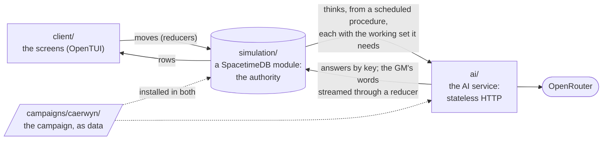

# Kingmaker: architecture

The way in for reviewing the game. It says what the parts are and how they connect, where state lives and how a change is checked, and links to each part's own doc for the detail. The [README](README.md) says what you can play and how to run it; its [rules](README.md#the-rules) are the ones every part keeps.

## The parts

- **The client** ([client/](client/)) is the game's screens on OpenTUI, in a terminal: the title, character creation, the sheet, the town's map and its action menu, the scene with its place drawn beside the talk, the notebook and The End. It reads rows and sends moves, and never talks to the AI service. Its bindings ([client/module_bindings](client/module_bindings/)) are generated from the module. Headless, the same client is the QA console (`npm run play`).
- **The simulation** ([simulation/](simulation/)) is the authority on everything that happens: every table, reducer, procedure and view ([schema.ts](simulation/src/schema.ts), [index.ts](simulation/src/index.ts)), the moves as plain functions over the tables, the job loop that asks the AI service ([jobs.ts](simulation/src/jobs.ts)), the GM's bookkeeping, the rules engine pinned to the game's dice, the story between scenes and the town. It's deterministic, and every move also runs on a memory host in the tests. Blueprint: [docs/v0-design.md](docs/v0-design.md) §3, §4 and §6.
- **The AI service** ([ai/](ai/README.md)) does all the model work and keeps the words: the GM (the two-part GM that plays the story's scenes and the talks between them), character creation's builds and backstories, the docs service (the lore, each game's copy of it, memories and disclosure), the prompts and the model client. It holds nothing between requests: each carries what it needs, and each answer is stored by its key before it's sent, so a retry is answered from the store.
- **Shared code** ([shared/](shared/)) is what the others run alike: the protocol between the simulation and the AI service, the scene graph and its loader, the world and its rows, the rules code, the map code. ES2021, no Node, no packages, since it runs in the module.
- **The hosts** ([hosts/](hosts/)) are the composition roots, the only code that reads the environment or argv: the AI service's process, the terminal client and the headless one, the dev stack that brings SpacetimeDB and the AI service up on one machine ([hosts/dev/README.md](hosts/dev/README.md)), the campaign tool, the end-to-end and live runs, and the page's workers.
- **The game in a browser** ([web/](web/README.md), [hosts/web/](hosts/web/), [docs/browser-design.md](docs/browser-design.md)) needs no server. A client worker runs the client on a JS stand-in for OpenTUI ([web/tui/](web/tui/)) drawn into xterm.js; a server worker runs the simulation on its memory host and the AI service beside it, both kept in IndexedDB ([web/server/](web/server/)); the two speak the wire in [shared/protocol/port.ts](shared/protocol/port.ts). The model calls go to OpenRouter with the player's own key, or the fake GM plays.
- **Campaigns are data** ([campaigns/](campaigns/README.md)): campaign.json, each scene as one `.kmscene` file ([docs/scene-format.md](docs/scene-format.md), the Obsidian plugin's format too), the places, maps, looks and ready-made builds, and the lore. [shared/scene/document.ts](shared/scene/document.ts) is the scene format and [files.ts](shared/scene/files.ts) the rest, [load.ts](shared/scene/load.ts) makes the runtime's Scene from a file and [beats.ts](shared/scene/beats.ts) says where a scene is (reached, its stage, its open routes, a route taken), the same code on both sides; `npm run campaign -- check` holds a folder to the rules, and installing it puts it in both services.
- **The site** ([web/site/](web/site/), [hosts/web/build-site.ts](hosts/web/build-site.ts)): the pitch and the roadmap in front of the game's page at `play/`, published by GitHub Pages, with a preview of each PR.
- **The GM loop** ([qa/loop/](qa/loop/README.md), [hosts/loop.ts](hosts/loop.ts)): QA rounds on the game, as the prototype ran them. Blind persona testers play scenes on a dev stack of the loop's own through the headless client's verbs, each game its own session, a later scene reached through every real boundary before it (each scene on the way ended for QA as the stack's owner). Blind reviewers judge each game from a pack of the scene's prep as the AI service's loader gives it, and a report shows the arms, the endings, the triaged findings and each turn's model calls from the stack's call log. Run by the `kingmaker-gm-loop` skill ([.claude/skills/](.claude/skills/kingmaker-gm-loop/SKILL.md)) and its workflow.
- **The tools beside it** ([tools/](tools/)): the Obsidian authoring plugin ([tools/authoring/](tools/authoring/README.md), its own package), which edits scene, map and scenario files and previews maps with the game's renderer ([client/map/render.ts](client/map/render.ts)); the Kingmaker Glyphs font's build ([tools/glyphs/](tools/glyphs/README.md)); and the SRD spell texts' build ([tools/srd-spells/](tools/srd-spells/build.py)).

## A turn

A line said in a scene of the story, as [docs/two-part-design.md](docs/two-part-design.md) tells it in full (the plumbing is [docs/v0-design.md](docs/v0-design.md) §6's; a talk with Kell between scenes plays the same steps, with no world and no dice, [docs/town-design.md](docs/town-design.md) §3.6):

1. The client calls the `say` reducer. The simulation writes the line, settles what the rules owe first (a fire burning on, a spell running out, and an act from the map's menu, which opens a waiting scene as its first turn), and starts the turn's job.
2. Each step is a POST to the AI service from a scheduled procedure, with the working set it needs, keyed `<game>:s<scene>:t<turn>:<step>`: `reply` (the two-part GM's mouthpiece: its words streamed to the turn's draft as they're written, and a check when a roll should settle something, which the simulation rolls from the game's `dice` row through the rules engine, writing the dice line and the outcome that came up), then `settle` (the stage manager keeping the world in step, beside the co-GM, which sets each person's role for the next reply and moves the scene along its routes; the simulation takes each move again with the same code, [shared/scene/beats.ts](shared/scene/beats.ts)). The simulation commits each answer.
3. Beside the turn, the suggested lines; after it, in the background, the memory reviews (`remember`). A route to an ending leaves the scene closing, and the next line's reply winds it down; at a scene's end, the `boundary` moves the story on.

## Where state lives

| Where | What |
|---|---|
| SpacetimeDB's tables | Everything that happens: games, scenes and turns, the transcript, the world's rows, the dice, the GM's bookkeeping, the jobs in flight. The authority |
| The AI service's stores | The answers by key, each game's call log, memory reviews and copy of the lore, the cost ledger, the installed campaigns: a folder (`runs/dev/ai` under the dev stack), or memory kept in IndexedDB in a page |
| The repo | The campaign, the prompts, the vendored rules engine and SRD texts |
| `runs/`, `dist/` | Run and build output, never committed |

## Checking a change

| Command | What it checks |
|---|---|
| `npm run check` | The type checks, the unit tests and the client's screens, offline (about 45 s) |
| `npm run e2e`, `npm run arc` | End to end on a real SpacetimeDB, the AI service on the fake model |
| `npm run build:site`, `npm run web:check` | The site, then the page played in headless Chromium on the fake GM |
| `npm run campaign -- check campaigns/caerwyn` | The campaign folder is fit to install |
| `npm run live -- --script <name>` | A scripted run on real models, recorded in [docs/live/](docs/live/) |
| `npm run loop -- <command>` | A QA round: blind persona testers and reviewers on real models, triaged and reported ([qa/loop/README.md](qa/loop/README.md)) |

CI runs [check.yml](.github/workflows/check.yml) (the checks, e2e, the browser and the AI service's image) on every PR, [preview.yml](.github/workflows/preview.yml) publishes each PR's site, and [pages.yml](.github/workflows/pages.yml) publishes main's. The authoring plugin has its own checks ([tools/authoring/README.md](tools/authoring/README.md#checks)).

## The docs

- **How it was built:** the plan ([docs/verticals.md](docs/verticals.md)) and each vertical's blueprint with what was built ([v0](docs/v0-design.md), [v5](docs/v5-design.md), [v1](docs/v1-design.md), [the full GM](docs/full-gm-design.md), [the world bridge](docs/world-bridge-design.md), [the story](docs/story-design.md), [the map](docs/map-design.md), [the browser](docs/browser-design.md), [the town](docs/town-design.md)), and the recorded live runs ([docs/live/](docs/live/)). They were written while the game lived in `v2/`.
- **Where it came from:** the prototype it was ported from, retired in [the migration to one codebase](docs/migration-log.md), is in git history at `bc2ab1f` and its docs in [docs/prototype/](docs/prototype/README.md); the research behind both is [docs/research/](docs/research/).
