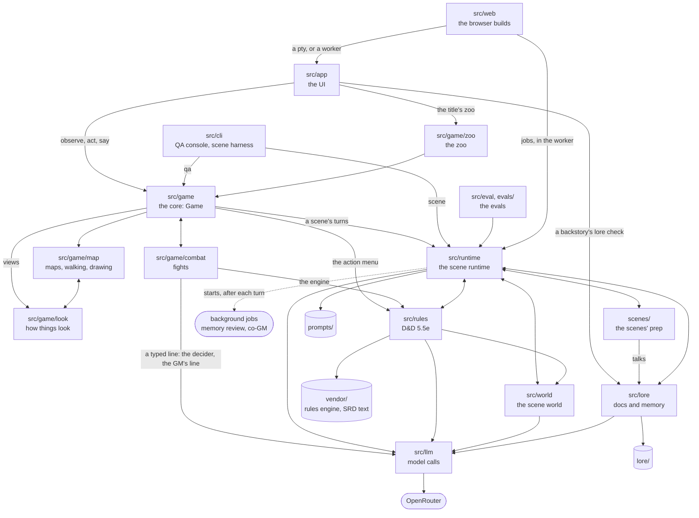
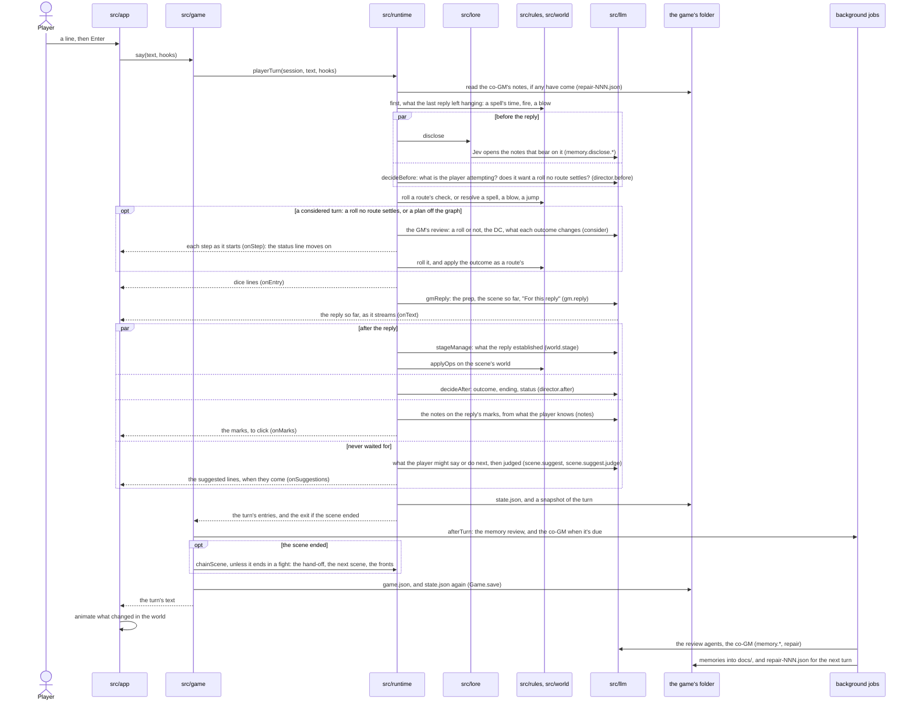

# Kingmaker V2: architecture

The entry point for reviewing this repo. It says what the parts are, how they connect, where state lives and how to check a change, and it links to each part's own doc for the detail. It describes the code as it is (PR #650's head; written at f5c6549 and kept up since). Its links to lines move with the code: `npm run docs:anchors` after a merge (src/cli/doc-anchors.ts). Where it's going is in [docs/design/productionise.md](docs/design/productionise.md).

## What the game is

Kingmaker V2 is a D&D game for one player, played in a terminal and run by an AI game master. You make a character from a sentence (one of three builds that fit it, or your own, and a backstory of your own, checked against the world), then walk the town of Caerwyn on an isometric map drawn in characters. Walking into a place opens its scene: a clerk hanged behind the granary, a dockside dive, a warehouse on the wharves at night; then the King sends for you. In a scene you say and do anything in plain English. The GM improvises around prep written for that scene (who's there, what they want and hide, the beats, the only ways it can end), the D&D 5.5e rules settle anything that takes dice, and the scene's world, a record of the place, keeps track of who stands where and what's burning. A scene ends through one of its exits, the story moves on, and the people you meet again remember what you did. Fights are played out a turn at a time on the map. Every model call goes to OpenRouter: Luna voices the GM, and Luna's decision mode and Jev make the fast judgements. The same game plays in a browser, and a zoo lays every feature out on maps of its own.

## The overall diagram

An arrow points from the code that imports to the code it imports, and a label, where there is one, says what for. A two-headed arrow joins two components that import each other. The cylinders are files the code reads at run time; from vendor/, src/rules also imports the engine's bundled build. The dashed arrow is a process: after each turn the runtime starts `node src/cli/scene.ts remember` and `repair` (in the browser, the worker runs the same jobs).

The arrows drawn are the main ones. Every import between components that the game or the evals make at run time goes down these layers, or both ways along a two-headed arrow:

1. the ways in: src/web, src/cli and the evals; then src/app;
2. the game: src/game/zoo; then src/game and src/game/combat; then src/game/map and src/game/look;
3. the scenes: src/runtime and scenes/;
4. the services: src/rules; then src/world and src/lore;
5. src/llm, and the content.

Imports of types only, and imports that only tests and dev tools make, are left out of the diagram and of that rule, and some of them go up: the map and the look import `src/game/types.ts`, and the rules' tests import combat's `pregen.ts`. This was checked against every import in the code at f5c6549, and src/game/combat's again when fights took typed lines (it calls src/llm now, for the decider and the GM's line); the collapsed table at the end of this section lists them all.

### The components

| Component | Directory | What it does | Doc |
|---|---|---|---|
| The UI | `src/app` | The OpenTUI terminal app: every screen, and the controller (`game.ts`) that drives the core and keeps the notebook. The game's only UI. | [src/app](src/app/README.md) |
| The browser builds | `src/web` | The server build (the app under a pty per tab, shown with xterm.js over a WebSocket) and the static build (the app in a Web Worker, with OpenTUI and Node redone in JavaScript), which the PR previews publish. | [src/web](src/web/README.md) |
| The CLIs | `src/cli` | The QA console (`npm run qa`: the whole game headless, by action id) and the scene harness (`npm run scene`: the runtime alone, and the process the background jobs run in). | [src/cli](src/cli/README.md) |
| The evals | `src/eval`, `evals/` | The GM evals: 163 cases of single replies, decisions, whole scenes and openings, checked mechanically and judged by a model, and the scribe's scripts. The stage manager's eval, scored against 26 labelled cases. | [evals](evals/README.md) |
| The game core | `src/game` | `Game` (`play.ts`): the modes (explore, scene, combat, the End), the action ids and the story's flow; the town's explorer, the action menu, and every picture (`views.ts`). | [src/game](src/game/README.md) |
| The map | `src/game/map` | Tile maps, walking, the isometric renderer and x-ray, and the overlay of what scenes and the rules left in each place. | [src/game/map](src/game/map/README.md) |
| Places from a description | `src/game/map/generate` | A model's plan of a place, compiled into a map and a world. The zoo's chandlery is one, compiled from a plan written by hand. | [src/game/map/generate](src/game/map/generate/README.md) |
| Fights | `src/game/combat` | Tactical fights on the map: boardgame.io run headless, the rules engine for every roll, the board's hazards, and the AI for everyone else; a line typed in a fight read onto the turn's own actions (the decider choosing among them), walked on the board, done as a click, and given the GM's line. | [src/game/combat](src/game/combat/README.md) |
| The look | `src/game/look` | How anything looks, from its name: glyphs, colour, light, effects, and the director that turns what changed in a world into motion. | [src/game/look](src/game/look/README.md) |
| The zoo | `src/game/zoo` | Every feature laid out on maps of its own (10 maps, 146 exhibits), and a headless tour that sets each one off and checks what the view played. | [src/game/zoo](src/game/zoo/README.md) |
| The scene runtime | `src/runtime` | A player's line in, the GM's reply out: the director and its decider, the voices, the co-GM, scene boundaries, companion talks, the suggested lines, the GM's markup and its notes, and the background jobs. It owns the session's state. | [src/runtime](src/runtime/README.md) |
| The scenes | `scenes/` | GM prep as TypeScript data: the cast, the beats and the routes between them, the exits with their scripts, and the places as worlds. | [scenes](scenes/README.md) |
| The docs service | `src/lore` | The lore as linked documents with a copy for each game, who may read what, what the GM is shown each turn, the memory reviews, and the fronts. | [src/lore](src/lore/README.md) |
| The scene world | `src/world` | A scene's place as an entity tree in feet, its physics (fire, water, spills, breaking), the stage manager that keeps it in step with the story, and the exit scripts' API. | [src/world](src/world/README.md) |
| The rules | `src/rules` | D&D 5.5e (SRD 5.2.1) on the vendored engine: the character, checks, spells, blows, rests, and what the character can do out of a fight. | [src/rules](src/rules/README.md) |
| Model calls | `src/llm` | OpenRouter's Responses and Decisions APIs: streaming, retries, the deciders, the tool loop, the call log and the cost ledger. | [src/llm](src/llm/README.md) |
| The lore | `lore/` | Caerwyn and its people in 154 Markdown docs, each with frontmatter that says who may read it. | [lore](lore/README.md) |
| The prompts | `prompts/` | The models' standing instructions, one Markdown file each. | [prompts](prompts/README.md) |
| The rules engine | `vendor/dnd-srd-engine` | dnd-srd-engine's bundled build, its starter pack, our typings and our patches. | [vendor/dnd-srd-engine](vendor/dnd-srd-engine/README.md) |
| The SRD's spell text | `vendor/srd-spells` | Every spell's description in the SRD's own words, for the sheet. | [vendor/srd-spells](vendor/srd-spells/README.md) |
| The glyph font | `tools/glyphs`, `assets/` | Kingmaker Glyphs, our font of pixel-art sprites, built from hand-drawn bitmaps. | [tools/glyphs](tools/glyphs/README.md) |
| Other tools | `tools/` | Python, none of it in CI: building the SRD's spell text (`srd-spells/build.py`), PNGs of the zoo tour's and the place generator's pictures (`ansi2png.py`, `preview.py`), and the generator bench's contact sheets (`sheet.py`). | none |

How to write scenes, why the runtime does what it does, and how to test it are in the GM guide, [docs/guide](docs/guide/README.md).

### How the parts connect

- **One UI, three hosts.** src/app runs in a terminal, under a pty per browser tab in the server build, or in a Web Worker in the static build. What reaches a browser page is the terminal's bytes, never the game's data ([the three ways to play](#the-three-ways-to-play)).
- **Play goes through the core.** The app, the QA console, the zoo's tour and the smoke tests play the same `Game` ([src/game/play.ts](src/game/play.ts)) by the same action ids, or say a line in a scene or a fight. The scene harness and the evals call the runtime directly, with no map and no fights. The app also reaches into the core's state, session and world as it draws; the QA console plays only through the core's calls, and reads its state for commands such as `qa map` and `qa sheet`.
- **Three ways into the rules.** In a scene, the runtime's decider picks a mechanic and src/rules resolves it on the scene's world. On the map, the action menu ([src/game/menu.ts](src/game/menu.ts)) calls the same functions on a world rebuilt from the map for each act. In a fight, src/game/combat drives the same engine through a bridge of its own, and a typed line is read onto the fight's own action ids (src/game/combat/typed.ts), not the scene's mechanics. Fire, damage and breaking are coded separately for each ([the table](src/game/README.md#the-same-rule-coded-more-than-once)).
- **The runtime has a shared kernel.** src/lore, src/world, src/rules and scenes/ import parts of the runtime: its types ([scene.ts](src/runtime/scene.ts), [session.ts](src/runtime/session.ts)), the dice ([dice.ts](src/runtime/dice.ts)), the session's folder (`sessionDir`), and [brief.ts](src/runtime/brief.ts) for the prompt loader, who's present, the transcript and `withImprovisedEnding`. The runtime imports each of them in turn, which is why those arrows have two heads.
- **The background jobs are processes.** `afterTurn` ([src/runtime/background.ts:37](src/runtime/background.ts#L37)) starts the scene harness's `remember` and `repair` commands, detached. The server build finds them by a tag and gives them up to 3 minutes after a game ends; the static build runs the same functions in its worker. The scene harness has its own copy of the rule that starts them ([src/cli/scene.ts:77](src/cli/scene.ts#L77)).
- **Exit scripts are recorded, not applied.** A scene's exit script runs against a recording world. The game reads back only `startCombat` (who a fight sets out) and `journal` (the notebook); a script's flags, quests and items change nothing in play.
- **Some state is global, and set at import.** Importing the zoo installs its ten maps in the map module's tables, and the app and the QA console both import it. [src/rules/actions.ts](src/rules/actions.ts), [src/game/menu.ts](src/game/menu.ts), [src/game/combat/fights.ts](src/game/combat/fights.ts) and [src/game/zoo/fights.ts](src/game/zoo/fights.ts) load the rules engine at import (about 70 ms, once per process).

Every import between components, at f5c6549 (src/game/combat's and character creation's since)

| Component | Imports at run time | Types only | Only in tests and dev tools |
|---|---|---|---|
| src/web | src/app, src/game/look, src/runtime | | src/game, src/game/combat, src/game/zoo, scenes/, src/rules, src/world |
| src/cli | src/game, src/game/zoo, src/runtime, scenes/, src/rules, src/world, src/lore, src/llm | | |
| src/eval, evals/ | src/runtime, scenes/, src/world, src/lore, src/llm | | src/rules |
| src/app | src/game, src/game/zoo, src/game/combat, src/game/map, src/game/look, src/runtime, scenes/, src/rules, src/lore, src/llm | src/world | |
| src/game/zoo | src/game, src/game/combat, src/game/map, src/game/look, src/runtime, scenes/, src/rules, src/world, src/lore, src/llm | | src/app |
| src/game | src/game/combat, src/game/map, src/game/look, src/runtime, scenes/, src/rules, src/world | | |
| src/game/combat | src/game, src/runtime, scenes/, src/rules, src/world, src/llm | vendor/dnd-srd-engine | |
| src/game/map, with generate/ | src/game/look, scenes/, src/world, src/llm | src/game | |
| src/game/look | src/game/map, src/runtime, scenes/, src/world, src/llm | src/game | src/app, src/game/combat |
| src/runtime | scenes/, src/rules, src/world, src/lore, src/llm | | |
| scenes/ | src/runtime, src/lore | src/world | |
| src/rules | src/runtime, src/world, src/llm, vendor/dnd-srd-engine | | src/game/combat, scenes/ |
| src/world | src/runtime, src/llm | | scenes/ |
| src/lore | src/runtime, src/llm | | |
| src/llm | nothing | | |

"At run time" means imported, as values, by a file that one of the game's processes or the evals load. Two of these come in by a side door: src/game/map imports src/llm only in generate/ (the zoo's chandlery wing loads it), and src/game/look imports scenes/ only because its index.ts re-exports the gallery's vignettes, and src/runtime only for speakers.ts (who says a quoted line: the barks and the transcript's colours share it). Besides imports, the runtime reads prompts/, src/lore reads lore/, src/rules reads the engine's starter pack and the SRD's text, and the static build bundles all four.

## One turn

What happens when the player says something in a scene, as the game's approach (`v2`) plays it: from the line typed to the reply on screen, and the notes the background jobs leave for the next turn. The names in brackets are the model calls' operations, as each game's `calls.jsonl` records them. The runtime's doc has every step with its code pointer ([One player turn](src/runtime/README.md#one-player-turn)).

- **The rules go first** with what the last reply left hanging (a timed spell running out, fire spreading in the world, a blow or a danger that lands on the player), and the GM is told their outcome before anything else.
- **One decider call before the reply** asks everything the turn needs: is the player attempting one of the scene's routes, or something the rules resolve; would a GM call for a roll, and is it what a route is for; should a pacing cue fire; is it off the graph. Disclosure runs alongside it. The rules then settle what's theirs, and each decision reaches the GM as a directive under "For this reply".
- **A considered turn** is one where a roll is wanted and nothing the author wrote settles it (another person, another ask, a plan nobody wrote). The GM reviews it before replying, with the whole prep: whether to roll at all, the skill, the DC (from the guidance's stakes, leverage and disposition), and what success and failure each change in the scene. The ruling is a route of its own, rolled and applied like any route's, and the reply plays what was decided. Those turns take a few seconds longer (first text at about 5 to 7 s, up to 12 s when OpenRouter is slow), and the app's status line says the GM is considering, a step at a time ([src/runtime/README.md](src/runtime/README.md#one-player-turn), [docs/guide/running.md](docs/guide/running.md)). `v2-quick` is the game as it was: an off-graph turn waited up to 3 s for the quick co-GM instead.
- **The reply streams.** The runtime calls the app's `onText` hook with the text so far as it grows: the words as the player reads them, and beside them who says each line ([The GM's markup](src/runtime/README.md#the-gms-markup)), which the transcript draws in each speaker's colour. The words a moment turns on, which the GM marked, get their notes from a second call that sees only what the player knows ([The notes](src/runtime/README.md#the-notes)), alongside the after-reply decision; the `onMarks` hook brings them to the screen to click, about 2 s after the reply. In a real 13-turn game the GM's first words came a median 1.4 s after the player's line ([productionise.md](docs/design/productionise.md#prediction)).
- **The turn saves once, at its end** ([src/runtime/engine.ts:958](src/runtime/engine.ts#L958)). A call that fails before then leaves the session changed in memory, so the app goes back to the last save ([src/app/game.ts:1529](src/app/game.ts#L1529)).
- **The suggested lines come when they're ready.** With the game's setting on, a small call after the reply proposes a few lines the player might say or do next, from what the player knows and nothing more, and the decider judges them against every fact, told which are held; nothing waits for either. On live turns they came a median 2.8 s after the reply, usually before the stage manager had finished, at about $0.0011 a reply ([Suggested lines](src/runtime/README.md#suggested-lines)).
- **Nothing waits for the background jobs.** The next turn merges the co-GM's notes if they've come and are for the same scene, and disclosure finds the new memories if the review has finished. In a terminal the jobs are separate processes that outlive the game.
- **At a scene's end** the core sets out a fight, or the runtime crosses the boundary: the hand-off, a check of the coming scenes against what happened, the next opening rewritten, what the player missed that the story needs carried into the next scene that can bring it out, and the fronts moved on ([Scene boundaries](src/runtime/README.md#scene-boundaries)).

## Where state lives

Each game is two mutable JSON documents, the session (`state.json`) and the game (`game.json`), saved in one folder, `runs/sessions/<id>/`, with the app's notebook and what its turns and jobs write beside them. `KM_RUNS_DIR` moves `runs/`.

### A game's folder

| File | What it is | Written by | Read by |
|---|---|---|---|
| `state.json` | The session, `SessionState` ([src/runtime/session.ts:231](src/runtime/session.ts#L231)) | `saveSession`, at the end of each turn (a temp file, then a rename), and again by `Game.save` | `loadSession`; the co-GM's job |
| `game.json` | The game, `GameState` ([src/game/play.ts:44](src/game/play.ts#L44)): the mode, the story (time of day, scenes played, the lead, flags), the map's `ExploreState`, and a fight in progress | `Game.save`, after every act and line | `Game.load` |
| `app.json` | The notebook and the latest messages | [src/app/save.ts](src/app/save.ts) | the app |
| `snapshots/<scene>-turn-NNN.json` | The session after each turn | `snapshotSession` | the memory job; eval fixtures (copied into `evals/fixtures/`); the world eval (the scenes that ended); the End's chapters |
| `docs/` | This game's copy of the lore: memories, the story so far, the fronts as they've moved, the review agents' edits | `writeDoc` in [src/lore/docs.ts](src/lore/docs.ts) | `readDoc`, which tries this copy first, then `lore/` |
| `repair-NNN.json`, `repair.lock` | The co-GM's notes and patches | the co-GM's job, or a quick co-GM that missed its deadline | `applyPendingRepairs`, at the start of the next turn |
| `remember-N.lock`, `memory-reviews.jsonl` | A memory review in progress; what each review changed | `afterTurn`; the memory job | people reading a run |
| `calls.jsonl` | Every model call: the whole prompt, the answer, the latency and the cost | src/llm, once the caller points the log here | people reading a run |
| `world-<scene>.ts` | The scribe's world-update script for a finished scene | `npm run scene -- world` | people reading a run (the world eval runs the scribe again on the snapshots) |

Outside a game's folder: `runs/cost-ledger.jsonl` (a line for every call on the machine), `runs/look-cache.json` (the model's looks for names the look layer doesn't know), `runs/deleted/` (games deleted from the title), and what the checks and evals write (such as `runs/evals/`, `runs/zoo-tour/`, `runs/app-smoke/`, `runs/web/`, `runs/web-static/` and `dist/web`). The ledger and the look cache are relative to the working directory, and `KM_COST_LEDGER` and `KM_LOOK_CACHE` move them. In the static build `runs/` is in the worker's memory, written through to IndexedDB, and the key is in localStorage.

### The session

`SessionState` is one object per game, in four parts ([src/runtime/README.md](src/runtime/README.md#what-it-owns)):

- **the story,** kept across scenes: the player, the turn count, the dice's seed and count, the transcript, the rules engine's campaign, each finished scene's record, the talks, and what the story still owes the player (a clue missed in its scene that a later one needs);
- **the current scene's own:** the beat and the path to it, established facts, the co-GM's notes and patches, who's present, and the scene's `world`. `freshScene` ([src/runtime/engine.ts:1126](src/runtime/engine.ts#L1126)) resets them when the next scene starts;
- **what's pending:** an ending held for the player's answer, a wind-down turn, a threat that lands next turn, a brawl, the ending itself;
- **what the boundary handed on:** where the next scene's prep is out of date, its rewritten opening, the lead, and what the player carried out.

What only the GM should know (the beat and the path, the co-GM's notes and patches, how far each secret-holder has opened up, the dice's seed) sits in the same object as the transcript.

### Lore and memory

The authored lore in `lore/` is never written in play. Each game writes to its own copy in `docs/`, and every read tries that copy first. A person's memories are notes under `Cast/<Name>/memories/`, private to them; the story so far and the fronts are the GM's. Each turn, disclosure picks which notes the GM sees for each person present. How it's done is in [src/lore/README.md](src/lore/README.md), and the docs' format in [lore/README.md](lore/README.md).

### The worlds

A world is an entity tree (src/world). Which one you're looking at depends on where the player is ([src/world/README.md](src/world/README.md#where-a-world-lives)):

| Where | What | Doc |
|---|---|---|
| `SessionState.world` | The current scene's place, built when the scene opens and dropped at its boundary | [src/world](src/world/README.md) |
| `SessionState.carried` | What the player carried out of the last scene, into the next | [src/runtime](src/runtime/README.md) |
| `ExploreState.overlay.scenes` | What a played scene left in its place, kept as map actors | [src/game/map](src/game/map/README.md) |
| `ExploreState.overlay.town` | What the rules did to the town between scenes. The town's world itself is rebuilt from the map for every act. | [src/game](src/game/README.md) |
| `ExploreState.roam` | A zoo wing's live world | [src/game/zoo](src/game/zoo/README.md) |
| `CombatG`, in `game.json`'s `combat` | A fight's own board: tiles on fire, dust, props, and its copy of the rules' campaign. When the fight ends it's written back into the scene's world. | [src/game/combat](src/game/combat/README.md) |

### In memory

Some state is per process, not per game: the prompts (read once), the call log's path and the spend so far, the background jobs' runner, the map module's tables of maps, places and the cast, the look's dressings, the glyph set, the lore's registry of characters, and the talk scenes built from the lore. Two games in one process share them.

## The three ways to play

src/app is the one UI, and it runs in three hosts ([src/web/README.md](src/web/README.md#the-three-ways-to-play) has them side by side):

| | The terminal | The server build | The static build |
|---|---|---|---|
| Start it | `npm run game` | `npm run web` | `npm run build:web`, then any static file server (GitHub Pages for the PR previews) |
| The game runs | in your terminal | under a pty for each browser tab | in a Web Worker in the tab |
| OpenTUI and Node | the real ones | the real ones | src/web/tui and the stand-ins in src/web/static/node |
| Saves | `runs/sessions/` | the server's `runs/`, shared by every tab | IndexedDB, a database for each place it's published |
| Background jobs | detached processes | the same, found by a tag and waited for | in the worker |
| The key | `OPENROUTER_API_KEY` or `~/secrets/` | the server's, or typed into the page | typed into the page, kept in localStorage |

How the content gets to the game:

| Content | The terminal and the server build | The static build |
|---|---|---|
| The code, scenes/ included | Node runs the TypeScript as it is (tsx for the TSX) | bundled by esbuild into `worker.js` and its chunks ([src/web/static/build.ts](src/web/static/build.ts)), with OpenTUI and the `node:` modules swapped for the stand-ins |
| `lore/` and `prompts/` | read from the repo with `node:fs` | in `content.json`, mounted read-only on the worker's in-memory file system |
| The engine's starter pack, the SRD's spell text | read from `vendor/` | in `content.json` |
| The glyph font | installed for the user (`npm run glyphs`); the server serves it from `assets/fonts` | copied into `fonts/` |

`content.json` takes only what the allowlist in [src/web/static/content.ts](src/web/static/content.ts) names. The static build ships everything the GM knows to the browser: every scene's secrets, as code, and the whole lore, gm docs included. That isn't a security concern: the content is public on GitHub and the game isn't competitive, so a player who reads ahead only spoils their own fun.

## Checks

### Running them

Offline, with no key:

| What | Command | Time | In CI |
|---|---|---|---|
| The typecheck, the unit tests and the screens check | `npm run check` | about 20 s | yes |
| The typecheck alone | `npm run typecheck` | under 1 s | yes |
| The unit tests alone (595) | `npm test`, or one component's with `node --no-warnings --test src/<dir>/*.test.ts` | about 20 s | yes |
| The screens check: the app's screens at 80x24 and up | `KM_RUNS_DIR=runs/check OPENROUTER_API_KEY=offline node --experimental-ffi --no-warnings --import tsx src/app/smoke/screens-check.tsx` | 10 s | yes |
| The static build | `npm run build:web` | under 1 s | yes |
| The arc through the core, without a UI | `KM_RUNS_DIR=runs/app-test OPENROUTER_API_KEY=offline node --no-warnings src/app/smoke/flow.ts` | about 4 s | no |
| The zoo's tour: every exhibit | `node --no-warnings src/game/zoo/tour.ts --no-png` | 16 s | two wings, in `npm test` |
| The real TUI under a pty, the whole arc | `python3 src/app/smoke/smoke.py` | about a minute | no |
| OpenTUI against its stand-in, cell for cell | `npm run web:tui-check` | 5 s | no |
| The static build, played in Chromium | `npm run web:static-check` | about 80 s | no |
| The server build, played in Chromium | `npm run web:check` | about 90 s | no |
| The stage manager eval's typecheck | `npx --no-install tsc --noEmit -p evals/world` | 1 s | no |
| Every scene's ids and targets | the `validateScene` one-liner in [scenes/README.md](scenes/README.md#how-to-test-it) | | no |
| Who may read each lore doc | the greps in [lore/README.md](lore/README.md#how-to-test-it) | | no |

Live, with `OPENROUTER_API_KEY` (or `~/secrets/kingmaker-dev-openrouter.txt`). Each costs money, and none is in CI:

| What | Command |
|---|---|
| The GM evals | `npm run eval -- --suite reply`, `decision`, `trajectory`, `opening` or `world`; then `npm run compare` on two runs ([evals](evals/README.md)) |
| The stage manager eval | `node --no-warnings evals/world/run.ts` |
| The memory eval | `node --no-warnings src/eval/memory-eval.ts --approach v2-nomemory,v2,v2-memory-lite` |
| The real TUI with the GM | `python3 src/app/smoke/smoke.py --live`, and `--live-fight` |
| The zoo's scenes with the GM | `node --no-warnings src/game/zoo/tour.ts --live` |
| The browser builds with the GM | `npm run web:static-check -- --live`, `npm run web:check -- --live` |
| A scene by hand | `npm run scene -- start <scene> --session <id>`, then `say`, `status` and `transcript` |

The Python checks need Python 3, and the pictures need Pillow. Each component's doc has its own checks under "How to test it".

### What CI gates

- **[check.yml](.github/workflows/check.yml)** runs `moon ci workspace:check workspace:build` on every PR and every push to main: the typecheck, `npm test`, the screens check and the static build. Moon runs only the affected tasks, and every task's inputs are the whole of src/, scenes/, lore/, prompts/, assets/, evals/ and vendor/ with the package and tsconfig files ([moon.yml](moon.yml)). So a change to any of those runs everything, and a change only to docs/ or the root's Markdown runs nothing.
- **[preview.yml](.github/workflows/preview.yml)** builds the static build at the PR's head and publishes it under `pr-preview/pr-<N>/` on the gh-pages branch, with a comment linking it: the pitch at its root, the roadmap at `roadmap/` and the game at `play/`. It doesn't run for PRs from forks.
- **[pages.yml](.github/workflows/pages.yml)** deploys main's build, with the previews copied in, to GitHub Pages. main is still V1 until PR #650 merges, so the site's root is V1's.
- **[evals.yml](.github/workflows/evals.yml)** is V1's. It runs `moon run workspace:eval` and `scripts/publish-eval-history.ts` on a push to main, and V2 has neither, so it will fail once V2 is on main.
- **Nothing is required.** main has no branch protection and the repo has no rulesets, so a red check informs a merge rather than blocking it.
- **Not in CI:** the checks in Chromium, the renderer comparison, the TUI smoke test, the flow smoke, the full zoo tour, the evals and the stage manager eval's typecheck.

## How to review

### A reading order

1. [README.md](README.md), then play it: `npm run game` (z on the title opens the zoo), or headless with the QA console: `npm run qa -- new --session try --as "Wren: a hedge wizard"`, then `qa observe` and `qa act` ([src/cli](src/cli/README.md#how-to-test-it)).
2. This page's diagram and [one turn](#one-turn).
3. [docs/guide/running.md](docs/guide/running.md): why each part of a turn exists.
4. [src/runtime](src/runtime/README.md) and [scenes](scenes/README.md): how a scene is played, and what it's played from.
5. [src/game](src/game/README.md): the modes, the action ids, and "A spell or a blow, end to end".
6. [src/app](src/app/README.md): the UI.
7. The rest as a change needs it, from [the components](#the-components).

### By kind of change

| The change | Look at | What proves it |
|---|---|---|
| A scene: `scenes/`, its world in `scenes/worlds/`, the lore it names | [scenes/README.md](scenes/README.md#where-to-look-first): a route's `when` is logic the decider judges; ids are shared with eval cases, the smoke tests, the fronts doc and the fights; a combat exit needs a fight set out for it; a recurring character's card must agree with their lore | Offline: the `validateScene` one-liner and `npm test`; in the game, `/exits` and `/end <id>` take each ending and run its script. Live: `npm run scene -- start <id>`, with `status` for the path the decider took, and the scene's eval cases by their ids' prefix (`npm run eval -- --case hc` for the hanged clerk's). |
| A rule: `src/rules`, combat's bridge to the engine, the engine itself | [src/rules/README.md](src/rules/README.md#where-to-look-first): the dice stream, dice lines that other code parses, and the twin of each workaround in `src/game/combat/rules.ts`; [the same rule coded more than once](src/game/README.md#the-same-rule-coded-more-than-once) | `node --no-warnings --test src/rules/*.test.ts src/game/combat/*.test.ts`; the zoo's Rules Room, Burning Gallery and Arena: `node --no-warnings src/game/zoo/tour.ts --only rules,fire,arena` |
| The world: `src/world` | [src/world/README.md](src/world/README.md#where-to-look-first): a new operation touches `WorldOp`, `applyOps`, the stage manager's schema and its `WORLD_LANGUAGE`; a physics change comes with the words the models are given | `node --no-warnings --test src/world/*.test.ts`; `tour.ts --only works,fire`; the stage manager eval (live) |
| How the GM plays: `prompts/`, the director's questions, the GM's brief | [prompts/README.md](prompts/README.md) and [src/runtime/README.md](src/runtime/README.md#where-to-look-first): the decider's wording and thresholds are logic, directives are matched by their opening words, and whatever goes in the brief goes to the GM every turn | The evals, live, before and after the change: `--suite decision` for the director, `--suite reply` and `--suite trajectory` for the GM, then `npm run compare`. `calls.jsonl` has each prompt as it was sent. |
| A turn: `src/runtime` | `playerTurn` ([src/runtime/engine.ts:446](src/runtime/engine.ts#L446)) holds four reply strategies, so check which approach flags gate a change; a new session field goes in `STORY_WIDE` ([src/runtime/talk.ts:41](src/runtime/talk.ts#L41)) or is reset by `freshScene` | No unit test drives a turn. `node --no-warnings --test src/runtime/*.test.ts` covers the decision and talks offline; then play `v2` live (the scene harness, the QA console, `smoke.py --live`, `tour.ts --live`) and run the decision suite. |
| The UI: `src/app`, the look, the map's renderer | [src/app/README.md](src/app/README.md#where-to-look-first): what each method sets and clears between screens, the ways on from a scene, streaming, the mouse's picks, the side panels at 80x24 | The screens check (CI); `python3 src/app/smoke/smoke.py`; `npm run web:tui-check` if it uses OpenTUI in a new way; the zoo's Hall of Looks for a look |
| The web build: `src/web` | [src/web/README.md](src/web/README.md#where-to-look-first): the Node stand-ins, the content allowlist, the key's handling, and the page both builds share | `npm run build:web` (CI); `npm run web:static-check`, `npm run web:check` and `npm run web:tui-check`; then the PR's preview link |
| Lore and memory: `lore/`, `src/lore` | [lore/README.md](lore/README.md#where-to-look-first): every doc's `visibility` and `readers`; summaries are what disclosure reads; the fronts doc's shape is parsed | `node --no-warnings --test src/lore/fronts.test.ts src/runtime/talk.test.ts`; the lore greps; the memory eval (live) |

### In any change

- **Words that other code parses.** Action ids are used by the app, the QA console, the zoo and saved games ([src/game/README.md](src/game/README.md#action-ids)). Dice lines are read by the look's director, the app's `isRoll` and `fightEffects`. Directives are dropped by their opening words in engine.ts. State and tag words are matched by spelling in the look, the scene menu and the map. The fronts doc's shape is parsed. Grep before renaming any of them.
- **New session state** goes in `STORY_WIDE` or is reset by `freshScene`; otherwise it leaks into the next scene, or a talk undoes it. The eval fixtures are snapshots of an older `SessionState`, and nothing migrates them.
- **No unit of work.** A turn or an act changes the live game as it goes and saves at the end, so a model call that fails part way leaves memory and disk apart ([src/game/README.md](src/game/README.md#known-gaps-and-sharp-edges)).
- **The dice stream.** Every call that opens the rules engine moves the session's roll count, so adding or removing one changes every later roll in a seeded game.
- **Latency.** The budget is about 5 s to the text that answers the player. A new model call in a turn should run alongside the decision or the after-reply decision, not in front of the reply. The GM's review on a considered turn is the one call that's in front of the reply on purpose, on those turns only, with the app saying so.
- **The browser.** A file the game newly reads with `fs` has to be in the static build's allowlist, or the browser won't have it. A new Node API needs a stand-in: without one the build fails, and with one that can't do it the game fails in play.
- **Process-wide state** is shared by every game in the process ([in memory](#in-memory)).
- **The story is in the code.** `FIRST_SCENE`, Kell's lines, the Heron's fight and Sallow's statblock live in src/game, src/game/map and src/game/combat, so a change to the story can need a change there.

## Where this is going

- **[docs/design/productionise.md](docs/design/productionise.md):** the target architecture and the order of work: client, shared and server bundles joined by a protocol of intents and events; the stores and the model client behind interfaces; the world's rules in one registry of interaction rules on components; and hosting on Firebase. It's a design, and none of it is built yet.
- **[docs/code.md](docs/code.md):** the brief it answers.
- **[docs/design/playable.md](docs/design/playable.md)** and **[docs/design/caerwyn-arc.md](docs/design/caerwyn-arc.md):** the designs of the playable game and of its story arc.
- **[docs/guide/](docs/guide/README.md):** how to write scenes the runtime plays well, why it runs a turn the way it does, and how to test it.
- **[docs/FINDINGS.md](docs/FINDINGS.md), [docs/experiments/](docs/experiments/), [docs/LOG.md](docs/LOG.md) and [docs/qa/](docs/qa/):** what the experiments found, their write-ups, the lab notebook, and the blind QA rounds.
- **[docs/research/](docs/research/):** the research behind the design: GM craft, characters, pacing, setting DCs, worldbuilding, context compaction, the art direction and V1's systems.
- **[Kingmaker V2 prototype.md](Kingmaker%20V2%20prototype.md):** the original brief for V2.
