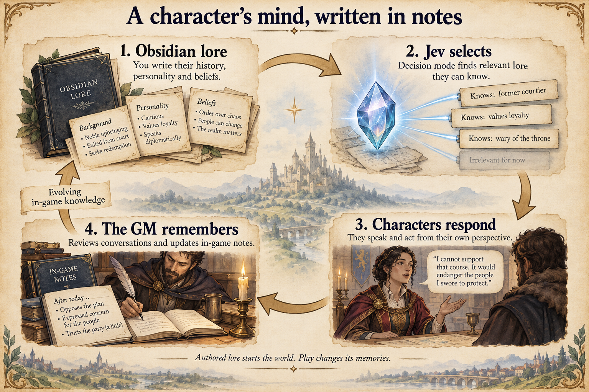

# Architecture

Kingmaker turns an Obsidian vault into a world you can roleplay in. This
document describes the intended shape of the system. It starts with the big
picture, how the world, the characters and the game master (GM) feed each
other, and then covers how that is built: hooks, services and the two kinds of
game state. [How Kingmaker works](docs/how-it-works.md) is a guided tour of each
system. Detailed behaviour lives in [`docs/`](docs/), and repository workflow
rules live in [`AGENTS.md`](AGENTS.md).

## The big picture: world, character, GM, with Jev at every step



Three participants pass the story around a loop:

- **The world** is everything that exists: authored lore and in-game notes (AI
  state, in documents), plus the physical palace (simulation state, in
  boardgame.io).
- **The character** speaks and acts from their own perspective. The speaking
  model has no tools and no reasoning (`effort: "none"`), so replies are fast.
  It only knows what was put in front of it.
- **The GM** adjudicates and remembers. It rules on dice, reviews what happened,
  and writes the consequences back into the world through services: memories,
  relationships, lore, and the activities that drive NPCs.

**Jev** is the decision-maker at every handoff. It uses a cheap, fast decisions
API that returns a probability for each option the host offers. It never writes
state and never invents free text, so it can run often without making the game
slow or expensive.

```
                         ┌──────────────── WORLD ────────────────┐
                         │  documents: lore, memories, goals     │
                         │  simulation: rooms, doors, bodies     │
                         └───▲─────────────┬────────────────▲────┘
              GM writes      │             │ Jev selects     │ Jev plans moves,
          notes and goals    │             │ permitted lore  │ checks waits,
                             │             ▼                 │ weighs perceptions
                     ┌───────┴──┐     ┌──────────────┐       │
                     │    GM    │◀────│  CHARACTER   │───────┘
                     │ reviews, │ Jev │ speaks, acts │
                     │ rulings  │flags└──────▲───────┘
                     └──────────┘            │ Jev steers the conversation
                                             │ tree and picks dice checks
                                          PLAYER
```

| Handoff | What Jev decides | System |
| --- | --- | --- |
| World → character | Which linked notes the character may know are relevant right now | Progressive disclosure |
| Player → character | Whether the player's move needs a check, and which skill and difficulty | Dice checks (the GM then rules on the roll) |
| Conversation → character | Whether the authored conversation has moved to its next node | Conversation trees |
| Character → GM | What in the exchange the world must react to, and so which reviews to dispatch | Attention |
| World → character, acting | The next action toward a goal, from an accessibility-tree-style room view | Activity planning |
| World → character, waiting | Whether to keep waiting, switch activity, or wake the GM | Waits |
| World → character, perceiving | Whether something seen or overheard matters to them | Perception |

Tool use, memory writes, world changes and adjudication belong to the GM and
host services, never to the character response model.

### The loop in four systems

1. **Progressive disclosure** gives the speaking character the lore it needs
   without tool calls. Jev reads the summaries of linked documents the
   character is allowed to see, and opens the relevant ones before the reply.
2. **Conversation trees** steer authored conversations. Between turns, Jev
   checks whether any of the current node's conditions has happened. If one
   has, the character gets new guidance.
3. **Attention** closes the loop. After each reply, Jev flags things the world
   should react to (promises, invented details, trades, plot progress). A
   decision tree turns the flags into focused GM review jobs that run in the
   background. An unremarkable turn costs one Jev call and no GM call.
4. **Activities and planning** turn agreements into action. Reviews write
   activity documents with goals and success criteria. Jev pursues each goal
   one action at a time, choosing from an accessibility-tree-style text view of
   the room in which every available action has an ID. Waits, routines and
   perception keep NPCs reacting between conversations.

Fast, cheap models sit on the path the player waits for. Expensive GM agents run
only when attention or an NPC's progress calls for them, and run in the
background. [How Kingmaker works](docs/how-it-works.md) walks through each system
and a full example.

## How it's built: three concepts

The engine has three parts:

1. **Hooks** plug into the game engine and define its *strategies*: how a
   conversation is answered, how a turn is reviewed, how an NPC chooses and
   carries out an action.
2. **Services** are modules of functionality that hooks call. They are injected,
   so a host, test or eval can replace any of them.
3. **Game state** comes in two kinds with different owners:
   - **Simulation state** is the physical world. It is a boardgame.io game: it
     changes only through moves, it is sent out to clients, and clients can
     evaluate moves ahead of the server as optimistic updates.
   - **AI state** is the lore and character knowledge used for LLM requests. It
     lives in the docs service, is authoritative, and runs only on the server.

   Everything that changes the physical world goes through the boardgame.io
   interface, including the AI.

```
              ┌──────────────────────────── host (web worker · headless · CLI · evals)
              │  composes services + strategies, schedules work, presents results
              ▼
   ┌─────────────────────┐   calls    ┌──────────────────────────────────────────┐
   │ Hooks / strategies  │──────────▶│ Services (injected)                       │
   │ setup, conversation,│           │ ai · disclosure · lore · character · map  │
   │ review, action,     │           │ docs · scenario · quests · inventory      │
   │ actionExecution,    │           │ mechanics · presentation · random · debug │
   │ resolution          │           └──────┬──────────────────────────┬─────────┘
   └─────────────────────┘                  │ SHA-checked edits        │ moves only
                                            ▼                          ▼
              ┌─ AI state (server-authoritative) ─┐   ┌─ Simulation state (boardgame.io G) ─┐
              │ docs service                      │   │ map, layout, doors, fixtures,       │
              │  lore, memories, relationships,   │   │ positions, movements, sheets,       │
              │  activities, waits, quests        │   │ inventories, runtime characters     │
              │ server-only; clients get views    │   │ synced to clients; optimistic moves │
              └───────────────────────────────────┘   └─────────────────────────────────────┘
                        └──── document paths only (runtime character → entry, activity, wait) ────┘
```

### 1. Hooks and strategies

`ConversationRuntime` (`packages/conversation/src/runtime.ts`) is the engine. It
owns no policy of its own; a host supplies `RuntimeStrategies`:

| Strategy | Responsibility | Default implementation |
| --- | --- | --- |
| `setup.prepare` | Build an agent's initial context. | `setupWorldAgent` |
| `conversation.respond` | Produce a character's reply: disclosure, checks, the reply, attention. | `conversationStrategy`, with `liveConversationStrategy` in the game |
| `review` (`classify`/`resolve`) | Decide what a conversation changed and record it. | `documentReviewStrategy` |
| `action` (`classify`/`resolve`) | Let Jev choose an NPC's next action from the supplied IDs. | `jevActionStrategy` |
| `actionExecution` (`classify`/`resolve`) | Carry out the chosen action. | `mapActionStrategy` |
| `resolution` (`classify`/`resolve`) | Resolve NPC-to-NPC exchanges. | `documentResolutionStrategy` |

Most strategies are a `classify`/`resolve` pair: classify decides what kind of
thing happened, resolve does it. Defaults are collected in
`apps/web/src/world-strategies.ts` and shared by the game and eval baselines.
Unprovided hooks throw `UnimplementedServiceError`, so a host states exactly
what it supports. Hooks receive services as arguments and never reach into a
host or global state.

Shared flows such as `runConversation` (`phases.ts`) wrap the hooks with
cancellation, tracing and ruling capture. They delegate to the strategy once
and do not add their own model calls.

### 2. Services

`RuntimeServices` (`packages/conversation/src/services.ts`) is the full set of
injectable modules:

| Service | Provides |
| --- | --- |
| `ai` | Thin adapters over the decisions (Jev) and responses (LLM) APIs, with transient-failure retry. |
| `disclosure`, `lore` | Character-scoped retrieval: discover links, check access, open permitted documents. |
| `agents` | Agent context preparation. |
| `character` | Dice mechanics (`rollCheck`, `rollSave`), character creation and the spoken `respond` call. |
| `map` | Physical observations, available actions and `interact` for movement, doors and fixtures. |
| `docs`, `scenario`, `quests` | Documents and scenario references, quest graphs and progress (from `createScenarioServices`). |
| `inventory` | SHA-checked inventory reads and transfers. |
| `presentation` | Shows authoritative outcomes (rolls, map, portraits). Never calculates them. |
| `random` | Production or deterministic randomness. |
| `debug` | Structured traces for the inspector and headless runs. Contains no secrets. |

World services come from `createScenarioServices(world)`
(`packages/lore/src/services.ts`), which shares one `WorldStore` across `docs`,
`scenario`, `quests`, `character`, `inventory` and `mechanics`. Hosts add the
model, map, presentation and debug services around them.

Dependency injection is how we change behaviour: replace a strategy to change
policy, a service to change how an operation is done, or the host to change
scheduling and integration. Tests inject fake AI, deterministic randomness and
silent presentation while running the real pipelines. Evals A/B a candidate
hook or service against the baseline from the same world and evidence. See
[development](docs/development.md#dependency-injection-for-implementations-tests-and-evals).

### 3. Game state

`kingmaker.v2.WorldState` (`packages/contracts/proto/kingmaker/v2/world.proto`)
is one protobuf world per playthrough. It holds two kinds of state, each with a
different owner, a different distribution model and a different write path.

| | Simulation state | AI state |
| --- | --- | --- |
| What | The physical world: map, layout, doors, fixtures, positions, movements, sheets, inventories, runtime characters | What characters and the GM know and intend: lore, memories, relationships, activities, waits, the player's entry, quests |
| Lives in | `WorldState.simulation`, the boardgame.io `G` | `WorldState.docs` and `WorldState.quests`, behind the docs and quest services |
| Changed by | Registered boardgame.io moves only | SHA- or revision-checked service writes |
| Distribution | Synced to clients; clients run moves optimistically | Server-only and authoritative; clients receive views, never the store |
| Used for | Rules, movement, rendering, observations | LLM context and GM records |

#### Simulation state: a boardgame.io game

The simulation is a boardgame.io game. `createSimulationAuthority`
(`packages/core/src/simulation-authority.ts`) registers the moves (`startMove`,
`completeMove`, `cancelMove`, `setDoor`, `interactWithFixture`,
`transferBetweenInventories`, `publishSimulationChanges`, and others) and
holds the state as `G`. Moves are deterministic functions of `{ G }` and
explicit arguments. They never read a clock, call a model or schedule work;
services such as movement supply time and timers around them. A move that
leaves `G` unchanged is treated as invalid.

Because moves are deterministic and the state is plain data, the simulation
can be sent to clients, and clients can evaluate moves locally as optimistic
updates before the authoritative result arrives. Renderers interpolate actor
positions from stored routes (`getActorPosition`, `mapAtTime`) instead of
holding their own copy of the physical state.

**Everything goes through the boardgame.io interface.** UI commands, NPC
action execution, map interactions, inventory transfers and GM tool calls
reach the simulation as moves, through the `mechanics`, `inventory` and `map`
services. The AI is no exception: when a review changes an inventory or a
document update touches a runtime character, the change is published as a
move (`publishSimulationChanges`). Nothing assigns to `G` directly, and
clients send service requests, never arbitrary moves. See
[map interactions](docs/map-services.md) and [navigation](docs/navigation.md).

Today this runs in a single process: the browser worker or headless process
holds the boardgame.io client locally (`WorldStore`, `executeLocalMove`), and
multiplayer hosting isn't built yet. The move-only rule is what keeps that
step open.

#### AI state: the docs service

`WorldState.docs` maps vault-relative paths to Markdown bodies, flat
frontmatter and resolved links. It holds the authored lore plus everything
learned in play: memories, relationships, activities, waits and the player's
character entry. LLM context is built from it. AI state is authoritative and
server-side: model calls, disclosure and GM tools run where the docs service
lives. Clients receive only views, such as dialogue, the player's own entry or
inspector traces. They never receive the document store, because it holds
other characters' secrets and GM-only truth.

The docs service writes with compare-and-swap: `read` returns a SHA, and
`create`/`replace`/`insert`/`delete` require it, validate a private draft
(links, access, scenario references), then publish. A stale SHA raises
`DocumentConflictError` and the caller rereads. **Quests**
(`WorldState.quests`) are GM-owned graphs with revision-checked transitions in
the same server-side store. See
[document-backed world state](docs/lore-world-state.md),
[activities and waits](docs/activity-waits.md) and
[quest service](docs/quest-service.md).

#### Where they meet

`WorldStore` (`packages/lore/src/world-store.ts`) holds both and serialises
writes. The two halves are connected only by references: runtime characters
point at document paths (character entry, activity, wait). Documents contain no
sheets, inventories or positions, and the simulation contains no prose.
Document edits don't invalidate mechanics, and moves don't rewrite documents.

## Hosts

Hosts compose services and strategies, own scheduling and persistence, and
present results:

- **Browser** (`apps/web`): the UI thread (`app.js`, renderer) talks to
  `game.worker.ts`. There, `WorldGameRuntime` (on `WorldHost`) holds the live
  world, serialises mutations, runs models and travel outside that queue, and
  autosaves dirty state to IndexedDB. The renderer animates state but owns none.
- **Headless** (`packages/headless`): `WorldHeadlessGame` drives the same runtime
  from TypeScript or a JSON-RPC socket console. See [headless](docs/headless.md).
- **Conversation CLI** (`apps/conversation-cli`, `npm run conversation`): a
  terminal UI for single conversations, disclosure and trees.
- **Evals** (`packages/evals`, `scripts/run-*-eval.ts`): repeated live-model runs
  of baseline and candidate strategies. See [evals](docs/evals.md).

## Repository layout

| Path | Role |
| --- | --- |
| `packages/contracts` | Protobuf schemas (`buf`) and generated TypeScript: v1 map, v2 world and quests, headless console. |
| `packages/core` | Deterministic rules: simulation moves and authority, movement, pathfinding, inventory, ability checks, physical views. No model calls. |
| `packages/lore` | Markdown parsing, document graph, access rules, `WorldStore` and the world services. |
| `packages/prompts` | Prompt catalog loaded from `lore/gm_prompts` (bundled by a Vite plugin). |
| `packages/providers` | OpenRouter responses, Jev decisions, structured output, rate limiting. |
| `packages/conversation` | `ConversationRuntime`, service interfaces, default strategies, disclosure, checks, reviews, map actions. |
| `packages/headless`, `packages/evals` | Headless host and eval harnesses. |
| `packages/observability`, `packages/service-tools` | Logging; service-call recording and layered document loading for tools. |
| `apps/web` | Browser game: UI, worker host, palace map and renderer, Stranger character creation. |
| `apps/conversation-cli` | Terminal conversation inspector. |
| `lore/` | The Obsidian vault: authored cast, world, scenarios and GM prompts. See [Working on Lore](lore/Authoring/Working%20on%20Lore.md). |
| `content/` | Non-vault authored data: palace map, conversation trees, sheets. |
| `tests/`, `evals/`, `scripts/` | Node test suite, eval fixtures and prompts, build and tooling scripts. |

Dependencies point downward: `contracts` → `core` → `lore` → `providers` →
`conversation` → hosts (`apps/*`, `headless`, `evals`). Lower layers must not
import from hosts. Headless and evals currently import the browser's world host
from `apps/web`, since that is where `WorldGameRuntime` lives.

## Invariants

- **The vault is the source; the save is the playthrough.** A fresh game is built
  from `lore/` and `content/`. Play writes to the saved world, never the vault.
- **Simulation changes are moves.** Every physical change, from the UI, NPCs or
  the GM, goes through a registered boardgame.io move. Moves stay deterministic
  and model-free so clients can run them optimistically.
- **AI state stays on the server.** Documents are authoritative and are never
  sent to clients as a store; clients get permitted views.
- **One live world, never cloned.** Read live state and stage only the documents,
  inventories or actors an operation changes. Validate, then publish through the
  owning service. Serialisation is for save/export only.
- **Optimistic concurrency at mutation boundaries.** Documents carry SHAs, quests
  revisions, and intent and inventory writes their own checks. A conflict
  publishes nothing and the caller reconsiders against fresh state; the engine
  never retries with a newer version for it. Each successful tool write saves
  immediately; there is no whole-world transaction.
- **Knowledge is scoped.** Flat `readers`/`visibility` frontmatter gates every
  character-facing retrieval. Summaries inherit their note's audience. Lore
  access tests enforce this across the vault.
- **Outcomes are authoritative before they are shown.** The host generates dice
  and validates actions; presentation and UI acknowledge, never decide.
- **No save migrations.** Incompatible schema or content changes require a fresh
  game.

## Further reading

[How Kingmaker works](docs/how-it-works.md) ·
[Runtime architecture](docs/architecture.md) ·
[Conversation services](docs/conversation-services.md) ·
[Document-backed world state](docs/lore-world-state.md) ·
[Map services](docs/map-services.md) ·
[Activities and waits](docs/activity-waits.md) ·
[Quest service](docs/quest-service.md) ·
[Background characters](docs/background-characters.md) ·
[Headless play](docs/headless.md) ·
[Evals](docs/evals.md) ·
[Development](docs/development.md) ·
[Agent Disclosure](lore/Authoring/Agent%20Disclosure.md)
