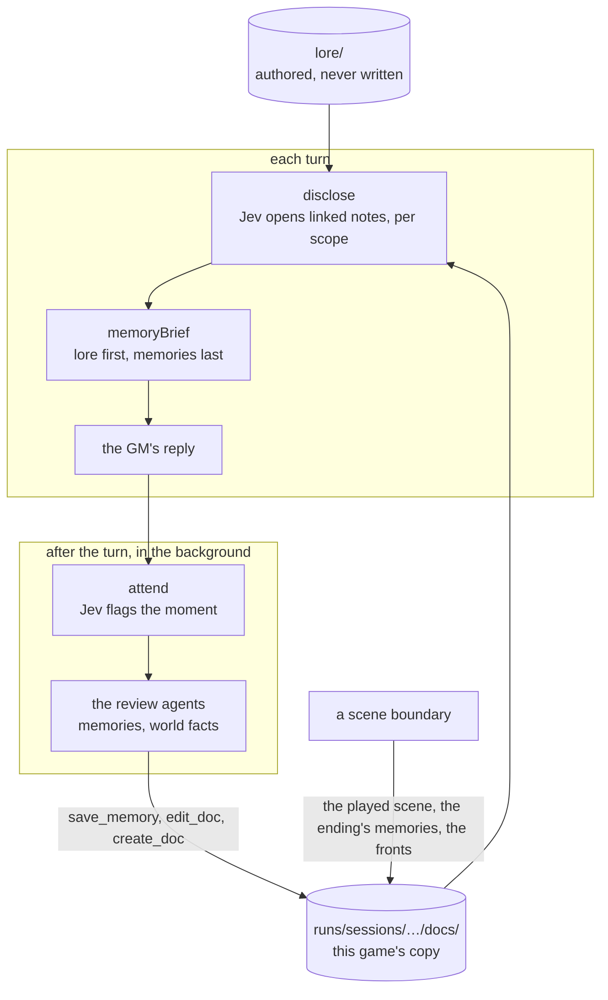

# ai/docs: the docs service

Part of the [architecture overview](../../ARCHITECTURE.md), and of [ai/](../README.md): the AI service's docs service.

The lore as linked Markdown documents, a copy of it for each game that play writes to, who may read what, what the GM is shown of it each turn, and what people remember. It's V1's docs service, rebuilt for scenes. The game's GM plays the prototype's `v2` approach, which has this memory, so disclosure and the reviews always run; the fronts and companion talks use the store too.

It's handed what it needs of the game, never the game itself: disclosure, the memory reviews and the ending's memories take a view of the game's working set ([types.ts](types.ts): the game's id and turn, the scene, the people present, the player, the transcript as the models read it, and the notes disclosure has open or withheld), and what disclosure keeps comes back as a value for the game to keep. The GM pipeline makes the view from each request ([gm/working-set.ts](../gm/working-set.ts)) and calls in here. (The prototype called it through adapters at its old paths, src/lore, until it was retired.)

```sh
npm run status -- --game <n> --memories    # on a running dev stack: every memory that game's reviews wrote
```

## What it is

The authored lore, a campaign's `lore/` (Caerwyn's is [campaigns/caerwyn/lore](../../campaigns/caerwyn/lore/index.md)), is the seed: Markdown files with a frontmatter line per key, linked to each other by relative links. Each game gets an overlay, `runs/sessions/<id>/docs/`, and every write goes there (copy on write), so play changes that game's lore and never the authored files. Both places are [config.ts](config.ts)'s, each a volume ([volumes.ts](volumes.ts): a folder on disk, or docs in memory, synchronous as the service is): by default the campaign's lore and `runs/sessions/<id>/docs/` folders (`KM_RUNS_DIR` moves runs/), made on the first read, and `configureDocs` moves them, as volumes or as folders by path. The AI service serves a campaign version's lore/ and each game's copy from its stores; a host with no file system (the page's server worker) gives volumes in memory. A folder asks for Node's fs when it's first read (`process.getBuiltinModule`) rather than importing it, so the service bundles for a browser with no `node:` import. On top of the store sit:

- **access by scope:** what each person in a scene, and the GM, may read;
- **progressive disclosure:** before each reply, Jev opens the linked notes that bear on the moment;
- **the reviews:** after each reply, in the background, agents write what people will remember and record what play has made true;
- **the boundary's records:** the scene as played, how it ended, and the fronts' clocks.

## What it owns

| File | What's in it |
|---|---|
| [docs.ts](docs.ts) | The store: `readDoc` (the overlay first, then lore/), `writeDoc` (the overlay only), `seedDoc` (as authored), `parseDoc` (the frontmatter), `permitted` (who may read), `linksIn` (a doc's links), `characterEntry` (a cast id's lore entry), `errandsOf` (what someone does next if nobody stops them: their `gm.md`'s "What they do next"), memories (`saveMemory`, `memoryIndex`, `memoryLines`), the story index (`savePlayedScene`, `saveFact`), the player's doc, `searchDocs`, `editDoc`, `createDoc` |
| [disclosure.ts](disclosure.ts) | `disclose` (each turn, per scope), `keepOpened`, `withhold`, and `memoryBrief` (what the GM is shown, in a stable part and a live part) |
| [reviews.ts](reviews.ts) | `memory: "docs"`: the attention filter (`attend`, V1's seven categories and `witnessed`), the two review agents and their tools (`reviewTurn`), and `broadcastEnding` |
| [remember.ts](remember.ts) | `memory: "lite"`: one merged review of a flagged turn (`rememberTurn`), and one memory per person at a scene's end (`rememberScene`) |
| [backstory.ts](backstory.ts) | Character creation's backstory: `draftBackstory` (one from the concept and build), `workIn` (notes made a story, keeping every name, place and number), `checkLore` (what doesn't fit the world, with a fix: checked against `canonFor`, the public lore only, and the story's `PREMISE`, never a GM's or a character's own doc, since what it says goes to the player as written), `applyFix`, `premiseSlips`, `finishBackstory` (who they are and their traits, for the sheet and the GM), and `MOST_WORDS` |
| [fronts.ts](fronts.ts) | `frontsText` and `moveFronts`: steps ticked and struck, and bills added, in this game's copy of a fronts doc |
| [types.ts](types.ts) | What it's handed: the working set (`WorkingSet`: the game, the turn, the scene, the player, who's present, the transcript, what disclosure keeps), and the backstory's shape |
| [config.ts](config.ts) | Where the authored lore and each game's copy are, as volumes (`DocsVolume`, `docsConfig`, `configureDocs`) |
| [volumes.ts](volumes.ts) | The volumes: `folderVolume` (a folder on disk), `memoryVolume` (a map, each write handed on to a host's write-behind) |
| [paths.ts](paths.ts) | The posix paths the AI service names docs and files by, with no `node:path` (held to Node's by its test) |

**Docs written in play,** in the overlay:

| Path | What it is | Visibility | Written by |
|---|---|---|---|
| `Cast/<Name>/memories/index.md` and a note per memory | A person's memories (`characters/<id>/memories/` for someone with no lore entry) | private to `character:<id>` | `saveMemory`: the review agents, the lite reviews, `broadcastEnding`, talks |
| `story/index.md`, `story/scenes/<scene>.md` | The scenes played so far: each one's hand-off and how it ended | gm | `savePlayedScene`, at a boundary |
| `story/facts/<id>.md` | Shared facts, each a note of its own (lite) | public | `saveFact` |
| `Player/<name>.md` | Who the player character is: their backstory in their own words and what it says of them (from character creation), and what they've told or shown people about themselves | gm | `writePlayerBackstory` when the session is made, `playerDoc`, then the world-facts agent |
| Any lore path | The world-facts agent's edits and new docs | as written | `editDoc`, `createDoc` |
| `World/Fronts.md` | The story's fronts, as this game has moved them | gm | `moveFronts` at a boundary; the world-facts agent mid-scene |

**What disclosure keeps,** which the game holds and hands back in each working set (`memory`): `opened` (the notes opened in this scene, with their scope and turn, 24 at most) and `withheld` (notes kept out of it however relevant they get: a talk's held story). `keepOpened` and `withhold` return it changed. The simulation keeps both in the scene's GM bookkeeping (`GmState`'s `opened` and `withheld`, [shared/gm/state.ts](../../shared/gm/state.ts)), so the next scene starts with none.

## How it fits



| Caller | Uses |
|---|---|
| [service/endpoints/turn.ts](../service/endpoints/turn.ts) | `disclose` before an opening and alongside each turn's decide; `keepOpened` |
| [gm/voice.ts](../gm/voice.ts) | `memoryBrief`, in every GM reply |
| [service/endpoints/remember.ts](../service/endpoints/remember.ts) | `reviewTurn`, after each turn (`POST /v1/turns/remember`), with the request's call context (`calls`) |
| [gm/boundary.ts](../gm/boundary.ts) | At a boundary: `errandsOf` (for the verdict: what the people the story goes on with do in the time between), `savePlayedScene`, `broadcastEnding`, `frontsText` and `moveFronts`, `saveMemory` and `memoryLines` |
| [gm/talk.ts](../gm/talk.ts) | A companion's talk: their lore entry, notes and memories (`characterEntry`, `seedDoc`, `memoryLines`, `saveMemory`), and `withhold` |
| [gm/knowledge.ts](../gm/knowledge.ts), [gm/notes.ts](../gm/notes.ts) | `listDocs` and `seedDoc`: the lore a note on a reply links to, and its card |
| [service/endpoints/backstories.ts](../service/endpoints/backstories.ts) | Character creation's backstory: `draftBackstory`, `workIn`, `checkLore`, `finishBackstory` (`applyFix` is shared/creation's) |

It calls [the model client](../llm/README.md) (`JevDecider` for disclosure and the attention filter, `runTools` for the agents, `respondJson` for the lite reviews) and [the prompts](../prompts/README.md) (the reviews'), and nothing outside ai/ and shared/. Who is present and the transcript come in the working set. The lite reviews ([remember.ts](remember.ts): `rememberTurn`, `rememberScene`) were the prototype's `memory: "lite"` approaches' alone: nothing in the game calls them.

## How it works

### Access

- **Scopes.** `gm`, and `character:<cast id>` for each person present.
- **`permitted`** ([docs.ts:89](docs.ts#L89)). The GM reads everything. A `gm` doc is the GM's alone; a `public` doc is anyone's; a `private` doc is only its `readers`'.
- **Defaults.** A doc with no frontmatter counts as `gm`; one with frontmatter but no `visibility` counts as `public`.

### Disclosure

- **Where each scope starts** ([disclosure.ts:25](disclosure.ts#L25)). Each person present starts with their lore entry (`Cast/<Name>/private.md`, found by its `character` id) and their memory index. The GM starts with the player's doc, the story index and the scene's `lore` docs.
- **Each turn,** alongside the decision. For each scope, the unopened notes linked from what it has open, and that it may read, go to Jev: a yes-or-no question per link, one call per scope and round, all scopes at once. A note opens above 0.7 (`OPEN_THRESHOLD`), four at most per scope per round, over two rounds; a note opened in the first round brings its own links into the second.
- **Open for the scene.** Opened notes stay open until the scene ends (24 at most). A note at 0.9 or more (`URGENT`) is clearly about this moment, and the reply is told to let it show.
- **What the GM reads** (`memoryBrief`, [disclosure.ts:114](disclosure.ts#L114)): a block per scope, so it can keep straight who knows what. `stable` is each person's lore entry and the GM's own notes (the player's doc, the scene's `lore` docs), sent before the conversation. `live` is the memory indexes, the notes opened and the story index, sent after it.

### Reviews (`memory: "docs"`)

After each turn, a background job runs `reviewTurn` ([reviews.ts:171](reviews.ts#L171)) on that turn's snapshot: the AI service runs it when the simulation asks (`POST /v1/turns/remember`), on the working set it sends once the turn is over, and appends a line to the game's `memory-reviews.jsonl` in its store.

- **`attend`:** one Jev call with V1's seven attention categories, and an eighth, `witnessed`: someone present saw or heard for themselves something the story may need them to tell or swear to later (an admission, who came in), a companion or whoever stood watch included. A category flagged at 0.4 or more (`FLAG_THRESHOLD`) fires its agent: a false flag costs a review that writes nothing, and a missed one loses the memory.
- **The personal-memories agent** handles commitments, changes in trust or knowledge, exchanges, and what witnesses saw and heard (in its own words: what Hobb admitted, not that it was recorded), with `save_memory`, `list_memories`, `read_doc` and `edit_doc`. It's told to write at most one memory per person present.
- **The world-facts agent** handles improvised details and lasting changes, with `search_lore`, `read_doc`, `edit_doc`, `create_doc`, `save_memory` and `list_memories`. It records a fact in the doc where it belongs, the player's claims about themselves in their doc, and talk anyone could hear in `World/Caerwyn now.md`. It may also tick or strike a front's step mid-scene, through `edit_doc` ([review/world.md](../prompts/review/world.md)).
- **How they run.** Each is a Luna tool loop at medium reasoning ([tools.ts](../llm/tools.ts)), with [review/system.md](../prompts/review/system.md) and its categories' prompts. They run in that order, so the second sees the first's edits. What each one changed goes in the session's `memory-reviews.jsonl`.

### The lite alternative (`memory: "lite"`)

`rememberTurn` ([remember.ts:74](remember.ts#L74)) flags five categories (at 0.5), then makes one JSON call that returns memories for the people present and facts as notes of their own (`story/facts/`). At a scene's end, `rememberScene` gives each person one memory of it.

### At a scene boundary

`chainScene` ([gm/boundary.ts](../gm/boundary.ts), the prototype's engine.ts) records the scene that ended:

- **`broadcastEnding`** (`docs`): everyone present gets the authored outcome as a memory, so the ending itself is never left to a review;
- **`rememberScene`** (`lite`);
- **`savePlayedScene`** (either): the hand-off as `story/scenes/<scene>.md`, linked from the story index.

Before any of that, the boundary's verdict reads the lore too. For each of the last scene's people who are in the scenes to come, `errandsOf` ([docs.ts](docs.ts)) gives the "What they do next" section of their `gm.md`, as this game's copy has it: Kell's afternoon, say, which is how the player hears where the story goes next. What they did between scenes is as true as play, unless play ruled it out.

The fronts move in the same crossing. `moveFronts` ([fronts.ts:25](fronts.ts#L25)) ticks the steps that play or time has made true (`- [x]`, "Ticked after" the scene), strikes the ones play has made meaningless (with why), and adds up to two new bills under "Bills still to come due", leaving out any already on their way. It writes this game's copy of the doc, and `frontsText` reads that copy back at the next boundary.

### A companion's stories: told, now, held

Talks ([gm/talk.ts](../gm/talk.ts)) keep a companion's stories with the store. `confidences` lists the private notes linked from their lore entry that they haven't told yet. A story they tell goes in their memories (`saveMemory`) as well as the talk record. The deepest is held until the third talk: the GM is told its title and summary and to turn the question aside, and `withhold` ([disclosure.ts:101](disclosure.ts#L101)) keeps the note itself out of disclosure.

## Where to look first

- **Access.** A new doc's `visibility` and `readers`, and any change to `permitted` or `parseDoc`. A private note whose frontmatter loses its `visibility` becomes everyone's.
- **What the agents can write.** The tools' definitions ([reviews.ts:85](reviews.ts#L85)) and their handlers ([reviews.ts:115](reviews.ts#L115)). The paths come from the model; `save_memory` takes only people present.
- **The thresholds:** `OPEN_THRESHOLD` (0.7), `PER_ROUND` (4), `MAX_OPEN` (24) and `URGENT` (0.9) in disclosure.ts; `FLAG_THRESHOLD` (0.4) in reviews.ts.
- **The stable and live parts of `memoryBrief`.** Something that changes every turn, put in `stable`, spoils the GM's prompt cache on every turn.
- **Writes go to the overlay.** `writeDoc` writes only to this game's copy. Nothing should write under lore/.

## How to test it

```sh
node --no-warnings --test 'ai/docs/*.test.ts'          # on a working set made by hand; the fronts in a game's copy; the backstory: offline
node --no-warnings --import tsx --test ai/service/endpoints/background.test.ts   # the remember endpoint: a review's notes in the game's copy, its line
npm run status -- --game <n> --memories                 # on a running dev stack: every memory that game's reviews wrote
```

The prototype's memory evals (`src/eval/memory-eval.ts`, `memory-run.ts`: does someone remember, a scene later?) went with it, in git history at `bc2ab1f`. After a live game, the AI service's store holds each game's copy of the lore and its `memory-reviews.jsonl`, which says which flags fired and what each review changed.

## Known gaps and sharp edges

- **A missing `visibility` fails open.** No frontmatter means `gm`, but frontmatter without `visibility` means `public`. Every authored doc has one today.
- **Whole-file writes, and no locks.** Memory reviews for consecutive turns can run at once, and two of them adding to one memory index can lose a line.
- **Synchronous.** Every `readDoc` reads its volume (a file, for a folder), `linksIn` reads each linked doc, and a `[[wiki link]]` lists both volumes.
- **Search isn't ranked.** `searchDocs` counts the query's words in each doc, across every `.md` under lore/.
- **The registry is the authored lore's.** `characterEntry` scans lore/ once per process, so a lore entry created in play isn't found.
- **The held story is cut, not annotated.** The GM knows its title and summary, and nothing else of it. A fast GM asked about something it can't see tends to invent it or deny it, and the reviews then record the invention.
- **Always Jev.** Disclosure and the attention filter make their own `JevDecider`; the approach's decider never reaches them.
- **Reviews run late.** A review reads its turn's snapshot but writes into the live overlay, perhaps after the next turn's disclosure has already read it.
- **The reviews have no unit tests.** Disclosure, the memory block, what disclosure keeps and the ending's memories are tested on a working set made by hand ([working-set.test.ts](working-set.test.ts)), the fronts and the backstory too, and `errandsOf` through the boundary's tests ([gm/boundary.test.ts](../gm/boundary.test.ts)). The attention filter and the review agents were tested by the prototype's memory evals, live.
- **A working set is a copy.** The prototype's view read its session as the docs service asked, so disclosure's second round saw the turn as it stood by then; the working set a request sends is a copy, so a second round sees the turn as it was sent.
