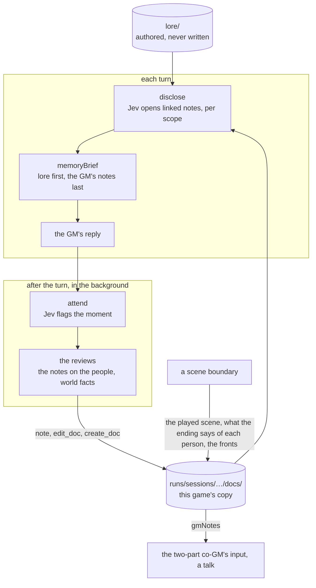

# ai/docs: the docs service

Part of the [architecture overview](../../ARCHITECTURE.md), and of [ai/](../README.md): the AI service's docs service.

The lore as linked Markdown documents, a copy of it for each game that play writes to, who may read what, what the GM is shown of it each turn, and the GM's notes on each person, which are what people remember. It's V1's docs service, rebuilt for scenes. The reviews always run after a turn; disclosure runs for the old pipeline's GM (a talk); the fronts, the boundary and companion talks use the store too.

It's handed what it needs of the game, never the game itself: disclosure and the memory reviews take a view of the game's working set ([types.ts](types.ts): the game's id and turn, the scene, the people present, the player, the transcript as the models read it, and the notes disclosure has open or withheld), and what disclosure keeps comes back as a value for the game to keep. The GM pipeline makes the view from each request ([gm/working-set.ts](../gm/working-set.ts)) and calls in here. (The prototype called it through adapters at its old paths, src/lore, until it was retired.)

```sh
npm run status -- --game <n> --notes       # on a running dev stack: the GM's notes on each person in that game
```

## What it is

The authored lore, a campaign's `lore/` (Caerwyn's is [campaigns/caerwyn/lore](../../campaigns/caerwyn/lore/index.md)), is the seed: Markdown files with a frontmatter line per key, linked to each other by relative links. Each game gets an overlay, `runs/sessions/<id>/docs/`, and every write goes there (copy on write), so play changes that game's lore and never the authored files. Both places are [config.ts](config.ts)'s, each a volume ([volumes.ts](volumes.ts): a folder on disk, or docs in memory, synchronous as the service is): by default the campaign's lore and `runs/sessions/<id>/docs/` folders (`KM_RUNS_DIR` moves runs/), made on the first read, and `configureDocs` moves them, as volumes or as folders by path. The AI service serves a campaign version's lore/ and each game's copy from its stores; a host with no file system (the page's server worker) gives volumes in memory. A folder asks for Node's fs when it's first read (`process.getBuiltinModule`) rather than importing it, so the service bundles for a browser with no `node:` import. On top of the store sit:

- **access by scope:** what each person in a scene, and the GM, may read;
- **progressive disclosure:** before each reply, Jev opens the linked notes that bear on the moment;
- **the GM's notes on each person:** one living note per person per game ([notes.ts](notes.ts)), in the third person: how they stand with the player now and why, what they've seen the player do, what they've learned, promises made by them or to them, and what they did;
- **the reviews:** after each reply, in the background, they bring the notes on the people present up to date and record what play has made true in the lore;
- **the boundary's records:** the scene as played, what its ending says of each person (in their notes), and the fronts' clocks.

## What it owns

| File | What's in it |
|---|---|
| [docs.ts](docs.ts) | The store: `readDoc` (the overlay first, then lore/), `writeDoc` (the overlay only), `seedDoc` (as authored), `parseDoc` (the frontmatter), `permitted` (who may read), `linksIn` (a doc's links), `characterEntry` (a cast id's lore entry), `errandsOf` (what someone does next if nobody stops them: their `gm.md`'s "What they do next"), the story index (`savePlayedScene`), the player's doc, `searchDocs`, `editDoc`, `createDoc` |
| [notes.ts](notes.ts) | The GM's notes on a person, one per game: where they are (`notesPath`), reading them from the game's copy only (`readNotes`, `notesDoc`), as a model reads them (`notesText`, and `gmNotes(game, id)`, what a GM part is given), and an update (`note`: the standing set, a line rewritten, taken out or added, a full part giving up its oldest line) |
| [disclosure.ts](disclosure.ts) | `disclose` (each turn, per scope), `keepOpened`, `withhold`, and `memoryBrief` (what the old pipeline's GM is shown, in a stable part and a live part) |
| [reviews.ts](reviews.ts) | The attention filter (`attend`, its categories brought to the notes' parts), the notes review (one structured call, `memory-review.md`) and the world-facts agent with its tools (`reviewTurn`) |
| [backstory.ts](backstory.ts) | Character creation's backstory: `draftBackstory` (one from the concept and build), `workIn` (notes made a story, keeping every name, place and number), `checkLore` (what doesn't fit the world, with a fix: checked against `canonFor`, the public lore only, and the story's `PREMISE`, never a GM's or a character's own doc, since what it says goes to the player as written), `applyFix`, `premiseSlips`, `finishBackstory` (who they are and their traits, for the sheet and the GM), and `MOST_WORDS` |
| [fronts.ts](fronts.ts) | `frontsText` and `moveFronts`: steps ticked and struck, and bills added, in this game's copy of a fronts doc |
| [types.ts](types.ts) | What it's handed: the working set (`WorkingSet`: the game, the turn, the scene, the player, who's present, the transcript, what disclosure keeps), and the backstory's shape |
| [config.ts](config.ts) | Where the authored lore and each game's copy are, as volumes (`DocsVolume`, `docsConfig`, `configureDocs`) |
| [volumes.ts](volumes.ts) | The volumes: `folderVolume` (a folder on disk), `memoryVolume` (a map, each write handed on to a host's write-behind) |
| [paths.ts](paths.ts) | The posix paths the AI service names docs and files by, with no `node:path` (held to Node's by its test) |

**Docs written in play,** in the overlay:

| Path | What it is | Visibility | Written by |
|---|---|---|---|
| `Cast/<Name>/notes.md` | The GM's notes on a person in this game (`characters/<id>/notes.md` for someone with no lore entry): five parts, each so many lines at most | gm | `note`: the notes review, the boundary (an ending's attitudes, memories and promises, who was there, the time between), a talk (what a companion told) |
| `story/index.md`, `story/scenes/<scene>.md` | The scenes played so far: each one's hand-off and how it ended | gm | `savePlayedScene`, at a boundary |
| `Player/<name>.md` | Who the player character is: their backstory in their own words and what it says of them (from character creation), and what they've told or shown people about themselves | gm | `writePlayerBackstory` when the session is made, `playerDoc`, then the world-facts agent |
| Any lore path | The world-facts agent's edits and new docs | as written | `editDoc`, `createDoc` |
| `World/Fronts.md` | The story's fronts, as this game has moved them | gm | `moveFronts` at a boundary; the world-facts agent mid-scene |

**What disclosure keeps,** which the game holds and hands back in each working set (`memory`): `opened` (the notes opened in this scene, with their scope and turn, 24 at most) and `withheld` (notes kept out of it however relevant they get: a talk's held story). `keepOpened` and `withhold` return it changed. The simulation keeps both in the scene's GM bookkeeping (`GmState`'s `opened` and `withheld`, [shared/gm/state.ts](../../shared/gm/state.ts)), so the next scene starts with none.

## How it fits



| Caller | Uses |
|---|---|
| [service/endpoints/turn.ts](../service/endpoints/turn.ts) | `disclose` before an opening and alongside each turn's decide (the old pipeline's, which nothing plays since the old pipeline's salvage; the two-part GM discloses nothing); `keepOpened` |
| [gm/voice.ts](../gm/voice.ts) | `memoryBrief`, in every reply of the old pipeline's GM (a talk's, and a fight's aftermath) |
| [gm/two-part.ts](../gm/two-part.ts) | `gmNotes`: the co-GM's input has the GM's notes on each person on stage (`notesOnPeople`); the mouthpiece reads none |
| [service/endpoints/remember.ts](../service/endpoints/remember.ts) | `reviewTurn`, after each turn (`POST /v1/turns/remember`), with the request's call context (`calls`) |
| [gm/boundary.ts](../gm/boundary.ts) | At a boundary: `errandsOf` (for the verdict: what the people the story goes on with do in the time between), `savePlayedScene`, `note` (what the ending says of each person, and the time between), `frontsText` and `moveFronts` |
| [gm/talk.ts](../gm/talk.ts) | A companion's talk: their lore entry and notes (`characterEntry`, `seedDoc`), the GM's notes on them (`gmNotes`, and `note` for what they told), and `withhold` |
| [gm/knowledge.ts](../gm/knowledge.ts) | `playerDocPath` and `readDoc`: the player's own doc, for the GM's note of what the player knows (until M2, the notes on a reply's marks linked into the lore with `listDocs` and `seedDoc` too) |
| [service/endpoints/backstories.ts](../service/endpoints/backstories.ts) | Character creation's backstory: `draftBackstory`, `workIn`, `checkLore`, `finishBackstory` (`applyFix` is shared/creation's) |

It calls [the model client](../llm/README.md) (`JevDecider` for disclosure and the attention filter, `respondJson` for the notes review, `runTools` for the world-facts agent) and [the prompts](../prompts/README.md) (the reviews'), and nothing outside ai/ and shared/. Who is present and the transcript come in the working set. The prototype's lite memory (`remember.ts`, `rememberTurn` and `rememberScene`, which nothing in the game called) went when the memories became the GM's notes (docs/migration-log.md, "The old pipeline's salvage").

## How it works

### Access

- **Scopes.** `gm`, and `character:<cast id>` for each person present.
- **`permitted`** ([docs.ts:89](docs.ts#L89)). The GM reads everything. A `gm` doc is the GM's alone; a `public` doc is anyone's; a `private` doc is only its `readers`'.
- **Defaults.** A doc with no frontmatter counts as `gm`; one with frontmatter but no `visibility` counts as `public`.

### Disclosure

- **Where each scope starts** ([disclosure.ts:25](disclosure.ts#L25)). Each person present starts with their lore entry (`Cast/<Name>/private.md`, found by its `character` id) and the GM's notes on them (from the game's copy only). The GM starts with the player's doc, the story index and the scene's `lore` docs.
- **Each turn,** alongside the decision. For each scope, the unopened notes linked from what it has open, and that it may read, go to Jev: a yes-or-no question per link, one call per scope and round, all scopes at once. A note opens above 0.7 (`OPEN_THRESHOLD`), four at most per scope per round, over two rounds; a note opened in the first round brings its own links into the second.
- **Open for the scene.** Opened notes stay open until the scene ends (24 at most). A note at 0.9 or more (`URGENT`) is clearly about this moment, and the reply is told to let it show.
- **What the GM reads** (`memoryBrief`, [disclosure.ts:114](disclosure.ts#L114)): a block per scope, so it can keep straight who knows what. `stable` is each person's lore entry and the GM's own notes (the player's doc, the scene's `lore` docs), sent before the conversation. `live` is the GM's notes on each person from play, the notes opened and the story index, sent after it. Its words are otherwise the prototype's, which the parity test holds the old pipeline to.

### The GM's notes on a person

One living note per person per game ([notes.ts](notes.ts)), kept by the memory reviews, the boundary and a talk. The user's framing, after QA round qa1-1018: "Maybe memory is more like GM notes for the character rather than personal memories." So it's in the third person and actionable, in five parts, each holding so many lines at most:

| Part | Holds | At most |
|---|---|---|
| Standing with the player | how they stand with the player character now, and why | 1 line, set, never added to |
| Seen the player do | a kindness or a cruelty, a threat, a gift or payment, a lie found out, how they treated someone | 5 |
| Learned | what they learned, or saw and heard for themselves, that the story may need from them | 6 |
| Promises | who promised what to whom, on what terms, and whether it's been kept | 4 |
| Did | what they did of consequence; how each scene ended for them; the time between | 8 |

- **It's kept current.** `note` reads the note again, then sets the standing, rewrites the line a `replaces` names (its words, or enough of them to find just that line), takes one out (an empty line), or adds one; a line the part has already is kept as it is, one `replaces` doesn't find is added, and a full part gives up its oldest line. A line is cut at a word past 400 characters. So the note never grows past a page.
- **It's the game's.** It's written to the game's copy only, and read from there only (`readNotes`, `notesDoc`): an authored doc at the same path is never anyone's notes.
- **Reading it:** `gmNotes(game, id)` is the note as text ("Standing with the player: …", then each other part's lines), or undefined when play hasn't given them any: what the two-part co-GM (each person on stage, `notesOnPeople`), a talk's plan and the old pipeline's GM (`memoryBrief`) are given.

### Reviews

After each turn, a background job runs `reviewTurn` ([reviews.ts](reviews.ts)) on that turn's snapshot: the AI service runs it when the simulation asks (`POST /v1/turns/remember`), on the working set it sends once the turn is over, and appends a line to the game's `memory-reviews.jsonl` in its store.

- **`attend`:** one Jev call with the attention categories, V1's brought to the notes' parts: `promise` (V1's deferred and general commitments), `standing` and `learned` (its change in relationship or knowledge, in two; learned with what someone present saw or heard for themselves, a companion or whoever stood watch included), `seen` (its exchange, with the rest of what the player did in front of someone) and `did` (what someone did on their own account); and V1's `improvised_detail` and `other_world_update`. V1's immediate commitment went (what's to be done now is done in the next reply or not at all). A category flagged at 0.4 or more (`FLAG_THRESHOLD`) fires its review: a false flag costs a review that writes nothing, and a missed one loses the line.
- **The notes review** runs when anything is flagged (a world fact has its witnesses too): one structured call (`memory.review.notes`, Luna at medium effort, [memory-review.md](../prompts/memory-review.md)), given each present person's notes as they stand and the moment, answering with updates, each a person, a part, the line as it should read now and the line it `replaces`. Each is written at once through `note`. It's told to note only what this moment brought (reviews of consecutive turns run at once, and the earlier one's lines may not be in yet), each thing once where it belongs, in the third person, only what each person lived through, never the investigation's steps or a remark as a line, and a witness's words that matter.
- **The world-facts agent** handles improvised details and lasting changes, with `search_lore`, `read_doc`, `edit_doc` and `create_doc`: a Luna tool loop at medium reasoning ([tools.ts](../llm/tools.ts)), with [review/system.md](../prompts/review/system.md) and its categories' prompts. It records a fact in the doc where it belongs, the player's claims about themselves in their doc, and talk anyone could hear in `World/Caerwyn now.md`. It may also tick or strike a front's step mid-scene, through `edit_doc` ([review/world.md](../prompts/review/world.md)). People's notes are the notes review's: its `edit_doc` and `create_doc` refuse a notes path.
- **How they run.** The notes review first, then the world-facts agent, which sees what the notes wrote. What each one changed goes in the game's `memory-reviews.jsonl` ("note kell seen: added …", "note kell promises: rewrote … → …").

### At a scene boundary

`chainScene` ([gm/boundary.ts](../gm/boundary.ts), the prototype's engine.ts) records the scene that ended:

- **`notesAtEnd`:** what the ending says of each person, in the GM's notes on them, from its effects and the scene's `onEnd` as play made them hold (their `if` and `unless` facts): an `attitude` is their standing ("Friendly: The King's investigator made Prout's case properly."), a `remember` a line of what they did ("The Hanged Clerk, as it ended: …"), a `promise` a line in the notes of each side; and everyone there with no memory of it from the ending has that they were there when it ended, so the ending itself is never left to a review (V1's milestone broadcast);
- **`rememberBetween`:** the time between, for the people of the scene that ended whom the lead or an adjustment names: a line each under what they did;
- **`savePlayedScene`:** the hand-off as `story/scenes/<scene>.md`, linked from the story index.

Each is written once for a boundary: run again after a crash, a line the notes have already is kept as it is, and the played scene's doc is there.

Before any of that, the boundary's verdict reads the lore too. For each of the last scene's people who are in the scenes to come, `errandsOf` ([docs.ts](docs.ts)) gives the "What they do next" section of their `gm.md`, as this game's copy has it: Kell's afternoon, say, which is how the player hears where the story goes next. What they did between scenes is as true as play, unless play ruled it out.

The fronts move in the same crossing. `moveFronts` ([fronts.ts:25](fronts.ts#L25)) ticks the steps that play or time has made true (`- [x]`, "Ticked after" the scene), strikes the ones play has made meaningless (with why), and adds up to two new bills under "Bills still to come due", leaving out any already on their way. It writes this game's copy of the doc, and `frontsText` reads that copy back at the next boundary.

### A companion's stories: told, now, held

Talks ([gm/talk.ts](../gm/talk.ts)) keep a companion's stories with the store. `confidences` lists the private notes linked from their lore entry that they haven't told yet. A story they tell goes in the GM's notes on them (a line under what they did) as well as the talk record, and the talk's plan reads those notes for how things stand. The deepest is held until the third talk: the GM is told its title and summary and to turn the question aside, and `withhold` ([disclosure.ts:101](disclosure.ts#L101)) keeps the note itself out of disclosure.

## Where to look first

- **Access.** A new doc's `visibility` and `readers`, and any change to `permitted` or `parseDoc`. A private note whose frontmatter loses its `visibility` becomes everyone's.
- **What the reviews can write.** The notes review's schema takes only the people present and the five parts; the world-facts agent's tools and their handlers ([reviews.ts](reviews.ts)) take paths from the model, and refuse a notes path.
- **The thresholds:** `OPEN_THRESHOLD` (0.7), `PER_ROUND` (4), `MAX_OPEN` (24) and `URGENT` (0.9) in disclosure.ts; `FLAG_THRESHOLD` (0.4) in reviews.ts.
- **The stable and live parts of `memoryBrief`.** Something that changes every turn, put in `stable`, spoils the GM's prompt cache on every turn.
- **Writes go to the overlay.** `writeDoc` writes only to this game's copy. Nothing should write under lore/.

## How to test it

```sh
node --no-warnings --test 'ai/docs/*.test.ts'          # on a working set made by hand; the GM's notes on docs in memory; the fronts in a game's copy; the backstory: offline
node --no-warnings --import tsx --test ai/service/endpoints/background.test.ts   # the remember endpoint: the notes review's lines in the game's copy (one added, then rewritten), its line
npm run status -- --game <n> --notes                    # on a running dev stack: the GM's notes on each person in that game
```

The prototype's memory evals (`src/eval/memory-eval.ts`, `memory-run.ts`: does someone remember, a scene later?) went with it, in git history at `bc2ab1f`. After a live game, the AI service's store holds each game's copy of the lore and its `memory-reviews.jsonl`, which says which flags fired and what each review changed.

## Known gaps and sharp edges

- **A missing `visibility` fails open.** No frontmatter means `gm`, but frontmatter without `visibility` means `public`. Every authored doc has one today.
- **Whole-file writes, and no locks.** A note is read again and written whole at each line, so writers one after another in a process keep each other's lines; reviews of consecutive turns still run at once, and the later may not see the earlier's lines (it's told to note only its own moment). Two processes writing one game's notes could lose a line.
- **Synchronous.** Every `readDoc` reads its volume (a file, for a folder), `linksIn` reads each linked doc, and a `[[wiki link]]` lists both volumes.
- **Search isn't ranked.** `searchDocs` counts the query's words in each doc, across every `.md` under lore/.
- **The registry is the authored lore's.** `characterEntry` scans lore/ once per process, so a lore entry created in play isn't found.
- **The held story is cut, not annotated.** The GM knows its title and summary, and nothing else of it. A fast GM asked about something it can't see tends to invent it or deny it, and the reviews then record the invention.
- **Always Jev.** Disclosure and the attention filter make their own `JevDecider`; the approach's decider never reaches them.
- **Reviews run late.** A review reads its turn's snapshot but writes into the live overlay, perhaps after the next turn's disclosure has already read it.
- **The reviews' judgement isn't unit-tested.** The notes ([notes.test.ts](notes.test.ts)), the notes review's writing and rewriting through the remember endpoint ([background.test.ts](../service/endpoints/background.test.ts)), disclosure, the memory block and what disclosure keeps ([working-set.test.ts](working-set.test.ts)), the fronts, the backstory, and the boundary's notes and `errandsOf` through the boundary's tests ([gm/crossing.test.ts](../gm/crossing.test.ts), [gm/boundary.test.ts](../gm/boundary.test.ts)) are; what the attention filter flags and what the notes review writes are the models', probed live (docs/migration-log.md).
- **A working set is a copy.** The prototype's view read its session as the docs service asked, so disclosure's second round saw the turn as it stood by then; the working set a request sends is a copy, so a second round sees the turn as it was sent.
