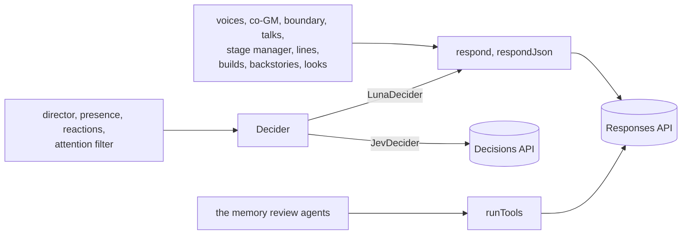

# ai/llm: model calls

Part of the [architecture overview](../../ARCHITECTURE.md), and of [ai/](../README.md): the AI service's model client. (Until the prototype was retired, it imported this too, through a one-line shim at each of its old paths, src/llm/*.ts.)

Every model call in the game goes through here: text, JSON and tool loops on OpenRouter's Responses API, and the deciders on its Decisions API. Each call is logged with what it cost and how long it took.

```sh
node --no-warnings --test 'ai/llm/*.test.ts'   # the call context and the stand-in for OpenRouter
```

## What it is

A thin client over OpenRouter with no SDK: `fetch`, server-sent events and JSON schemas. It decides nothing about the game. It carries the requests that the GM pipeline, the docs service, character creation and the looks build, retries what's worth retrying, and records each call twice: in full in the caller's call log, and as a line of cost and latency in the cost ledger.

## What it owns

| File | What's in it |
|---|---|
| [openrouter.ts](openrouter.ts) | `respond` (streamed text, optionally held to a JSON schema), `respondJson`, `fetchWithRetry`, the API key (`apiKey`), the call log (`setCallLog`, `logCall`), the cost ledger and the process's spend (`recordCost`, `sessionSpend`), and the model ids `LUNA` and `SOL` |
| [decide.ts](decide.ts) | The `Decider` interface (one named choice per question, with probabilities) and its implementations: `JevDecider` (the Decisions API, for Jev and for Luna's decision mode), `LunaDecider` (strict structured output) and `CascadeDecider` (Jev, then Luna for unsure answers). `deciderFor` turns an approach's decider name into one. |
| [tools.ts](tools.ts) | `runTools`: the tool-calling loop the background memory reviews run |
| [fake-openrouter.ts](fake-openrouter.ts) | A stand-in for OpenRouter for tests that play real turns with no network: each decision's quietest choice, JSON made to fit the schema asked for, the GM's lines from a script (a word at a time with `streamMs`), a slow decider (`decisionDelayMs`), slow structured calls by their schema's name (`byNameDelayMs`), slow suggested lines (`suggestDelayMs`), a talk's lines apart from a scene's (`talkSuggestions`), and a tool loop's calls by its first tool (`toolCalls`: its first round makes them, the next says "Done."). `fakeOpenRouter` puts it in place of the process's `fetch`; `fakeFetch` hands it over as a fetch of its own, for a call context |

**State.** Two module-level values: the call log's path (from `KM_CALL_LOG`, or `setCallLog`) and the spend so far in this process (`sessionSpend`). A call made with a **call context** (`CallContext`: a `calls` on `respond`'s or `runTools`' request, the third argument of `JevDecider`) touches neither: it goes through the context's `fetch` with its key, and its log lines (one as each call starts, so a call cut off is still counted, and one when it's done) and costs go to the context's `log` and `cost`, as the AI service keeps each request's apart. Without one (a test's or a script's call; never the AI service's), two files:

- **The call log:** one JSON line per call, retry or failure, with the operation, the model, the effort, the whole request (instructions and input), the text or the answers, latency, time to first text, cost and tokens. A caller points it at a file (`KM_CALL_LOG`, or `setCallLog`); the AI service's requests log to each game's own `calls.jsonl` in its store instead, through their call contexts. With no path set, nothing is logged.
- **The cost ledger:** `runs/cost-ledger.jsonl` (`KM_COST_LEDGER`), a line per call with the provider, operation, model, cost and latency, for every game, eval and job on the machine.

### The models

| Model | Constant | What uses it |
|---|---|---|
| `openai/gpt-6-luna` | `LUNA` | The default for `respond`. Every voice (GM, narrator, actors) at reasoning `none`; the hand-off, the boundary verdict and the fronts at `low`; the full co-GM at `medium` and the quick one at `none`. Also the stage manager, the scribe, the memory reviews, the character sheet, the talk's plan and lines, the look inventions, and the eval judge at `high`. |
| `openai/gpt-6-luna-decisions` | `LUNA_DECISIONS_MODEL` | `luna-decisions`, the decider of `v2` and most approaches: the director, who is present, reactions, a talk's sift |
| `typesafe/jev-1.13` | `JEV_MODEL` | The attention filter (the docs service makes its own `JevDecider`, whatever the approach), the `jev` approaches, and the fast half of a cascade |
| `openai/gpt-6-sol` | `SOL` | Nothing in the game (the prototype's eval judge took it for a second opinion) |

## How it fits



Each of the three logs every call to the caller's call log (a request's call context, in the AI service) and the cost ledger.

| Caller | Uses |
|---|---|
| [gm/](../gm/) | `respond` and `respondJson` (the GM's voices, the two-part GM's mouthpiece and co-GM, the hand-off, the boundary verdict and the fronts, a talk's plan and lines, the stage manager, the suggested lines) |
| [service/endpoints/turn.ts](../service/endpoints/turn.ts) | `JevDecider`: the director (Luna's decision mode) |
| [the docs service](../docs/README.md) | `JevDecider` (the attention filter), `runTools` (the review agents), `respondJson` (the backstory, the lite reviews) |
| [rules/](../rules/), [look/](../look/) | `respondJson` (the builds, the look inventions) |
| [service/calls.ts](../service/calls.ts) | each request's call context: its fetch, key, log and cost |

It calls `https://openrouter.ai/api/v1/responses` (`respond`, `runTools`) and `https://openrouter.ai/api/alpha/decisions` (`JevDecider`), with the key from `OPENROUTER_API_KEY` or `~/secrets/kingmaker-dev-openrouter.txt`.

## How it works

- **`respond`** ([openrouter.ts:251](openrouter.ts#L251)) sends a Responses request (`store: false`, the reasoning effort, a strict JSON schema when asked), reads the event stream, and calls `onText` with the text so far as it grows. It returns the final answer's text with its cost, latency, time to first text and tokens.
- **`respondJson`** ([openrouter.ts:354](openrouter.ts#L354)) parses the text (a fenced block too) and returns the object, with the call's result as `_meta`. JSON it can't read throws.
- **Retries.** `fetchWithRetry` ([openrouter.ts:139](openrouter.ts#L139)) retries a network error four times (after 1, 2, 4 and 8 s), and HTTP 429 or 5xx four times (after the `Retry-After`, or 1.5, 3, 6 and 12 s). Retries go in the call log, never on screen. Then, once per call, `respond` starts again from the top when moderation flagged the request (it sometimes flags fantasy violence), the stream failed or ended early, the response came back incomplete, or the reply came split into a commentary message and a final answer (Luna without reasoning does that now and then). A caller whose reply is a list read a line at a time can take it as far as it got instead (`asFarAsItGot`: out of tokens, the text so far, marked `cutShort`; in two phases, the final answer), as the suggested lines do. A caller on a deadline takes a two-phase reply's final answer when it's usable (`finalAnswer`: for JSON, when it reads as JSON), as the GM's review on a considered turn does: one of its rulings came whole in the final phase, was asked for again, and the second try ran past the review's 12 s. Anything else, such as a second failure, throws; a 401 throws `KeyRefused` at once (OpenRouter turned the key down, and asking again won't mend it), which the AI service answers as 403 `key_refused`.
- **Timeouts.** A `respond` call has 180 s, its retries included, and its one restart another 180 s. A `runTools` round has 180 s, and a decision 60 s.
- **Deciders.** Every decider answers `decide(state, questions, operation)`. Each question is a set of named criteria, and each answer is a choice with its probabilities.
  - `JevDecider` ([decide.ts:22](decide.ts#L22)) asks the Decisions API and checks every answer against its criteria. It answers a question with only one option itself, since the API wants at least two.
  - `LunaDecider` ([decide.ts:73](decide.ts#L73)) asks for strict JSON with an enum per question, so its probabilities are 1 for the choice and 0 for the rest.
  - `CascadeDecider` ([decide.ts:116](decide.ts#L116)) asks Jev, then re-asks Luna whatever Jev answered with less confidence than its threshold (`cascade-0.8` by default). No approach uses it; the decision suite can.
- **`runTools`** ([tools.ts:18](tools.ts#L18)) is a stateless loop (`store: false`). Each round it sends the conversation so far, the model's own output items included (with their encrypted reasoning), plus each tool's result, until the model answers without a call; 12 rounds at most. A malformed call is sent back as an error, twice, before the loop gives up.

## Where to look first

- **The request's shape** in `respond` reaches every call: the effort, `store: false`, strict schemas, and what goes in `instructions` rather than `input` (the GM's prompt cache depends on a stable prefix).
- **Retries and timeouts** change how long a turn can take. A caller that passes its own `signal` (the speculative reply, a talk's next lines) gets no timeout at all.
- **What a `Decision` means.** The director's confidence bars read `probabilities`, so a decider that returns other numbers changes every judgement in the game.
- **What gets logged.** The call log holds whole prompts: each scene's secrets, the lore, the transcript. It's a developer's file, and nothing reads it back into play.

## How to test it

```sh
npm run typecheck
node --no-warnings --test 'ai/llm/*.test.ts'   # the call context, the stand-in's slow reply and slow decider
```

The prototype's decision suite (`npm run eval -- --suite decision`: each decider's accuracy and latency on fixture states) went with it, in git history at `bc2ab1f`.

[seam.test.ts](seam.test.ts) holds the call context to what it promises (its fetch, key, log and cost, and nothing of the process's), and the stand-in's slow reply and slow decider. `OPENROUTER_API_KEY=offline` sends a key OpenRouter refuses (HTTP 401): every call fails at once, with no retries, and that's how the offline paths are exercised.

## Known gaps and sharp edges

- **The process's own mode stays.** The call context is how the AI service gives each request its own transport, key, log and usage. A call without one uses the process's (the stand-in for tests replaces `fetch` for the whole process), as the prototype's call sites all did; and there's no replay client: the director's test passes a scripted `Decider` instead.
- **Per process, not per game, without a call context.** The call log's path and the spend are module state: two games in one process log to whichever path was set last and share one spend. A call context keeps a call out of both.
- **The ledger isn't the bill.** A reply split into commentary and answer is recorded and then retried, so the ledger has both, but the result's `costUsd` (and so the turn's metric) has only the retry. Failed and incomplete attempts aren't recorded at all. `runTools` records each round with the latency since the loop began.
- **The deciders differ in more than speed.** `LunaDecider`'s probabilities are 1 and 0, so every confidence bar in the director passes on any answer it gives; Jev and Luna's decision mode return real probabilities. Comparing deciders compares behaviour, not only accuracy.
- **The Decisions API is OpenRouter's alpha endpoint** (`/api/alpha/decisions`).
- **`apiKey` copies the key file's key into `process.env`,** as the prototype's detached background jobs needed it to (they inherited it).
