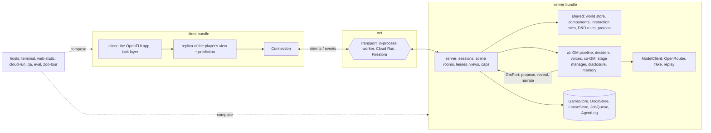

# Productionising Kingmaker V2

A design, not yet built (October 2026). It turns the brief in [docs/code.md](../code.md) into a target architecture and an order of work. It is grounded in a review of the code as it stands (HEAD 67f150a) and in outside research on systemic world models, client/server game frameworks and hosting on Firebase.

[ARCHITECTURE.md](../../ARCHITECTURE.md) describes the code as it is; this document describes where it's going.

## Decisions so far

From the brief and the conversations around it:

- **Goals:**
  - ready for multiplayer and for hosting on Firebase;
  - easy to test new ideas (evals) and to test at the unit and integration level through DI;
  - single-responsibility abstractions that are easy to extend, without abstraction for its own sake.
- **Shape:**
  - client, shared and server code, with the server authoritative and clients predicting what they can;
  - world updates go through a client/server interface much like the QA console's;
  - the GM runs server-side with privileged calls;
  - conversation is game state; the docs service and agent transcripts are the AI side.
- **Packaging:** separate bundles that still run as one page, a host starting the server and pointing the client at it over an in-process transport that DI can swap for a network one.
- **Multiplayer is BG3-style.** The player who starts a scene is in control of it until they hand it off.
- **Who pays:** playtesters are allowlisted and the host pays for model calls for now. A Stripe integration may charge for usage later.
- **Firebase is a possibility, not a plan.** The stores sit behind interfaces so Firestore could be swapped in; nothing is built on it yet.
- **The server should be stateless,** so it can scale out and host many games: each move loads the game from the store, runs, and saves. The first version can be one server with four clients on sticky connections.
- **The scenes' secrets aren't a security concern.** The content is public on GitHub and the game isn't competitive: a player who reads ahead only spoils their own fun.
- **The world is ECS-inspired, optimised for composability:** "optimise for composability so we can extend things with new interactions". The implementation is open.
- **Construction:** config owned by each part, assembled into one JSON; DI without a framework.
- **Style:** exported and orchestration functions read as flat steps that call helpers. The eslint rules in the brief (max-depth 2, max-nested-callbacks 2, complexity 10, cognitive complexity 12) are guidance, not CI.
- **Process:** big changes wait until the zoo is merged, so each step can be checked against every exhibit.

## Where we are

Measured on the code, with file pointers in the review notes.

### State and stores

- **Each game's state is two mutable JSON blobs:**
  - `SessionState`, about 50 fields, in runs/sessions/&lt;id&gt;/state.json. In one real 14-turn game it was 86 KB, of which the rules engine's event log was 29 KB.
  - `GameState`, in game.json.

  The app adds app.json, and per-turn snapshots, call logs (4.4 MB for 173 calls in that game), the co-GM's mailbox files and the docs service's per-session overlay of the lore sit beside them.
- **The stores are synchronous files, not in-memory,** written from about ten modules. Turns read files mid-pipeline: pending repairs, every lore link the disclosure walks, the GM's notes. There are 45 docs-store call sites outside the store and 28 session load/save sites. Only the static build is in-memory, and it gets there by faking `node:fs` over IndexedDB.
- **What players see and what only the GM knows are mixed.** The GM's beat, path, established facts, secrets and notes sit in the same object as the transcript. The dice seed predicts every roll. The static build sends all of it to the browser. That isn't a security problem (the scenes are public, and the game isn't competitive), but separating them is what lets each player's screen show their own view, and lets the GM's state live with the server.

### The seam

- **`Game` in src/game/play.ts** (observe, act by id, say) is the server API in embryo, and the QA console sits on it. The console reloads from disk on every command, which shows the core can serve stateless requests from saved state.
- **Nothing crosses that seam as data.** The terminal app holds the core as a live object and reaches into its state, the session and the world about a hundred times. Both browser builds send terminal bytes, not game messages.
- **The app's `Game`** (src/app/game.ts) is 1,514 lines with about 90 methods: screens, menus, aiming, walking, streaming, overlays, targeting, three effect caches, the notebook, saves and Kell's talks.

### The world

- **It is already half an ECS.** Each place is one JSON entity tree: kind, parent, position, material, HP, `tags` for what a thing is and `states` for what it is now, and notes.
- **The behaviour is not.** Fire, damage and breaking are coded separately for scenes, for the town's world, for fights and for the map's overlay, with different words that disagree.
- **Probes found real bugs:**
  - people don't burn outside fights (Kell stood in a burning oil slick for four turns unharmed);
  - things the story creates can't catch fire;
  - a falling lantern stays lit in a scene and bursts into oil in a fight;
  - the director waits for a "fire spread" line that nothing writes;
  - world time only passes while something burns.
- **A new interaction is expensive.** "Ice melts near fire" touches about eight places: the physics, the physics prose given to the models, the world-op schema, the stage manager's language, the look director, the map's decay and the fights, which have no ice at all. "Oil on a thing, then fire" is about as bad.

### Complexity

Linted with the brief's rules over 193 production files (45,551 lines):
- 393 functions are over cyclomatic 10 and 286 over cognitive 12;
- 117 are over 25, and 14 are over 100.

The worst:

| cognitive | function |
|--:|---|
| 393 | `playerTurn` (src/runtime/engine.ts) |
| 324 | `renderStage` (src/game/look/stage.ts) |
| 304 | `layoutOnce` (src/game/map/generate/layout.ts) |
| 237 | `render` (src/game/map/render.ts) |
| 231 | `applyOps` (src/world/scene-world.ts) |
| 124 | `decideBefore` (src/runtime/director.ts) |

`playerTurn` is 419 lines. It reads approach flags 24 times, writes session fields about 60 times, and holds four reply strategies inline. No test drives it.

## The target

### Five concepts

The game composes from five concepts, with services around them:

- **entities with components:** what exists;
- **rules:** what happens when components meet;
- **intents:** what an actor can ask to do;
- **scenes:** what the GM runs, one controller at a time;
- **views:** who sees what.

### Packages and bundles



- **`src/shared`** is pure and deterministic, with no I/O. It holds:
  - the world store, components and interaction rules;
  - the D&D rules wrapper;
  - the action catalogue and its legality;
  - pathing;
  - the protocol's types: `apply(state, intent, dice) → events | rejection`, `reduce(state, event)` and `project(state, viewer) → view`.
- **`src/server`** is the authority. It holds intent handlers, sessions and scene rooms, leases, per-player views, usage caps, and the store interfaces with their implementations.
- **`src/ai`** is server-only. It holds:
  - the GM pipeline: deciders, voices, the co-GM, the stage manager, disclosure and memory;
  - the `ModelClient`;
  - the docs service;
  - background jobs.
- **`src/client`** holds the OpenTUI app, a replica of the player's view, prediction, the look layer and the connection.
- **`src/hosts/*`** are composition roots, one per way of running: the terminal, the static web build, Cloud Run, the QA console, the evals and the zoo tour.
- **`content/`** holds scenes split into a public card and the GM's prep, plus the lore, prompts, maps and prefabs.

There are two bundles. The client bundle carries client, shared and what the screens need. The server bundle carries server, ai, shared and all the content. On a single page, each runs in its own worker, joined by a MessageChannel. The split keeps the model calls, and the key, with the server; it isn't about secrecy.

### The protocol

Messages, not RPC proxies, so any channel can carry, log and replay them:

```ts
export interface Connection {
  send(intent: Intent): Promise<Ack>;
  events(): AsyncIterable<GameEvent>;
  view(): Promise<PlayerView>;            // a snapshot on (re)connect
}

export type Intent =
  | { kind: "act"; id: string; action: string }
  | { kind: "say"; id: string; text: string }
  | { kind: "walk"; id: string; to: Tile }
  | { kind: "handOff"; id: string; to: PlayerId };

export type GameEvent =
  | { kind: "view"; rev: number; patch: ViewPatch }
  | { kind: "entry"; entry: Entry }
  | { kind: "text"; entry: string; delta: string }   // a GM reply, streaming
  | { kind: "rules"; event: RulesEvent }
  | { kind: "ack"; intent: string; ok: boolean; error?: string };
```

- **Each player gets their own view.** The server and the GM hold the whole game; clients get `project(state, viewer)` and filtered events: what that player's screen shows. The dice are rolled on the server, the one authority. One invariant gets tested so views stay right as events arrive: `project(reduce(s, e))` equals the client applying `filter(e, viewer)` to `project(s)`.
- **The intent log, the seed and a replay of the model calls reproduce any game,** which is what bug reports and evals need.

### Scene rooms and BG3-style control

- **One room per live scene.** It is a mailbox processed one message at a time, with at most one GM turn in flight.
- **Controller:**
  - The room has a controller, the player who opened the scene. Only their intents go to the GM.
  - Other players in the session see the conversation live. Later they could suggest a line to the controller.
  - `handOff` passes control and needs the other player to accept.
- **A session can have several rooms at once,** as BG3 parties split up. The town's world is the session's. A person or thing is in at most one live scene.
- **The GM is a server-side service with a privileged, in-process port,** not a network client:

  ```ts
  export interface GmPort {
    gmView(scene: SceneId): GmView;
    propose(ops: WorldOp[]): OpResult;   // the GM proposes; the same rules as a player's decide
    reveal(fact: FactId, to: PlayerId): void;
    endScene(exit: ExitId): void;
  }
  ```

  Some GM writes skip the world's checks today. Under the port, every write goes through the rules a player's intent would.

### Prediction

In a real 13-turn game, the GM's first words came a median 1.4 s after the player's line, and the reply streamed for another 2.1 s. No client can predict a model.
- **Predict:** walking on the map, aiming previews (already computed locally), menus, and showing the player's own line straight away.
- **Everything else:** acknowledge at once, mark it pending, and stream the result.
- **Reconciling:** keep a queue of pending intents and replay them over each new authoritative version. When a prediction turns out wrong (the tile caught fire meanwhile), drop it and show the server's reason.
- **No dice on the client.** Dice are rolled on the server.
- **GM text is never shown speculatively.** We removed speculative GM replies in v2 because players saw replies taken back.

### Stores, config and the composition root

- **Stores are async at the edge, and a turn works on a synchronous working set.** A turn loads the working set (story, scenes, world, transcript tail, GM state and lore overlay, with revisions), changes it in memory, and commits once. A failed turn discards its working set. The domain code stays synchronous, so the 45 docs call sites don't change; only the turn's host awaits a store.

  ```ts
  export interface GameStore {
    load(game: GameId): Promise<WorkingSet>;
    commit(game: GameId, change: Commit): Promise<Revisions>;   // all or nothing; fails on a stale revision
  }
  export interface LeaseStore { acquire(key: string, holder: string, ms: number): Promise<Lease | undefined>; release(lease: Lease): Promise<void> }
  export interface JobQueue { enqueue(job: Job): Promise<void> }                  // inline | worker | Cloud Tasks
  export interface ModelClient { respond(req: ModelRequest, onDelta?: (text: string) => void): Promise<ModelResult> }   // OpenRouter | fake | replay
  export interface AgentLog { call(record: CallRecord): void }                  // file | console | Cloud Logging
  ```

  Each store has memory, file, IndexedDB and Firestore implementations, chosen by config and checked by one set of contract tests.
- **Config:** each package exports its `Config` type, its defaults and a schema. A `kind` field picks a strategy, so the 27 approaches become presets. Secrets are referenced, never stored. Nothing reads config or `process.env` when it's imported.
- **Services are a typed record.** Each part gets only what it uses, rather than a dynamic `services.add` that drifts into a service locator.
- **The composition root, in the brief's style:**

  ```ts
  export interface Config { host: host.Config; client: client.Config; shared: shared.Config; server: server.Config; ai: ai.Config }

  export async function runGame(config: Config): Promise<void> {
    const services = await newServices(config);

    const server = newServer(config.server, services);

    const connection = connect(config.host.transport, server);

    const client = newClient(config.client, connection);

    await client.run();
  }
  ```

### The turn, flattened

`playerTurn` in the brief's style. Each step is a helper, and the reply strategy comes from config:

```ts
/** One player turn: how the GM answers. */
export async function playerTurn(gm: Gm, turn: TurnRequest): Promise<TurnResult> {
  const ctx = await gm.beginTurn(turn);

  if (ctx.state.closing) {
    return gm.windDown(ctx);
  }

  await gm.coGm.reviewFirst(ctx);

  const ruled = await gm.rules.settleBeforeReply(ctx);

  const early = gm.startEarly(ctx, ruled);

  const decision = await gm.decider.beforeReply(ctx, turn.mechanic);

  const directions = await gm.direct(ctx, decision, early);

  const reply = await gm.voice.reply(ctx, decision, directions, early);

  const after = await gm.afterReply(ctx, decision, reply);

  gm.world.settle(ctx, after);

  return gm.finishTurn(ctx, after.ending);
}
```

"Flat" doesn't mean sequential: the turn's overlap stays (the quick co-GM alongside the decision, the stage manager alongside the after-reply decision). Algorithms such as the map's layout are judged by their tests, not by the complexity limits.

## The world: components and interaction rules

The test for this design: **a new interaction is one module, one test and one zoo exhibit.** It needs no edits to `castSpell`, the physics loop or any other interaction.

How the comparable games do it:
- **Caves of Qud.** Each object is an ordered list of parts with data. Parts receive typed events (take damage, get described) and can change them, and objects come from blueprints that inherit in data. In Brian Bucklew's words, the physics part "doesn't know anything about invulnerability".
- **Breath of the Wild's chemistry engine.** It runs on three rules: elements change the state of materials, elements change each other, and materials don't change each other.
- **Divinity: Original Sin 2 / BG3 surfaces.** These are templates: a type, a lifetime and statuses applied on contact.

Kingmaker takes Qud's shape with BotW's discipline:

- **Components are plain JSON on entities:** Flammable, Burning, Wet, Frozen, Conductive, Health, Material, Container, HangingFrom, Grappled (with who holds them), Lit. Tags and states become typed components, one at a time. Their names stay the words the GM and the stage manager use.
- **A few elements and events.** Spells, physics and the rules emit `damage` events with an element (fire, cold, water, lightning, force, acid) at an entity or an area. A `describe` event asks each component for its words for the GM, as Qud builds a display name.
- **Commands are the only way to change the world:** add or remove a component, damage, move, spawn, destroy. They are logged as a patch, so the change is diffable, syncable and replayable.
- **Interaction rules live in a registry, one module each,** loaded from config so they can be swapped or tested alone:

  ```ts
  // src/shared/world/interactions/burning.ts
  export const burning: Interaction = {
    id: "burning",
    // Fire that reaches something that can burn sets it alight.
    on: { event: "damage", element: "fire", has: ["Flammable"] },
    apply: (world, hit) => world.add(hit.target, "Burning", { intensity: hit.amount }),

    // Each round it burns on: it hurts what's burning (people too), and reaches what's beside it.
    each: { has: ["Burning"], run: (world, e) => {
      world.emit({ kind: "damage", element: "fire", target: e.id, amount: world.roll("1d6") });
      world.emitNear(e, 5, { kind: "damage", element: "fire", amount: 1 }, ["Flammable"]);
    } },

    // What it means, for the GM, the stage manager and the look layer.
    words: { gm: "on fire: takes fire damage each round and spreads to flammable things within 5 ft" },
    look: "flames",
  };
  ```

  `castSpell` only says "fire, 8d6, this sphere". What fire does to a haystack, to Kell and to a puddle of oil is the registry's business, and it is the same in scenes, on the town map and in fights.
- **The narrative layer stays as documents.** The rules engine stays the authority on creatures. The ECS covers the physical world, and the GM reads it through `describe`.
- **No ECS library.** None fits JSON snapshots, stable string ids, prefab subtrees and per-player diffs:
  - koota is the most active, but has no serialisation;
  - bitECS 0.4 serialises to binary only;
  - miniplex is unmaintained.

  A small in-house `WorldStore` (components, relations, a rule dispatcher and a patch log) fits behind an interface, so a library can be swapped in later.
- **Blueprints and prefabs:** game objects as graphs (a stall with its awning, wares and lantern) defined once and copied into places and scenes. This replaces the map's overlay and makes place worlds persist.

The bugs above (people not burning, created things not catching fire, the lantern that differs by mode) go away when scenes, the town and fights share one rule set. Each one becomes a zoo exhibit with a world expectation.

## Hosting

### Stateless by design

- **Each move is one request.** Load the game's working set from the store, run the move, commit with a revision check. Nothing lives in the process between moves, so any instance can serve any game, and the server scales out without sticky sessions.
- **The GM's reply** streams back on the acting player's request. Other players in the session see it through the store (a listener on the transcript) when the server is stateless, or through the server's broadcast in version 1.
- **Two moves at once:** the second commit sees a newer revision, and retries or is turned away. With one controller per scene that's rare.
- **Background jobs** (memory reviews, the co-GM's repair) are queued with an explicit payload, and load and commit like any move: an in-process queue first, Cloud Tasks later. Cloud Run and Functions don't guarantee CPU after a response, so nothing is fire-and-forget.
- **Caches** hold only what never changes: scenes, the lore seed, the rules pack, prompts.

### Version 1: one server

One Node server, up to four clients on WebSockets (sticky), its stores on its own disk. It runs the same code as the stateless version: the stores and the queue are the only parts that change.

### If it goes on Firebase

The stores are the swap point.
- Firestore holds game state, events and each player's view; Cloud Storage holds the call logs.
- Firebase Auth with an allowlist gates who plays. The OpenRouter key lives in Secret Manager.
- The server runs on Cloud Run: Firebase Functions list Node 22 as their newest runtime, and the code requires Node 26.
- A move is one call (a callable `rpc`, or plain HTTP) that streams the reply back. Other players follow the transcript through Firestore listeners.

### Data

| Data | Where | Who reads it |
|---|---|---|
| `sessions/{sid}`, `events/{seq}`, `snapshots/{seq}` | Firestore | the session's players |
| `players/{uid}/…`: the facts each player has been told | Firestore | that player only |
| `gm/{sid}/docs/*`: the session's lore overlay, one document per markdown file | Firestore | the server |
| `lore/*` | Firestore or Cloud Storage | the server |
| call logs, one JSON object per call | Cloud Storage, with a cost and latency index in Firestore | server and admins |

Clients write nothing directly; moves go through the server. Documents stay small: one per batch of events and one per message, and snapshots under the 1 MiB document limit. The rules engine's event log (29 KB after 14 turns) is the main growth risk, so measure it.

### Money

- **Measured cost of a turn** (the ledger, 2,929 turns): median $0.0013 and p95 $0.0045 in model calls. The latest build, with memory reviews, has a median of $0.0066.
- **Google Cloud adds** about $0.0002–0.0009 a turn: Firestore, compute and logs. All-in, a turn is about $0.007–0.009, roughly 90% of it model calls.
- **A 2-hour session for 4 players** (about 120 GM turns) is about $1. Allow 1.5× for multiplayer's longer prompts.
- **Fixed costs** are the Blaze plan and about $8 a month per warm instance.
- **Caps come first, since the host pays.** The game already records each call's cost. The server enforces a daily limit per player and an overall one, and the same per-player usage records feed a Stripe integration later, as metered usage or as prepaid credits (friendlier for players). Firebase's Stripe extension handles checkout and keeps subscriptions in sync with Firestore.

### Keeping page-only mode

The same server bundle runs in the browser's worker with:
- the in-process transport (structured-clone messages, with injectable latency);
- IndexedDB stores;
- the player's own OpenRouter key.

The GitHub Pages previews then still need no Firebase project. The hosted build needs its own Content Security Policy, because the static build's policy blocks Firebase and reCAPTCHA.

## The order of work

The game stays playable and the preview green throughout. Every step is checked with the zoo tour, the QA console and the static build's check.

0. **Merge the zoo and give it world expectations,** such as "after the Fireball, the scarecrow burns and the stone fireman is unharmed". Keep its report as the baseline.
   *Proves:* the zoo catches changes in behaviour, not just missing effects.
1. **The composition root, config and a model client.**
   - Add `newServices(config)` and config.json, with the approaches as presets.
   - Put a `ModelClient` behind the 20 model call sites. It comes in three versions: OpenRouter, a fake scripted by operation, and a replay that serves a session's logged calls back in order.
   - Remove the setters and the environment reads made at import time.
   - Flatten `playerTurn`, checked against a replay.

   *Proves:*
   - `playerTurn` gets its first tests.
   - Replaying a real game reproduces its transcript, or names the prompt that drifted.
   - Two games in one process keep separate logs and costs.
2. **State documents and a unit of work per turn.**
   - Split `SessionState` into the story, the scene, GM-only state, the rules log and the transcript, keyed by player id.
   - Add a `GameStore` with memory, file and IndexedDB implementations (the file one reads today's saves).
   - A turn loads, changes and commits once.

   *Proves:* a turn killed halfway leaves the last state intact, and the static build drops its fake fs for game state.
3. **The seam.**
   - The app becomes a client of `Connection` over a serialising in-process transport, with events feeding its view model and the app's `Game` split by concern.
   - The QA console and the zoo tour use the protocol.
   - The static build gives the server its own worker.

   *Proves:* nothing shares memory: every message goes through the transport.
4. **The world track,** which can start once step 1 is in. Pilot it on the zoo's wings, whose worlds already persist through a visit:
   - components on top of `Entity`;
   - the interaction registry, taking over the physics tick, the surfaces, damage to things and destruction;
   - the engine bridge;
   - fights on the same world;
   - persistent place worlds and prefabs, with the overlay removed.
5. **Hosting:**
   - version 1: the server as its own process, stores on its disk, four clients on WebSockets, the allowlist and the caps;
   - when it's needed: Firestore stores under the same contract tests, run on the emulator, and the stateless server on Cloud Run with a queue for background jobs.
6. **Multiplayer:**
   - scene controllers with hand-offs;
   - concurrent scenes;
   - per-player views;
   - prompts and evals that know there is more than one player character.

Don't flatten `playerTurn` while the interaction rules are moving: both rewrite the same part of engine.ts.

## Risks, and what to measure

- **Prompt drift during refactors.** The prompts are tuned by evals. The replay `ModelClient` guards them by showing any prompt that changed for the same game.
- **Moves lost or clobbered when two land at once.** Guarded by revision checks on commit, and tested with two QA clients in one scene.
- **Document sizes against Firestore's 1 MiB limit,** especially the rules engine's event log. Measure per turn over a long session.
- **Turn concurrency in multiplayer.** Put two QA clients in one scene, and measure the latency players feel against the 3 s and 5 s budgets.
- **Cost:** per turn and per session from the ledger, with caps enforced before they're needed.
- **The world track changing behaviour.** The zoo's world expectations are the regression suite, and every exhibit is a test.

## Sources

The full reports are kept with the session's research notes. The main outside sources:
- **Caves of Qud:**
  - Brian Bucklew, "Data-Driven Engines of Qud and Sproggiwood", IRDC 2015: https://www.youtube.com/watch?v=U03XXzcThGU
  - the Qud modding wiki on events, parts and objects: https://wiki.cavesofqud.com/wiki/Modding:Events
- **Breath of the Wild:** "Change and Constant: Breaking Conventions with The Legend of Zelda: Breath of the Wild", GDC 2017: https://www.gdcvault.com/play/1024562/Change-and-Constant-Breaking-Conventions
- **BG3 surfaces:** https://bg3.wiki/wiki/Surfaces
- **Divinity: Original Sin 2,** surfaces as server-side actions: https://github.com/Norbyte/ositools/blob/master/Docs/LuaAPIDocs.md
- **Firebase:**
  - Cloud Functions: https://firebase.google.com/docs/functions/manage-functions?gen=2nd
  - callables and streaming: https://firebase.google.com/docs/functions/callable?gen=2nd
  - task queues: https://firebase.google.com/docs/functions/task-functions
  - Cloud Run WebSockets: https://docs.cloud.google.com/run/docs/triggering/websockets
  - Cloud Run pricing: https://cloud.google.com/run/pricing
- **boardgame.io** (kept for fights only; no release since November 2022): https://www.npmjs.com/package/boardgame.io
