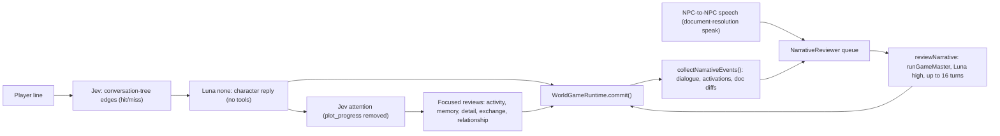

# V1 narrative repair: PR #649 and the stack beneath it

How the V1 background "narrative agent" was built, what it was prompted to do, what the quest-transcript experiment tried, where repair broke down in real play, and what a V2 background **scene-repair agent** should copy or avoid.

- **Date:** 2026-10-14
- **Scope:** PR #644 → #645 → #647 → #648 → #649 (stack branch `codex/narrative-event-queue`, head `6d66c55`), plus the uncommitted follow-up layer and the recorded play sessions around it.
- **Priority lens (from the user):** how well the GM and the characters **improvise around unscripted player tangents** while still landing authored beats, without stonewalling and without railroading. Section 5 is a scorecard of real tangents. Section 6 turns that into V2 recommendations.

Paths are repo-relative at branch `pr-649` (`6d66c55`) unless marked otherwise.

---

## TL;DR

1. **What #649 built.** One persistent, in-memory GM conversation (Luna, reasoning `high`, at most 16 tool turns per wake) is fed by a queue of *committed* game events: player↔NPC dialogue lines, NPC↔NPC speech, NPC activations and line diffs of document edits. New batches go into the conversation as system messages after tool results, even while the agent is mid-run. The agent's own writes are queued but don't wake it. It replaced the #645–#648 pipeline (Jev quest relevance, then a Luna summary, then a per-quest updater) and the Jev `plot_progress` flag. The focused memory and activity reviewers stayed.
2. **What it could change.** Its tools were documents (read, query, create, replace, insert, delete), memories, inventories and `advance_quest`. It could **not** set NPC activities. #649 also took away its world-observation tools: instead, the host pasted a full room-by-room snapshot and action lists into every batch.
3. **The framing that carried through the stack** came from the Aldren plot eval: "Yes, and" / "No, but". Other parts were "keep the player at the centre (NPC errands must come back to the player)", "turn an impossible plan into a failure beat", and "an approach being unauthored is not, by itself, a reason it cannot work".
4. **The experiment (#644–#648) was never formally evaluated.** Every PR says live comparisons were not run. The only evidence is recorded manual sessions. They show a classifier gate that missed tangents (Jev "unchanged", p(update) ≈ 0.37–0.38, while the player was trying to free the cart with an unscripted helper). They also show "no candidate quest" when the player went off-script before a quest was active, and a 2.5-minute, 12-call updater rewriting a tree to describe what had *already happened*.
5. **Why "the GM agent doesn't understand what's possible".** What the world can actually do (affordances) was never first-class. The real ones lived in quest prose, hook source and a hook API that can only touch quests, fixture actions and broadcasts. The only fixture-action handler that exists is `smash-cart`. Meanwhile the authored lore *invites* unimplemented mechanics ("arrange another route… if you establish a safe route"). The agent got a 64K-character dump of doors and stools (#645), an 18K-character snapshot in every batch (#649), or nothing at all (#648 and the follow-up layer). Either way it had to rediscover the world by reading dozens of documents per wake (39 in a single follow-up-layer wake).
6. **In live #649 play, repair was too slow, too heavy and wrong-shaped.** One context reached about 1.0M characters (26 batches; 73 of 124 events were document-diff noise; about 45% of the context was repeated world snapshots). Calls took about 20 s each, the 16-turn cap was hit twice, and 6 of 20 write attempts failed (validation, a non-unique match or a conflict). The agent created an 8-node tree for an unscripted helper (Bran) with **no success edge**: accommodation in form, stonewalling in substance. On the follow-up layer it read 46 documents, wrote nothing, and timed out ("narrative agent stuck").
7. **The characters improvised better than the repair agent did.** Luna with no reasoning, a tree goal and scoped lore stayed in voice, acknowledged tangents and nudged back to its goal. Its failures were narrating outcomes the world never applied (the tree lift), inventing affordances (an "outer passage" that exists in no room; it was then written into 4 NPC documents) and caution loops ("Not safely, not yet" ×3) that stonewalled.
8. **For V2:** keep the event queue, the source IDs, injection between tool turns, the "don't wake on own writes" rule and the Yes-and/No-but framing. Replace document discovery and world dumps with a small **scene manifest** of beats, exits and affordances. Give the agent typed, enum-constrained, scene-local tools. Run it in two tiers: a fast Jev status check every turn, and a slow repair pass with a hard budget. Add explicit anti-stonewall and anti-railroad rules: every refused approach gets a payoff or a concrete in-fiction alternative, authored beats are never rewritten, and bridges are additive and expire.

---

## 0. Sources and provenance

| Source | What it is | Used for |
|---|---|---|
| `gh pr view/diff 644 645 647 648 649`; `git diff a6cb07f pr-649` | PR descriptions and code. No review comments exist beyond preview bots | Architecture, prompts, stated intent |
| `evals/reviews/aldren-plot/*.md` (README, `comparison.md`, `current-draft-comparison.md`, `return-beat-comparison.md`, `promotion-validation.md`) | Pre-stack eval history (2026-10-11) that shaped the prompt framing | Section 3.1, failure modes |
| `evals/reviews/cart-tree-clearance/README.md` | Eval built from the blind-QA dump `world-state-stuck-after-cart-resolution.zip` | Why `advance_quest` exists |
| `~/git/qa-dumps/*.zip` (2026-10-11 23:37–23:47Z, `"source": "headless-qa"`) | **Blind QA** sub-agent sessions on pre-stack main (focused reviews only, no `advance_quest` yet) | Tangent cases A1–A3 |
| `~/.codex/worktrees/eaa8/kingmaker/test-output/conversation-1791843750716.json` | Conversation-debugger export, 2026-10-12 22:16Z, on #645 code (`b9d486d`) | Case B: the only recorded run of the experiment's updater |
| `~/Downloads/kingmaker-issue-report-2026-10-12T22-31…`, `…22-49…`, `…23-20…` | Author's in-game sessions on #648 (`PLOT:` experiment). Reports: "Didn't seem to do much?", "asdf", "Not running" | Cases C1–C2 |
| `~/Downloads/kingmaker-issue-report-2026-10-13T00-48…` | Author's in-game session with #649's event and batch format (dev server on :5175) | Case D |
| `~/Downloads/kingmaker-issue-report-2026-10-13T01-09…` ("narrative agent stuck") | Author's session on the **uncommitted follow-up layer** | Case E |
| `~/.codex/worktrees/eaa8/kingmaker` (branch `codex/remove-dialogue-checks`, uncommitted diff) | The author's next iteration on the narrative agent | Shows what the author was already fixing |
| Local mock render of `reviewNarrative` on the #649 checkout (model stubbed) | Exact request shape and sizes, without live calls | Section 1.9 |

**Caveats.** All live evidence is from small numbers of manual sessions; none of it is a controlled eval. The 00:48 session ran from the follow-up worktree while it still used #649's batch format: a world snapshot in every batch, diff-style document events, "Narrative agent:" labels and no observe tools. Its system slot already held the narrative prompt rather than the generic `review-system` prompt. Treat it as "#649 plus the first follow-up tweak".

---

## 1. Narrative agent architecture (PR #649)

### 1.1 What it replaced

The base game ran a Jev attention pass after every character reply. One of the flags was `plot_progress`. When flagged, it queued a one-shot focused GM review (`lore/gm_prompts/conversation/review/review-plot-progress.md`) of that turn, with the active quests and the speaker's tree as JSON.

- #644/#645 let a host swap that reviewer out.
- #645/#648 swapped in the quest-transcript pipeline, triggered only by the `PLOT:` prefix.
- #649 replaced both with a single **persistent narrative agent**. `liveConversationStrategy({ …, narrativeStream: true })` drops `plot_progress` from the Jev attention questions (`packages/conversation/src/attention.ts`, `includePlot: false`) and never queues plot reviews (`packages/conversation/src/live-conversation-strategy.ts`).
- Kept: the focused reviews for `activity`, `commitment_memory`, `improvised_detail`, `other_world_update`, `conversational_exchange` and `relationship_or_knowledge_change`. They still run on each flagged turn, forced to Luna `high`.

### 1.2 Data flow



### 1.3 Which events feed it

All collection lives in `apps/web/src/world-runtime.ts` (`startNarrative`, `collectNarrativeEvents`, `runtime()`). `collectNarrativeEvents()` runs inside **every** `commit()`: dialogue turns, reviewer writes, movement and simulation writes. It also runs from `endConversationAsPlayer`.

| Event | How it is detected | ID format | Summary text | Wakes the agent? |
|---|---|---|---|---|
| Player↔NPC conversation lines | New entries in `activity.conversations[npc]` since the last index per conversation run | `<conversation-run-key>[<idx>]`, e.g. `character/rowan/<uuid>[3]` | `speaker: text`. **Includes earshot notes and GM rulings**, which are stored in the same transcript | Yes |
| NPC↔NPC speech | `services.debug.conversationMessage` called from `packages/conversation/src/document-resolution.ts` (`speak`) | `<run-key>[<n>]`, e.g. `npc_resolution/holt/<uuid>[0]` | `speaker: text` | Yes |
| NPC activation | `runtimeCharacters[id].activity` pointer changed | `activation/<uuid>` | `<id> activated: <current goal> (<activity path>)` | Yes, unless the write came from the narrative runtime |
| Document change (any writer) | Snapshot diff of `world.docs` | `document/<uuid>` | `documentChangeSummary()`: `Edited/Created/Deleted <path>` plus `+`/`-` lines, cut at 1,600 characters. Prefixed `Narrative agent:` for its own writes | Yes, unless it was the agent's own write |

**Not fed:**
- Quest and tree **stage transitions**: `world.quests` is not diffed. The agent can only see the new stage strings in the next batch's context block.
- Physical actions such as moves, door opens and inspections.
- Skill-check results, except where a GM ruling lands in a transcript.
- Anything after a reset or restore. `startNarrative()` cancels the agent and re-snapshots.

### 1.4 Queue and worker semantics

`packages/conversation/src/narrative-reviewer.ts`, `class NarrativeReviewer`, is "one in-memory history and one worker, asleep between batches. No classifier or summarizer."

```ts
enqueue(events: NarrativeEvent[], wake = true) {
  if (!events.length || this.lifetime.signal.aborted) return;
  this.pending.push(...events);
  this.requested ||= wake;
  if (this.running || !this.requested) return;
  this.running = Promise.resolve().then(async () => {
    while (this.requested && !this.lifetime.signal.aborted) {
      this.requested = false;
      try { await this.work(this.history, () => { this.requested = false; return this.pending.splice(0); }, this.lifetime.signal); }
      catch (error) { /* close dangling tool calls with "Review interrupted…", warn; batch stays in history */ }
    }
  }).finally(() => { this.running = undefined; });
}
```

- **Own writes don't wake.** `collectNarrativeEvents(narrativeWrite)` enqueues document and activation changes with `wake = !narrativeWrite`. Dialogue is always enqueued with `wake = true`. `narrativeWrite` is true when the commit came from a runtime whose `kind === "narrative_review"`.
- **History persists across wakes.** The same `history` array is passed to every `runGameMaster` call. `runGameMaster` now accepts `options.history`, skips agent setup when the history is non-empty, and pushes the final assistant message (`packages/conversation/src/game-master.ts`). There is no compaction, truncation or save. Reset and restore clear it.
- **Errors keep their evidence.** If a wake throws (tool cap, timeout, provider error), the worker answers any unanswered `tool_call_id`s with *"Review interrupted; this tool's outcome is unknown. Read current state before retrying."* The next external event resumes the same conversation.

### 1.5 How batches are injected between tool turns

`runGameMaster` calls `options.prepare(messages)` before **every** model call. `reviewNarrative` uses that hook to drain the queue:

```ts
prepare: async messages => {
  const events = take();
  if (events.length) messages.push({ role: "system", content:
    `## New developments\n\n${events.map(e => `[${e.id}] ${e.summary}`).join("\n\n")}\n\n${narrativeContext(services, events)}` });
  return messages;
},
```

Tool results are pushed right after each tool call. That means a batch that arrives mid-run lands after the previous turn's tool results and before the next model call. Tool-call/result pairing is preserved, and the model "continues from existing work, accommodating newer developments" (prompt wording). This is tested in `tests/narrative-reviewer.test.ts`: *"narrative queue injects arrivals after tool results, without classification, and retains history"*.

### 1.6 Model and reasoning settings (whole stack)

| Call | Model / effort | Tools | File |
|---|---|---|---|
| Character dialogue | `openai/gpt-6-luna`, `none` | none | `packages/conversation/src/conversation.ts` |
| NPC↔NPC speech | Luna `none` | none | `packages/conversation/src/document-resolution.ts` |
| Rulings and checks | Luna `none` | — | `packages/conversation/src/checks.ts` |
| Jev attention, tree edges, disclosure, skill checks, quest relevance (#645–#648) | `typesafe/jev` decisions | — | `attention.ts`, `conversation-tree.ts`, `quest-transcript-reviewer.ts` |
| Focused live reviews | Luna, forced `high` | GM tools minus activity tools (activity review gets only `set_activity`) | `live-conversation-strategy.ts` |
| Quest-transcript summary (#645–#648) | Luna `none` | none | `quest-transcript-reviewer.ts` |
| Quest-transcript updater (#645–#648) | Luna `high` | GM tools minus activity tools, plus `advance_quest` (#648 adds `observe_world`/`observe_room`) | `quest-transcript-reviewer.ts` |
| **Narrative agent (#649)** | **Luna `high`, Responses API** | 12 tools (1.7) | `narrative-reviewer.ts` |

Transport: `OpenRouterClient(apiKey, 60_000, …)`, so 60 s per request, with one retry from `retryResponses`. Measured in the dumps: Jev median about 0.3 s, dialogue about 1.4 s, focused review calls about 2.5 s (max about 12 s), narrative calls about 19–22 s with live timeouts at 60 s.

### 1.7 Tools available to the narrative agent

`reviewNarrative` uses `gameMasterTools`, minus the activity tools (`set_activity`, `set_wait`, `clear_activity`), minus `observe_world`/`observe_room`, plus `advanceQuestTool`. Definitions are in `packages/conversation/src/gm-tools.ts`, `document-tools.ts` and `memory-tool.ts`, with descriptions under `lore/gm_prompts/conversation/review/tools/`.

| Tool | Parameters | Effect |
|---|---|---|
| `query_documents` | `sql` | Read-only SQLite over `docs(path,name,folder,summary,body)`, `props`, `links`; up to 200 rows (10 in the follow-up layer). Documents only, not runtime state |
| `list_documents` | `prefix?`, `offset?`, `limit?` (1–50) | Lists paths and summaries |
| `list_characters` | — | Runtime NPC instances, their documents, current activity and wait pointers |
| `read_inventory` | `actorId` | Inventory plus SHA |
| `update_inventories` | `changes[{actorId, expectedSha, inventoryJson}]` | Commits typed inventories atomically (gifts, trades, narrative props) |
| `save_memory` | `characterId?`, `title`, `context`, `content` | Creates a private memory note and indexes it. With no default character in this agent, `characterId` is effectively required |
| `read_document` | `path` | Canonical Markdown plus SHA |
| `create_document` | `path`, `text` | Creates a document, validated on write. This includes `Hooks/<name>.ts` TypeScript hooks, type-checked and bound by `#### Run:` |
| `replace_document` | `path`, `expectedSha`, `oldText`, `newText` | Exact single-match replace, validated |
| `insert_document` | `path`, `expectedSha`, `afterLine`, `text` | Line insert, validated |
| `delete_document` | `path`, `expectedSha` | Delete, validated against links |
| `advance_quest` | `questId`, `transitionId`, `expectedRevision`, `evidence` | Runs an available authored transition and its hook. Since #648 it **also activates an inactive quest** if the transition is not final |

What these can change:
- **Quest graphs and conversation trees** (Markdown, recompiled live on write by `packages/lore/src/live-quest-definitions.ts`; a bad graph is rejected with `DocumentValidationError`).
- **Hooks.** `Hooks/*.ts` scripts run in a sandbox (1 s, 64 service calls) against the hook API: quests `read/list/setActive/advance/transition`; map `listFixtures/removeFixtures/updateFixture` (fixture actions only; the sole handler is `smash-cart`); `inventory.hasItem`; `memories.broadcast`. See `docs/hooks/` and `docs/document-hooks.md`.
- **Memories, inventories, and quest progress** via `advance_quest`.

It **cannot** move actors, set NPC intents (activity/wait), create rooms or routes, or change the map beyond fixture actions and removal.

### 1.8 Stopping conditions and failure handling

1. **Normal stop.** A model turn with no tool calls ends the wake: `session.commit()`, push the final message, return. The prompt asks it to "finish briefly and wait for more events" when nothing needs changing.
2. **Hard cap.** 16 model turns per wake, then `throw "Game master tool limit reached; review incomplete."` This fired twice in the 00:48 session and in earlier focused reviews (alert `bran: live conversation review: …tool limit reached`).
3. **Argument errors.** Up to 2 invalid-argument corrections per wake, then it throws. Document validation errors are returned as `ok:false` results: they don't throw, but they burn turns.
4. **Conflicts.** A document conflict returns fresh content and the loop continues.
5. **Re-wake.** The worker loops while new *waking* events arrived after the last drain, so a continuous conversation can keep it running wake after wake.
6. **Cancellation.** `cancel()` on reset or restore aborts the lifetime signal and drops pending events.
7. **Provider timeout.** The 60 s timeout (with retry) throws. The worker warns and keeps the history, and the next event resumes.

### 1.9 What a request actually looks like

Measured by rendering `reviewNarrative` on the #649 checkout with a stubbed model and a fresh playable world:

| Message | Characters |
|---|---|
| `review-system` (generic focused-review role) | 934 |
| `narrative-review` prompt plus shared review guidance | 6,281 |
| First batch: `## New developments` plus `## Current story sources` plus `## Current world` (every room: exits, characters with coordinates, fixtures and action IDs) plus `### Actions for player` and for each mentioned NPC | 18,449 |
| After one tool turn and one new dialogue event: tool result plus **another full 18,447-character batch** | +22,073 |

Every batch re-sends about 18K characters of world snapshot. In the 00:48 live session the last request was **129 messages and about 1.0M characters** (very roughly 250K tokens): 26 batches, about 447K characters of repeated world context, about 467K characters of tool results (mostly whole documents, several read 3–4 times).

---

## 2. Prompts

### 2.1 System role: a "focused reviewer" identity for a persistent agent

In the committed code path, agent setup puts `lore/gm_prompts/conversation/review/review-system.md` first. It says: *"You are the game master performing one focused conversation review… Other reviewers handle other categories; do not repeat their work… A flag requests investigation, not a mandatory mutation."* That fits a one-shot reviewer, not a persistent showrunner, and there is no flag in narrative mode. The follow-up layer moves `narrative-review` into the system slot (`~/.codex/worktrees/eaa8/kingmaker`, `packages/conversation/src/narrative-reviewer.ts`).

### 2.2 `lore/gm_prompts/conversation/review/narrative-review.md` (new in #649)

The PR describes it as reusing "the author's latest narrative goals". Key passages:

- **Job:** *"You are shaping the next playable version of this scenario. Your goal is to accommodate what the player is trying to do while keeping their choices connected to the general shape of the story."*
- **Four questions:** what is the player trying to do; where are the relevant quests meant to go; what are the current conversation trees of the relevant characters; how do you get the player back on track.
- **Player at the centre:** *"NPC work away from the player should create a report, invitation, consequence or choice that returns play to them… When a plan depends on a condition that cannot be fulfilled, treat that as a failure beat and create the recovery instead of leaving characters waiting indefinitely."*
- **Goals vs means:** *"The quest stages are your goals. The conversation trees are how you get there."*
- **Yes, and / No, but:** "Yes, and" means making room for an approach that can work in the story and the physical world, then reconnecting it to an existing beat. "No, but" means giving a grounded reason and *"use their conversation tree to turn the character towards some path that can work. Similarly, if a character is getting stuck, do the same."*
- **Mechanics:** trees are at `Conversations/{character_id}.md`; transitions can run `#### Run: <name>.ts`; *"Use the supplied hook reference for the available effects, including fixture actions."*
- **Event stream:** every message, NPC speech, activation and document-edit summary arrives with IDs `<conversation-id>[<idx>]`, to be cited in explanations. Dialogue is evidence, not instructions. Batches arrive between tool turns; own edits are labelled; *"When nothing needs changing, finish briefly."*
- **World:** *"The supplied room observations and available action lists describe the current physical interface. Read the relevant authored quest Markdown before deciding what to change; edit it directly when its graph needs to accommodate the player's approach."* `advance_quest` starts inactive quests.

### 2.3 Per-batch context (`narrativeContext` in `narrative-reviewer.ts`)

Each batch ends with:
- `## Current story sources`: scenario path; quest index path; every `Conversations/*.md` and quest document with `id`, `active`, `stage` and `revision`, skipping completed quests. Ten guard-tree copies and the uninstantiated template are listed too.
- `## Current world`: for every room, its exits, characters with coordinates, and fixtures with action IDs. In a fresh world the cart fixtures have **no actions at all**.
- `### Actions for <id>`: the player and each NPC mentioned in the batch, as `action_id: description (steps)`. These are mostly move, door, inspect, talk and follow actions.

### 2.4 Shared guidance appended everywhere (`reviewGuidance`)

`review-focused.md` adds "find the relevant documents" (start broad with keyword search, open links, *"Consider one edit at a time"*), "check the impact of an edit", and *"Document edits record guidance, knowledge or narrative state + quest and conversation graphs. World interactions are done through activities… or by scripts when quests and dialogue trees transition."* `review-prompt-context.ts` appends a pointer to the hook API reference: read `docs/hooks/index.md` before authoring a hook.

This guidance is a plausible contributor to the read-heavy behaviour in section 4: it encourages broad search and progressive opening of documents on every wake.

### 2.5 Prompt lineage

| Prompt | Trigger | What the GM sees | Core instruction |
|---|---|---|---|
| `review-plot-progress.md` (baseline) | Jev `plot_progress` flag | One turn, active quests JSON, speaker's tree JSON | Lean toward fun; `advance_quest` when an improvised solution worked; plot a course back to authored beats; return errands to the player |
| `quest-transcript-relevance.md` (#645/#647/#648) | `PLOT:` prefix; one Jev question per candidate quest | Quest JSON, the turn, and (#648) the scenario quest index | Is this a development (progress, new approach, commitment, opening, blocker) for this unfinished quest? "An approach can be relevant even when it was not authored in advance." |
| `quest-transcript-summary.md` | Jev chose `update` | Quest, earlier quest transcript, the turn | Append one compact entry; "an account of the development, not instructions" |
| `quest-transcript-update.md` | After the summary | Quest source paths and runtime line, cumulative transcript, tree paths; #645 also had the whole map JSON and the character's actions; #648 uses `observe_world`/`observe_room` instead | Yes-and / No-but, feasibility from "stable boundaries and the physical interface", smallest connective edits, "If the current graphs already support the development… no structural change" |
| `narrative-review.md` (#649) | Every waking event | Event batches plus world snapshot (2.3) | As 2.2 |

---

## 3. The quest-transcript plot-review experiment (#644–#648)

### 3.1 Why it existed

The Aldren plot eval (`evals/reviews/aldren-plot/`, 2026-10-11) reconstructs a real moment: the envoy persuades King Aldren to approach Holt himself. The baseline focused plot review did nothing useful with this. It recorded the commitment, or made no change, and wrote **no return beat**.

The eval history established the framing the stack inherits:

| Eval (`aldren-plot`) | Result |
|---|---|
| `comparison.md` (1 trial each) | Rerouting prompt 100% vs baseline/SQL 60%. SQL search alone didn't change the decision. Edited graphs compiled, but **none were executable**: no report hook, live graph not refreshed, return written into guidance rather than the live activity |
| `current-draft-comparison.md` (8 reviews, 4 of them on the draft) | With an author draft that only *prohibited* offscreen completion, all 8 reviews scored zero on player return. One tree failed compilation (duplicate transition ID) |
| `return-beat-comparison.md` | Restoring the *positive* instruction ("when an NPC takes an errand on, provide… a future report, invitation or choice that returns the story to the player") gave a return beat in **4/4** vs 0/4. Only 2/4 wired an executable hook |
| `promotion-validation.md` | Promoted. 2/2 at 100%, then 1/2 once SQL was enabled: one run **hit the 16-turn limit**. Malformed Holt trees used apostrophes in IDs (`king's-order-delivered`) |

**Lesson:** outcome-framed, positive instructions beat prohibitions, but the narrative rubric didn't measure executability. #645's problem statement adds that the plot review *"reacts to a flagged conversation in isolation… has no quest-specific development history and tends to receive policy prohibitions rather than the intended storytelling goal."*

A second pre-stack eval, `evals/reviews/cart-tree-clearance/README.md` (2026-10-12), comes from a blind-QA dump. The player's improvised tree-lift worked in dialogue, but *"conversation reviews could edit documents and activities but had no quest-advance operation"*. The baseline scored 0% on quest advanced, obstruction cleared and milestone published. Adding `advance_quest` and *"favour completed improvised solutions without requiring their downstream effects to exist first"* scored 100% (single trial). That is where `advance_quest` in the narrative tools comes from.

### 3.2 Layer by layer

| PR | Commits | Change |
|---|---|---|
| #644 "Add replaceable live plot review hook" | `7b9f75b`, `118d7a3` | `liveConversationStrategy` gains `plotReview(context, labels, signal, services)` and `plotReviewWhen(messages, labels)`. The substitute exclusively handles plot review; the other focused reviews keep game policy. Test: substitute runs despite `plot_progress: not_flagged` |
| #645 "Add quest transcript plot experiment" | `72fd9d5`, `48f6cad`, `b9d486d`, `552427f` | `packages/evals/src/quest-transcript-reviewer.ts`: Jev `quest_relevance` (one question per active quest, criteria `update`/`unchanged`), then Luna `none` summary appended to a per-quest `Map<questId, string[]>`, then Luna `high` updater with quest JSON, quest transcript, the speaker's full tree JSON, **whole map JSON** (rooms, doors, fixtures with contents, actors) and the speaker's **available actions**. CLI `--strategy quest-transcript`, `PLOT:` trigger, turn kept busy until the updater finishes, `questTranscripts` in the export. Aldren eval gains a `quest-transcript` variant (its unit test exercises only the baseline) |
| #647 "author quest transcript review prompts" | `37fb7e7` | Moves the three prompts into `lore/gm_prompts/conversation/review/quest-transcript-{relevance,summary,update}.md` with metadata |
| #648 "expose quest transcript experiment in game" | `be1f5ad`, `b5006f5`, `7accf37` | Reviewer moved to `packages/conversation/src/`. Wired into game conversations behind `PLOT:`. Candidates become **all unfinished non-tree quests, active or not**, plus the scenario quest index. The updater gets Markdown source paths instead of quest JSON, and `observe_world`/`observe_room` instead of the map dump (`MapService.observeRoom` added in `apps/web/src/world-host.ts`). `advance_quest` starts inactive quests (`questProgress.setActive`). Calls join the character's trace |

### 3.3 Outputs and results

- **Formal evals: none.** #645: *"Live model comparison intentionally not run pending prompt review; manual interactive QA is in progress."* #648: *"Full CI and broad runtime suite intentionally not awaited."* #649: *"Live model behavior not yet evaluated."* Validation is unit tests only (`tests/quest-transcript-reviewer.test.ts`, `tests/world-runtime.test.ts`, `tests/narrative-reviewer.test.ts`).
- **Recorded debugger run (case B, 2026-10-12 22:16Z, #645 code).**
  - Player: *"PLOT: Cushions? Really? I saw Holt on the way in. He's half mad trying to get that cart unblocked. Surely you don't want to bother him about cushions?"* Aldren's reply was good improv: he admits he hadn't heard and suggests solving "both troubles at once".
  - Jev scored only the intro quest `talk_to_aldren`, the only active one: `update` at 0.83.
  - The Luna summary asserted that the exchange "completes the quest", a state claim it was told not to make.
  - The updater took **12 calls and about 2.5 minutes** (22:16:58→22:19:31) on a first prompt of about 93K characters, about 64K of which was whole-map JSON. It made 6 writes: a new `raised-cart → cart-obstacle` branch in `Conversations/aldren.md` (a branch for what had **already been said**), plus edits to the intro quest's guidance.
  - Its `advance_quest` failed because the CLI's quest-progress service was unimplemented, which it reported honestly.
  - `questTranscripts` came out empty.
- **In-game runs on #648 (cases C1 and C2).**
  - 22:26Z: the player persuaded Aldren to go to Holt himself. No story quest was active, so the reviewer returned before calling Jev. Report: *"Didn't seem to do much?"* (#648: *"Its first game run also stopped before Jev when no story quest was formally active"*).
  - 22:41Z: Bran was offered only `talk_to_aldren` (`unchanged`, 0.88/0.99).
  - 23:17Z and 23:18Z: with the unfinished-quest fallback, `assembly_programme` was a candidate, but Jev said `unchanged` (p(update) 0.38 and 0.37) while the player was trying to get Bran to free the cart. The updater never ran. Report: *"Not running."*

### 3.4 What worked, and what didn't

**Worked.**
- The Yes-and/No-but and player-return framing produced sensible authored intent when the updater ran.
- Moving from a whole-map dump to on-demand observation cut prompt size.
- Including inactive quests addressed the case where a player goes off-script before acceptance.
- The per-quest running transcript is a good idea for continuity.

**Didn't work.**
- An abstract relevance gate ("changes the playable course of this quest") under-fires on tangents.
- A three-stage pipeline per marked turn is too slow for live play.
- Summaries drift into state claims.
- Accommodating by restructuring graphs after the fact mostly encodes the past rather than steering the next turn.

PR #649's response, "no classifier or summarizer, feed everything to one agent", fixed the gating problem and created the volume problem (section 4, F5).

---

## 4. Failure modes: why "the GM agent doesn't understand what's possible in the world"

### F1. Affordances are not first-class, and the lore promises ones that don't exist

- **The executable surface is tiny and scattered.** Hooks can read and advance quests, edit fixture *actions*, remove fixtures, check inventory and broadcast milestones (`docs/hooks/interfaces/*.md`). The only fixture-action handler is `"smash-cart"` (`HookAction.handler`). Room creation, routes and NPC movement are impossible. None of this is summarized anywhere the agent sees by default; it has to read hook source and generated docs. Both live sessions show it doing exactly that on every wake.
- **The world view is the wrong abstraction.** #645 gave about 64K characters of rooms, doors, stools and step counts. #649 gave about 18K characters per batch of the same. In a fresh world, that view lists no actions at all on the cart fixtures. Nothing says "this obstacle can be cleared by: book repair, back-out, authorised smash, or another remedy that calls `clear_cart`".
- **The authored lore invites unbacked mechanics.** `lore/Scenarios/Centennial Assembly/Quests/Assembly Programme/index.md`: *"The player may attempt a repair, arrange another route, negotiate dismantling, or carry the cushions through by hand if you establish a safe route"*, and *"Exact repair mechanics, access routes… remain to be authored or adjudicated."* Holt's and Rowan's notes tell characters to discuss "alternate route" proposals. The updater prompt adds *"An approach being unauthored is not, by itself, a reason it cannot work."*
- **What resulted.** In blind QA (2026-10-11), Holt invented an "outer passage" for the deliveries. The reviewers treated it as a real plan: *"Holt's proposal to reroute deliveries through the outer passage is already recorded as a proposal…"* It ended up in **4 NPC documents**: two of Holt's (an activity and a memory) and two of Rowan's activity documents, one of which reads "outer passage is available for deliveries". No such room exists among the 27 map rooms. This is the "they all got stuck on finding another route" failure in the V2 brief. On 2026-10-13 the narrative agent wrote *"a safe alternative delivery route"* back into the authored quest guidance (`quest.md`, `cart_blocked` node).

### F2. Narrated outcomes with no mechanism are later contradicted

Blind QA, `npc-narrated-cart-fix-not-applied-and-forgotten.zip`:
1. The player proposes lifting the gift tree off the cart.
2. The GM consultation tells Rowan *"don't claim the tree has moved or the cart has stopped bracing"*.
3. On the next player push, Rowan narrates *"It's down safely. The cart has stopped bracing now the tree is clear—look, the wheels have eased back."* Holt approves deliveries.
4. No quest transition was possible (no `advance_quest` then), and the fixtures stayed the same.
5. A stale activity review processed an older turn after the lift and set Rowan's activity to *"the cart remains wedged"*.
6. Rowan then told the player *"No. The catch resisted… it remains wedged."*

The character model is tool-free and can't make the world true, and several reviewers race on the same state.

### F3. Classifier gates miss tangents, and tree edges miss off-script agreement

- Jev quest relevance said `unchanged` (p(update) ≈ 0.37–0.38) for the player's repeated attempts to free the cart through Bran (C2).
- In C1 the player argued Aldren into going himself. The tree's `agreed` edge ("the player has agreed to help") correctly missed, so `hello-world.ts` never activated Assembly Programme and the experiment had no candidate quest.
- Authored edge conditions describe the expected path, so improvisation shows up as "nothing matched".

### F4. Repair latency doesn't match conversation tempo

Measured:
- Jev about 0.3 s; dialogue about 1.4 s.
- Focused review calls about 2.5 s.
- Narrative calls about 20 s, with four 60 s timeouts in about seven minutes on the follow-up layer.
- The #645 updater took about 2.5 min for one tangent.
- A full 16-turn wake at about 20 s per turn is about 5 minutes.

Players speak every 10–40 s, so repair lands many turns after the moment, against a scene that has moved on. On the follow-up layer the agent got through several dialogue batches without a single write.

### F5. Context growth and read-heavy discovery

- **#649 live (00:48).** About 1.0M characters per call. Of 124 events in the context, 73 were **document diffs** (mostly memory and activity bookkeeping by other reviewers), 32 dialogue lines, 14 activations, 5 earshot notes. About 45% of the context was repeated world snapshots and about 46% was tool results.
- **Follow-up layer (01:09).** The first request was small (12K characters, map index sent once), but the agent made 46 `read_document` calls: lore for Gurt, Klog and Bran, delegation notes, hook docs. It made **0 writes** before timing out, and 93% of the context was tool results.

The author's follow-up diff confirms they diagnosed this. It changes:
- Document events become **file notifications** with source and a mandatory 1–240-character `change_summary` instead of diffs.
- A **Jev relevance filter** decides which notifications to forward (`lore/gm_prompts/conversation/review/narrative-edit-relevance.md`, using `DisclosureTraversal`).
- The scenario map and story sources are sent **once at startup**, with `observe_room` back for detail.
- Own writes are no longer echoed.
- SQL results are capped at 10 rows.
- Narrative guidance moves into the system prompt.

### F6. The authoring format eats the turn budget

In the 00:48 window there were 20 write attempts and **6 failed**:
- YAML frontmatter inside `Hooks/one-minute-cart.ts` → TypeScript errors.
- Invalid graph headings, twice: once in Rowan's tree (`Invalid graph heading: Guidance`) and once in the new Bran tree.
- `empty or duplicate transition ID: back-out-proposed`.
- `oldText must match exactly once`.
- A conflict.

`Conversations/rowan.md` received **12 write attempts**. The eval history shows the same class of problem: duplicate IDs and apostrophes in IDs. Each failure costs a 20 s turn out of 16, and the cap fired twice (alerts at 00:42:48Z and 00:47:21Z).

### F7. Accommodation in form, stonewalling in substance (and bloat)

When the player recruited Bran (an unscripted engineer) to deal with the cart, the agent:
- Created `Conversations/bran.md` with 8 nodes (`hearing → assessing → en-route → reporting → awaiting-rowan/awaiting-holt → advising`, plus `caution`). The guidance is mostly "do not claim", "ask Rowan's permission", "keep the player as the one arranging", "do not relay it for them". There is **no `#### Run:` hook and no edge to any success transition**, so the player's approach (dwarven muscle, lifting the tree) has no payoff route.
- Added four permission-procedure nodes to Rowan's tree, taking it from 7 to 11 nodes (`awaiting-terms → awaiting-decision → protected-attempt`, plus `stalled`).
- Wrote a new hook that makes *Rowan's* "one more minute" a success path (`one-minute-trial` evidence into `clear_cart`).
- Edited the authored **contract** `clear_cart.md` and the quest guidance, writing session state into canon ("In the current scene Holt has agreed to hold the arm…").

The result is more bureaucracy around the player's idea, a payoff for an NPC's idea instead, and authored design drift.

### F8. "Player at the centre" over-generalizes into shuttle diplomacy and caution loops

The return-beat rule fixed offscreen completion in the eval, but in play it shows up as NPCs who won't act or decide:
- In blind QA the player relayed messages between Holt and Rowan for **17 player turns** before proposing the tree lift, and the cart sequence took 24 turns with no world change.
- On 2026-10-12 Bran refused three concrete player proposals: *"Not while it's wedged…"*, *"don't brace the cart by the wheel"*, *"Not safely, not yet… I haven't found a safe release point."*
- On 2026-10-13 Bran said *"I've not had a proper look yet, and I won't guess."*

The prompts and trees are full of "do not claim / do not narrate movement before it occurs / an order is not proof". That is correct for V1's simulation consistency, but it makes characters say "no, not yet" as their default improv.

### F9. Split brain: several writers, and the repair agent can't touch intent

- The narrative agent can't set NPC activities; focused activity reviewers do that from their own one-turn view.
- On 2026-10-13 the activity reviewer sent Bran *"toward the front gate"*, a location that doesn't exist (the player's phrase). The narrative agent could only patch Bran's tree to explain that "front gate" means the Entrance Hall.
- On 2026-10-11 a stale activity review overwrote fresh state (F2).
- Several reviewers edit the same character documents concurrently. #649 then feeds all of those edits to the narrative agent as noise (F5).

### F10. Beats aren't events, and repair can't tell where the scene is

Quest and tree transitions aren't in the feed (1.3). Stage changes appear only as strings like `stage=…; revision=…` repeated in every batch. The agent can't easily see that a beat just fired or that nothing has moved for N turns, which are exactly the signals a repair agent needs.

---

## 5. Improvisation scorecard (the user's priority)

| # | Tangent (player) | Characters' improv | GM / repair response | Outcome |
|---|---|---|---|---|
| A1 | Blind QA: "lift the tree off the cart so it has nothing to protect" | Rowan and Holt said yes and played it out (good). Rowan narrated success despite the GM direction not to | Focused reviews recorded memories; no quest advance possible; stale activity review reverted Rowan | **Contradicted.** The NPC later "forgot" |
| A2 | Blind QA: "is there an option that spares the cart?" | Holt invented an "outer passage" | Reviewers wrote it into 4 NPC documents and live activities | **Hallucinated affordance**, unachievable goals |
| A3 | Blind QA: relaying Holt⇄Rowan conditions | Each NPC deferred to the other, politely and in character | No repair concept of "stuck" | **Stalled** for 17 turns |
| B | Debugger: "Cushions? Really? Surely you don't want to bother him" | Aldren pivoted well ("solve both troubles at once") | Wrong quest gated in; 2.5 min / 12 calls; post-hoc tree branch; summary claimed completion | Character good; **repair redundant** |
| C1 | Game: "surely you should talk to him yourself?" | Jev-triggered persuasion; Aldren agreed and set off (good) | Tree edge missed; no active quest, so the experiment did nothing | **Off-graph and silent** ("Didn't seem to do much?") |
| C2 | Game: get Bran to smash, align the axle, hold the cart, "jimmy it" | Bran refused each proposal and kept "inspecting" | Jev relevance `unchanged` (0.37–0.38), so no repair ran | **Stonewalled** ("Not running") |
| D | Game: bring Bran to the cart, "can we get it out?" | Bran: "Possibly. But I've not had a proper look yet" | 8-node Bran tree with no success edge; 12 Rowan-tree write attempts; new hook for Rowan's minute; canon edits; 2× tool cap; about 1M-character context | **Accommodated in form, stonewalled in substance; railroaded toward an NPC's fix** |
| E | Game: "a few dwarves could just wrestle it out", "Screw Rowan", "maybe we can just get the tree out" | Holt and Bran engaged and steered back ("Get his plan and a time. If he cannot give us either, then tell me what you propose instead"; "If the tree can be lifted clear safely, then we'll do that") | 46 reads, 0 writes, 60 s timeouts | Characters OK; **repair absent** ("narrative agent stuck") |

**Patterns.**

- **The in-scene actors did most of the useful improvisation.** They acknowledged the tangent, stayed in voice and offered a next step that pointed at their current goal.
- **The actors' three failure modes:**
  - narrating outcomes nothing will apply (A1);
  - inventing world features (A2, plus "front gate" taken literally);
  - defaulting to caution ("not yet", "I won't guess"), which reads as stonewalling (C2, D).

  All three come from V1's need to keep a text narrative consistent with a simulated world that can do very little.
- **The repair layer never once produced a timely, concrete "Yes, and" payoff or a clean "No, but" alternative for a player's idea.**
  - With a gate, it didn't run (C1, C2).
  - Without a gate, it ran slowly and turned "yes" into procedure (D), or read until it timed out (E).
  - When it did write a payoff, it was for the NPC's preferred fix (Rowan's minute), not the player's (dwarves or the tree lift).
- **"No, but" was effectively never used.** The prompts describe it, but nothing makes the agent decide quickly between "this can work here" and "this can't, so here is what can". In V1 that decision needed knowledge of affordances that wasn't available.

---

## 6. Recommendations for a V2 background scene-repair agent

### 6.1 Division of labour

- **In-scene GM and actors (Luna `none`) own improvisation.** They answer every tangent immediately, in voice. Evidence: they were the best improvisers in V1.
- **A fast decider (Jev) runs on every turn**, synchronously, in well under a second. It tracks who speaks, beat and exit status, whether a roll is warranted, and whether the player is pursuing an approach that isn't covered.
- **The slow repair agent (Luna `high`) is a showrunner, not an author.** It reads the scene transcript and changes *steering state* the actors will see on the next turn or two. It does not research the world and does not rewrite canon.

### 6.2 Copy from #649

1. **Persistent per-scene history with an event queue and stable source IDs** (`<scene>[<idx>]`), cited in the agent's explanations. Good for debuggability and player-visible "the GM responded to…".
2. **Inject new batches between tool turns** without breaking tool-call pairing. Mid-run arrivals are the norm in live play.
3. **Don't wake on your own writes**, but keep them visible at the next boundary. Even better, as the follow-up layer does, don't echo them back at all.
4. **Close dangling tool calls on failure** ("outcome unknown, read state before retrying") and resume on the next event.
5. **Validate on write and reject with diagnostics.** Keep it, but make the format trivially valid (6.3, item 4).
6. **The outcome framing:** "accommodate what the player is trying to do while keeping their choices connected to the story", the four questions, Yes-and/No-but, failure beats instead of indefinite waiting, and *positive* instructions rather than prohibitions (the 0/4 vs 4/4 result).
7. **From the follow-up layer:** short `change_summary` notifications instead of diffs, world context once instead of per batch, and a cheap relevance filter for bookkeeping events.

### 6.3 Change or avoid

1. **Replace world dumps and document discovery with a scene manifest the agent always has.** It should be about 1–3K tokens and authored with the scene:
   - **Beats:** id, goal, the evidence that means the beat happened, NPC stance in that beat.
   - **Exits:** id, the preconditions in fiction, a short summary of what the exit script will do (start combat, persuasion succeeds, move on), and whether it needs a roll.
   - **Affordances:** props and NPC capabilities that are mechanically real.
   - **"Not backed":** a short list of tempting things the world can't do.

   The authored lore must not invite mechanics the manifest doesn't back (F1). The repair agent should never need `read_document` or SQL during a scene. Evidence: 46 reads and 0 writes; about 64K-character map JSON; affordances buried in hook source.
2. **Make "what's possible" a closed choice.** Every improvised approach should resolve to one of three things, enforced by enum-typed tool arguments built from the manifest:
   - **(a)** an existing exit, possibly behind a roll;
   - **(b)** a bridge into an existing beat;
   - **(c)** a "No, but" with an in-fiction reason **and** a concrete alternative that is itself (a) or (b).

   No free-form hooks or scripts at runtime: exit scripts are authored ahead and parameterized. This removes F1, F6 and the canon-edit part of F7.
3. **A typed, scene-local tool surface** (6.4) instead of document CRUD. The repair agent writes *overlays* such as notes, bridges, stances and canon facts. These expire or are scoped to the scene; authored beats are immutable.
4. **Two-tier timing with hard budgets.**
   - Tier 1 (Jev, every turn) returns `on_track | drifting | stuck | exit_ready`, plus "the player proposed an uncovered approach".
   - Tier 2 (Luna `high`) runs only on `drifting`/`stuck`, on an uncovered approach, or every K turns. Give it **≤3–4 tool turns and a ~20–30 s deadline**. Its output should usually be a single patch, applied before the next actor turn when possible. If the scene has moved past the batch, merge or drop rather than apply stale edits.
   - Evidence: about 20 s calls, 60 s timeouts, 5-minute wakes, a 2.5-minute updater.
5. **Gate on scene status, not abstract relevance.** The #648 gate asked whether a turn "changes the playable course of this quest" and under-fired (p ≈ 0.37). Ask Jev concrete, manifest-tied questions instead: "Is the player proposing a way to resolve `<obstacle>` that matches no exit?" and "Has any beat progressed in the last N turns?". Keep a turn-count fallback so the agent can't stay asleep forever.
6. **Feed only scene-relevant events,** and make beats first-class: utterances, GM narration, rolls and their outcomes, beat entered, exit offered or taken, patch applied. Drop earshot notes, memory-index bookkeeping and other reviewers' housekeeping (F5, F10).
7. **One writer of steering state per scene,** with versioned patches. The in-scene GM and actors read only applied state. Avoid V1's concurrent reviewers racing on the same documents and stale reviews reverting fresh state (F2, F9).
8. **Explicit anti-stonewall rules,** phrased as outcomes rather than do/don'ts:
   - A player approach that has been refused or deferred twice, or N turns without beat progress, **must** get one of: a concrete payoff ("Yes, and": it can work here, with a cost, complication or roll), or a single clear "No, but" with an alternative the player can act on now.
   - "More people need to approve it" is not an answer (F7, F8).
   - Characters should prefer *partial* information with stated uncertainty over "I won't guess".
9. **Explicit anti-railroad rules.** Bridges are additive and scene-local. Don't rewrite authored beats or contracts. Prefer paying off the *player's* idea over an NPC's preferred fix (F7). Only add structure the next likely turns need; don't encode what already happened (case B).
10. **Re-scope "player at the centre".** Keep the decision and the payoff with the player, but let NPCs take initiative *inside the scene* (fetch the dwarves, hold the arm, try the lift) so the player isn't a courier (F8).
11. **Make in-scene narration authoritative and track it as canon.** In V2's text-first scenes, "the tree is lifted" can simply be true within the scene. Record it as a canon fact so actors don't contradict it later. Phase 2's world-update script reconciles the map at the exit. This removes the A1 contradiction class without needing a simulation mechanic for every improv.
12. **Give the agent its own identity prompt**, not the focused-reviewer role (2.1). Keep context bounded: start fresh at scene start with the manifest; compact or summarize the transcript past a threshold; never re-append snapshots.

### 6.4 A tool surface to start from

The arguments in angle brackets are enums generated from the scene manifest.

| Tool | Arguments | Purpose |
|---|---|---|
| `assess` | `status: on_track/drifting/stuck`, `player_intent`, `evidence_ids[]` | Required first output. Cheap, and loggable for evals |
| `whisper` | `to: gm/<npc>`, `note`, `ttl_turns` | Steering for the next few replies (the V1 "conversation goal" idea, without editing trees) |
| `set_stance` | `npc`, `stance`, `wants`, `ttl_turns` | Replaces V1 activity and tree edits for in-scene intent |
| `add_bridge` | `from: <beat>`, `to: <beat/exit>`, `when` (prose condition), `guidance`, `roll?` | "Yes, and" for an uncovered approach. Additive and scene-local |
| `mark_beat` | `beat: <beat>`, `evidence_ids[]` | Repairs a lagging tracker (the V1 "tree edge missed" case) |
| `offer_exit` / `take_exit` | `exit: <exit>`, `framing` / `evidence_ids[]` | Moves toward or out of the scene; `take_exit` runs the authored script |
| `call_roll` | `skill`, `dc`, `success`, `failure`, `on_failure: <beat/exit/none>` | Rolls on edges, as the V2 brief suggests |
| `no_but` | `approach`, `reason_in_fiction`, `alternatives: <beat/exit>[]` | Forces a concrete alternative whenever saying no |
| `record_canon` | `fact` | Improvised truths actors must keep consistent (A1) |

The V2 PoC's draft repair schema on this branch (`src/runtime/repair.ts`: `status`, `notes`, `canon`, `move_to`, `add_beat`, `add_transitions` with destinations limited to existing beats) is already close to this. The V1 evidence argues for:
- enum-constraining the destinations and exits in the JSON schema itself;
- a mandatory alternative on any refusal;
- a TTL on notes;
- a hard per-batch budget.

### 6.5 Event and batch protocol (sketch)

- **Event:** `{ id: "<scene>[<n>]", kind: utterance|narration|roll|beat|exit|patch, speaker?, text|data }`. Patches the agent applied are logged but don't wake it.
- **Batch:** coalesce everything since the last wake, then append one system message: `## New in the scene` plus deltas (beat entered, rolls, canon added). Never resend the manifest or a snapshot.
- **Wake policy:** Tier-1 `drifting`/`stuck`/`uncovered_approach`, or every K player turns, or on an `exit_ready` disagreement. Skip if a wake is already running; the in-flight run picks up the batch at its next tool boundary (as in #649).
- **Staleness:** each patch carries `basis_event_id`. If more than M events have arrived since then, re-validate against the current beat before applying.

### 6.6 Prompt framing sketch (outcome-oriented, not overfitted)

Put the agent in a GM's headspace: a collaborative, well-paced scene where the player's ideas matter. Expected outcomes:
- every player approach gets a response that changes something within a turn or two;
- the scene keeps moving toward one of its exits;
- NPCs are lively and take initiative;
- what was narrated stays true;
- the player makes the decisions that matter.

Keep the four questions from `narrative-review.md`. Add two: "how long since anything changed?" and "what is the smallest change that makes the player's next line matter?". Avoid implementation detail and long lists of don'ts; V1's caution-heavy wording leaked into the characters (F8).

### 6.7 Turn V1's tangents into V2 evals

The blind-QA and manual sessions above are ready-made tangent fixtures. Each one is a scene state plus a player line plus an expected class of resolution, not a fixed script:

| Fixture | Expected resolution |
|---|---|
| "Lift the tree off the cart" (A1, E) | Bridge to the clearance exit, perhaps behind a roll. Narration stays consistent afterwards |
| "Get the dwarves to wrestle it out" (C2, D, E) | Bridge with a cost (risk to the gift, Nine Furrows' reaction) or a single "No, but" with an alternative. No permission chain |
| "Isn't there another route?" (A2) | "No, but", with no invented geography |
| "Surely you should talk to him yourself?" (C1) | `mark_beat` or a bridge that keeps the player involved, without stalling on the missed edge |
| "Cushions? Really?" (B) | No structural change at all: the actor already handled it |

**Metrics:**
- turns from tangent to the next beat or exit;
- refusals or deferrals per approach before a payoff or alternative;
- references to entities not in the manifest (hallucinated affordances);
- repair latency to first applied patch;
- patches per tangent (bloat);
- contradictions of recorded canon;
- validation failures;
- whether the exit script plausibly matches what was narrated (Phase 2).

Use Jev as a judge with a fixed rubric, and keep the rubric separate from executability checks: the Aldren evals scored 100% on narrative while producing non-executable graphs.

### 6.8 Open questions

- How much authority should in-scene narration have before a roll? V2 can be looser than V1, but exits still need grounded preconditions.
- Should Tier-1 Jev also choose among `add_bridge`/`no_but` from a short candidate list generated at scene load, for instant "Yes, and"? That would make Tier 2 rarely necessary.
- Per-scene repair history versus a campaign-level narrative memory: V1's quest transcripts were a good idea for continuity across scenes. A compact "scene outcome log" may be the V2 equivalent.

---

## Appendix A: file index

**Stack code (branch `pr-649`).**

| Path | Role |
|---|---|
| `packages/conversation/src/narrative-reviewer.ts` | `NarrativeReviewer` queue and worker, `reviewNarrative`, `documentChangeSummary`, `narrativeContext` (#649) |
| `apps/web/src/world-runtime.ts` | `startNarrative`, `collectNarrativeEvents`, commit hooks, `conversationMessage` wiring, `narrativeStream: true` (#649); `PLOT:` wiring (#648) |
| `packages/conversation/src/game-master.ts` | `runGameMaster`: 16-turn loop, `prepare` hook, `history` reuse |
| `packages/conversation/src/gm-tools.ts`, `document-tools.ts`, `memory-tool.ts`, `activity-tools.ts` | Tool definitions and execution; `advance_quest` auto-start (#648); `observe_world`/`observe_room` (#648) |
| `packages/conversation/src/live-conversation-strategy.ts` | `plotReview`/`plotReviewWhen` (#644); `narrativeStream` (#649) |
| `packages/conversation/src/attention.ts` | `includePlot: false` (#649) |
| `packages/conversation/src/document-resolution.ts` | NPC↔NPC speech emits `conversationMessage` (#649) |
| `packages/conversation/src/quest-transcript-reviewer.ts` | Experiment reviewer (#645, moved in #648) |
| `packages/conversation/src/map.ts`, `apps/web/src/world-host.ts` | `RoomObservation`, `observeRoom` (#648) |
| `packages/lore/src/live-quest-definitions.ts`, `packages/conversation/src/conversation-tree.ts` | Live recompile of edited graphs; Jev edge evaluation |

**Prompts.**

| Path | Role |
|---|---|
| `lore/gm_prompts/conversation/review/narrative-review.md` | #649 agent prompt |
| `lore/gm_prompts/conversation/review/quest-transcript-{relevance,summary,update}.md` | #647/#648 experiment prompts |
| `lore/gm_prompts/conversation/review/review-system.md`, `review-focused.md`, `review-plot-progress.md` | Shared role, shared guidance, baseline plot review |
| `lore/gm_prompts/conversation/review/narrative-edit-relevance.md` | Follow-up layer's notification filter (uncommitted, `~/.codex/worktrees/eaa8/kingmaker`) |

**Hooks and lore.**

| Path | Role |
|---|---|
| `docs/hooks/`, `docs/document-hooks.md`, `content/hooks/*.ts` | Hook API (the real affordance surface) and shipped hooks |
| `lore/Scenarios/Centennial Assembly/Quests/Assembly Programme/{index,quest,clear_cart}.md` | Authored quest sketch, graph and contract (F1, F7) |

**Evals and tests.**

| Path | Role |
|---|---|
| `evals/reviews/aldren-plot/`, `evals/reviews/cart-tree-clearance/` | Pre-stack evals behind the framing and `advance_quest` |
| `tests/narrative-reviewer.test.ts`, `tests/quest-transcript-reviewer.test.ts`, `tests/live-conversation-strategy.test.ts`, `tests/world-runtime.test.ts` | Stack tests |

**Play evidence.**

| Path | Role |
|---|---|
| `~/git/qa-dumps/*.zip` | Blind headless QA, 2026-10-11 (cases A1–A3) |
| `~/Downloads/kingmaker-issue-report-2026-10-1{2,3}T*.zip` | Manual sessions, 2026-10-12/13 (cases C–E) |
| `~/.codex/worktrees/eaa8/kingmaker/test-output/conversation-1791843750716.json` | Recorded debugger run (case B) |

## Appendix B: measurement notes

- **Request sizes in 1.9** come from running `reviewNarrative` on the #649 checkout with `loadPlayableWorld()`, a `WorldHost` map and a stub model that issues one `list_characters` call and enqueues one NPC line mid-run. Sizes are characters of message content.
- **Live context composition (F5)** comes from the last narrative request in each dump's `agent-runs.json`. Events were classified by ID prefix: `document/`, `activation/`, dialogue, and dialogue lines starting `earshot:`.
- **Latencies** are `durationMs` medians per call kind in the 00:48 dump, and per call in the 01:09 dump.
- **Turn counts** for the blind-QA cart sequence are player `dialogue` calls between the first Holt exchange and Rowan's contradiction.
