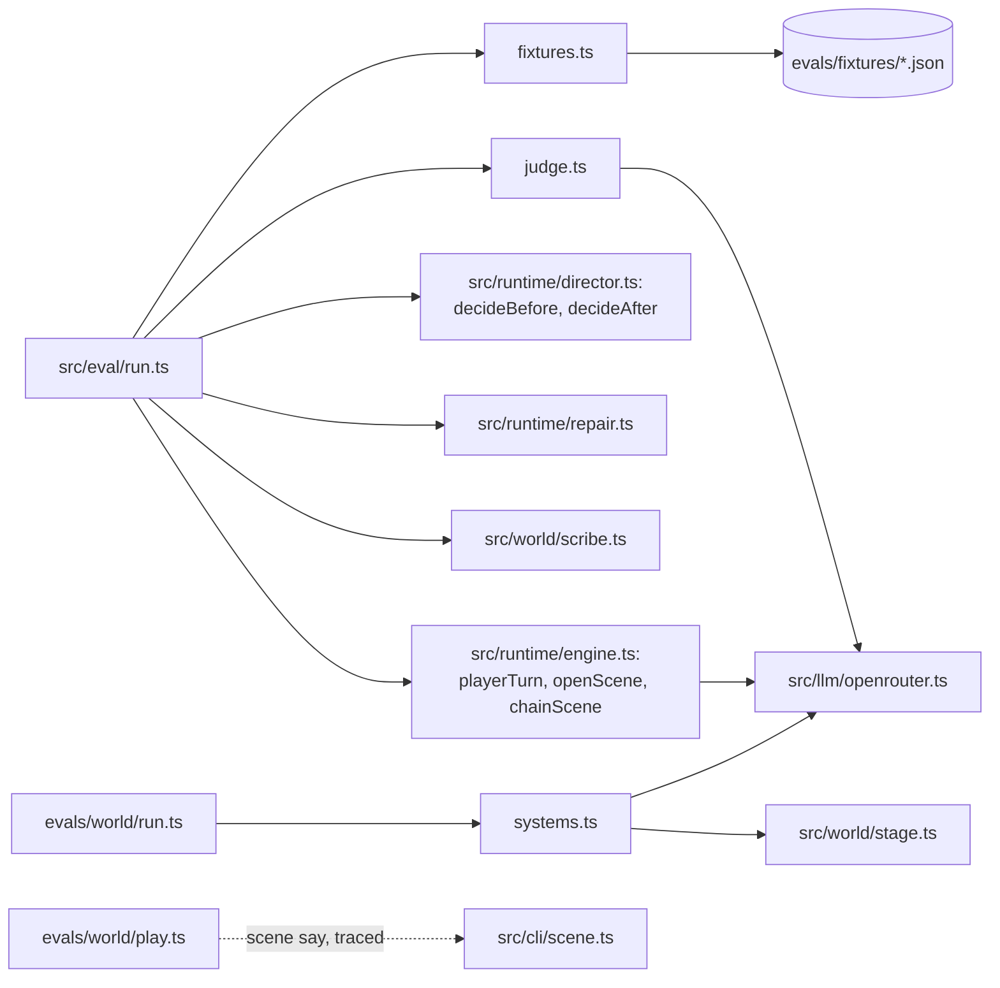

# Evals: src/eval and evals/

Part of the [architecture overview](../ARCHITECTURE.md). Where it's going (a `ModelClient` that can replay a session's calls, so a refactor shows any prompt that drifted) is in [docs/design/productionise.md](../docs/design/productionise.md#stores-config-and-the-composition-root).

## What it is

Two eval harnesses that run the game's model calls against the real model and score what comes back, with their cases and fixtures. Read [docs/guide/testing.md](../docs/guide/testing.md) first: the numbers are flags that say where to read transcripts, not targets to fit.

- **The GM evals** (`src/eval`, `npm run eval`) put the scene runtime in a fixed moment and judge what it does: one reply, one decision, a whole scene against a simulated player, the next scene's opening, or the scribe's world script. A judge model scores each against a criterion written for the case.
- **The stage-manager eval** (`evals/world`) scores how well the world is kept in step with the story: after a recorded exchange, did people move, things change hands and states change as the reply said? It compares today's stage manager (`src/world/stage.ts`) with alternatives (operations, tool calls, a block in the GM's own reply, a decider), against hand-written labels.

`evals/fixtures` holds the session snapshots the GM evals' cases are pinned to.

## What it owns

| path | what it is |
|---|---|
| `src/eval/run.ts` | The GM evals' runner: picks cases, runs the suites, writes `results.json` and `summary.md`. |
| `src/eval/types.ts` | The case types: `ReplyCase`, `DecisionCase`, `TrajectoryCase`, `OpeningCase`. |
| `src/eval/cases/*.ts` | The cases, as TypeScript lists (`CASES` in index.ts): 163 of them, 82 reply, 44 decision, 34 trajectory and 3 opening. `memory.ts` has the memory eval's two. |
| `src/eval/fixtures.ts` | `buildFixture`: a moment in a scene, from a snapshot file or built by hand (beat, transcript, established facts, notes). |
| `src/eval/judge.ts` | The judge: `judgeTurn`, `judgeTrajectory`, `judgeWorldUpdate`, on five dimensions (intent, consistency, characters, steering, craft) and the case's criterion. |
| `src/eval/compare.ts` | `npm run compare`: per-approach and per-decider aggregates of runs, side by side. |
| `src/eval/rejudge.ts` | Judges an earlier run's replies again with another judge and reports agreement. No GM calls. |
| `src/eval/memory-eval.ts`, `memory-run.ts` | The memory eval (does a character remember, in a later scene, what the player did?) and a smoke runner for scripted memory sessions. |
| `evals/fixtures/<topic>/*.json` | 48 session snapshots from QA rounds and playtests (absurd-r1, ambrose, memory, pacing, playtest-1, playtest-2, qa1): each a `SessionState` from real play, most taken just before a turn that went wrong (ambrose's, from a reported game, trimmed of the rules engine and the world, which a decision doesn't read). |
| `evals/world/run.ts` | The stage-manager eval's runner, with `--rescore` and `--report`. |
| `evals/world/cases/*.json` | 26 labelled cases from real play: the world exactly as the stage manager read it, the exchange, and what the reply established. |
| `evals/world/systems.ts` | The 14 systems compared (`current`, `stage`, `ops`, `tools`, `gm-block`, `decider-*` and their variants). |
| `evals/world/score.ts`, `types.ts`, `cases.ts` | The scorer (the world before and after as atomic changes, checked against the labels), the case type, the loader. |
| `evals/world/play.ts`, `trace.ts`, `capture.ts`, `scripts*.json` | Growing the cases: scripted sessions played through `scene say` with a trace preloaded, then turned into unlabelled cases. |
| `evals/world/*.ts` (the rest) | One-off studies: where the player acts from, whether the GM reads the world, a single-pass GM block, hybrids, patches, a proposed world language, what the GM reads. |

Every run writes under `runs/evals/`: `<stamp>[-label]/` for the GM evals (`results.json`, `summary.md`, `calls.jsonl`, and the sessions the runtime saves, since run.ts points `KM_RUNS_DIR` there), `<stamp>-memory/` for the memory eval, and `world-<stamp>/` for the stage-manager eval.

## How it fits



- **The GM evals call the runtime as the game does,** not through a CLI: `playerTurn` for a reply or a trajectory, `decideBefore` and `decideAfter` with a named decider (`deciderFor` in src/llm/decide.ts), `chainScene` and `openScene` for an opening, and the scribe for the world suite. The co-GM runs inline when the approach has one, before the reply or between a trajectory's turns, rather than as a background job.
- **Nothing in the game calls the evals,** and CI doesn't run them (see below).
- **QA failures become cases** by copying the session's `snapshots/<scene>-turn-NNN.json` into `evals/fixtures/<topic>/` and writing a case with the player's real input (docs/guide/testing.md, "Turning a failure into a case").

## How it works

**A GM eval run** (src/eval/run.ts):

1. Select cases by `--suite`, `--case` (an id or a prefix) and `--tag`.
2. For each case and sample, build the moment (`buildFixture`) and play it with each approach (`--approach`, or the case's own, or `gm,actors`) or each decider (`--decider`, default `jev,luna-none`).
3. Check what's mechanical: the transition taken, the roll, the exit (reply cases); the choice against the acceptable ones (decision cases).
4. Judge the rest (`judge.ts`): Luna at high reasoning by default, `KM_JUDGE_MODEL` and `KM_JUDGE_EFFORT` for another.
5. Write `results.json` and a `summary.md` of means by case and approach, with latency and cost.

The suites:

| suite | plays | judged on |
|---|---|---|
| `reply` | one player turn at a fixed moment | the five dimensions and the case's criterion, plus mechanical expectations |
| `decision` | the decider alone, before or after a reply | whether its choice is one of the acceptable ones, and its latency |
| `trajectory` | a whole scene, a simulated player (`prompts/player-sim.md`) with a persona, up to `maxTurns` | the transcript: the dimensions, progress, tangents and how they were handled, the criterion |
| `opening` | the next scene's opening after a recorded ending | whether it picks up from what really happened |
| `world` | the scribe on scene endings found under `--from` (default `runs/sessions`) | missing and wrong changes in the world script |

**The stage-manager eval** (evals/world/run.ts) runs each system on each case (`--systems`, default `current,ops`), diffs the world before and after into changes, and scores precision over the changes a system made and recall over the ones the reply established, by kind (positions, hand-overs, states, arrivals, exits). `--report` prints the failures to read, and `--rescore` scores a run again after the labels change.

## Where to look first

- **A new or changed case:** its file in `src/eval/cases/`, the criterion's wording (it should name an outcome, and fail stalling and withholding as well as the failure seen), and the fixture it's pinned to.
- **A change to the judge:** `prompts/judge.md` and judge.ts. Any change moves every score, so compare a run before and after with `npm run compare`, or re-judge an old run with rejudge.ts.
- **A change to the runtime the evals call:** run.ts calls `playerTurn`, `decideBefore` and `decideAfter` with their real signatures, so a signature change shows up here at the typecheck.
- **A change to `SessionState`:** the fixtures are snapshots of it as it was when they were taken, and nothing migrates them. `buildFixture` spreads a snapshot over a new session's fields.

## How to test it

Every suite calls the model and costs money; each call's cost is in the run's `calls.jsonl`. Most need `OPENROUTER_API_KEY` (or `~/secrets/kingmaker-dev-openrouter.txt`).

```sh
npm run eval -- --suite reply --case qa1 --approach v2 --samples 3          # reply cases whose id starts qa1
npm run eval -- --suite decision --decider luna-decisions,jev,luna-none     # decider accuracy and latency
npm run eval -- --suite trajectory --approach v2,actors --samples 2
npm run eval -- --suite opening
npm run eval -- --suite world --from runs/sessions --mode reconcile         # the scribe on recorded endings (default mode: append)
npm run compare -- runs/evals/<a> runs/evals/<b>                            # aggregates side by side
KM_JUDGE_MODEL=openai/gpt-6-sol KM_JUDGE_EFFORT=medium node --no-warnings src/eval/rejudge.ts runs/evals/<a> [limit]
node --no-warnings src/eval/memory-eval.ts [--case id,id] [--approach v2-nomemory,v2,v2-memory-lite] [--samples 1]

node --no-warnings evals/world/run.ts [--systems current,ops,tools] [--samples 2] [--cases id,...]
node --no-warnings evals/world/run.ts --report runs/evals/world-<stamp> [--system ops]
npx --no-install tsc --noEmit -p evals/world                                # the stage-manager eval's own typecheck
```

`npm run typecheck` covers src/eval but not evals/: the root tsconfig.json includes only `src`, `scenes` and `world`, so evals/world has its own tsconfig.json and is typechecked only when someone asks.

## Known gaps and sharp edges

- **CI runs none of this.** `.github/workflows/evals.yml` is V1's, kept through V2's fresh start: on a push to main it runs `moon run workspace:eval` and `scripts/publish-eval-history.ts`. V2's moon.yml has no `eval` task and there's no `scripts/` directory, so once V2 is on main the workflow fails (after its credentials check, which also needs the `OPENROUTER_EVAL_KEY` secret).
- **The default approaches aren't the game's.** Without `--approach`, reply, trajectory and opening cases that don't name their own run `gm` and `actors` (`DEFAULT_APPROACHES`, src/eval/run.ts:75). The game plays `v2`.
- **The memory eval's defaults are out of date.** Without `--approach` it runs `v2` and `v2-memory`, which both have the docs service now (they differ only in freeform rolls), and its header still calls `v2` hand-offs only. `--approach v2-nomemory,v2,v2-memory-lite` compares no memory, the docs service and the lite reviews.
- **run.ts is a script, not a module.** It makes its output directory, sets `KM_RUNS_DIR` and starts the run as it loads, so nothing can import its pieces.
- **The judge is a model.** It's often stricter than a player would be, and some criteria are flawed. With 2–3 samples a case, ±3 of 20 is noise.
- **evals/world cites a document that isn't here.** language.ts names docs/research/gm-world-interface.md, which was never merged (src/world/README.md has the same note for stage.ts).
- **evals/world's one-off studies** (act-position.ts, gm-reads.ts, hybrid.ts and the rest) were written for one question each, and nothing checks they still run beyond the typecheck above.
