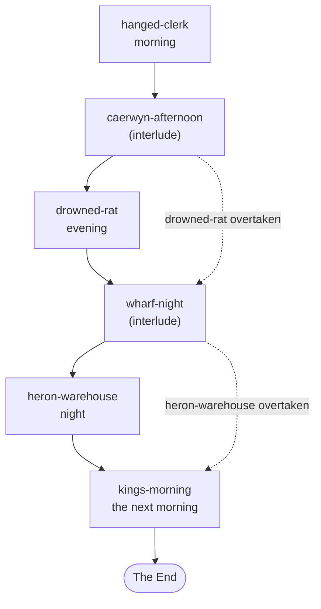

# scenes: the authored scenes

Part of the [architecture overview](../ARCHITECTURE.md).

GM prep as TypeScript data, one module per scene: who is there and what they want, the beats the scene is built around, the routes between them, the only ways it can end, and what each ending does to the world. The runtime ([src/runtime](../src/runtime/README.md)) plays them; nothing here runs on its own. How to write a scene the runtime plays well is in [docs/guide/authoring.md](../docs/guide/authoring.md).

```sh
npm run scene -- list                              # the story's and the experiments' scenes, and the approaches
npm run scene -- start hanged-clerk --session s1   # play one in the terminal
```

## What it is

A scene is prep, not a script. The type is `Scene`, at [src/runtime/scene.ts:166](../src/runtime/scene.ts#L166), where most fields carry a comment. The GM improvises everything between the beats; the runtime keeps track of which beat the story is at, judges the routes the player takes, and closes the scene through one of its exits. Each exit can say which scene comes next, and a scene can say what it takes for granted, so the story skips it once play has made that untrue. The story's scenes share one world, Caerwyn on the eve of the Centennial Assembly, whose lore is in [lore/](../lore/README.md).

## What it owns

| File | What's in it |
|---|---|
| [index.ts](index.ts) | `SCENES` (the story's and the experiments'), `ZOO_SCENES`, and `sceneById` |
| `<scene>.ts` | One scene each (the table below) |
| [worlds/](worlds/) | The place as a world (`WorldSpec`, [src/world/scene-world.ts](../src/world/scene-world.ts)) for the four Caerwyn scenes: areas, things, where people start, in feet |
| [interludes.ts](interludes.ts) | Downtime between scenes, standing in for the map: `caerwyn-afternoon` and `wharf-night`, with Kell's card for them |
| [talk.ts](talk.ts) | A talk with a companion, built from their lore (`talkScene`), and its ids (`talk-<companion>-<n>`) |
| [holed.ts](holed.ts) | Three scenes with key routes taken out, for the repair experiments |
| [zoo/](zoo/) | The zoo's seven scenes: short, each showing a few mechanisms ([src/game/zoo/README.md](../src/game/zoo/README.md)) |

| Scene | What it is | Leads to |
|---|---|---|
| `hanged-clerk` | A clerk hanged behind the granary: an investigation, two kids who know more than they say, a watch sergeant with until noon. Morning; a world. | `caerwyn-afternoon` |
| `caerwyn-afternoon` | Interlude: the market square on the eve of the Assembly | `drowned-rat` |
| `drowned-rat` | A dockside dive with house rules, and a frightened big man with a bandaged hand. Evening; a world. If the granary missed Prout's page, it's here too, still in the boot on Cob's feet. | `wharf-night` |
| `wharf-night` | Interlude: the wharves after dark | `heron-warehouse` |
| `heron-warehouse` | The King's grain re-sacked under a heron, a barge on the ebb, the true book. Night; a world; a fight exit. | `kings-morning` |
| `kings-morning` | The report to the King before the procession. The next morning, after a long rest and a level; a world. | The End |
| `stranger-crossroads` | Character creation as a scene (`createsCharacter`) | `crossroads-ambush` |
| `crossroads-ambush`, `crossroads-aftermath` | A raving farmer, goblins in the hedge, a stolen idol; then what comes after. A fight exit. | `crossroads-aftermath`; nothing |
| `crossroads-situation` | The ambush written as a situation, with one beat and no sequence | nothing |
| `garrows-toll`, `warren-hostage`, `blocked-entrance`, `green-standoff` | Earlier test scenes: a toll, a hostage, a wedged cart, a standoff on a green | nothing |
| `crossroads-holed`, `entrance-holed`, `toll-holed` | Repair experiments: an ending with no route to it | nothing |

The playable game starts at `hanged-clerk` (`FIRST_SCENE`, [src/game/play.ts](../src/game/play.ts)) and plays the Caerwyn arc, skipping the interludes because it has a map. The scene harness can start any scene. The other scenes are what the evals' cases use ([src/eval/cases/](../src/eval/cases/)).



The Caerwyn arc. Solid arrows are the exits' `next`; a dotted arrow skips a scene for its `overtaken`, because play has already made untrue what it `assumes`. The first PoC's chain, for the scene harness, is `stranger-crossroads` to `crossroads-ambush` to `crossroads-aftermath`.

## The Scene format

| Field | What it is | Who reads it |
|---|---|---|
| `id`, `title`, `summary` | Names; the summary is for listings | everything; `scene list` |
| `setting`, `premise`, `hook`, `opening` | The place (for the GM), the scene's dramatic question, what the player knows walking in, and the direction for the opening | the GM's brief; the decider (the premise); the boundary (the premise and the opening); the app (the hook) |
| `cast` | `Character` cards: look, voice, wants, fears, what they know, secrets, attitude. Also `called` (what the player calls them until they hear the name), `enters` (the beat they arrive at), `group` and `members`, and `statblock` and `weapon` for the rules. | the brief, the director, the actors, the rules, the world |
| `start`, `beats` | Each beat has its direction, cast notes, one pressure for when things stall, and its transitions | the tracker, the GM's note, the co-GM |
| transitions, `anytime` | Routes: `when` (prose the decider judges), `on` (`attempt` and `cue` are judged before the reply and `outcome` after it; a route with a check defaults to `attempt`, any other to `outcome`), `to` or a `check` (skill, DC, the reason shown with the dice, success and failure lines, `onSuccess`, `onFailure`, and optionally facts each outcome `establishes`), `establishes` (true whichever way a check goes), `given` (only someone else can bring it about), `essential` (the essential it brings: the route is there only while the scene has it, and goes once it's found; a ruling that counts as it brings it out too) and `towards` (an essential it's a way towards without bringing it, like a bribe that gets haggling: there and gone as the essential is, and it brings nothing out) | the director; a considered turn's ruling is made in this same shape |
| `exits` | The only ways it ends: a `kind` (`combat` goes to the map), the outcome, how to close, `next`, and a `script` | the director, the brief, `finishScene`, `chainScene` |
| `limits` | What the scene can't offer, so the GM can say "no, but" honestly | the director, the brief, the actors, the co-GM |
| `essentials` | What the player must come across for the endings to be reachable: where it was placed, who carries it, what it opens up. One the rest of the story needs has `later` (what for) and `things` (the world's things it's in): missed here, the boundary carries it on. `missed` ("<scene>:<essential>") makes one this scene's own prep for an earlier scene's, for if the player missed it there. | the director (relocation, landed), the brief, the co-GM; the boundary (`later`, `things`, `missed`: [src/runtime/owed.ts](../src/runtime/owed.ts)) |
| `background` | Facts carried in from before | the brief, the boundary |
| `world`, `afterwards` | The place as a world, and the world ops applied when the scene ends, whatever the ending | `openScene`, `finishScene`, the game's maps |
| `anchors` | Named spots that exit scripts refer to | the scripts' recording world |
| `lore`, `fronts` | The GM's always-open lore docs; the fronts doc that moves on at this scene's boundary | disclosure; the boundary; the notes on the GM's marks (the public ones) |
| `known` | What anyone here knows and a newcomer wouldn't, where the public lore doesn't say it: the place's customs, prices and common talk. Never a secret | the notes on the GM's marks (src/runtime/notes.ts) |
| `assumes`, `overtaken` | What the prep takes for granted, and where the story goes instead once play has made it untrue | the boundary |
| `time`, `rest`, `milestone`, `interlude`, `createsCharacter` | The hour (for the map), a rest before it opens, a level as it opens, downtime the game skips, character creation | the game, `openScene`, `chainScene`, `playerTurn` |
| `companion`, `approach` | A talk's companion; the scene's own approach overrides | talks; `sceneApproach` |

## How it fits

`sceneById` ([index.ts:32](index.ts#L32)) is the only way in: it finds the scene in `SCENES` or `ZOO_SCENES`, or builds a talk from a companion's lore, and adds "an ending of their own" (`withImprovisedEnding`, [src/runtime/brief.ts](../src/runtime/brief.ts)). Everything that plays a scene goes through it: the runtime, the game core, the zoo, the evals and the scene harness. The scenes import the runtime's types and `withImprovisedEnding`, the world's script types ([src/world/dsl.ts](../src/world/dsl.ts)) and, for talks, the docs store ([src/lore/docs.ts](../src/lore/docs.ts)); the runtime imports `sceneById`. So scenes/ and src/runtime depend on each other.

Where a story scene sits on the map, and how its fight is set out, is the game's business: [src/game/map/places.ts](../src/game/map/places.ts), [src/game/town.ts](../src/game/town.ts) and [src/game/combat/](../src/game/combat/).

## How it works

- **A turn's view of a scene.** The director puts the current beat's transitions and the `anytime` ones to the decider, with each `when` as the criterion's text. A check's `reason` says what the roll is for, and the decider is told to match only that act ([src/runtime/director.ts](../src/runtime/director.ts), `rollNote`). The considered-rolls flag lists the routes with a roll by their reasons too: an attempt at another person, ask or payoff goes to the GM's ruling rather than the nearest route, so a reason should say whom the roll works on and what it wins ("to get Cob to trust you with what he heard"), and a route a roll shouldn't decide wants no check at all. A ruling that amounts to one of the beat's outcome routes counts as it (its `establishes` come with it), so the facts exit scripts look for are worth putting on those routes. An exit is reached by a transition that leads to it, or by the after-reply read of which ending the story is at, which is asked over every exit's outcome.
- **The GM's view.** The brief lists the setting, premise, background, every cast card with its secrets, the exits' outcomes, the essentials and the limits. Each turn's note adds the beat's direction, its cast notes, its pressure (once, after the beat has sat for two exchanges) and the routes from here.
- **Exit scripts.** `script(world, outcome)` runs when the scene ends, against a recording world ([src/world/dsl.ts](../src/world/dsl.ts)): nothing in the game changes; each call is recorded in `state.ended.operations`. The game reads two of them: `startCombat`, which the fights set out ([src/game/combat/fights.ts](../src/game/combat/fights.ts), [heron.ts](../src/game/combat/heron.ts)), and `journal`, the End's chapters ([src/app/story.ts](../src/app/story.ts)). The rest (quests, flags, attitudes, items, memories) is read by the scribe's world updates and the world eval suite. `outcome.established` holds the facts the routes established, so a script can branch on what happened.
- **Worlds.** `openScene` builds the world from the spec, with the cast where `people` puts them and what the player carried in. From then on the rules and the stage manager keep it in step with the story, and the GM reads it every turn.
- **Talks.** `talkScene` ([talk.ts:55](talk.ts#L55)) builds the companion's card from their lore (their look from `public.md`, their voice from `private.md`, their statblock from an authored card), with two beats (`talk`, `told`), a goodbye exit, limits that keep a talk from moving the story, and its own approach (no co-GM, no freeform rolls or considered rolls, staged secrets).

## Where to look first

- **`when` is logic.** The decider matches the player's turn against it. A route that would end the scene should say so; one with a roll should name the act the roll tests, not what has to happen first.
- **Ids are shared.** Transition targets, exit ids and cast ids are referred to by eval cases, the smoke tests (`/end <exit>`), the fronts doc's "Ticked by" lines, the fights' setups and the world's `people`.
- **A combat exit needs a fight to set out.** Its script's `startCombat`, the place on the map, and the fight's setup in src/game/combat.
- **Recurring characters are carded in every scene they're in.** Kell has four cards across the story's scenes (the two interludes share one) and one in the zoo, all with `KELL_VOICE` ([hanged-clerk.ts:39](hanged-clerk.ts#L39)); her lore entry is the one place for who she is. A card should read the state of the world ("as things stand between her and the investigator") rather than assume it.
- **`assumes` and `overtaken`.** What the prep takes for granted, written so the boundary can judge it against what happened.
- **`later` and `missed`.** An essential the story needs later, missed in its scene, is carried by the boundary into the next scene that holds ([src/runtime/owed.ts](../src/runtime/owed.ts)), placed with that scene's people, or by that scene's own prep for it (`missed`), whose routes (`essential`, and `towards` for the ones that don't bring it) are the scene's only while it's owed. A scene's prep for a missed essential must be written for the case where it was found too: its cards stay neutral ("only if the page is still in his boot"), since the essential and its routes aren't there then.
- **Secrets and success lines.** A success line gives one piece of a secret, not all of it, and a truth the scene needs has more than one way in (its essentials).

## How to test it

```sh
npm run scene -- list
npm run scene -- start drowned-rat --session s1   # then say, status (the path taken), transcript, map
npm run qa -- new --session q1 --as "Wren Ashdown: a quick-witted ranger"   # the arc in the playable game; qa end --exit <id> takes an ending
npm run eval -- --case <id>                       # an eval case by id (src/eval/cases/, by scene)
npm test                                          # the zoo's test validates the zoo's scenes; the director's test plays hanged-clerk's yard; arc-prep's holds the arc's prep to what a player's report found (src/runtime/arc-prep.test.ts)
node --no-warnings --input-type=module -e 'const { SCENES, ZOO_SCENES } = await import("./scenes/index.ts"); const { validateScene } = await import("./src/runtime/scene.ts"); for (const s of [...SCENES, ...ZOO_SCENES]) { const p = validateScene(s); if (p.length) console.log(s.id, p); }'   # every scene's ids and targets: silent when all is well
```

Offline (`OPENROUTER_API_KEY=offline`), a scene still opens on its place in the game, and `/exits` then `/end <id>` takes any of its endings and runs its script.

## Known gaps and sharp edges

- **What `validateScene` checks.** The zoo's scenes are validated in a test ([src/game/zoo/zoo.test.ts:69](../src/game/zoo/zoo.test.ts#L69)), and so are the story's ([src/runtime/owed.test.ts](../src/runtime/owed.test.ts)), with every `missed` standing for an essential the story carries; the one-liner above passes for all 24 at this head. It checks essentials' ids, carriers and `things`, and the routes that bring them, but not `next`, `overtaken`, the `lore` and `fronts` paths or the world's `people`. All of them hold today, but nothing checks them.
- **Exit scripts are recorded, not applied.** Of their operations the game reads only `startCombat` and `journal`: a script's `setFlag`, `quest` or `addItem` changes nothing in play. What the player carries out of a scene is what its world says they hold.
- **Prose is logic, and only evals test it.** The decider reads `when`, the GM reads the outcomes and closings, and a reworded route changes what the player can do.
- **A talk's card is built once per process** from the authored lore ([talk.ts:48](talk.ts#L48)), so edits that play makes to the companion's lore don't change it.
- **Everything here is in the static build,** secrets included: the scenes are bundled as code ([src/web/static/content.ts](../src/web/static/content.ts)).
