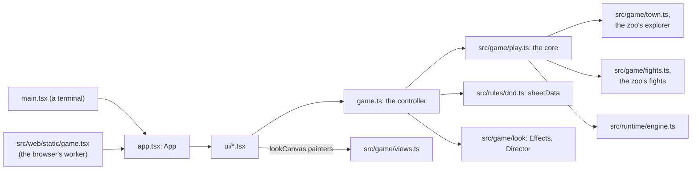
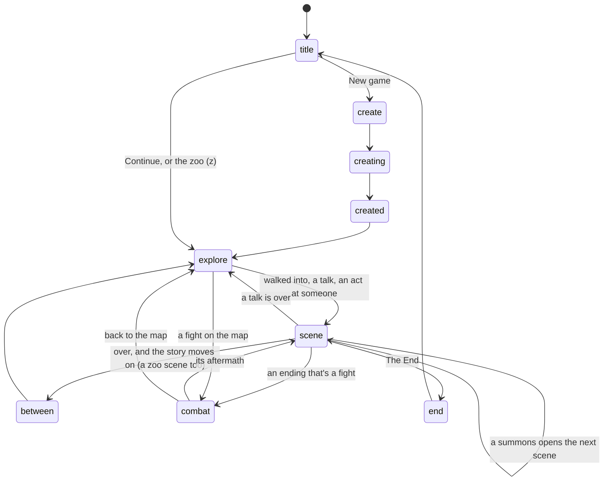

# src/app: the playable game

Part of the [architecture overview](../../ARCHITECTURE.md). Where it's going (a client of the core over a connection that carries intents and events, its controller split by concern) is in [docs/design/productionise.md](../../docs/design/productionise.md#the-protocol).

## What it is

The OpenTUI React terminal app that runs the whole story (docs/design/playable.md): make a character, walk Caerwyn on the isometric map, play the GM-run scenes, fight at the Heron on the map, report to the King, The End.

```sh
npm run game        # node --experimental-ffi --no-warnings --import tsx src/app/main.tsx
```

It needs a real terminal and `OPENROUTER_API_KEY` (or `~/secrets/kingmaker-dev-openrouter.txt`). The world is lit in 24-bit colour: where `COLORTERM` isn't set (macOS Terminal, and ssh doesn't pass it on), OpenTUI falls back to 256 colours and the lamplight goes grey, so set `COLORTERM=truecolor` if the terminal can take it. Saves go under `runs/sessions/<id>/`, and `KM_RUNS_DIR` moves them:

- `game.json`: the game core's save, with the mode, the story, the map (where the player stands, what scenes did to their places) and the fight.
- `state.json`: the runtime's session.
- `app.json`: the app's notebook and messages.

The app is the game's one UI, and it runs in three hosts. In a terminal, `main.tsx` starts it on OpenTUI's native renderer. The server build (src/web/server.ts) runs that same command under a pty for each browser tab. The static build bundles it into a Web Worker, with OpenTUI and the Node modules it uses replaced by JavaScript stand-ins, and `src/web/static/game.tsx` starts it as `main.tsx` does. [src/web/README.md](../web/README.md) has the three side by side.

## What it owns

- **What's on screen:** `Game` in game.ts (game.ts:194), the app's controller. It holds which screen is up, the transcript with the GM's reply streaming in (`lines`, `live`), the card between scenes, the notebook, the overlay, the map's right-click menu, the scene's right-click menu, the action menu and its aiming, a scene that's over and waiting for the player (`over`), the core's choices, the fight's target, and the look of each scene, the town and a zoo wing (an `Effects` and a `Director` each) and of a fight (an `Effects`). It holds no React: the screens subscribe (`useGame` in ui/common.tsx) and redraw when it emits.
- **One file of the save:** `app.json`, with the notebook and the latest messages (save.ts). The game itself is the core's (`game.json`) and the runtime's (`state.json`).
- **The title's lists:** the story games to Continue (`resumable`) and the zoo visits (`zooVisits`), and deleting a game into `runs/deleted/`.

| file | what it does |
|---|---|
| `main.tsx` | The terminal's entry: checks for a real terminal, registers `<lookCanvas>`, makes OpenTUI's renderer and a `Game`, renders `<App>`. A failure anywhere shows on the game's status line. |
| `app.tsx` | `App`: one screen at a time by `game.screen`, with the overlay on top. Ctrl+C saves and quits. |
| `game.ts` | The controller, about 1,700 lines in sections by screen: the title and creation, the map, the action menu, scenes, the scene's place, combat, the look, the End and saving. Also `isRoll`, `commandNamed` and `talkBetween`. |
| `save.ts` | `app.json`, the title's lists, deleting a game. |
| `story.ts` | What the app adds to the story: the notebook's lines from an ending's world script, the epilogue, words for the time of day, `leadWay`. |
| `theme.ts` | The app's colours (`C`), and the cast's letters for the transcript. |
| `rules-repair.ts` | A stop-gap for a rules-engine bug (see the gaps below). |
| `ui/title.tsx`, `ui/create.tsx` | The title, character creation, and the sheet after it. |
| `ui/explore.tsx` | The map, its side panel (Nearby, the lead, What happens) and the keys at the bottom. |
| `ui/scene.tsx`, `ui/place.tsx` | A scene: the conversation, the box, the core's choices; and the scene's place beside it. |
| `ui/between.tsx` | The moment between scenes: Kell with the news, or the card. |
| `ui/combat.tsx` | A fight on its battlefield, with its side panel and options. |
| `ui/end.tsx` | The End. |
| `ui/overlay.tsx` | The overlays: the sheet, help, the notebook, the scene's place on the map (`/map`), the game's menu (Esc), the spell picker, a fight's every option, What happens in full, and the zoo's sign, window and view from above. |
| `ui/actions.tsx`, `ui/menu.tsx` | The action menu (and a fight's every option), and the right-click menus. |
| `ui/sheet.tsx`, `ui/sheet-layout.ts`, `ui/portraits.ts` | The character sheet: a page at a time or in columns, a portrait for each class, a spell's page. |
| `ui/common.tsx` | What the screens share: `isEnter`, `wayOnKey`, `FPS`, `SCROLLBAR`, `useGame`, `Lines`. |
| `smoke/` | The checks (How to test it). |

## How it fits



The app is a view over the game core, `src/game/play.ts`, the same one the headless QA console (`npm run qa`) plays. The core owns the story flow:

- exploring, scenes, fights and The End;
- chaining scenes and skipping interludes (walking the map stands in for them);
- a fight's end, then its aftermath back in its scene;
- the King's summons.

Exploration and fights plug into the core, and the app uses the real modules:

- **`src/game/town.ts`:** the map module's exploration (src/game/map) as the core's Explorer. Its state is the map's `ExploreState`, kept in the game.
- **`src/game/fights.ts`:** tactical combat (src/game/combat) on the scene's own place, with everyone where the scene's world has them.
- **`src/game/views.ts`:** every picture the game draws (the town, a scene's place on the map and from above, a fight), through the look layer (src/game/look): things by the rules, living ground, coloured light, effects. The screens draw them as live canvases, about twelve frames a second.

`game.ts` is the app's controller, and the screens in `ui/` subscribe to it. It adds what a terminal needs:

- the GM's reply streaming in;
- a scene that's over staying up until the player goes on, then the moment between scenes (Kell telling the news, or the card) and the notebook (the exit scripts' journal lines);
- the look of each scene and fight: one set of effects and a director, so spells, fires, damage numbers and barks show in the world as they land;
- overlays: the sheet, help, the scene's place on the map (/map), the spell picker, a fight's every option;
- the character sheet: the rules engine's sheet as data (`sheetData` in src/rules/dnd.ts), laid out for the screen by `ui/sheet-layout.ts` (a page at a time on a small screen, all of it in columns on a big one), with a portrait for each class (`ui/portraits.ts`), shown by `ui/sheet.tsx` after character creation and over the game (c, s, /sheet). In a fight it reads the fight's own campaign, so it's as the fight has left you. A spell on it, picked, shows in the sheet's own box (`spellPage`): its card, what it does in this game at the character's own numbers (the attack or save, the damage and how it grows, the area: the engine's mechanics, `src/rules/spells.ts`) and the SRD 5.2.1's description in its own words (vendored by spell id in `vendor/srd-spells`, CC BY 4.0), with the SRD's attribution statement. What the engine adds for the character is in the numbers, named (from its own effect stack: `spellExtras` in src/rules/dnd.ts): the Wisdom modifier it adds to a heal whatever the class, Disciple of Life, Agonizing Blast. Where the game and the SRD part ways, it says so: a casting time of the SRD's that isn't the game's, a higher slot that does nothing more here, a spell a fight on the map doesn't offer (`inFights`, which the fight itself uses);
- walking a step at a time, to the lead or wherever you clicked, and the map's right-click menu (what's at a tile: the town explorer's `actionsAt`, picked from what the renderer drew where);
- the scene's right-click menu (what's in its place: `thingActions` in `src/game/scene-menu.ts`, picked from what the stage drew where), its quiet notes of a glance (never the world's descriptions, which are the GM's), and the deeds it sends as the player's turn (`sceneMenu`, `lookNote`, `deed` in `game.ts`; the menu box is `ui/menu.tsx`);
- the fight's target, picked by a click the same way (the battlefield's `Picks`), and a beat between the other side's turns;
- side panels laid out a row at a time in the rows they have (the map's and the fight's): what's needed first, then what fills the room. A squeezed box draws its lines over each other.

Every action goes through the core by the same action ids the QA console uses (`walk_northeast`, `interact`, `talk_kell`, `attack_crake-1`, `cast_fire-bolt_sallow`, `shove_crake-1`, `urge_intimidation_yield_crake-1`, `end_turn`, `continue`), and a line typed in a fight goes through the core's `say` as a scene's does, read onto those ids (`qa say` types in a fight too). The screens draw from the core's state: the map module's explore state, the scene's world, and the fight's controller.

The action menu has three parts:

- **[src/rules/actions.ts](../rules/actions.ts)**, the catalogue. What the character can do out of a fight, read synchronously from their rules state (`rulesNow` in src/rules/dnd.ts): each entry's kind, its one line, why it can't be done now, what it does to whoever it's aimed at (harm, social, help), and its aim (nothing, yourself, someone, someone or something, a spot for an area, a direction, a place to land), with how far it reaches.
- **[src/game/menu.ts](../game/menu.ts)**, the menu on the map. It adds what's in reach to the catalogue, and checks an aim from where the player stands (reach, a clear line past walls and trees, what an area covers and catches). Then it does the act through the rules (`castSpell`, `useFeature`, `attack`, `wrestle`, `jump`, a Stealth check, `rest`, Arcane Recovery, `useItem`), and the town's reactions to any violence. The core's ids:

  | id | does |
  |---|---|
  | `cast_<spell>`, `cast_<spell>_self`, `cast_<spell>@x,y` | a spell: no aim, on yourself, at whoever or whatever is on a tile (an area's centre, a cone's way) |
  | `feature_<id>`, `feature_<id>_self`, `feature_<id>@x,y` | a class feature |
  | `attack@x,y`, `throw@x,y`, `shove@x,y`, `grapple@x,y` | a blow with the weapon in hand, a stone, a shove over, a grab |
  | `jump@x,y` | a leap to a tile: within reach it happens, half as far again takes Athletics |
  | `hide`, `rest_short`, `rest_short_recover`, `rest_long`, `use_<item>` | a Stealth check; an hour (with Arcane Recovery); a night; something used up |

  The QA observation lists the whole menu, with ids, and its actions include what needs no aiming and the nearest target of what does. An id that can't be done says why, and does nothing.
- **[src/game/town-world.ts](../game/town-world.ts)**, the town's world. The map's own things (its doors, carts, stalls, signs, the old elm), what played scenes left in their places, the people about and the player, as a scene world (src/world/scene-world.ts) for the rules, its feet from the map's corner (`townRegion`). It's built fresh for each act. `keepTown` writes what changed into the map's overlay (`ex.overlay.town`): the things as they were left, the people until the story's clock moves on, what was spilled or scorched. The map draws from that (`withTownChanges` in map/reconcile.ts), and it saves with the game. A door in pieces is open to walking and pathing; a locked-up place whose gate is broken (the granary yard after its scene) is open again. A place whose scene is still to come isn't in it: its people, its things and its doors (the yard gate, the loft door), and what of the town its world has too (the old elm), are `waiting`, and what's done to them opens the scene instead, so the GM is told the place as it is. On a map with a world live on it (a zoo's wing), the rules' world is that one: its own people and things, changed in place, kept in it with the visit (not the town's overlay), and nobody in it the story's (no talks, no scenes waiting).

On screen ([ui/actions.tsx](ui/actions.tsx), [ui/explore.tsx](ui/explore.tsx)), the act's lines go to the news (What happens), and the look layer plays them in the town's world: the spell from the player to its aim, the numbers over what it hurt, the splinters and smoke of what it broke, a puff for whoever ran (`townFx` in game.ts). A scene opened by an act gets its first turn through the core with the act already chosen (`say(text, hooks, { mechanic })`, then `playerTurn`'s `mechanic`). The decider isn't asked what the rules resolve, so the act is resolved exactly as chosen, and no route's roll rides on top of it. A fight that breaks out on the map is `fightOnMap` in the core's state: it's set out where everyone stood (`startWith` in the fights factory), drawn with the town round it, and its end goes back to the map (the explorer's `afterFight`, which says how it went), not to a scene's aftermath. A zoo ring's fight is `fightOnMap` too, set out by the zoo's own fights (`fight: true`). In a zoo wing, what the menu did plays as the zoo's news, on the wing's own look (`mapFx`), as its exhibits' do.

Talking to someone who walks with the player between scenes (`talk_kell`, e beside Kell, or a right-click on her, on the map or in the Nearby list) opens a talk ([src/runtime/talk.ts](../runtime/talk.ts)): a scene in the core's scene mode, with the story's own scene set aside until it's over. The core's observation offers its dialogue choices as actions: `say_1`… and `say_goodbye` are of kind `say` (the label is the line, and `act(id)` is the same as `say(label)`), and `walk_on` ends the talk without a word. The app lists them all over the box; a line is said as if typed, and walking on acts `walk_on`. When the talk ends the core is back in explore mode where the player was, with the same lead; `talkOf(sceneId)` ([scenes/talk.ts](../../scenes/talk.ts)) tells a talk's scene from a scene of the story, and the app goes straight back to the map from it: no moment between scenes after a talk. A talk that ends on her last word (a goodbye) keeps it up until the player goes on, as a scene does; walking on is back on the map at once. A greeting that never came (offline, or the GM gave up) isn't saved by the core: the talk is still on screen, to walk on from.

## How it works

**The screens** are a state machine on `game.screen` (app.tsx), moved on by the controller:



**A turn in a scene:**

1. The box submits a line to `Game.input` (game.ts:985). A `/command` goes first: `peek` opens the sheet, `/map`, the notebook or the help at any time, and `command` does the rest.
2. The controller sets `busy` (one of the GM's excuses: `GM_BUSY`'s 25 lines, dealt like cards by `BusyLines`, so the same one never shows twice running), and `watch()` checks every 250 ms whether the scene has ended mid-turn (`notice`).
3. `core.say(text, this.hooks())` plays the turn. The hooks stream it: `onStep` moves the status line on during a considered turn (it opens on "The GM is considering the ramifications of your actions…", then the next excuse at each step of the GM's ruling: the review, its weighing, its success and failure, the roll), `onSpeaker` starts the live line, `onText` grows it (a redraw at most every 33 ms), and `onEntry` puts each finished line in the transcript and plays it in the scene's look (`animate`: the spells, the numbers, the barks). The browser builds run this same app, so they show the same lines.
4. Afterwards `observeScene` animates what the stage manager changed (and `repairCampaign` runs: a leftover, see the gaps below).
5. If the turn fails part-way, the controller reloads the last save (`Core.load`) and says the turn didn't happen.
6. `settle` brings the notebook up to date. A scene that's over stays on screen (`over`) with what comes next made ready: Kell with the news, or the card. `continueScene` goes on when the player presses an Enter of their own or clicks.

Everything the player does goes through the core by the same action ids the QA console uses, or as a line said in a scene.

### A scene, on screen

- Each exchange is a turn in its own box: the player's line under their name, with a bar down its side, then everything that answered it. The latest turn is the brightest.
- The rules' lines keep the dice (🎲) when there's a roll in them. The rest are news, marked ⓘ in their own colour: what you carry ("You no longer have your javelin"), what's burning, what you are now (`isRoll` in `game.ts` tells them apart).
- When a scene ends, its last reply stays up, and the box becomes the way on: an Enter of its own, or a click. Into a fight, to the next scene (a summons), to The End, or to whoever walks with the player: Kell reads the notebook's new entry back, says how the time went (the story's own lead, when the hand-off wrote one) and where the story goes next, and then it's the map. Where next is the core's lead in the map's own words (`leadWay` in `story.ts`), drawn in her notebook's margin: the sidebar says the same, arrow and paces. With nobody walking with you, it's the card.
- The core can offer choices in scene mode: a talk's lines to say and its goodbye (kind `say`: the label is the line), and walking on. They're listed over the box, to click or pick with 1–9; a short screen lists fewer lines, never fewer ways out. A line goes through as if typed; walking on is straight back to the map.
- The box submits what it holds as Enter comes, not the draft of the render before: letters and their Enter in one read (a paste, a fast typist, the browser's terminal) arrive whole.
- The conversation's scrollbar is laid over a column kept for it (`SCROLLBAR` in `ui/common.tsx`). A scrollbar that takes its own room narrows the text when it first appears, and OpenTUI doesn't re-wrap text already laid out: each line lost its last character under it.
- A click on the conversation leaves the box with the keys (its scrollbox isn't focusable): OpenTUI gives a left click's focus to what's under it, and the next words typed went nowhere.

### The scene's place

On the right is the scene's place, drawn from above (`stageView`), and under it who's there and what's spilled (a narrow panel at 80 columns, where the place is small and the box's own hint stands in for "How to talk"). It's played like the map:

- **Pointing.** Point at someone or something in the place, or at a line of the list, and it lights up (every cell drawn for it, as the map lights a tile) while the bottom line says what it is, in place of the keys, as on the map (the line under the conversation keeps the GM's spinner and the game's word): the name (or what they're called, until the player has heard it: "the boy in the too-big boots"), what they're doing or how it is (the world's notes and states: burning, open, asleep), who has it or what it's in, on or hanging from, and what a click does. The floor says what it is ("The yard · cobbles, and a puddle"); a wall the dressing draws is the world's wall ("the yard wall"), the river the river. The stage records what it drew where, as the map does (`StagePicks` in `src/game/look/stage.ts`: whose each cell is, what's under them there, and the floor), so pointing agrees with drawing.
- **A click** does the most natural thing: talk to someone (their name starts your line in the box, "Cob, ", before whatever you'd typed; another's name takes its place), glance at something.
- **A right-click** (or Enter, with nothing typed, on what Tab picked out) opens a menu of what you can do with it, in the map menu's style and inside the panel: it never covers the conversation's words. Only a left click, a number or Enter chooses from it: a right-click on the open menu is a right-click on what's under it (in a small panel the menu covers most of the place), so a stray one never does a deed. What it offers is `src/game/scene-menu.ts` (`thingActions`), and only what fits:
  - someone: talk to them, look (a glance), look them over (a turn), give them something you carry (which), go over (if they're not beside you), cast one of your spells at them (which: only the ones the rules have ready, and only those that harm, help or fill an area round them, so no Shield, Mage Hand or Find Familiar), and last attack them, with what (a weapon you carry, or your bare hands): two choices, never one click, since a blow starts a fight, an arrest or a brawl;
  - you: look at yourself (what you carry, how you are), your things (what you carry isn't drawn: each thing here has its own menu, to look at, look closely at, give to someone, put down or cast on), cast on yourself (what reaches only you or helps; nothing that harms, goes out from you or works on things);
  - a thing: look, put it out if it's burning, look closely, take it (if it's small and loose: not fixed, chained, burning, hanging, full of drink, a body or furniture; from whatever has it), what it's for (open or try a door, close it, look inside a container, light or put out a lamp, go through a passage, get down what hangs, cut a rope with something on it, read a book or a sign), give it to someone or put it down if it's yours, go over to it, cast at it what works on things (Mending only on what's broken), and last break it down, break it open or smash it, where that's worth doing (a shut door or box, a keg, a jar of spirits, a lit lantern, glass);
  - a spill (oil, a puddle, smoke): look, put it out if it's burning, look closely, go over, cast at it;
  - the floor: look, and go over there if it's another part of the place (or by something, in yours).
  - Whatever else is drawn in the same cell comes last, with its own menu: the hoist rope and the beam, under Prout.
  - What other people carry isn't drawn or listed, so it isn't offered (its names can give away what the scene keeps back: Cob's boots are Prout's).
- **A glance** (Look) is instant and isn't a turn: what anyone could see from where they stand, a quiet note in the conversation (◉) the GM never hears. The name, how it is (its states), who has it or what it's in, on or hanging from, what the story has said of it (the world's notes: where people stood as the scene opened, then what the narration and the rules established), and how far off it is, or in which part of the place. Never the world's descriptions: they're written for the GM and hold what the scene means to be found by looking properly (the level cord mark under Prout's noose, the docker's knot on the cleat, "J. Sallow" in the Roll, the heron pennies in Nan's jar). Looking closely is a turn, "(I take a close look at the tally desk)", and the GM says what that finds.
- **Deeds** go as your turn, as if you'd typed them, in brackets: "(I pick up Prout's satchel)", "(I give the boy in the too-big boots one of my pennies)", "(I try to open the loft door)", "(I take a close look at Wendell Prout's body)", "(I cast Fire Bolt at the hoist rope)", "(I cast Cure Wounds on Sergeant Agnes Kell)", "(I attack the boy in the too-big boots with my bare hands)". The director, the rules and the GM take them as they take typed ones. While the GM has the floor, only looking and starting a line are offered; once the scene is over, only looking.
- **The box keeps its keys.** Tab, which it has no use for, goes through what's in the place (the people first, nearest first, then things, then what the place is built of); ↑↓ and Enter do only while nothing's typed, and Enter only on what Tab picked out (not on what the mouse happens to rest on); Esc lets go of what Tab picked out before it opens the game's menu. With the menu open, anything typed (a letter, a space, Backspace) puts it away and goes in the box.

## Where to look first

- **The method the screen calls.** game.ts is in sections by screen (`// Explore`, `// Scene`, `// Combat`...). Read the method with what it sets and clears on the way between screens (`over`, `card`, `choices`, `typing`, `menu`, `aiming`, `walking`): most bugs are something left set. `toTitle` and `sceneView` reset them.
- **Endings and ways on:** `notice`, `watch`, `settle`, `continueScene` and `moveOn` in game.ts, and `wayOnKey` in ui/common.tsx. They decide when a scene is over, and make sure a line typed as it ends doesn't carry the player onto the map.
- **Streaming:** `hooks()` in game.ts. A summons can stream the next scene's opening while the last one is still on screen (`shown` against the session's scene).
- **The mouse:** a click is resolved through what was drawn (`Picks` from the map's renderer, `StagePicks` from the stage), so anything drawn must fill the picks for itself.
- **Layout:** the side panels are laid out a row at a time in the rows they have (ui/explore.tsx, ui/combat.tsx). The screens check runs them at 80x24 and up; a squeezed panel draws its lines over each other.
- **The browser:** the app is bundled for the static build, where Node is a few stand-ins (src/web/static/node: fs, path, os, url, crypto, module, process, util, and a child_process that throws). Something new from Node fails the build if it's missing, or fails in play if the stand-in can't do it.
- **Headless play:** what the app does on its own, outside the core (a glance at something, the sheet, the overlays), the QA console can't reach.

## How to test it

```sh
node --no-warnings --test src/app/*.test.ts src/app/ui/*.test.ts      # 26 tests, about 2.5 s: the controller's helpers, saves, the zoo from the title, the sheet
```

```sh
python3 src/app/smoke/smoke.py                # the real TUI under a pty, the whole arc offline (about a minute)
python3 src/app/smoke/smoke.py --live         # real GM turns, quit and resume, /map, a real scene boundary, Kell after it, and a talk with her
python3 src/app/smoke/smoke.py --live-fight   # a live-built wizard through to the Heron, casting from the spell picker
KM_RUNS_DIR=runs/check node --experimental-ffi --no-warnings --import tsx src/app/smoke/scene-check.tsx   # the scene screens at 80 to 160 columns: every character drawn; the keys and clicks on them
KM_RUNS_DIR=runs/check OPENROUTER_API_KEY=offline node --experimental-ffi --no-warnings --import tsx src/app/smoke/screens-check.tsx   # the map and the fight at 80x24 and up, typing in a fight at 80x24 and 130x42, the action menu and aiming by the mouse (Fireball at a door), a spell on the sheet clicked, a scene's place at 80x24 and 130x42, reporting a problem at 80x24 (/report, the Esc menu's line, b on the map), the title, the End, the zoo (its side panel, a sign's card, the help scrolled, a long line kept by its start): side panels whole, the mouse
KM_RUNS_DIR=runs/live-check node --experimental-ffi --no-warnings --import tsx src/app/smoke/scene-menu-live.tsx   # the scene's menu with the real GM: a penny given and a Fire Bolt cast from it, as turns
KM_RUNS_DIR=runs/app-test OPENROUTER_API_KEY=offline node --no-warnings src/app/smoke/flow.ts   # the core with the map and fights, no UI
KM_RUNS_DIR=runs/app-test node --no-warnings src/app/smoke/caster.ts                            # casting in a fight, headless
node --no-warnings src/game/zoo/tour.ts                                                           # the zoo's tour: every exhibit set off headless, pictures and a report (--live for the GM)
```

The offline run uses an invalid API key, so the GM can't speak, and it ends scenes with `/end`. It covers:

- character creation (New game by a click), walking, overlays, and g walking to the later leads (across town, through the Rat's door, along the wharves);
- the mouse, as xterm reports it (SGR 1006): pointing at Kell, a click that walks, a right-click menu closed with Esc, and Kell's scene opened from hers; the map's keys at the bottom clicked;
- the action menu (m): its kinds, what can't be done now dimmed with why, and a click on Hide (the rules' Stealth check, in the news);
- every scene, its place drawn beside the transcript, the slash commands (and one old `#`, written with its Enter in one go), clicks on the way on, a command and outside an overlay;
- the clerk's yard by mouse: Kell pointed at in the list under the place, right-clicked (her menu), glanced at (the quiet note), Esc, a click that starts the line with her name, and Tab picking her out;
- each scene staying up once it's over, typing on as it ends going nowhere (and walking nobody), Kell telling the news between scenes (typing at her going nowhere either) with the way the map's lead gives, and the notebook;
- a talk with Kell between scenes (right-clicked in the Nearby list), its choices listed, walking on by a click, and straight back to the map;
- save, quit and Continue (on the map, by a click, and mid-fight);
- a whole tactical fight on the Heron's floor (a click on a blue tile, on someone to aim at, on the end-turn button, and on the way on), the aftermath, the summons, and The End (and back to the title by a click);
- the zoo from the title (z): its map with the next exhibit, the view from above (v), and back to the title, where the visit is carried on and not offered as a game to Continue;
- a problem reported mid-scene (`/report`), mid-fight, in the zoo and from the title (b): each report read back from runs/reports, with the words, the screen as it was, the terminal's size, and the fight's round, the visit's state, or the latest game.

The live run plays a real talk with Kell too: one of her suggested lines clicked, then the goodbye, and back to the map with no card between.

Each step's screen is saved under `runs/app-smoke/<run>/`. `smoke/vt.py` is the small VT screen it reads, and sends the keys and the mouse with.

CI runs the unit tests (`npm test`) and the screens check (moon.yml's `screens`, about 10 s), with the typecheck. The smoke runs, the scene check, the live scene-menu check, flow.ts and caster.ts are run by hand.

## Known gaps and sharp edges

- **game.ts is big.** It's about 1,700 lines, with a hundred or so methods and getters across every screen. [docs/design/productionise.md](../../docs/design/productionise.md) splits it by concern, behind a connection to the core.
- **It reaches into the core.** The controller holds the core as a live object and reads its state, session and world directly (`core.state`, `core.session`, `exploreState`, `zooOf`, `townWorld`). Both browser builds send terminal bytes, not game data.
- **A failed turn goes back to the last save.** The runtime saves the session only when a turn completes (`playerTurn` in src/runtime/engine.ts), so reloading drops the half-played turn, and the scene's look starts again from the saved world.
- **Errors are shown, not thrown.** main.tsx catches unhandled rejections and exceptions and puts them on the status line, so a bug can look like a message.
- **Background jobs outlive a turn,** and the game. After every turn the core starts the memory review and the co-GM's repair (src/runtime/background.ts) as detached processes of src/cli/scene.ts. Quitting doesn't stop them.
- **Knobs read from the environment:** `KM_APP_STEP_MS` (walking pace), `KM_APP_COMBAT_DELAY_MS` (the other side's turns), `KM_APP_TALK_MS` (Kell's lines between scenes), `KM_IN_BROWSER` (Esc on the title doesn't quit), `KM_GLYPHS`, `KM_RUNS_DIR`.
- **rules-repair.ts is left over.** It patched a rules-engine bug: a spell attack logged the spell's id as `weaponInstanceId`, and the engine then refused to reload the campaign. src/rules/dnd.ts now cleans every event it commits (`wellFormed`, dnd.ts:81), and so does combat (`Table.apply` in src/game/combat/rules.ts), so the app's repair after each turn and on resume only matters for a save made before the fix.

## Playing

The game is mostly played with the mouse. On the map, click somewhere to walk there, a step at a time, round whatever's in the way (through it, if it's a door; as near as you can get, if you can't); any key or click stops you. Right-click someone or something for what you can do with them: talk, look, go through, step in, walk over, or Do something… (the action menu, aimed at them). The sidebar's Nearby list works the same way, and the tile under the pointer lights up while the bottom line says what's there. In a scene, the place on the right works the same way: point at someone or something in it (or in the list under it) and it lights up while the bottom line says what it is; click someone to talk to them, or something to glance at it; right-click for what you can do with it. In a fight, click a blue tile to move there, click someone on the other side to aim at them, and click the one you're aiming at to attack. Everywhere, the key hints at the bottom (and a fight's options) are buttons, and the title's and the End's choices take a click. Every key still works.

### The action menu

m on the map (or its button at the bottom) lists what the character can do there, by kind, from their rules state:

- **Cantrips**, and **spells by level** with the slots left (a warlock's pact slots; a ritual is cast as one, with no slot);
- **class features** with their uses left: Second Wind, Lay on Hands, Channel Divinity (Divine Spark, Preserve Life, Sacred Weapon), Rage, Bardic Inspiration, Innate Sorcery, Arcane Recovery (with a short rest), Magical Cunning;
- **actions**: attack with the weapon in hand, leap, hide, throw something, shove someone over, grab hold of someone, a short rest, a long rest;
- **to hand**: what they carry that's used up (a potion), when there's any.

Each line says in a few words what it does and how far. What can't be done now is dimmed, and says why: no slots left (and what brings them back), only in a fight (Dash, Action Surge, Cunning Action, Shield), nobody or nothing in reach, you're not hurt, nothing to rest off, rested already (a short rest and a long rest each once a time of day), a spell cast one of several ways (Command's word, Hex's ability: the menu can't ask which yet, and in a scene the player's words say it). Click a line, or ↑↓ and Enter, or its number (1–9 count down the lines on show); ←→ jump a kind; the wheel scrolls; Esc, or a click outside, puts it away. It fits 80x24 (the list scrolls) and opens out on a bigger screen.

What needs aiming is aimed on the map, as a fight is. The pointer is the aim: a click does it (if it can be done there; the bottom line says why not). Or Tab through what's in reach, nearest first; move the aim with the arrows; t for yourself, where it can be; Enter. Esc, or a right-click, thinks better of it, and m goes back to the menu. A faint ring is how far it reaches and the gold tiles are what it can be aimed at. An area spell shows what it covers in its element's colour, and the bottom line says what it catches: the rules' own placement and measure (castSpell's, in feet; walls don't stop it), so what it says is what the rules hit. An area's aim starts on the nearest target it doesn't catch you in; one that catches you says so in red and asks for the Enter or the click again. The line also says an upcast's slot, and what a leap goes over and what it takes (Athletics, DC 12). From a right-click's "Do something…", an area is aimed at what was clicked, not cast. Fireball is a spot 150 ft off; Burning Hands a direction; a leap a place to land in reach (not over a wall); Misty Step a place you can see. The menu's lines are picked by the pointer only as it moves, so a pointer resting over the menu leaves the keys' pick alone.

It's the rules' work on the town's world (below): a Fireball at a door breaks it, and the doorway's open from then on; a Fire Bolt sets a stall alight, which burns until the clock moves on (or you rest). Hurt someone, or try to, and the people about react, each by what they are: most get out, some cower, some run for the watch, the goose doesn't care, and the palace guards come on. Healing someone, even someone who's down, isn't violence. Then it's a fight, on the town's own map (two of a kind told apart: the first palace guard, G, and the second, g), and after it you're back where it left you, with whoever went down lying where they fell until the clock moves on. From hiding, nobody saw who did it. Hidden lasts until you show yourself: a step, a door, a word with anyone, a scene (the sidebar says "hidden" while you are), and a failed Hide can't be tried again from the same spot before the clock moves on. Anything done to someone or something whose scene is waiting (Kell at the granary gate, the gate itself, the old elm over the yard wall, the palace page) opens their scene, with your act as its first turn, for the scene's rules to resolve (they spend the slot there, and the GM plays the rest), from as far off as you stood. An area that would reach them is aimed at one of them, or not at all. A scene opened by an act that takes a roll (a leap or Misty Step into the yard) shows as it opens, as a walk into it does. What would hurt Kell between scenes, or work on her mind (Charm Person), opens a talk with her the same way. Charming a passer-by isn't something the map can play: it says so.

In a fight, m lists every option the same way, by kind: attacks, cantrips and spells by level with the slots left, things to knock over, a grab and a shove for whoever's beside you, moving, and the rest.

### Typing in a fight

A fight takes a typed line as a scene does, in a box under the log. Enter, or a click on the box, gives it the keys; Enter sends; Esc, or a click anywhere else (or a button), gives them back to the fight's own keys. While it hasn't got them, the letters are the fight's hotkeys, as ever; from the Enter that gives it them, they're the box's, even in the same read (a fast typist, a slow frame). The hints at the bottom say which keys are whose. It fits 80x24 (a one-line box under the log, the line scrolling sideways only near its end), and the browser builds draw it, and give it the keys and take them back, cell for cell as the terminal does (`npm run web:tui-check`).

- **Words** are said out loud and cost nothing. Whoever they're said to answers in a line, in the house voice (anyone else's, the GM's for the room; someone who's just given up can answer too). A word with weight, urging someone on the other side to give up, run or hold back ("Drop it, Crake: nobody's paying you for this"), is the Influence action, as 2024 has it: their action, and a Charisma check by its kind (intimidation, persuasion, deception, performance) against 15 or their Intelligence, at disadvantage while they're still keen on the fight. How they'd take it is the fight's to say, from how it's going for them: someone who'd gladly stop (a Crake whose paymaster is down) does, with no roll; someone who never would (Sallow with his Crakes still standing) answers, and it costs nothing. A read of who they are can only make it harder. Talked round, they surrender, make for the way out (giving up if they can't get there) or let their next turn go by. A failure can't be tried the same way on them again that fight, and a wolf understands a threat and nothing else. A fight with nobody in charge that ends with the last of them yielding is a surrender, and the scene picks up from it as "they gave up".
- **Deeds** in *asterisks* or (brackets), or plainly narrated, and plain commands, are read onto the turn's own options: which act, at whom, which spell and from which slot, a move and whether it comes before the act or after it (a Disengage or a Dash always before the move it's for), a second act if the turn has it (a fighter's second blow; a stab after a shove, which takes the whole action, is said not to have happened), a bonus-action spell besides, within the action economy (one action and its attacks, one bonus action, your movement). The weapon named is the weapon used ("with my bow"). A look or a think is the Search or Study action, a check that changes nothing on the board. Something to hand that isn't a weapon is an improvised weapon (the rules' unarmed strike); a grab or a shove is the rules' Grapple or Shove; a lantern or a brazier beside you is knocked over, and a fire spell at one brings it down burning.
- **It's walked on the board first, then done as a click is:** where each move would leave you and with what movement, and whether each act could be done from there. A move before an act goes somewhere it can be done from (a step back that keeps the line on Sallow for the Fire Bolt). Then the reading is the fight's own action ids (the QA console's), done in order through the core, so the rules resolve it and the dice are the ones a click would have rolled. The rules' lines show at once; then a short GM line streams in after them, dressing what they did without deciding anything (it gets 10 seconds; Esc, or any of the fight's keys, waves it on); then, if there's nothing left worth doing, the turn passes and the others go. Only the dice can stop a plan partway (an opportunity attack that drops you, a second blow's target down to the first), and the log says what didn't happen and why.
- **What can't be done says why, and nothing's spent:** a spell you haven't got ("Fireball isn't one of your spells"), one you can't cast now (no slot, a reaction, Spiritual Weapon with the action gone), someone out of reach or out of sight this turn, two things that each take the action, someone on your side, a way out too far to get through this turn (and that a Dash would do it), a throw (not part of fights yet beyond arm's length), hiding or a class feature (not yet either). An unsure read asks which of the two it couldn't choose between. The reason shows under the log until the next thing you do. An area that would catch you or a friend says so first, and the line stays in the box: Enter again does it. Sent while it isn't your turn yet (or the GM's still speaking), a line waits in the box, and says so until it can go.
- **Offline**, the plain commands still work (no model reads them): `attack sallow`, `cast fire bolt at the nearest crake`, `cast fireball at the crakes`, `move to the brazier`, `move to the brazier and kick it over`, `shove the crake over`, `grab the crake`, `intimidate the crake into giving up`, `cast magic missile at sallow with a 2nd-level slot`, `back off and cast fire bolt at sallow`, `dash and leave`, `dodge`, `end turn`. Anything else says the GM is offline, with commands that fit the fight.

How it's read: `src/game/combat/typed.ts` (and the files beside it: src/game/combat/README.md, "A typed line"). The plain commands are parsed first, online too (they're quick and need no model). Anything else goes to the decider (the session's own, luna-decisions), given the fight as it stands and this turn's options as its choices: every act it can make at everyone it can reach (now, or by closing in first), the spells it has and can't cast now with why, where it might move and when, a second act, a bonus action, who's spoken to, and whether they're urged to stop, how, and anything about who they are that makes it harder. It chooses; it doesn't invent. A deed is done only on a sure read (its kind well ahead of any other), and the line's own words hold it to the weapon named. The GM's line is `src/game/combat/voice.ts` with `prompts/fight.md`: given every fact of the fight (who's where and how, who they are from the scene's cast or the world, the log), the line typed and what the rules made of it. What was typed and said is table talk, kept beside the fight's rules (never in their state) and saved with it.

| where | keys |
|---|---|
| title | ↑↓ and Enter; Continue resumes the latest game (or click one); x deletes the game picked out (x again to be sure: its folder goes to runs/deleted/); z the zoo (x on it, twice, puts the visit away: the next one starts afresh); b (or Report a problem…) reports a problem with the latest game |
| character | Tab between name and concept; Enter; on the sheet, r makes them again (or click the buttons) |
| the sheet | ←→, Tab or 1–9 turn its pages (or click a tab); ↑↓, PgUp/PgDn or the wheel scroll a long page (on a page with spells, ↑↓ pick one instead, and Esc lets it go); a click on a spell, or Enter on the one picked, shows what it is, and ← Back, Esc, Enter or Backspace put the sheet back as it was; Esc, or a click outside it, puts it away |
| explore | arrows or WASD walk (they move with the screen: up is up; the map's north is up-left); e or Enter interact; m the action menu (↑↓ and Enter, 1–9, ←→ a kind, Esc); g walk to the lead (any key stops); c sheet; j notebook; r What happens in full (or a click on it: a line too long for the box shows its start there); b report a problem; ? help; Esc menu. In the zoo, v from above, and a sign read opens in full (↑↓ scroll, 1–9 sets off what's listed, Esc closes) |
| aiming | the pointer aims, a click does it; Tab (Shift+Tab) through what's in reach; arrows move the aim; t yourself; Enter does it; m back to the menu; Esc or a right-click cancels |
| scene | type and press Enter: plain words are said, `*asterisks*` or `(brackets)` are done; 1–9 (or a click) chooses one of the core's choices, when there are any (a talk's lines, its goodbye, walking on); `/sheet` `/map` `/journal` `/help` `/report` (any time, even with the GM mid-sentence) `/save` `/quit` (typed, or clicked at the bottom; the old `#sheet` still works); PgUp/PgDn or the wheel scroll; a scene that's over waits for an Enter of its own or a click; Tab (or ↑↓ with nothing typed) goes through what's in the place, Enter (with nothing typed) opens the menu of what Tab picked out (↑↓ and Enter or its number, → and ← in and out of what to give, which spell or what with, Esc never mind, anything typed goes in the box), Esc lets go of it; Esc menu |
| between scenes | Enter (or a click) hurries Kell along, then goes on to the map; Esc menu |
| combat | arrows move 5 ft; Tab or 1–9 pick a target; a attack; z close in; c cast (Enter at the target, t on yourself); u knock over a lantern or brazier; d dash; g dodge; x disengage; f let the dice decide; m every option, by kind (the action menu's keys); e end turn; s sheet; b report a problem (whoever's turn it is); Enter (or a click on the box under the log) to type what you say or do, Enter to send it, Esc (or a click anywhere else) for the keys again (while the box has them, b and the rest are letters); when it's over, Enter (or a click) |
| the end | Enter (or a click) back to the title (in the zoo, back to the zoo); b report a problem; q quit |
| reporting | what went wrong, typed (Enter sends it, Esc never minds); then Enter (or a click) back to the game |
| anywhere | Ctrl+C saves and quits; Esc's menu has Report a problem… (last: ↑ from the top) |

A way on (a scene that's over, the moment between scenes) takes an Enter of its own, or a click. Typed characters never go on, and the Enter that ends a line typed at it only ends that line ("that went unsaid"; `wayOnKey` in `ui/common.tsx`, `typing` in `game.ts`): a line being typed as a scene ends doesn't carry the player past its last word, through Kell and onto the map, where the rest of it would walk.

For testing, in a scene, `/exits` lists the endings and `/end <id>` takes one now.

### Reporting a problem

Something wrong? Report it from wherever it happened, and Claude can look into it from the report alone:

- **How:** b on the map, in the zoo and in a fight (whoever's turn it is); `/report` in a scene (any time, the GM mid-sentence too); Report a problem… in the Esc menu (its last line), anywhere; and on the title (b, or its own line), about the latest game played.
- **What went wrong?** A line or two: what you did, what happened, what you expected. Enter sends it; Esc never minds. In a scene it can come with the command, and goes at once: `/report Kell asked me the same thing three times`.
- **Where it goes:** `runs/reports/<time>-<game>.json.gz`, beside the sessions (`KM_RUNS_DIR` moves both), and the game says so in a way that's easy to pass on: "Saved runs/reports/20261015-150233-hanged-clerk-….json.gz: tell Claude 'report 20261015-150233-hanged-clerk-….json.gz'". On the map, What happens keeps it too. The server's games (npm run web) save it on the server; the static build downloads it (src/web/README.md).
- **What's in it** (one file, gzipped JSON; src/report/dump.ts):
  - your words and the time;
  - the build (its git commit, and whether there were changes beyond it; or the static build's stamp) and the settings: the approach, the glyph set, the terminal's size, the browser's window and user agent, the game's `KM_*` settings;
  - where you were (the screen, what was open over it, a turn under way, the fight's round) and the screen as it was, as text, with the last few screens before it;
  - the game's files: `game.json`, `state.json` and `app.json` (and, if a turn was under way, the game as it was in memory), the last 10 snapshots, `calls.jsonl` (every model call with its prompts and replies: all of them, or the last 300), the GM's notes (`memory-reviews.jsonl`, the co-GM's `repair-*.json`), the docs it wrote, and its lines of the cost ledger;
  - the errors caught or logged since the game started, with their stacks;
  - in the zoo, the visit's own state.
- **Never the key.** The key in use (and the dev key, if this machine has one) and anything shaped like an OpenRouter key (`sk-or-…`) are taken out of everything in it before it's written, and a screen with a key on it isn't kept at all (src/report/redact.ts).

The game saves first, as `/save` does (unless a turn is under way). The report keeps the screen from before its question came up (from the Esc menu, the screen from before the menu): `src/app/report.ts` notes the screens as the game changes and reads the renderer's last frame, and catches what's logged or thrown. Reading one is the report tool's (src/cli/README.md).

### The zoo

The title's "The zoo" (or z) opens the zoo (src/game/zoo/README.md): every feature of the game laid out on maps of its own, to see and try. Each exhibit has a sign, which opens in full when read (with what can be set off by it), and a lever, bell, chalk circle or person to set it off from its right-click menu; g walks to the next exhibit you haven't seen, and v looks down on a wing from above. A wing's map is framed rather than followed: it fills the view, its way in at a corner. A visit is a game of its own: it's never offered as a game to Continue (the zoo carries on the latest visit), and nothing done in it reaches the story. The app plays the zoo's explorer and fights for it, plays what its exhibits set off on the map, goes to the battlefield for an arena bell and back to the map after, and after one of its scenes shows the notebook's entry (read back by Kell, if she's walking with you) and what became of the place afterwards on the way back to the map. Its window shows the story's first morning, and its curtain cord the End screen for the visit so far (Enter comes back). Leaving the zoo puts the glyph set back to KM_GLYPHS's.
