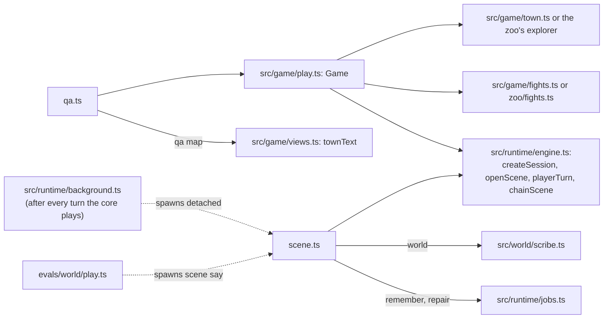

# src/cli: the scene harness, the QA console and problem reports

Part of the [architecture overview](../../ARCHITECTURE.md). Where it's going (the QA console on the protocol, as one of the hosts that compose the game) is in [docs/design/productionise.md](../../docs/design/productionise.md#packages-and-bundles).

## What it is

Two command lines over the game. Every command but `scene play` is a process of its own, with all the state on disk between commands.

- **The scene harness** (`scene.ts`, `npm run scene`) plays the scene runtime alone: one scene at a time, chained to the next, with any approach. It has no map, no fights and no UI. The blind QA rounds in [docs/qa](../../docs/qa/) were played through it (`scene start`, then `scene say` a turn at a time). It is also how the game runs its background jobs outside the browser: `src/runtime/background.ts` starts `scene.ts remember` and `scene.ts repair` as detached processes after every turn.
- **The QA console** (`qa.ts`, `npm run qa`) plays the whole game headless through the game core (`src/game/play.ts`): Caerwyn on the map, the scenes, the fights on the map, The End, or a zoo visit. You observe, then act by an action id from the observation, or say something in a scene. It's V1's QA console without the socket. [docs/design/productionise.md](../../docs/design/productionise.md) treats the calls it sits on (observe, act by id, say) as the server's API in embryo.

## What it owns

Neither CLI keeps state of its own. What they read and write is the runtime's and the core's:

| file | written by | what it is |
|---|---|---|
| `runs/sessions/<id>/state.json` | both (src/runtime/session.ts) | the scene runtime's session |
| `runs/sessions/<id>/game.json` | the QA console (the core) | the game: mode, story, where the player stands, the fight |
| `runs/sessions/<id>/snapshots/<scene>-turn-NNN.json` | the runtime | the session after each turn (eval fixtures are copied from these) |
| `runs/sessions/<id>/calls.jsonl` | both (`setCallLog`) | every model call, with what it saw and cost |
| `runs/sessions/<id>/remember-N.lock`, `repair.lock` | the harness, background.ts | a background job running; the job deletes it when it's done |
| `runs/sessions/<id>/world-<scene>.ts` | `scene world` | the scribe's world-update script for a finished scene |
| `<output>/REPORT.md` and a copy of the session | `qa dump` | a bug report |
| `runs/reports/<time>-<game>.json.gz` | the game (src/report), or `npm run report -- make` | a problem a player reported: read it with `npm run report` (below) |

`KM_RUNS_DIR` moves `runs/`.

## How it fits



- **qa.ts** creates or loads a `Game` with the town's explorer and `mapFights()` (qa.ts:79, qa.ts:85), or a zoo visit (`newZoo`, `loadZoo` from src/game/zoo/game.ts). It uses `observe`, `act`, `say` and `endScene`, the same calls and action ids the app makes. `qa map` prints `townText` (src/game/views.ts) and the scene's world from above (`asciiMap`).
- **scene.ts** calls the runtime directly: `createSession`, `openScene`, `playerTurn` (streaming through `TurnHooks` on a terminal) and `chainScene`. `world` runs the scribe (src/world/scribe.ts) on the snapshot each finished scene ended on. `sheet` is the rules' `sheetText`, `memories` lists the docs service's per-session overlay (src/lore/docs.ts).
- **Who starts scene.ts besides a person:** `src/runtime/background.ts:25` spawns it for `remember` and `repair` after every turn of the terminal game, the server build's game and the QA console. In the static build there are no processes, so the worker runs the same jobs in-process (`setBackgroundRunner`, src/web/static/game.tsx). `evals/world/play.ts` drives `scene say` as separate processes with a stage-manager trace preloaded.

## How it works

**A harness turn** (`scene say`, scene.ts:169):

1. Wait for the co-GM's last job, up to `KM_REPAIR_WAIT_MS` (0 by default: never hold the player for it).
2. Load the session, and point the call log at it.
3. `playerTurn`, streaming the reply on a terminal.
4. Start the turn's background jobs, detached (`spawnRemember`, `spawnRepair`): the memory review if the approach has memory, and the co-GM's repair while the scene is still going.
5. If the scene ended, chain to the next and play its opening. A combat ending isn't fought: "For this PoC, the party wins."

`scene play` does the same in a readline loop, with `/sheet`, `/map` and `/quit` (the old `#sheet` and `#map` too). `scene start` prints the opening and stops, so a QA player can go on with `scene say`.

**A QA command** (qa.ts:62): load the game (with the zoo's explorer if `game.json` says `hub: "zoo"`), do one thing, let the core save, and print the observation: the mode, what the player sees, the hint and the actions with their ids. After `act` or `say` in a scene it doesn't print the scene again, only what can be done next. The scene's suggested lines come a moment after the reply, so `act` and `say` wait for them (`Game.suggested`) and list them as `say_1`…: `qa act --id say_2` says that line. `qa suggestions --session <id> [on|off]` is the game's setting, as the app's Esc menu and `/suggestions` have it.

Beside them, `doc-anchors.ts` (`npm run docs:anchors`) keeps the docs' line links pointing at what they meant: a link named for a symbol goes to its definition, and any other follows its line from the commit that wrote it, through the diff. `--check` only lists what's moved, and fails if anything has. Run it after a merge.

## Where to look first

- **A new command or flag:** the `USAGE` string and `main()` in each file. Both are flat `if` chains on the command name.
- **A change to how the jobs start:** scene.ts:77–87 (`spawnRepair`, `spawnRemember`) and src/runtime/background.ts:37 (`afterTurn`) are two copies of the same rule, and must agree. background.ts asks `sceneApproach` (a talk has no co-GM); the harness asks `approachById`.
- **A change to what QA players see:** `print` and `options` in qa.ts, and `Game.observe()` in src/game/play.ts, which writes the text and the actions. A GM reply is followed by its markup in words (`render` in play.ts, `markupLines` in src/runtime/markup.ts): `⟨who says what: …⟩` (a tag that's nobody in the cast, someone the GM brought in, as "the porter (not in the cast)"; a line nobody can tell, "nobody can tell"), then a line for each marked phrase with its kind, its note and what it's linked to (a lore doc by its name), so a QA player can check who spoke and that no note gives away what the player doesn't know. The scene harness and the transcripts (`qa transcript`, `scene transcript`) show it the same way; the harness prints a reply's notes when they're written, a moment after it (`onMarks`).

## How to test it

There are no unit tests of the CLIs themselves. `npm run typecheck` covers them, and the core they drive has its tests (src/game, src/app/smoke/flow.ts). To try them:

```sh
npm run scene -- list                                              # scenes and approaches
npm run scene -- start hanged-clerk --session try --approach v2   # the opening (needs the model)
npm run scene -- say try '(I look up at the hoist rope)'
npm run scene -- status try                                        # beat, path, co-GM notes, latency, cost (not for blind QA)
npm run scene -- transcript try
npm run scene -- world try                                         # the scribe on every finished scene

OPENROUTER_API_KEY=offline npm run qa -- new --session z1 --zoo   # a zoo visit, no model needed to walk it
npm run qa -- observe --session z1
npm run qa -- act --session z1 --id go_to_lead
npm run qa -- map --session z1 --w 100 --h 30
npm run qa -- new --session g1 --as "Tamsin Vell: a disgraced palace auditor"   # a story game (the model builds the character)
npm run qa -- builds --session g2 --as "Brother Odo: a large, gentle hedge-priest"   # character creation's three builds, as cards
npm run qa -- new --session g2 --as "Brother Odo: a large, gentle hedge-priest" --build 1 --backstory-file /abs/odo.md --accept-fixes   # one of them, with a backstory checked against the lore
npm run qa -- end --session g1                                      # in a scene, lists its exits; --exit <id> takes one
npm run qa -- suggestions --session g1 off                        # the suggested lines off (on asks for this moment's at once)
npm run qa -- dump --session g1 --output /abs/path --description "what went wrong"
```

## Reports: investigating a problem a player reported

A player who hits a problem reports it from the game (b on the map and in a fight, `/report` in a scene, Report a problem… in the Esc menu, or the title's, about the latest game: src/app/README.md). The game says where the report went: "Saved runs/reports/<file>: tell Claude 'report <file>'". The file is everything needed to look into it: what they said, the build and settings, where they were and the screen, the game's saves, snapshots, model calls and notes, its cost, and the errors caught (src/report/dump.ts). The key is never in it.

```sh
npm run report -- inspect <file>                   # the summary (below)
npm run report -- inspect <file> --turns 8         # more of the last turns
npm run report -- inspect <file> --call 13         # call #13 in full: its prompt (or the decider's state and questions) and its reply
npm run report -- inspect <file> --snapshot 3      # turn 3's snapshot: the scene's state, its transcript, its world from above (--raw: JSON)
npm run report -- inspect <file> --diff 3          # the world from the turn before 3 to 3 (--diff 1 3: between two turns)
npm run report -- inspect <file> --screens         # the last few screens before it, and the one it was reported from
npm run report -- inspect <file> --errors          # every error caught, with its whole stack
npm run report -- inspect <file> --calls           # every call, a line each: when, which turn, how long, what it cost, whether it failed
npm run report -- inspect <file> --world           # the scene's world now, from above
npm run report -- inspect <file> --json            # the whole report, as JSON (for jq)
npm run report -- restore <file> [--as <id>]       # its game as a new session, as it was reported
npm run report -- list                             # the reports on this machine, newest first
npm run report -- make --session <id> "<words>"    # a report from a saved game (a QA session, say), as the game would make one
```

`<file>` is a path; or a name, looked for in runs/reports (`KM_RUNS_DIR`'s) and in ~/Downloads (where the static build's go); or `latest`. "report <file>", as the game puts it, works too.

### Investigating one

1. **Read the summary:** `npm run report -- inspect <file>`. It says, in order:
   - what the player said, when, the build (the commit, with local changes or not; the static build's stamp), the settings (the approach, the glyphs, the terminal's size, the browser), the game and where they were in it: the screen and what was open over it, the mode, the scene, its beat and turn, a turn under way;
   - the screen as it was, as text;
   - the last turns: each player's line; the decider's answers (what stands out first, the quiet ones in brackets); the rules' details and lines (🎲); the path the scene took; the GM's reply; the decision after it; the stage manager's operations, with what came of them in the world (`(not done)` for what it couldn't do); the other calls of the turn; and its timing and cost;
   - on the map, What happens; in a fight, who's where, their hit points and its last lines; in the zoo, the wing, what's been seen and the last thing set off;
   - the world's changes;
   - the errors caught, failed or retried calls, slow calls (8 s or more, or first text after 3 s), and every operation's calls, latency and cost, beside the cost ledger's lines for the game.
2. **Find the turn it went wrong in,** and the call behind it. Each call has a number (#n): `--call n` shows exactly what the model was told and what it said. Calls go with the turn whose player's line their prompt holds.
3. **Look at the world:** `--diff` shows what changed between turns, `--snapshot` the scene as it stood, `--world` where everyone is now.
4. **Play it again:** `npm run report -- restore <file>` makes its game a new session (a new id: nothing is overwritten), at the moment it was reported (a report made mid-turn restores to the save before that turn). Then `npm run qa -- observe --session <id>` and `qa say` / `qa act` to try it, or `npm run game` and Continue (it's the latest game; a zoo visit is the title's zoo).
5. **Fix the cause,** generally, and keep the moment as a case (docs/guide/testing.md: a snapshot from `--snapshot <turn> --raw` is a fixture).

### What's in a report

One file, gzipped JSON (`kind: "kingmaker-report"`, `format: 1`):

- `words`, `at`: what the player said, and when;
- `build`: `host` (terminal, server or static), `commit`, `dirty`, `stamp`, `node`, `platform`, the save formats;
- `settings`: `approach`, `glyphs`, `terminal` (cols and rows), `window` and `userAgent` (in a browser), `offline`, and `env` (the `KM_*` settings and the terminal's: never anything named like a key);
- `where`: the app's `screen`, the `overlay` it came from, `busy` (a turn under way), `over`, `fight` (round, whose turn), `latest` (from the title), and `place` (the mode, scene, beat, turn, time, map and tile, from the files);
- `screens`: `now` (as it was reported) and `recent` (the last few before it);
- `game`: `id`; `files` (`game`, `state`, `app`: what's saved; one that wouldn't parse is kept as `{ unreadable }`); `live` (the game in memory, when a turn was under way); `snapshots` (the last 10); `calls` (`total`, and `kept`: all of them, or the last 300); `memoryReviews`; `repairs`; `docs` (the overlay the game wrote); `ledger` (its lines of the cost ledger); `others` (anything else in its folder: a lock file says a background job was still running);
- `errors`: everything caught or logged (`console.error`, `console.warn`), with its stack;
- `zoo`: a visit's own state;
- `redacted`: how many keys were taken out.

Before it's written, the key in use (and the dev key, if there is one on the machine) and anything shaped like an OpenRouter key (`sk-or-…`) are taken out of all of it, and a screen with a key on it isn't kept (src/report/redact.ts; src/report/report.test.ts plants keys in a call log, a save, the docs, an error and the screen, and fails if one survives).

## Known gaps and sharp edges

- **Offline, the QA console can't play a scene.** A scene's opening needs the GM. When it fails, the game is still on the map, because the core saves only once the opening has come, and each command is a new process. The app keeps the scene on screen in memory, and the zoo's tour ends it in the same process, so both can end it offline. `qa end` can't.
- **The QA console always plays `v2`.** `Game.create` (src/game/play.ts) fixes the approach. The harness takes `--approach`.
- **Background jobs race the next command.** The QA console doesn't wait for the last turn's jobs. The harness waits for the co-GM only if `KM_REPAIR_WAIT_MS` says so. Jobs write their own files, which the next turn picks up when it finds them.
- **Hidden commands.** `remember`, `repair` (the background jobs) and `memories` aren't in the harness's usage text.
- **Unused imports kept alive.** scene.ts ends with `.finally(() => { void sessionSpend; void readFileSync; void applyRepair; })` (scene.ts:278). Nothing else in the file uses `sessionSpend` or `applyRepair`.
- **No fights in the harness.** A combat exit is skipped as won. Fights are only in the playable game (the app, the QA console, the zoo's tour).
