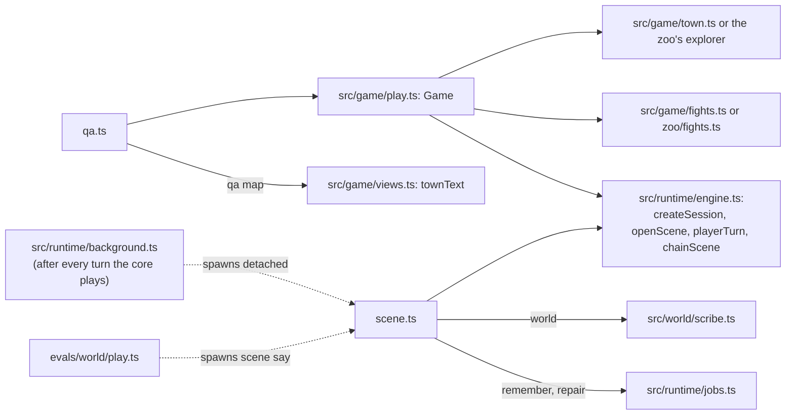

# src/cli: the scene harness and the QA console

Part of the [architecture overview](../../ARCHITECTURE.md). Where it's going (the QA console on the protocol, as one of the hosts that compose the game) is in [docs/design/productionise.md](../../docs/design/productionise.md#packages-and-bundles).

## What it is

Two command lines over the game. Every command but `scene play` is a process of its own, with all the state on disk between commands.

- **The scene harness** (`scene.ts`, `npm run scene`) plays the scene runtime alone: one scene at a time, chained to the next, with any approach. It has no map, no fights and no UI. The blind QA rounds in [docs/qa](../../docs/qa/) were played through it (`scene start`, then `scene say` a turn at a time). It is also how the game runs its background jobs outside the browser: `src/runtime/background.ts` starts `scene.ts remember` and `scene.ts repair` as detached processes after every turn.
- **The QA console** (`qa.ts`, `npm run qa`) plays the whole game headless through the game core (`src/game/play.ts`): Caerwyn on the map, the scenes, the fights on the map, The End, or a zoo visit. You observe, then act by an action id from the observation, or say something in a scene. It's V1's QA console without the socket. [docs/design/productionise.md](../../docs/design/productionise.md) treats the calls it sits on (observe, act by id, say) as the server's API in embryo.

## What it owns

Neither CLI keeps state of its own. What they read and write is the runtime's and the core's:

| file | written by | what it is |
|---|---|---|
| `runs/sessions/<id>/state.json` | both (src/runtime/session.ts) | the scene runtime's session |
| `runs/sessions/<id>/game.json` | the QA console (the core) | the game: mode, story, where the player stands, the fight |
| `runs/sessions/<id>/snapshots/<scene>-turn-NNN.json` | the runtime | the session after each turn (eval fixtures are copied from these) |
| `runs/sessions/<id>/calls.jsonl` | both (`setCallLog`) | every model call, with what it saw and cost |
| `runs/sessions/<id>/remember-N.lock`, `repair.lock` | the harness, background.ts | a background job running; the job deletes it when it's done |
| `runs/sessions/<id>/world-<scene>.ts` | `scene world` | the scribe's world-update script for a finished scene |
| `<output>/REPORT.md` and a copy of the session | `qa dump` | a bug report |

`KM_RUNS_DIR` moves `runs/`.

## How it fits



- **qa.ts** creates or loads a `Game` with the town's explorer and `mapFights()` (qa.ts:79, qa.ts:85), or a zoo visit (`newZoo`, `loadZoo` from src/game/zoo/game.ts). It uses `observe`, `act`, `say` and `endScene`, the same calls and action ids the app makes. `qa map` prints `townText` (src/game/views.ts) and the scene's world from above (`asciiMap`).
- **scene.ts** calls the runtime directly: `createSession`, `openScene`, `playerTurn` (streaming through `TurnHooks` on a terminal) and `chainScene`. `world` runs the scribe (src/world/scribe.ts) on the snapshot each finished scene ended on. `sheet` is the rules' `sheetText`, `memories` lists the docs service's per-session overlay (src/lore/docs.ts).
- **Who starts scene.ts besides a person:** `src/runtime/background.ts:25` spawns it for `remember` and `repair` after every turn of the terminal game, the server build's game and the QA console. In the static build there are no processes, so the worker runs the same jobs in-process (`setBackgroundRunner`, src/web/static/game.tsx). `evals/world/play.ts` drives `scene say` as separate processes with a stage-manager trace preloaded.

## How it works

**A harness turn** (`scene say`, scene.ts:161):

1. Wait for the co-GM's last job, up to `KM_REPAIR_WAIT_MS` (0 by default: never hold the player for it).
2. Load the session, and point the call log at it.
3. `playerTurn`, streaming the reply on a terminal.
4. Start the turn's background jobs, detached (`spawnRemember`, `spawnRepair`): the memory review if the approach has memory, and the co-GM's repair while the scene is still going.
5. If the scene ended, chain to the next and play its opening. A combat ending isn't fought: "For this PoC, the party wins."

`scene play` does the same in a readline loop, with `/sheet`, `/map` and `/quit` (the old `#sheet` and `#map` too). `scene start` prints the opening and stops, so a QA player can go on with `scene say`.

**A QA command** (qa.ts:62): load the game (with the zoo's explorer if `game.json` says `hub: "zoo"`), do one thing, let the core save, and print the observation: the mode, what the player sees, the hint and the actions with their ids. After `act` or `say` in a scene it doesn't print the scene again, only what can be done next.

## Where to look first

- **A new command or flag:** the `USAGE` string and `main()` in each file. Both are flat `if` chains on the command name.
- **A change to how the jobs start:** scene.ts:69–83 (`spawnRepair`, `spawnRemember`) and src/runtime/background.ts:37 (`afterTurn`) are two copies of the same rule, and must agree. background.ts asks `sceneApproach` (a talk has no co-GM); the harness asks `approachById`.
- **A change to what QA players see:** `print` and `options` in qa.ts, and `Game.observe()` in src/game/play.ts, which writes the text and the actions.

## How to test it

There are no unit tests of the CLIs themselves. `npm run typecheck` covers them, and the core they drive has its tests (src/game, src/app/smoke/flow.ts). To try them:

```sh
npm run scene -- list                                              # scenes and approaches
npm run scene -- start hanged-clerk --session try --approach v2   # the opening (needs the model)
npm run scene -- say try '(I look up at the hoist rope)'
npm run scene -- status try                                        # beat, path, co-GM notes, latency, cost (not for blind QA)
npm run scene -- transcript try
npm run scene -- world try                                         # the scribe on every finished scene

OPENROUTER_API_KEY=offline npm run qa -- new --session z1 --zoo   # a zoo visit, no model needed to walk it
npm run qa -- observe --session z1
npm run qa -- act --session z1 --id go_to_lead
npm run qa -- map --session z1 --w 100 --h 30
npm run qa -- new --session g1 --as "Tamsin Vell: a disgraced palace auditor"   # a story game (the model builds the character)
npm run qa -- end --session g1                                      # in a scene, lists its exits; --exit <id> takes one
npm run qa -- dump --session g1 --output /abs/path --description "what went wrong"
```

## Known gaps and sharp edges

- **Offline, the QA console can't play a scene.** A scene's opening needs the GM. When it fails, the game is still on the map, because the core saves only once the opening has come, and each command is a new process. The app keeps the scene on screen in memory, and the zoo's tour ends it in the same process, so both can end it offline. `qa end` can't.
- **The QA console always plays `v2`.** `Game.create` (src/game/play.ts) fixes the approach. The harness takes `--approach`.
- **Background jobs race the next command.** The QA console doesn't wait for the last turn's jobs. The harness waits for the co-GM only if `KM_REPAIR_WAIT_MS` says so. Jobs write their own files, which the next turn picks up when it finds them.
- **Hidden commands.** `remember`, `repair` (the background jobs) and `memories` aren't in the harness's usage text.
- **Unused imports kept alive.** scene.ts ends with `.finally(() => { void sessionSpend; void readFileSync; void applyRepair; })` (scene.ts:267). Nothing else in the file uses `sessionSpend` or `applyRepair`.
- **No fights in the harness.** A combat exit is skipped as won. Fights are only in the playable game (the app, the QA console, the zoo's tour).
