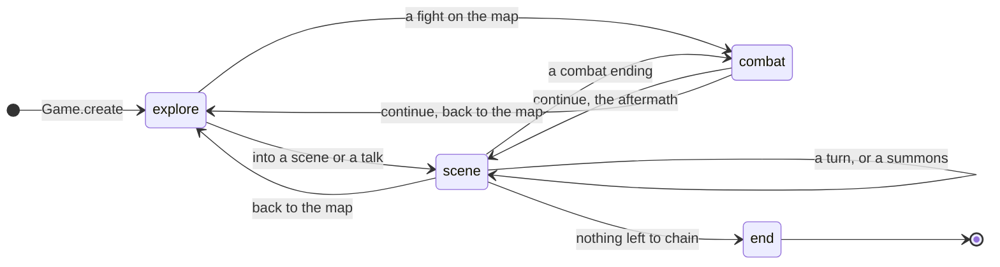
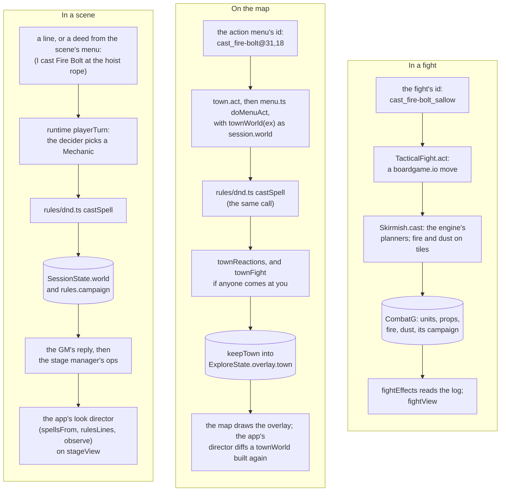

# src/game: the game core

Part of the [architecture overview](../../ARCHITECTURE.md). Where it's going (`Game` as the server's API in embryo, with intents and events crossing the seam as data) is in [docs/design/productionise.md](../../docs/design/productionise.md#the-seam).

## What it is

The playable game without a UI. A `Game` ([play.ts](play.ts)) holds a game's state and its runtime session, and moves between four modes: exploring the map, a GM-run scene, a fight, and The End. Everything is done by action id (`walk_northeast`, `talk_kell`, `cast_fire-bolt@31,18`, `attack_crake-1`, `continue`) or, in a scene, by saying something, so the terminal app, the QA console, the zoo's tour and the smoke tests all play the same game. Exploring and fighting plug in behind two interfaces, `Explorer` and `FightFactory`; the story's are Caerwyn on the map ([town.ts](town.ts)) and tactical fights on the scene's own place ([fights.ts](fights.ts)).

Its subdirectories have docs of their own: [map/](map/README.md) (tile maps, exploration, the isometric renderer), [look/](look/README.md) (how everything is drawn), [combat/](combat/README.md) (fights) and [zoo/](zoo/README.md) (every feature on maps of its own).

## What it owns

| file | what's in it |
|---|---|
| [`play.ts`](play.ts) | [`Game`](play.ts#L139) and [`GameState`](play.ts#L43); the modes and the story flow between them; the [`Explorer`](play.ts#L83), [`Fight`](play.ts#L120) and [`FightFactory`](play.ts#L128) interfaces; `Observation` and `Action` |
| [`types.ts`](types.ts) | The seams between the map, combat and the app: `TileMap`, `MapActor`, `Region`, `StoryState`, `CombatSetup`, `CombatResult`, styled lines |
| [`town.ts`](town.ts) | [`town`](town.ts#L473), the story's Explorer: the map module's exploration behind action ids (walking, talking, doors, ways out, the lead), the right-click menu ([`actionsAt`](town.ts#L325)), and the action menu's entry points ([`actionMenu`](town.ts#L425), [`aimFor`](town.ts#L430), [`aimAt`](town.ts#L437)) |
| [`town-world.ts`](town-world.ts) | [`townWorld(ex)`](town-world.ts#L130): the map's things and people as a scene world, for the rules out of scenes; [`keepTown`](town-world.ts#L256), which writes what the rules changed into the map's overlay |
| [`menu.ts`](menu.ts) | The action menu on the map: aiming ([`checkAim`](menu.ts#L244), [`aimView`](menu.ts#L378)), doing it through the rules ([`doMenuAct`](menu.ts#L516)), the town's reactions to violence ([`townReactions`](menu.ts#L678)), a fight that breaks out ([`townFight`](menu.ts#L728)), and acts that open a scene or a talk ([`storyRoute`](menu.ts#L499)) |
| [`scene-menu.ts`](scene-menu.ts) | Pointing and right-clicking in a scene's place: [`thingActions`](scene-menu.ts#L417), [`lookText`](scene-menu.ts#L243), [`pointedAt`](scene-menu.ts#L202). It makes glances and deeds (the player's turn as words, "(I pick up Prout's satchel)"), never rules calls |
| [`fights.ts`](fights.ts) | [`mapFights()`](fights.ts#L10): tactical fights on the scene's place (the map module's `battlefield`) |
| [`views.ts`](views.ts) | Every picture: [`townView`](views.ts#L59), [`stageView`](views.ts#L101), [`fightView`](views.ts#L130), and [`fightEffects`](views.ts#L166) (a fight's log played as effects) |
| `places.ts`, `fight-standin.ts` | The text explorer and the one-action fight from before the map and combat. Neither is wired in; the fight stand-in only carries on a fight it saved itself |
| `views-check.tsx` | OpenTUI draws a fight exactly as the map renders it |

### State

`GameState` is saved in runs/sessions/&lt;id&gt;/game.json, beside the runtime's state.json:

- `mode`; `story` (the time of day, the scenes played, the lead, flags); `recent` (what the next observation says first);
- `explore`, the explorer's own: for the town a `TownState` (the map's `ExploreState`, with its overlay of what scenes and the rules did to places; a short log; when the player last rested; where they were seen trying to hide);
- `combat`, the fight in progress as its module saves it, and `fightOnMap` when it should end back on the map;
- `hub` and `hubTime` for a zoo visit.

[`Game.save()`](play.ts#L186) writes both files, synchronously, after every act and every line said.

## How it fits

- **Called by:** src/app/game.ts (the terminal app, which holds a `Game` as a live object and reads its state, session and fight), [src/cli/qa.ts](../cli/qa.ts) (the QA console, which loads it from disk for every command), src/game/zoo (its own Explorer and fights over the same `Game`), the smoke tests (src/app/smoke/flow.ts) and the zoo's tour.
- **Calls:** [the scene runtime](../runtime/README.md) (`createSession`, `openScene`, `playerTurn`, `chainScene`, `forceEnding`, `resumeAfterFight`, `openHubScene`, `closeHubScene` in src/runtime/engine.ts; talks in src/runtime/talk.ts; `afterTurn`, the co-GM and memory reviews in the background), [src/rules](../rules/README.md), [src/world](../world/README.md), and its own map, look and combat modules.

| entry point | does |
|---|---|
| `Game.create({ player, explorer, fights, build?, seed?, level?, hub? })` | a new game: the session, the character (from the concept, or a ready-made build), the first lead |
| `Game.load(id, explorer, fights)` | a saved game (`Game.hubOf(id)` says whose explorer it needs) |
| `observe()` | what to show and the actions, for the mode |
| `act(id, hooks)` | an explore or fight action, or a talk's line |
| `say(text, hooks, { mechanic })` | a scene turn; `mechanic` is the rules' act already chosen (the action menu's) |
| `endScene(exitId)`, `carryOn()` | for QA: take one of a scene's endings now; go on from a scene that ended but never moved on |

## How it works

### The modes



| transition | where |
|---|---|
| into a scene or a talk | [`beginScene`](play.ts#L335), [`beginTalk`](play.ts#L318). An act that opened it is the scene's first turn, its mechanic already chosen ([play.ts:229](play.ts#L229)) |
| a scene ends | [`afterScene`](play.ts#L349): a fight if the ending says so; otherwise the explorer keeps the place (`leaveScene`) and [`onward`](play.ts#L434) chains the next scene (a lead to walk to, a summons, or The End). A hub's scene goes back to its map ([`backToHub`](play.ts#L370)) |
| a fight from the map | [`beginFight`](play.ts#L387), with `fightOnMap` set |
| a fight ends | [`afterFight`](play.ts#L403): back on the map (the explorer's `afterFight`), or the scene's aftermath (`resumeAfterFight`); the player comes round (`comeTo`); a story fight's flags go into the story |

### Action ids

The ids are the core's contract with every client. A QA observation lists the ones that make sense now; the by-tile and aimed forms take any tile, and say why when it won't do.

| mode | handled by | ids |
|---|---|---|
| explore | [`town.act`](town.ts#L540) | `walk_<direction>` (north is up-left on screen), `go_to_lead`, `go_to_<who or where>`, `talk_<id>`, `examine_<id>`, `enter_<place>`, `travel_<way>`, `open_door_<direction>`, `interact`, `look`; by tile, for a click: `walk@x,y`, `look@x,y`, `talk@x,y`, `enter@x,y`, `travel@x,y`, `door@x,y` |
| explore: the action menu | [`storyRoute`](menu.ts#L499), then [`doMenuAct`](menu.ts#L516) | `cast_<spell>`, `cast_<spell>_self`, `cast_<spell>@x,y`, and the same for `feature_<id>`; `attack@x,y`, `throw@x,y`, `shove@x,y`, `grapple@x,y`, `jump@x,y`; `hide`, `rest_short`, `rest_short_recover`, `rest_long`, `use_<item>` |
| scene | `Game.say`; a talk's choices through `Game.act` | anything said; in a talk `say_1`…, `say_goodbye`, `walk_on` |
| combat | [`TacticalFight.act`](combat/fights.ts#L184) | `attack_<target>[_with_<weapon>]`, `cast_<spell>` (on yourself), `cast_<spell>_<target>`, `cast_<spell>_at_<target>` or `_at_<x>_<y>` (an area), `use_<prop>`, `close_<id>`, `make_for_the_door`, `step_<direction>`, `move_<x>_<y>`, `leave`, `dash`, `dodge`, `disengage`, `auto`, `end_turn`; when it's over, `continue` |

The zoo's explorer adds its own (each exhibit's `use_<trigger>`): see [zoo/](zoo/README.md).

### The town's world

Out of a scene the session has no world, so the rules get one built from the map. [`townWorld(ex)`](town-world.ts#L130) takes what the map has here (`actorsHere`: its decor and people, what played scenes left, the player), adds the doors the map draws as tiles, guesses each thing's material and size from its name ([`STUFF`](town-world.ts#L68)), and lays it out in feet from the map's corner, 5 ft a tile. A place whose scene is still to come isn't in it: its people and things are `waiting`, and an act at one of them opens that scene with the act as its first turn ([`storyRoute`](menu.ts#L499)). An act that would hurt Kell or work on her mind opens a talk with her instead.

`doMenuAct` swaps the town's world in as `session.world` while the rules run ([`onTown`](menu.ts#L482)), lets the people about react to violence (`townReactions`: most run, some cower, the guards come on), sets out a fight if anyone comes at the player (`townFight`, a `CombatSetup` for `Game` to start), and [`keepTown`](town-world.ts#L256) writes what changed into the map's overlay (`ex.overlay.town`): the things as they were left, the people until the clock moves on, the spills. The map draws from the overlay, and it saves with the game. On a map with a world live on it (a zoo's wing), that world is used instead, changed in place.

### A spell or a blow, end to end

The same Fire Bolt, three ways. Scenes and the map share the rules calls in src/rules/dnd.ts; fights call the engine through their own bridge.



- **In a scene** the rules act on the scene's world and return dice lines and a directive. The lines go into the transcript, the directive into the GM's brief ("Narrate exactly this"), and after the reply the stage manager records the knock-on effects the GM narrated. The app's look director plays the lines (the spell from caster to aim, damage numbers) and then the world's difference (what caught fire, broke or moved).
- **On the map** the same rules calls act on the town's world. What they change is kept in the map's overlay, and the app plays the act's lines in a town world built again after the act. If anyone comes at the player, the act's `fight` starts one on the map, and the fight's lane takes over.
- **In a fight** the engine is the same but the board is the fight's own: tiles on fire, dust and props in `CombatG`. The app parses the fight's log into effects. When the fight ends, the player's state goes back to the session and the board is written into the scene's world for the aftermath ([combat/](combat/README.md)); a fight from the map writes who fell where into the town's overlay instead (`afterFight` in [town.ts](town.ts#L599)).

### The same rule, coded more than once

Scenes, the town map, the map's ageing of what was left, and fights each have their own coding of the world's rules. They agree in places and not in others.

| rule | in scenes (src/world) | on the town map | in fights (src/game/combat) |
|---|---|---|---|
| what catches fire | `ignite`, by tags, material and wetness ([systems.ts:81](../world/systems.ts#L81)); never a person | the same `ignite`, on materials guessed from names ([town-world.ts:68](town-world.ts#L68)) | the tiles of any fire spell, a broken lit prop, and `fuel` tiles (flammable things on the battlefield) ([skirmish.ts:640](combat/skirmish.ts#L640)) |
| fire over time | `tick`: 1d10 a turn to what burns, spreading 5 ft, wrecks smouldering ([scene-world.ts:715](../world/scene-world.ts#L715)); burning surfaces ([systems.ts:188](../world/systems.ts#L188)); only while something burns | nothing burns on: it's `burning` until a later time of day, when the map makes it destroyed and burnt ([map/reconcile.ts:294](map/reconcile.ts#L294), and again for played scenes' leftovers, region states and spills in the same file), or until the player rests ([menu.ts:819](menu.ts#L819)) | fire runs along the fuel each round ([`spreadFire`](combat/skirmish.ts#L685)) |
| fire and people | never: the player is hurt by fire only through the rules (a spell, or `hazard` when their area explodes) | never | starting a turn beside fire costs 1d6, DEX DC 10 for half ([`scorch`](combat/skirmish.ts#L697)), through the engine's trap rules |
| grain dust | a `dusty` area explodes when something in it burns: 4d6 fire to each thing in it, and the player's save through `hazard` ([src/runtime/engine.ts:293](../runtime/engine.ts#L293)) | none | dust tiles explode when fire reaches them: 5d6 fire to everyone in them, DEX DC 13 for half ([`explode`](combat/skirmish.ts#L657)) |
| damage to things | [`damageThing`](../world/scene-world.ts#L689): AC and HP by material and size, immunities by material; the rules roll our own dice for it ([`objectDamage`](../rules/dnd.ts#L1203)) | the same, on guessed materials | only props (lanterns, braziers) with a fixed AC and HP ([setup.ts:112](combat/setup.ts#L112)); any hit breaks one ([`attackProp`](combat/skirmish.ts#L379)) |
| breaking | [`destroy`](../world/scene-world.ts#L660): what it held falls out, what hung from it falls; [`breakOpen`](../world/systems.ts#L166) spills a container | the same; a broken door can be walked through (the map drops its `blocks`) | [`breakProp`](combat/skirmish.ts#L622): a lit lantern sets fire where it lands, a brazier on its neighbours too |
| a spell's area | [`caughtIn`](../world/scene-world.ts#L370) in feet, through walls | the same, and the aim shows it ([`areaReach`](menu.ts#L328)) | [`areaTiles`](combat/grid.ts#L157) on tiles, stopped by walls |
| reactions to violence | the model decides who flees, cowers or fights (`decideReactions` in src/runtime) | a fixed table, by who they are and a hash ([`townReactions`](menu.ts#L678)) | none: it's a fight |

The models are told the scenes' version: `PHYSICS` and `WORLD_LANGUAGE` in src/world. The productionise review's probes found the bugs this leads to (people don't burn outside fights, a lantern behaves one way in a scene and another in a fight); the plan is one registry of interaction rules for all three ([productionise.md](../../docs/design/productionise.md#the-world-components-and-interaction-rules)).

## Where to look first

- **Action ids are a contract.** The app, the QA console, the zoo's exhibits and tour, the smoke tests and saved games use them. Renaming one is a breaking change: grep for it.
- **Mode changes in play.ts.** Each branch sets `mode`, and some set or clear `fightOnMap`, `hubTime` or `combat`. A new path has to end in a save.
- **The hub's paths** (`hub`, `open`, `backToHub`, `fight: true`, `fightOnMap`) are the zoo's. The story never takes them, so the zoo's tour is their test.
- **The town's entity ids** (`baseId`, `<map>:door@x,y`, a scene's own ids) are the keys of the saved overlay. Changing how they're made orphans what saved games recorded.
- **Aiming and doing must agree.** `checkAim` decides what the menu offers and shows; `doMenuAct` checks the aim again when it acts. The area's aim uses the rules' own `areaPlacement` and `inArea`, so what the bottom line says it catches is what the rules hit.
- **`onTown`** swaps `session.world` and puts it back in `finally`. A rules call made outside it acts on whatever world the session has (or none).
- **A glance in a scene never shows an entity's `description`:** that's the GM's, and holds what the scene means to be found by looking properly. scene-menu.test.ts guards it.
- **`fightEffects`** finds what to play by matching the fight's log lines with regular expressions: a reworded line in src/game/combat changes what's drawn.

## How to test it

```sh
node --no-warnings --test src/game/*.test.ts      # the town, the menu, the scene's menu, fights through the loop, the views: 50 tests, offline, about 6 s
KM_RUNS_DIR=runs/app-test OPENROUTER_API_KEY=offline node --no-warnings src/app/smoke/flow.ts   # the whole arc through the core with the map and fights, no UI
node --no-warnings src/game/zoo/tour.ts           # every exhibit through the core, offline
KM_RUNS_DIR=runs/check node --experimental-ffi --no-warnings --import tsx src/game/views-check.tsx   # OpenTUI draws a fight as the map renders it
```

By hand, through the QA console:

```sh
npm run qa -- new --session doc --as "Wren: a hedge wizard"   # live: the model builds the character and the GM plays the scenes
npm run qa -- observe --session doc                           # what you see, the action menu, and the ids
npm run qa -- act --session doc --id go_to_lead
npm run qa -- say --session doc "(I look at the body)"        # in a scene
npm run qa -- end --session doc                               # in a scene: its endings (--exit <id> takes one)
```

With `OPENROUTER_API_KEY=offline` the console can walk, look and use the action menu (the class defaults stand in for the build), but a scene's opening needs the GM: walking into one fails and nothing is saved, so the game stays on the map. flow.ts and the zoo's tour play offline because they carry on with the live `Game`.

## Known gaps and sharp edges

- **No unit of work.** An act or a turn changes the live `Game` and its session as it goes, and saves at the end. When a model call fails part way, the live game and the files disagree. The app goes back to the last save after a failed scene turn, but keeps the live game after a failed explore act (a scene whose opening didn't come is still on, and `/end` moves on); the QA console reloads the files for every command, so offline it never gets into a scene.
- **The seam isn't data yet.** The app reaches into `core.state`, `core.session` and `currentFight` directly; only the QA console uses the core as an API ([productionise.md](../../docs/design/productionise.md#the-seam)).
- **Refusals come two ways.** On the map and in a scene, an id that isn't there throws (`Unavailable action: …`); on the map, one that's there but can't be done now comes back as a line in brackets ("(Hide: not now, …)"). In a fight an unknown id comes back as a line too. Neither changes the game.
- **The story leaks into the core.** `FIRST_SCENE` is the hanged clerk; the town's reactions and rests speak for Kell and Caerwyn; combat's `encounterFor` special-cases the Heron.
- **Reactions to violence are decided twice:** by the model in scenes, by a fixed table on the map (the table above).
- **The story's flags come only from a fight's result** ([play.ts:419](play.ts#L419)); the zoo sets its own. An exit script's `setFlag` is recorded and not applied (src/world's DSL).
- **The town's world is rebuilt for every menu, aim and act,** from the map's actors and the overlay, and the menu checks every entry against everything in reach. Each QA observation includes the menu, so observing costs a menu build.
- **A fight from the map needs `startWith`.** A factory without it gets the act's text back and no fight ([play.ts:225](play.ts#L225)).
- **menu.ts awaits the rules engine at import** (top-level `await dnd()`), so anything that imports town.ts loads the engine.
- **`places.ts` and `fight-standin.ts` are museum pieces;** the zoo's hall has a sign that says so.
