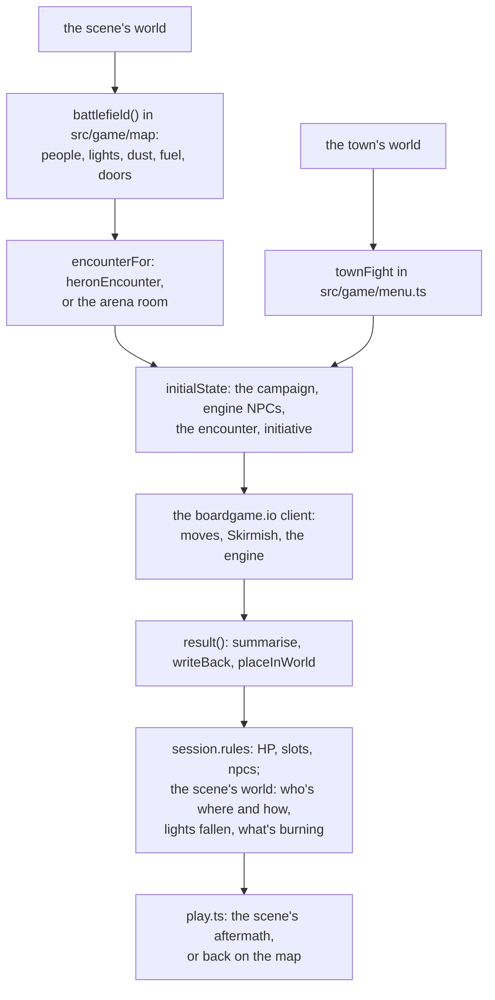
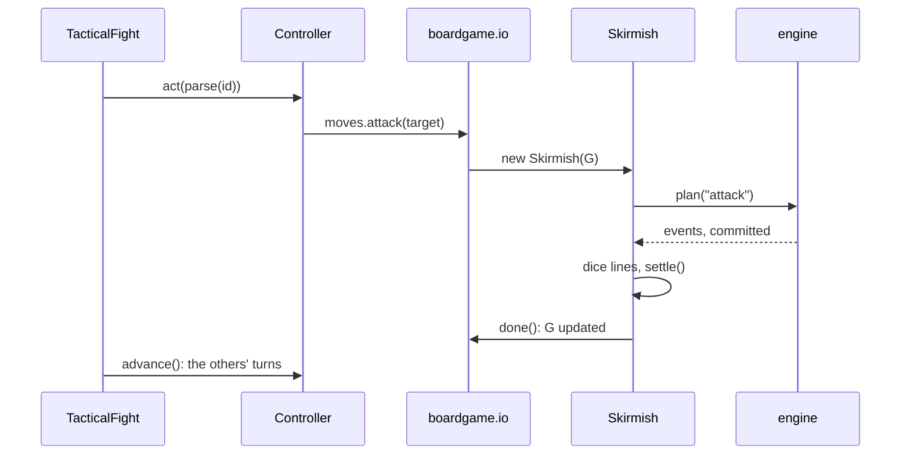
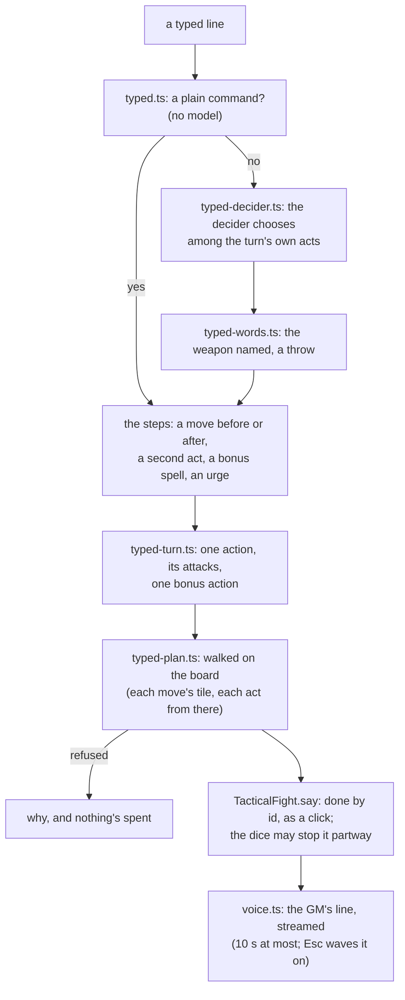

# src/game/combat: tactical fights

Part of the [architecture overview](../../../ARCHITECTURE.md). Where fights are going (on the same world and interaction rules as scenes; boardgame.io kept for fights only) is in [docs/design/productionise.md](../../../docs/design/productionise.md#the-order-of-work).

## What it is

Roll for initiative and fight it out on the map, a turn at a time. A fight is a [boardgame.io](https://boardgame.io) game run headless in the same process: one player per combatant, in the order the rules engine rolled, with a move for everything a combatant can do on their turn. Every roll and every rule the engine keeps (initiative, whose turn it is, movement, attacks, spells, saves, damage, conditions, death saves, opportunity attacks) is the vendored engine's. This module adds the board around them: 5 ft tiles, paths, line of sight and cover, spell areas on tiles and range checks, the hazards (grain dust, fire, lanterns and the brazier), the AI that plays everyone else, the flavour, and the hand-back to the story.

A turn is played by its action ids (a click, a key, the QA console), or typed, as a scene is: plain words are said and answered, and deeds in *asterisks* or (brackets), or plain commands, are read onto the turn's own action ids and done as a click does them, with the GM's line on what the rules did ([A typed line](#a-typed-line)).

The rules decisions (what a diagonal costs, who rolls death saves, when Sallow yields, what the dust does) are written down in the header of [index.ts](index.ts): read it first.

## What it owns

| file | what's in it |
|---|---|
| [`fights.ts`](fights.ts) | [`tacticalFights()`](fights.ts#L56), the play loop's `FightFactory` (`start`, `load`, `startWith`); [`TacticalFight`](fights.ts#L109), the play loop's `Fight` (its text, its action ids, `act`, `say` for a typed line, `save`); [`encounterFor`](fights.ts#L83): the Heron's fight, or the arena room for any other scene |
| [`controller.ts`](controller.ts) | [`startCombat`](controller.ts#L67) and `resumeCombat`: a `CombatController` over the boardgame.io client (`view`, `options`, `act`, `advance`, `result`, `look` for the board as the rules see it, `note` for table talk); writing the end back ([`writeBack`](controller.ts#L270), [`placeInWorld`](controller.ts#L319)); [`summarise`](controller.ts#L382), the story's version of how it went |
| [`game.ts`](game.ts) | [`combatGame`](game.ts#L23), the boardgame.io game: turn order from the engine's encounter, and the moves |
| [`skirmish.ts`](skirmish.ts) | [`Skirmish`](skirmish.ts#L59), the rules of the board, one per move: moving a step at a time, attacks (and Sallow's parry, and something to hand), spells laid on tiles (from a higher slot when asked), a grab and a shove, a word with weight (`influence`, and `moodOf`: how the fight has them take it), a look or a think, props, fire and dust, falling, nerve, surrender, arrest, and how it ends; and the player's `options` |
| [`moves.ts`](moves.ts) | Where a move by name takes someone (next to someone, away from the other side, onto the way out), from where they stand or where a plan would leave them, so a typed plan is checked on the tiles it's then done on |
| [`typed.ts`](typed.ts) | [`readLine`](typed.ts#L60): a typed line read onto the turn: the plain commands, parsed with no model, or the decider; `Reading` |
| [`typed-turn.ts`](typed-turn.ts) | The turn as a typed line sees it: who and what the words name, what each kind of act comes to in action ids (closing in first, the nearest of a kind, an area aimed where it misses your side), why not, and the action economy |
| [`typed-decider.ts`](typed-decider.ts) | The decider's reading: every act the turn allows (and why not for the rest) as its options, the questions (a move and when, a second act, a bonus spell, an upcast, who's spoken to, an urge and how they'd take it), and how sure a read must be to spend something |
| [`typed-words.ts`](typed-words.ts) | The line's own words against the decider's read of a blow: the weapon named, and a throw |
| [`typed-plan.ts`](typed-plan.ts) | A plan walked on the board before it's done: each move's tile (one the next act can be done from), and the first step that couldn't happen |
| [`voice.ts`](voice.ts) | The GM's line on a typed turn (prompts/fight.md): whoever was spoken to answering, or the GM saying what the rules did, given every fact of the fight |
| [`rules.ts`](rules.ts) | The bridge to the engine: `Kit` (one engine and one dice stream a fight), [`Table`](rules.ts#L28) (the live campaign during a move), [`Rules`](rules.ts#L108) (the campaign kept in memory between moves); statblocks ([`STATBLOCKS`](rules.ts#L155), `statblockFor`, `createNpc`); [`diceLines`](rules.ts#L220) |
| [`setup.ts`](setup.ts) | [`initialState`](setup.ts#L34): the session's campaign, the people as engine characters, the engine's encounter and initiative, the props, the dust and the fuel |
| [`model.ts`](model.ts) | The types: [`CombatG`](model.ts#L75), `Unit`, `Prop`, `LogLine`, `PlayerAction`, `PlayerOptions`, `CombatView` |
| [`grid.ts`](grid.ts) | Pure tile geometry: paths (`findPath`, `explore`), lines (`line`, `clearShot`), [`areaTiles`](grid.ts#L157), `rangeFeet` |
| [`ai.ts`](ai.ts) | [`decide`](ai.ts#L39): the next step for everyone else, as the cast's notes in lore/Cast have them; and for the player, for the demo and "let the dice decide" |
| [`heron.ts`](heron.ts), [`heron-grid.ts`](heron-grid.ts) | The Heron's fight as a `CombatSetup` ([`heronEncounter`](heron.ts#L40): Sallow and his Crakes, or Hep's gang before midnight; Kell on your side), and a grid of its own for when the map module has none |
| [`flavour.ts`](flavour.ts) | What a fight looks like in words, in the house style, picked by a hash of the moment |
| [`render.ts`](render.ts) | The fight as text (the QA console, the demo) and as styled lines |
| [`pregen.ts`](pregen.ts) | Ready-made characters, built by the engine without the model, for the demo and the tests |
| [`demo.ts`](demo.ts) | The Heron played headless by the AI on both sides |

### State

`CombatG`, boardgame.io's G, is plain JSON. The play loop saves it in game.json's `combat`, as `{ combat: SavedCombat, unseen }`.

- **The rules:** `campaign` (the engine's serialised campaign: the truth about hit points, slots, conditions and the encounter) and `rng` (the engine's dice state between moves), so a fight carries on and replays exactly.
- **The board:** `map`, `units` (a projection of the engine's characters, for drawing and the AI), `order` and `active`, `round`, `props`, and the tiles of `dust`, `fire` and `fuel`; `exits`.
- **The story:** `log`, `flags` (`dust_exploded`, `fire`, `lit_by`, `walked:<id>`, `grappler:<id>`, `urged:<id>`...), `outcome`, `place`.
- **Table talk** (what was typed, who answered, the GM's line) is kept beside G, never in it: the controller's `notes`, saved in `SavedCombat` with the place in the log each goes. The dice don't hear it.

## How it fits

- [src/game/fights.ts](../fights.ts) makes the story's factory, `mapFights()`, which lays the fight on the scene's own place: the [map module](../map/README.md)'s `battlefield(sceneId, world)` gives the map, where everyone stands, the lit lights, the dusty tiles and what burns.
- [src/game/play.ts](../play.ts) calls `start` when a scene ends in a fight, `startWith` for a fight that breaks out on the map (a `CombatSetup` from `townFight` in src/game/menu.ts), and `load` when a saved game is in a fight. It acts by id through `TacticalFight.act`, and a line typed in a fight goes to `TacticalFight.say` (the core's `say`, as in a scene; `qa say` too). When the fight is over, `result()` gives the `CombatResult` the story goes on from.
- The app draws `TacticalFight.controller` (`view`, `options`, `area`) through `fightView` in src/game/views.ts, plays the log as effects with `fightEffects`, and sets `pace` to give each of the other side's turns its moment. Its fight screen has a box to type in under the log (src/app/README.md, "Typing in a fight").
- The zoo's arena sets out its own rings (src/game/zoo/fights.ts).
- It calls [src/rules](../../rules/README.md) (`dnd()` for the engine, `damageLine`, `inFights` and `RAYS`), boardgame.io's CommonJS client, the scene cards (scenes/), and writes into the session's rules state and the scene's world ([src/world](../../world/README.md)). For a typed line it calls [src/llm](../../llm/README.md): the session's decider, and the fast GM voice with prompts/fight.md (through the runtime's prompt loader).

## How it works

### From a scene to a fight and back



- **Who's in it.** `heronEncounter` reads the scene's cast cards, the session (is it the midnight beat, is Kell absent) and the exit script's `startCombat` operation: Sallow with the talking and the silent Crake and the lantern-boy, or Hep and her porters; Kell on the player's side unless she's absent. Any other scene gets `arenaEncounter`: a plain 20 by 9 room, its leader and their people from `startCombat`, mapped to SRD statblocks (`ASSET_STATBLOCK`).
- **The same people.** Someone the scene's rules already made in the engine (a blow in the scene) is the same engine character in the fight. Someone the fight builds afresh, with a statblock of its own (Sallow's `sword-cane-duellist`, the Crakes' `river-bruiser`), carries their hurt over.
- **Writing back,** once, the first time `result()` is called: the encounter closed; the player's hit points (never below 0, and stable if down), slots and conditions in `session.rules.campaign`; the people the fight made kept in `rules.npcs`; in the scene's world, how everyone is (hurt, down, gone, arrested), and on a map lined up with it, where everyone ended up, the lanterns fallen or broken, the areas on fire, the dust gone up, and what stood within a tile of the fire alight.

### A move



Each operation on a `Skirmish` returns an error message, or nothing when it happened; a refusal is put on `G.error` for the controller to report. boardgame.io's `turn.onBegin` starts a turn (its header, a death save rolled as it began, dodging ending, the heat of the fire), and `turn.onEnd` advances the engine's encounter past anyone who can't take a turn.

### A typed line



- **The plain commands** ("attack sallow", "cast fireball at the crakes", "move to the brazier and kick it over", "dash and leave", "end turn") are read with no model, online and off. Anything else is the decider's; offline, it says the GM is offline, with commands that fit this fight.
- **The decider chooses; it doesn't invent.** Its options are every act the rules allow this turn, at everyone it can reach now or by closing in, each spell at each target (an area with who it would catch), and for the rest why not: out of reach, out of sight, hand to hand with someone only a shot reaches, a spell they can't cast now, something fights don't do yet. An act must be read surely to spend anything: its kind (a Fire Bolt at whoever, a heal, a shove) well ahead of any other. Unsure, it asks which of the two it couldn't choose between (or, with nothing close, for plainer words), and spends nothing.
- **How someone takes being urged to stop is the fight's** (`Skirmish.moodOf`), never the decider's alone: Sallow won't hear of it while his hired hands stand, and hired hands whose paymaster is down would gladly stop. The decider's read of who they are can only make it harder.
- **The plan is walked before it's done.** A move before an act goes to a tile the act can be done from; a way out too far to get through this turn says how far, and that a Dash would do it. Only what the dice decide can stop a plan partway (an opportunity attack that drops you, a blow's target gone down to the one before), and the log says so.
- **An area that would catch you or a friend** says so first, and is done when said again.

### The board's hazards

- **Grain dust.** Fire reaching a dust tile (a fire spell's tiles, a broken lantern, the brazier kicked over, burning sacks beside it) explodes the whole cloud: 5d6 fire to everyone in it, a Dexterity save at DC 13 for half, through the engine's trap rules so resistances and dropping to 0 work as they do for a spell.
- **Fire.** Burning tiles spread along the `fuel` (sacks, a heap of empties) at the end of each round, and starting a turn on or beside them costs 1d6 fire (DC 10 for half). The fight's summary says so, and the story's flags get `heron_burned`.
- **Props.** Lanterns and braziers have a fixed AC and hit points; a hit, or using one, brings it down, and a lit one sets fire where it lands. The lantern-boy's lantern falls when he's hurt.

### The fight's action ids

`attack_<target>[_with_<weapon>]` (or `_with_improvised`), `cast_<spell>` (on yourself), `cast_<spell>_<target>` (a person, or a thing for a fire spell), `cast_<spell>_at_<target>` or `_at_<x>_<y>` (an area), with `_slot<n>` for a higher slot, `use_<prop>`, `shove_<id>`, `push_<id>`, `grapple_<id>`, `urge_<skill>_<yield|go|hold>[_<mood>]_<id>`, `check_<skill>_<dc>`, `close_<id>`, `back_off`, `make_for_the_door`, `step_<direction>`, `move_<x>_<y>`, `leave`, `dash`, `dodge`, `disengage`, `auto` (the AI plays your turn) and `end_turn`. A named move that's there already (`close_<id>` beside them, `make_for_the_door` in it) is no move. When a turn has nothing left worth doing, it ends by itself.

## Where to look first

- **G stays JSON.** Everything a fight needs is in G; the live campaign in `Rules` is a cache keyed by G's serialised campaign, and a loaded fight rebuilds it. Something kept outside G is lost on a save.
- **Determinism.** The engine's dice state rides in `G.rng`, and flavour lines are picked by a hash of the moment, never by the dice. `combat.test.ts` checks that a seed replays the same fight; anything in a move that decides an outcome by `Math.random` or the clock breaks it.
- **`result()` throws until the fight is over,** and writes back the first time it's called after that (the `written` flag is saved with the fight).
- **The Heron is in the code.** Sallow's statblock and parry, the Crakes' and the lantern-boy's roles, Kell's arrests, the `heron_burned` flag (set by any fight with fire in it), the AI's tactics (from lore/Cast/Master Josiah Sallow/gm.md and lore/Cast/The Crake Brothers/gm.md) and the flavour pools. A change to the Heron's cast or their notes may need one here.
- **Twins in src/rules.** `wellFormed`, `missesMiss` and the statblock weapon table are copies of src/rules/dnd.ts's (the first two keyed a little differently), and `diceLines` is a second version of its `describe`. A fix to one usually wants the other.
- **The fight's log is parsed for drawing.** `fightEffects` in src/game/views.ts matches "You cast ...", "attack on ...: hit" and "takes N damage" lines: reword them and check the effects still play.

## How to test it

```sh
node --no-warnings --test src/game/combat/combat.test.ts   # the grid, the Heron, a fight, saves, determinism, the cast's notes: 21 tests, offline
node --no-warnings --test src/game/combat/typed.test.ts    # a typed line: the plain commands, the decider's reading (a stub), the plan walked, refusals that spend nothing
node --no-warnings --test src/game/combat/acts.test.ts     # a grab, a shove, getting up, a word with weight and how the fight has them take it, a look, a higher slot
node --no-warnings --test src/game/fights.test.ts          # the battlefield from the scene's world, and a fight through the play loop
node --no-warnings src/game/combat/demo.ts                 # the Heron, played by the AI on both sides, the grid and the log each round
node --no-warnings src/game/combat/demo.ts --pregen wizard --level 5 --seed 4                 # Fireball meets the grain dust
node --no-warnings src/game/combat/demo.ts --runs 40 --pregens fighter,wizard,rogue,cleric   # outcomes over many seeds
node --no-warnings src/game/zoo/tour.ts --only arena       # the arena's rings: the Heron rehearsed, brawlers, archers, wolves, running for the gate
```

`--hep` plays the fight before midnight (Hep's gang, no Sallow), and `--kell wharf` brings Kell in at the land door. The app's smoke test (src/app/smoke/smoke.py) fights the Heron by mouse in the real terminal UI.

## Known gaps and sharp edges

- **The fight's world is its own.** Tiles on fire, dust and fuel, and props with a fixed AC and hit points (brazier 19 and 10, lantern 12 and 1). It doesn't read the scene world's materials or physics, and writes back only who's where and how they are, fallen and broken lights, burning areas, the dust gone up and what stood within a tile of the fire. So a lit lantern brought down in a fight sets the floor alight, where in a scene a fallen lantern just lies there lit. The full comparison is in [src/game/README.md](../README.md#the-same-rule-coded-more-than-once).
- **Spell areas differ from scenes'.** `areaTiles` lays an area on tiles and walls stop it; a scene's `caughtIn` works in feet through walls.
- **Spells:** only those `inFights` allows (an action or a bonus action, every effect of a kind the board plays: attack, save, auto-hit, heal, a hit-point pool like Sleep's, a buff). No reactions, summons, zones or teleports. Thrown weapons can't be thrown beyond 5 ft yet: the engine's reach check refuses them.
- **Only the Heron has a real setup.** Any other scene's fight is the arena room, set out from the exit script's `startCombat`; the zoo's rings set out their own.
- **The player can't die** in a fight: three failed death saves (or massive damage) leave them "nearly died", written back at 0 HP and stable; the play loop brings them round as the story picks up (`comeTo`). Everyone else is out cold rather than dying, except that massive damage kills a grown combatant.
- **boardgame.io** has had no release since November 2022 and has no exports map: [game.ts](game.ts#L19) loads its CommonJS build with `createRequire`.
- **fights.ts awaits the engine at import,** because a saved fight's `load` must be synchronous.
- **New casts fight generically.** The AI's tactics and the flavour are the Heron's cast's; anyone else falls back to a role by side and statblock (bruiser, brawler, archer, coward, ally).
- **Typed lines can't ask for everything.** Hiding and taking cover, class features (Second Wind, Action Surge, Cunning Action), jumping and climbing, throwing past arm's length, and reactions aren't part of fights yet, and say so. There's no height on the board to shove anyone off. A shove takes the whole action (the engine's), not one attack of it. The AI never grabs, shoves or urges, and someone held never tries to get free.
- **The decider reads well, not perfectly.** An unsure read asks rather than spends, but a confident wrong one is done; `node --no-warnings src/game/zoo/tour.ts --live --only arena` and the typed lines in the zoo's rings are the live check.
