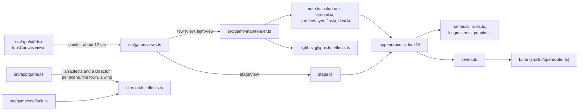

# src/game/look: the look of the world view

Part of the [architecture overview](../../../ARCHITECTURE.md). Where it's going (in the client's bundle, with each interaction rule naming its own look) is in [docs/design/productionise.md](../../../docs/design/productionise.md#the-world-components-and-interaction-rules).

This module is the art direction layer: how anything in the world looks, alive. The research and decisions behind it are in [docs/research/ascii-art-direction.md](../../../docs/research/ascii-art-direction.md).

## What it is

Given a thing's name, kind, tags and states, the look layer decides its cell: a glyph in the chosen glyph set, colours, glow, the light it sheds, how it moves. It also makes the ground alive (water runs, grass sways, fire flickers), lights the world in colour, plays effects (a fireball, a splash, damage numbers, barks), and turns what changed in a world between turns into motion (the director). It draws a scene's world from above (the stage), and it hands the isometric map renderer (`src/game/map/render.ts`) the looks it paints with. Anything the GM invents gets a look at once by rule, and the fast model is asked about names the rules don't know. Animation is a pure function of where, when and a seed, so the same frame can always be drawn again.

## What it owns

- **The glyph set,** once per process: `glyphSet()` reads `KM_GLYPHS` (or guesses), and `setGlyphSet` changes it for everything (the zoo's glyph lever).
- **The model's looks for unknown names,** cached on disk (`runs/look-cache.json`, or `KM_LOOK_CACHE`).
- **`DRESSINGS`,** what each scene's world is built of, by scene id. The zoo writes its wings' and rooms' in as it loads.
- **The types the views pass about:** `Look`, `Lookable`, `LookContext`, `Cell`, `EffectFrame`, `Dressing`, `StageView`, `StagePicks`, `GlyphSet`.

It holds no game state. `Effects` and `Director` are objects the callers make and keep (src/app/game.ts): an `Effects` and a `Director` for each scene, for the town and for a zoo wing, and an `Effects` for each fight.

| file | what it does |
|---|---|
| `appearance.ts` | `lookOf(thing, ctx)`, the look of anything right now: glyph, fg, bg, bold, glow, the light it sheds (flickered), lift, alpha, group, footprint and stamp, burning, wreck. `baseLook` is the static half, cached per kind of thing. |
| `names.ts` | `parseName`: the head noun; states and colours from adjectives; "a flock of", "a pool of", "a bucket of", "a stub of". |
| `roles.ts` | The rules: about 175 roles (glyph per set, colour, motion, light, footprint), matched by head noun, then phrase, then tag, then kind, and a fallback role per kind. |
| `people.ts` | The cast's letters and colours, from the map module's `CAST` (the one cast table). |
| `invent.ts` | Unknown names: an immediate guess, then a batched Luna call (glyphs chosen by name from a menu), cached on disk. `inventNow` invents at once and says what it cost (the place generator uses it). |
| `glyphs.ts` | The glyph sets (kingmaker, ascii, nerd, plain), the verified Nerd Font code points, `km(name)` for our sprites, seven-bit fallbacks, `detectGlyphSet`. |
| `kingmaker.ts` | The kingmaker set's rules: a sprite for a being by the words in its name, then its role ("an old watchman", "a flock of pigeons"), never a beast for a person or a surname for a sprite (Tom Fox is a man); the cast's are their `km` in the cast table. Postures (the dead lie still, sleepers lie down, the hanged hang), wingbeats, dark sprites lifted so they show. |
| `kingmaker-glyphs.ts` | Generated by `tools/glyphs/build.py`: the sprites' names, code points (U+10E000 up) and pixels. |
| `kingmaker-check.tsx` | OpenTUI draws the map and the gallery with sprites, and every row lines up (`npm run glyphs:check`). |
| `color.ts` | Packed-RGB maths, the named palette, Qud's 18 colours, flame ramps, damage colours. |
| `noise.ts` | Hashes, value noise and `flicker`: animation is a pure function of (where, when, seed). |
| `terrain.ts` | Living terrain: ground, walls, surfaces (water, oil, spirits, blood, ash, ice...), flames on a burning surface, clouds, rain. |
| `surfaces.ts` | The world's surfaces (`kind: "surface"` entities from `src/world/systems.ts`) as patches and clouds. |
| `light.ts` | `LightField`: ambient by time of day (indoor and outdoor), coloured sources, soft falloff, shadows from walls; `shade` and `glint`. |
| `effects.ts` | `Effects`: analytic particles, rings, flashes, transient lights, shake; floating numbers, alerts and barks. |
| `director.ts` | Turns world changes into motion: walks (tweens), ignitions, douses, wrecks, explosions, spills, damage numbers, barks from replies. |
| `stage.ts` | A top-down renderer for a scene world: the scene's place in the app, beside the transcript. `StagePicks` records what it drew where, for the mouse. |
| `dressings.ts` | What the story's scene worlds are built of (floors, walls, glass, windows, water), by scene: `DRESSINGS`, `dressingFor`. |
| `map.ts` | The face the isometric map renderer calls (below). |
| `canvas.ts` | The frame (cells), with `toLines()` (StyledLine[]), `toAnsi()`, `toPlain()` and `toJSON()`. |
| `opentui.ts` | `<lookCanvas>`: a live OpenTUI renderable that paints frames (a Canvas, or styled lines) straight into the buffer, at most `fps` new frames a second. |
| `index.ts` | The module's exports, with a summary of each part. |
| `vignettes.ts`, `gallery.tsx`, `dump.ts`, `smoke.py` | The gallery, its headless dump and its smoke test. |
| `frames.ts` | Headless frames of the game's own views (src/game/views.ts) with the look. |

## How it fits



What calls it:

- **src/game/map/render.ts** for every look on the isometric map: things and people (`actorLook`), ground, surfaces, hazards, light, effects and the glyph set.
- **src/game/views.ts:** `stageView` draws a scene's place with `renderStage` and `dressingFor`; `fightView` and `fightEffects` use the cast's looks and the spell elements.
- **src/app/game.ts** keeps the `Effects` and `Director` objects and feeds them: `sceneLook()` for a scene, `townFx()` for the action menu's acts on the map, `fightFx()` for a fight, `mapFx()` for a zoo wing.
- **src/app/ui** draws the live views with `<lookCanvas>` (registered by `registerLookCanvas()` in src/app/main.tsx, and in src/web/static/game.tsx for the browser).
- **src/game/zoo** plays its exhibits' news through the director (`playNews` in zoo/look.ts), and writes its dressings into `DRESSINGS`.
- **src/game/map/generate** asks `inventNow` about a generated place's things, and makes its own dressing.

It calls src/world/scene-world.ts (entities and positions), `CAST` in src/game/map/looks.ts, the model through src/llm/openrouter.ts (invent.ts only), and OpenTUI (opentui.ts, and the gallery and the glyph check).

## How it works

### The API in one screen

```ts
import { lookOf, Effects, Director, renderStage, actorLook, groundAt, surfaceLayer, lookFrame } from "./look/index.ts";

lookOf(entity, { t: now, time: "night", glyphs: "ascii" })   // a cell (+ light, glow, lift...) for anything with a name
lookOf({ name: "a flock of pigeons", kind: "creature" })     // GM inventions too: rules first, the model's cache next, a guess meanwhile

const fx = new Effects();                                     // per scene; the clock is performance.now() unless you pass one
fx.effect("fireball", { from: casterFeet, at: targetFeet, radius: 20 });   // returns { duration, endsAt }
fx.effect("bolt", { from, to, color: "#9ad8ff" }); fx.effect("explosion", { at, radius: 15 }); fx.effect("splash", { at });
fx.float(atOrId, "12", { damage: "fire" }); fx.bark("kell", "Was that strictly necessary?"); fx.alert("cob");
const frame = fx.frame(now, id => positionOf(world, id));     // sprites, areas, texts, lights, shake: all in feet

const director = new Director(fx); director.prime(world);     // when a scene opens
director.spellsFrom(world, ruleLines, now, aliases);          // "Cast Fireball ...: a 20-foot sphere on X": a ball of fire from the player to X
director.rulesLines(world, ruleLines, now, aliases);          // "X takes 7 fire damage", "the big man takes 7 damage" float a 7
director.observe(world, now);                                 // after every turn: walks, fires, douses, spills, wrecks (and hurt the lines didn't float)
director.barksFrom(world, gmReply, now, called);              // short quoted lines over their speakers (called: "the landlady")
director.barkLine(world, "kell", line, now);                  // a cast member's own short line

renderStage(world, dressing, { w, h, t: now, time, effects: fx, positions: id => director.tweens.at(id, now) });  // a Canvas
```

### A look, from a name

`lookOf` (appearance.ts:261) parses the name for its head noun, states and colours (names.ts), matches a role by head noun, then phrase, then tag, then kind (roles.ts), and applies the thing's states (burning, wet, smashed, hanging, hidden). In the kingmaker set, a being gets a sprite by its name, then its role (kingmaker.ts), and the cast get theirs from the cast table. A name no rule knows gets a guess straight away, and a batched request to Luna (invent.ts). The answer is cached, and the next frame uses it.

### How it's wired into the game

The plug-in point is `src/game/views.ts`: every picture of the world the game draws goes through it, with one clock, `t` in milliseconds (`performance.now()` in the app).

**The isometric map** (`src/game/map/render.ts`, for the town, a scene's place on the map and a fight on its battlefield) keeps its own projection, blocks, roofs, cutaways and markers. The look decides the rest:

- **Things and people** are `actorLook(actor, frame)`: world things by the rules, the cast by their letters, the map's decor as authored, with their states (burning things flicker and throw tongues of flame, embers and smoke; smashed ones are splinters; the hidden are faint). The player's highlight, bunting and the hanged man's rope are the map's own.
- **Ground** is `groundAt(terrain, px, py, frame)` per cell, in projected-plane coordinates so it doesn't crawl with the camera; rivers run the way each map's river runs.
- **Surfaces** are `surfaceLayer(world, frame)` for each scene world on the map (`RenderOptions.worlds`): the live scene's, and what played scenes spilled (the map's overlay keeps them; smoke clears and fires burn out by a later hour). They lie over the ground and under actors; smoke and steam veil everything. `reconcile.actorsFromWorld` skips them: they're patches, not actors.
- **Hazards** (`RenderOptions.hazards`) are tiles on fire (`fireAt`), thick with dust (`dustAt`) or scorched: a fight's own, or a world's areas (`areaHazards`: the Heron's dusty floor, where it went up).
- **Light** is per tile and coloured, Brogue-style: the time of day's daylight (`DAYLIGHT` in the map's palette: dimmer in a room whose roof is lifted), plus every source in reach (lamps and fires by `actorLook`'s light, burning patches, effects, a fight's fire, lit windows at night and daylight through them by day), falling off softly and stopped by opaque tiles. Buildings keep a floor of light; people (on the map and on the stage: `shadeBeing`) take only half the light's colour, so they stay who they are (Hobb by the blue fire is still orange), and never sink below 3.5:1 against their ground, so they stay findable at night. The Rat's driftwood fire lights it blue.
- **Effects** (`RenderOptions.effects`: an `EffectFrame` in a region's world feet) are projected: sprites by their feet and height, areas cell by cell, the frame's shake on the camera, and floating text (barks, damage numbers) last and unlit.
- **Plain text** (`color: false`, the QA console's `townText`) stays quiet: the palette's static ground, no motion, no effects, no icons, single-width glyphs.

**A scene's place from above** is `stageView` (the stage with `dressingFor(scene)`). The app keeps one `Effects` and one `Director` per scene (`Game.sceneLook()` in `src/app/game.ts`): primed when the scene's place is first drawn; the rules' lines go to `spellsFrom`, `rulesLines` and `observe` as they land (in that order: a number floats once); the GM's reply to `barksFrom` (and a cast member's own line to `barkLine`); and after every turn `observe` animates what the stage manager changed. The scene screen draws the stage beside the transcript (a live `<lookCanvas>`); `/map` shows the same place on the isometric map with the same effects.

**The town between scenes** has its own `Effects` and `Director` (`Game.townFx()`), playing what the action menu's acts did in the town's world: the spell from the player to its aim, the numbers over what it hurt, the splinters and smoke of what it broke, a puff for whoever ran. In a zoo wing it's the wing's own look (`Game.mapFx()`), which plays the exhibits' news.

**A fight** plays its log as effects (`fightEffects`: a spell from its caster, a ball of fire for fire in an area, sparks where a blow lands, damage numbers, the dust going up), with its dust hanging and its fire burning on the battlefield.

**In the app** the world's views are live canvases that ask for a new frame about twelve times a second (`FPS` in `src/app/ui/common.tsx`) and are held still under an overlay; the rest of the screen redraws only when the game changes.

**Glyph sets.** `glyphSet()` reads `KM_GLYPHS` once; everything the look draws honours it (the map's own glyphs too, in plain).

## Where to look first

- **A thing that looks wrong:** run its name through `describeLook` (appearance.ts:442), which says which rule decided it and how each glyph set draws it. The fix is usually a role in roles.ts or a word in names.ts. Then check that the Hall of Looks in the zoo still reads right (src/game/zoo, wing C).
- **A new effect kind:** effects.ts, then whoever sets it off (director.ts from world changes, `fightEffects` in src/game/views.ts from a fight's log, the zoo's cues).
- **A change to the rules' wording** (the lines src/rules writes): the director finds spells and damage in those lines by pattern (`spellsFrom`, `rulesLines`), so play the zoo's Burning Gallery or its tour to see the numbers still float and the spells still play.
- **Anything per frame** (light.ts, terrain.ts, `actorLook`): it runs for every cell about twelve times a second, so watch the cost. `baseLook` caches the static half by kind of thing.
- **Plain text:** `color: false` must stay quiet and single-width. The QA console and the tests read it.

## How to test it

```sh
# The gallery: eight animated vignettes on real scene worlds, with the real rules and physics.
node --experimental-ffi --no-warnings --import tsx src/game/look/gallery.tsx [rat|yard|dust|surfaces|inventions|glyphs|weather|sprites] [--glyphs kingmaker]
#   keys: ←/→ or 1-8 vignette · space pause · r restart · g glyph set · t time of day · w weather · q quit

# Exact frames, headless (plain, ANSI, or every cell as JSON):
node --no-warnings src/game/look/dump.ts                      # list the vignettes
node --no-warnings src/game/look/dump.ts rat --t 0,8600,15000 # frames at those milliseconds
node --no-warnings src/game/look/dump.ts surfaces --ansi --w 120 --h 40
KM_GLYPHS=kingmaker node --no-warnings src/game/look/dump.ts yard --ansi   # the set from KM_GLYPHS
node --no-warnings src/game/look/dump.ts all --plain --glyphs plain

# The game's own views with the look (the town, scenes on the map and from above, the Heron fight):
node --no-warnings src/game/look/frames.ts                    # .ansi, .txt and .json frames into runs/look-wire

# Tests (33, under a second), and a pty smoke test of the gallery:
node --test --no-warnings src/game/look/*.test.ts
python3 src/game/look/smoke.py
python3 src/game/look/smoke.py --glyphs kingmaker              # in another glyph set (here with the cast as sprites)
npm run glyphs:check                                           # OpenTUI draws sprites on the map and in the gallery, a cell each
```

`npm test` runs the tests with everything else, and CI runs `npm test`. The map's tests check the look on the map too (src/game/map/map.test.ts), and the screens check draws it in the app.

**Environment variables.**
- `KM_GLYPHS=ascii|nerd|plain|kingmaker` sets the glyph set. Without it, `detectGlyphSet` picks kingmaker when the Kingmaker Glyphs font is installed for this user (`npm run glyphs` puts it in `~/.local/share/fonts/kingmaker`) and the terminal is local, not over SSH; plain on a dumb terminal or a locale that isn't UTF-8; and ascii otherwise. nerd needs a Nerd Font, ideally a Mono variant, or kitty or WezTerm. The static build draws with kingmaker unless the page asks otherwise (`?glyphs=ascii`), since it serves the font itself. See [tools/glyphs/README.md](../../../tools/glyphs/README.md).
- `KM_LOOK_CACHE` sets where the model's looks are cached (the default is `runs/look-cache.json`).
- `KM_LOOK_MODEL=off` never calls the model. The tests, `dump.ts`, `frames.ts`, the zoo's tour and the renderer comparison (`npm run web:tui-check`) set it.

## Known gaps and sharp edges

- **Dressings are by scene id.** The arc's four worlds have hand-written dressings (the Rat, the yard and loft, the Heron, the King's room). The zoo's wings and rooms get theirs read off their maps (src/game/zoo/dressing.ts), and a generated place gets one from its compiler. A new scene world with none renders with the stage's defaults (cobbles outside, boards in) and no walls: give it a dressing, or read it off its map as the zoo does.
- **Combat's own letters.** The app draws a fight's cast from the one cast table, and the others with no letter twice (`fightLooks`: a porter's S is Saul's, so he's L), but the combat module's text grid (the QA console's view of a fight, `gridText`) still has letters of its own (Hep is H there, G on the map).
- **The map's light is per tile.** Walls stop it whole tiles at a time, and a block's faces take the light of the tile they stand on.
- **Nerd icons overhang in non-Mono fonts.** The nerd set is opt-in for that reason.
- **The kingmaker set needs its font where the terminal runs.** No terminal query says whether a font is installed, so the guess is whether it's installed here and the terminal is local. Over SSH the game draws letters, since the terminal's fonts are on another machine: set `KM_GLYPHS=kingmaker` if that machine has the font. Without the font, the sprites show as boxes. On the map, sprites appear where the renderer draws its actors through `actorLook`. They match Adwaita Mono's cell, a screen pixel a design pixel at 11 point; a terminal font with another advance draws them a little wide or narrow.
- **The model's looks aren't reviewed.** The menu keeps them sane, but a bad answer stays cached until `runs/look-cache.json` is edited or deleted.
- **The director parses prose.** It finds spells, damage and barks in the rules' lines and the GM's reply by pattern, so it depends on their wording.
- **`renderStage` is one long function** (stage.ts:269; cognitive complexity 324 in [productionise.md](../../../docs/design/productionise.md)'s lint).
