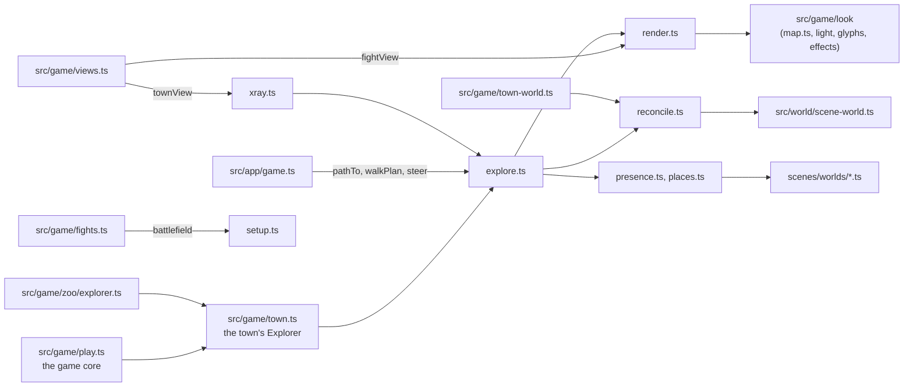
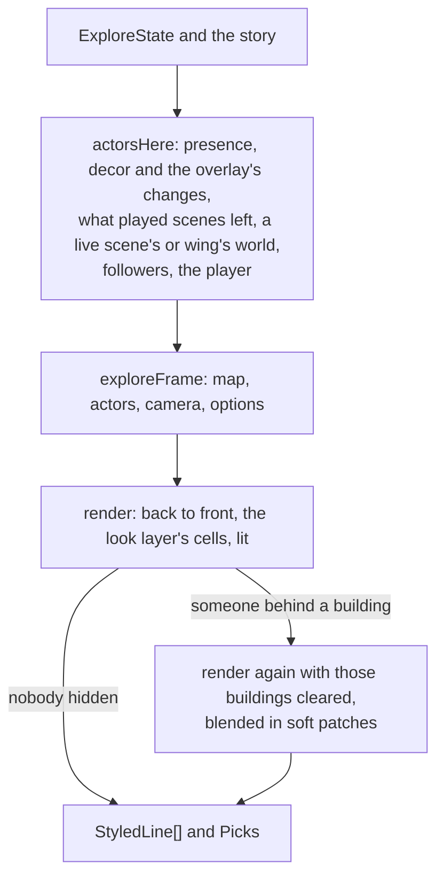

# src/game/map: the maps you walk

Part of the [architecture overview](../../../ARCHITECTURE.md). Where it's going (persistent worlds for places and prefabs in place of the overlay, with one set of interaction rules for scenes, the town and fights) is in [docs/design/productionise.md](../../../docs/design/productionise.md#the-world-components-and-interaction-rules).

## What it is

The world you walk around in between scenes, and the ground the scenes are played on. It has the tile maps of Caerwyn and the places its scenes are played in, and walking about them: collision, doors, paths to other maps, and the story's triggers (step into the granary yard, talk to Kell). It also has the isometric renderer that draws them, x-ray for whoever stands behind a building, and the bridge between a scene's world (an entity tree in feet, `src/world/scene-world.ts`) and the map's 5-ft tiles. It has no UI of its own. The game core plays it through `src/game/town.ts`, and `src/game/views.ts` draws it for the app and the QA console. Places generated from a description are in [generate/](generate/README.md).

## What it owns

**State.** `ExploreState` (explore.ts:22) is the player's place on the maps, as plain JSON. It lives in the game's save (`game.json`, under `explore`, wrapped in `TownState` by src/game/town.ts) and holds:

- where the player is: `map`, `at`, `facing`, `steps`, and `hidden` after a Stealth check;
- `story`, a copy of the game's `StoryState` (the time of day, the scenes played, the lead, flags). The game's story is the truth, and `setStory` keeps this copy in step;
- `overlay` (`MapOverlay`, reconcile.ts:216): what played scenes did to their places, and what the rules did to the town's own things outside scenes (written by `keepTown` in src/game/town-world.ts);
- `followers`, who walks with the player (Kell, after the granary);
- `scene`, the scene being played, if any;
- `roam`: worlds live on maps outside any scene (the zoo's wings), by map id;
- the quip memory, so walking into the same wall never gets the same line twice running.

**Tables the rest of the game reads and adds to.** These are module state, shared by every game in the process:

| table | where | who adds to it |
|---|---|---|
| `MAPS` | maps/index.ts | the four hand-made maps; the zoo's wings (src/game/zoo/install.ts); generated places (generate/install.ts) |
| `PLACES` | places.ts:33 | the arc's four scenes, by hand; `installPlace` can stand a generated place in for one |
| other places | places.ts:65 `registerPlace` | the zoo's wings, booths and rooms |
| maps whose regions reconcile can find | reconcile.ts `registerMaps` | maps/index.ts, the zoo, generate |
| presence | presence.ts:65 `addPresence` | the zoo's rooms, and the annexe's street by the hour |
| `CAST` | looks.ts:17 | the cast's letters, colours and sprites (the one cast table); generate/people.ts adds a generated place's people |

**Types.** The shared contract is src/game/types.ts: `TileMap`, `Tile`, `Region`, `MapActor`, `Interaction`, `StoryState`, `StyledLine`. tiles.ts adds optional extensions that the rest of the game can ignore: `MapTile` (a style for the renderer, a roof), `PlaceRegion` (how its scene is triggered, opening hours, locked after its scene, what its locked doors say), `MapDef` and `MapSpec`.

**Files.**

| file | what it does |
|---|---|
| `index.ts` | The public API. Its header comment shows each use: exploring, a scene on the map, combat, saving. |
| `tiles.ts` | Maps authored as ASCII grids with a legend (`buildMap`), terrain defaults, and tile and region lookups. |
| `maps/*.ts` | The hand-made maps: `caerwyn` (the town, 64x46), `drowned-rat` (16x13), `heron` (23x19) and `palace` (14x12). `MAPS`, `getMap`, `decorOf`. |
| `places.ts` | Where each scene of the arc is played (`PLACES`): its map and region, its world, who's there first, its time of day, the lead marker in the town and where the player comes out. Also the interludes the map stands in for, and `storyFromSession`. |
| `presence.ts` | Who's about, from the story: the town by the hour, the lead's place with its people waiting, places still to come with nobody in them yet. `leadMarker`. |
| `explore.ts` | Walking about: `newExploration`, `move`, `steer`, `pathTo`, `walkPlan`, `travel`, `interact`, `look`, `lookAt`, `tileName`, `nearby`, `enterScene`, `leaveScene`, `renderExplore`, `exploreFrame`, `exploreCamera`. |
| `reconcile.ts` | Feet and tiles (`feetToTile`, `tileToFeet`), a world drawn as map actors (`actorsFromWorld`), and the overlay (`captureScene`, `overlayActors`, `withTownChanges`, `townSurfaces`). |
| `render.ts` | The isometric renderer: `render`, `project`, `screenOf`, `tileAtScreen`, and `Picks` for the mouse. |
| `xray.ts` | X-ray: `xrayExplore`, `renderXray`, `findHidden`, `matters`. |
| `setup.ts` | A scene's place as a battlefield (`battlefield`), a world's hazards on the map (`areaHazards`), and `reachable` and `spotsNear` (only the demo and the tests use these two: combat has its own grid). |
| `looks.ts` | The cast table, looks for the map's own things, and `raiseFor` (how high a thing is drawn). |
| `palette.ts` | Ground and block looks, daylight by the time of day, colour helpers. |
| `quips.ts` | What walking into things says (`bumpLine`, `placeLine`). |
| `ansi.ts` | Styled lines as ANSI or plain text. |
| `view.tsx` | `MapView`: styled lines as OpenTUI text, used by the checks. |
| `demo.ts`, `xray-demo.ts`, `xray-audit.ts`, `view-check.tsx` | A headless tour through the public API, x-ray before and after, an audit of how often anyone is hidden, and OpenTUI drawing the map cell for cell. |
| `generate/` | Places generated from a description ([its README](generate/README.md)). |

## How it fits



What calls it:

- **src/game/town.ts** wraps it as the game core's `Explorer`, with stable action ids (`walk_north`, `go_to_lead`, `talk_kell`, `walk@x,y` and so on; the list is in its header). The QA console and the app both play the map through it. The zoo's explorer uses the town's walking, looking and doors on its own maps.
- **src/game/views.ts** draws it. `townView` (views.ts:59) goes through `xrayExplore` (views.ts:71); `fightView` (views.ts:130) calls `render` directly with a `battlefield`; `townText` is the plain version the QA console prints.
- **src/game/town-world.ts** builds the town as a scene world for the action menu's spells and blows (lined up with the whole map by `townRegion`), and writes what changed back into `ex.overlay.town` with `keepTown`.
- **src/game/fights.ts** lays a fight out on the scene's place with `battlefield`.
- **src/app/game.ts** walks a step at a time (`pathTo`, `walkPlan`, `steer`, `SCREEN_KEYS`) and reads the mouse through `Picks`.
- **src/game/zoo** adds its wings to `MAPS`, registers their places and presence, and keeps each wing's world live in `ExploreState.roam`.

What it calls: src/world/scene-world.ts for worlds and positions; the look layer (src/game/look) for how anything looks, the light, the glyph set and effects; and scenes/worlds/*.ts for the arc's world specs.

## How it works

**Coordinates.** x runs east and y south, and a tile is 5 ft. The viewer stands to the south-west: tile (x, y) projects to column 2(x + y) and row y − x (`project`, render.ts:132), so the map's north runs up-left on screen and its east up-right. A scene's world lines up with its region through the region's `worldOrigin`. Tile t covers feet [5t, 5t + 5) from it, and its centre is 5t + 2.5 (reconcile.ts:24).

**A frame of the town.**



- `actorsHere` (explore.ts:130) gathers everyone and everything on the map: `presence` for the story's people, the map's decor with the town's changes applied (`withTownChanges`), what played scenes left (`overlayActors`), a live scene's world or a zoo wing's through `actorsFromWorld`, the followers and the player.
- `render` (render.ts:182) paints rows of the projected plane back to front. Ground comes per cell from the look layer, then raised blocks (a lit top, the west face, the south face), with the roof off and the front walls cut down to a ledge in the room the player is in. Then actors by `actorLook`, surfaces, hazards, effects, smoke, the lead marker, coloured light per tile, and floating text last. Its passes are commented in that order. It fills `Picks` as it paints, so a click picks what's drawn in that cell.
- `xrayExplore` (xray.ts:74) draws the frame once. When someone who matters (`matters`: people, the player, items, things a scene put there) is under something nearer, it draws it again with those buildings cleared and blends the two round each hidden one. A frame with nobody hidden costs one render and comes back untouched.

**Walking.** `move` (explore.ts:201) takes a step with collision: walls, water, locked doors, people. A bump says what it hit (quips.ts), a door or an exit travels to another map, and stepping into a live scene's place (or into someone whose scene is waiting) returns a trigger for the core to open. `steer` (explore.ts:774) turns an arrow key by the screen into a map step that follows the street, since the screen's up is a diagonal on the map. `pathTo` and `walkPlan` share a breadth-first search (explore.ts:373) round walls, water, shut doors and people; a click walks onto a tile, through it if it's a door, or as near as there's a way.

**Scenes on the map.** `enterScene` puts the player where the scene's world starts them. While the scene plays, `renderExplore(ex, size, { world })` draws its place with the roof off and the world's people and things on it. `leaveScene(ex, world)` (explore.ts:612) must run before the runtime's `chainScene` drops the world: it captures what the scene did to its place into the overlay (`captureScene`), and the map shows that from then on. What was burning has burned out by a later time of day.

**Fights.** `battlefield(sceneId, world)` (setup.ts:36) turns a scene's place into a fight's map: people where the world has them, furniture in the way and giving cover, doors as the world says, lights that can be knocked over, and the tiles that are dusty or will burn.

## Where to look first

- **A change to what's drawn:** render.ts, then whether xray.ts still agrees (it draws the same frame through `exploreFrame`). Plain text (`color: false`) must stay quiet and single-width, because the QA console and the tests read it.
- **A change to who's about, or where a scene happens:** presence.ts and places.ts. Both name the arc's scenes and people.
- **A change to walking:** `move`, `search` and `steer` in explore.ts, with walk.test.ts and steer.test.ts.
- **A change to what scenes leave behind:** the overlay in reconcile.ts, and the order of `leaveScene` and `chainScene` in the core (`Explorer.leaveScene` in src/game/play.ts).
- **Anything that adds to `MAPS`, `PLACES` or `CAST` while the game runs:** it's global, so it outlives the game that added it.
- **How high a thing is drawn:** generate/'s furnisher copies render.ts's rule (`raiseFor` here, `liftOf` in generate/camera.ts). Change one and you must change the other.

## How to test it

```sh
node --no-warnings --test src/game/map/*.test.ts src/game/map/generate/*.test.ts   # 75 tests, about 2 s
node --no-warnings src/game/map/demo.ts [--plain | --color] [--w 80] [--h 24]          # a headless tour through the public API
node --no-warnings src/game/map/xray-demo.ts [--w 120] [--h 40] [--json dir]          # x-ray before and after, where it matters
node --no-warnings src/game/map/xray-audit.ts [--json out.json]                        # how often anyone is hidden, on the arc's routes and every tile
node --experimental-ffi --no-warnings --import tsx src/game/map/view-check.tsx        # OpenTUI draws the map exactly as rendered
npm run qa -- map --session <id>                                                        # the map where a QA game stands, as plain text
```

- **map.test.ts:** every map well formed, the worlds lined up with their places, walking, opening hours and locking up, the lead, the overlay, the battlefield, the look on the map, and the whole arc through the API as the app drives it.
- **pick.test.ts:** the mouse picks what's drawn.
- **walk.test.ts:** clicks, bumps and looking.
- **steer.test.ts** and **xray.test.ts:** steering and x-ray.

`npm test` runs these with everything else, and CI runs `npm test`. The zoo's annexe and Hall of Looks exercise the same code by hand ([src/game/zoo](../zoo/README.md)).

## Known gaps and sharp edges

- **The story is in the module.** The arc's scenes are named in places.ts, the town's people by the hour in presence.ts, Kell's lines and the locked doors' lines in explore.ts (`kellLine`, `LOCKED`), and the cast in looks.ts. A new story means editing the map module.
- **Global tables.** `MAPS`, the places, the presences and `CAST` are module state. The zoo adds its ten maps when src/game/zoo/wings/index.ts is imported, which the app and the QA console both do, so every game process has them. Two generated places with someone of the same id share a look until one is uninstalled.
- **The overlay is a second record of the world.** What scenes and the rules leave behind is kept as map actors and surface entities in `ExploreState`, not as a persistent world for each place. [docs/design/productionise.md](../../../docs/design/productionise.md) plans to replace it with persistent place worlds and prefabs.
- **X-ray is on for the town view only.** `fightView` calls `render` directly, so someone behind the sacks in a fight isn't drawn through. xray.ts's header still describes wiring it into both.
- **Light is per tile.** Walls stop it whole tiles at a time, and a block's faces take the light of the tile they stand on.
- **Two clocks.** `RenderOptions` takes `t` in milliseconds, or the old 100-ms `tick` when there's no `t`.
- **`render` is one function of about 600 lines** (render.ts:182–785). Its passes are commented, but there's no smaller seam to test them by.
