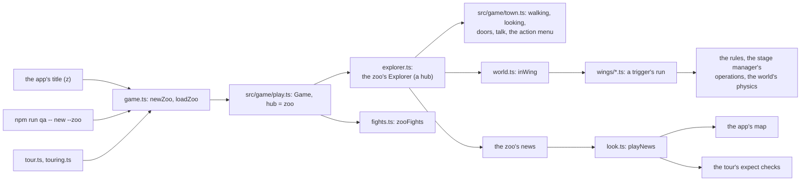
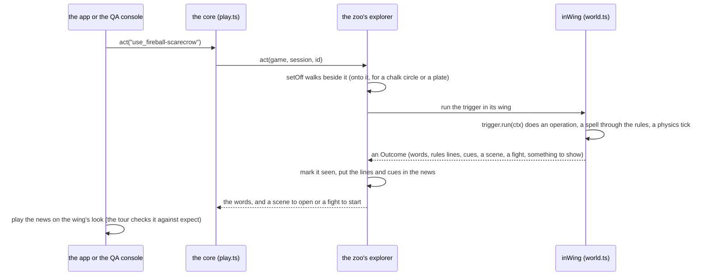

# src/game/zoo: the zoo

Part of the [architecture overview](../../../ARCHITECTURE.md). Where it's going (world expectations for every exhibit, and every step of the work checked against them) is in [docs/design/productionise.md](../../../docs/design/productionise.md#the-order-of-work).

## What it is

Every feature of the game, laid out to see and try. In game development a zoo is a level where every feature stands still long enough to be looked at; this one is walked on the map like Caerwyn, with a sign by each exhibit (what it is, how to set it off, in the house's voice) and, where the player sets it off, a lever, bell, chalk circle, plate or person at hand.

```sh
npm run game        # then "The zoo" on the title screen (or z)
npm run qa -- new --session my-visit --zoo      # the same zoo by action id (qa observe / qa act --id use_fireball-scarecrow ...)
node --no-warnings src/game/zoo/tour.ts         # the headless tour: every exhibit, offline
```

A visit is a game of its own (`game.hub = "zoo"`), kept apart from the story: it's never offered as a game to Continue (the title's zoo carries on the latest visit instead), it has no lead and plays nothing on, and nothing done in it reaches Caerwyn's saves, arc or state. The visitor comes in as Wren Ashdown, a level-five wizard (the Burning Gallery's fire is in the wizard's robes); the hall's wardrobe makes them anyone else.

It's ten maps, the Front Hall and nine wings (eight through the hall's doors, and the chandlery through the annexe's), with 144 exhibits and 186 triggers between them. Every exhibit is also a check: the headless tour sets every one of them off and compares what the view played with what it should.

## What it owns

- **The zoo's state,** `ZooState` (model.ts), kept beside the map's in the game's explore state (`game.explore.zoo`, read with `zooOf`): the exhibits seen (the next one not seen is g's lead), each wing's story time in turns, the last thing done's news for the view to play once (numbered by `seq`), the fight in progress from the map, and what the screen should show once (a sign's card, The End, the window).
- **Each wing's world,** live on its map in `ExploreState.roam` (src/game/map), made afresh by `freshWorld` (world.ts) when a visit starts and when a wing's lever puts everything back.
- **A visit's saves:** a game of its own under `runs/sessions/<id>/`, like any other, with `hub: "zoo"` in its `game.json`. The boundary desk writes the zoo's fronts into the visit's own copy of the docs.
- **What it adds to the game's tables as it loads.** src/game/zoo/wings/index.ts installs every wing (`installWing`) into the map module's `MAPS`, places and presences and the look layer's `DRESSINGS`, and registers the Theatre's booths and Kell's desk as places. Any process that imports the zoo has them, and the app and the QA console both do.

The files:

- **`model.ts`:** wings, exhibits and triggers, and what a trigger did (`Outcome`: words, rules lines, cues, a scene to open, a fight to start, something for the screen to show: The End, the window). The zoo's state's `show` asks the app, once each, for a sign's card, The End or the window.
- **`window.ts`, `fronts.ts`:** the story's first morning as a new game has it (to look at); the zoo's own fronts doc, written into a visit's docs the first time the boundary desk is used.
- **`wings/*.ts`:** one file a wing. Each has:
  - a grid drawn by hand, with marker letters for spots that the code reads (`marks`), or a compiled place;
  - a world lined up with the map, 5 ft to a tile from (0, 0);
  - its exhibits.
- **`install.ts`:** puts a wing among the game's maps:
  - its own region over the whole map, as its world's place;
  - its signs and stations as decor;
  - a dressing for the view from above, read off the map.
- **`explorer.ts`:** the zoo behind the game core's Explorer.
  - It's a hub: it opens any of its scenes, each ending back on the map with nothing chained on, and fights start from the map.
  - Walking, looking, doors and talk are the town's own (src/game/town.ts), and so is the action menu, whose acts it reports as its news.
  - It adds the triggers, the next exhibit, scenes opened from their rooms, and plates.
- **`world.ts`:** the wings' worlds.
  - A trigger runs with the player in the wing's world where they stand on the map, carrying what they carry, and with the session's world the wing's for the while, so the rules reach it as they reach a scene's.
  - Gear that changes hands changes the sheet.
- **`fights.ts`, `arenas.ts`:** the arena's rings as fights on the arena's own map, and a fight that breaks out in a wing (set out as the town's is, its end kept in the wing's world). The scenes' fights are the story's own (src/game/fights.ts).
- **`look.ts`, `pictures.ts`:** playing a trigger's news on a view's effects, and pictures without a terminal.
- **`touring.ts`, `tour.ts`:** the tour.
- **`scenes/zoo/`:** the zoo's scenes, authored like the story's (beats, checks, cues, exits with scripts), each on a booth's world.
- **`game.ts`:** `newZoo` and `loadZoo`, where the app's title, the QA console and the tour start or carry on a visit.
- **`builds.ts`:** who the visitor can be (the wardrobe): seven ready-made builds at level 5, made by the rules engine with no model.
- **`dressing.ts`:** a dressing for the view from above, read off a map (`dressingFromMap`, for the wings and the rooms).
- **`zoo.test.ts`:** the tests (src/app/zoo.test.ts has the app's).

## How it fits



- **Who starts a visit:** the app's title (`Game.zoo()` in src/app/game.ts carries on the latest visit, or calls `newZoo`), the QA console (`qa new --zoo`, then `loadZoo` whenever `game.json` says `hub: "zoo"`), and the tour. All three play the same `Game` (src/game/play.ts) with the zoo's explorer and fights.
- **What it calls:** the town's explorer for everything that isn't an exhibit (walking, looking, doors, talk and the action menu: the zoo's `act` falls through to `town.act`), the map module for its maps and the wings' live worlds, the rules engine and the world's operations and physics for what the triggers do, the look layer for playing the news, and the runtime's `openHubScene` and `closeHubScene` for its scenes.

The game core supports hubs for the zoo, and the story never takes these paths:

- **`play.ts`:**
  - an explore action can `open` any scene or start a `fight` from the map;
  - a hub's scene ends back on the map (`backToHub`);
  - a fight from the map ends there (`fightOnMap`, as a fight that breaks out on the town's map does).
- **`runtime/engine.ts`:** `openHubScene` and `closeHubScene` open a scene afresh and close it without a hand-off.
- **`town-world.ts`:** on a map with a world live on it, the rules' world for the action menu is that one (its own entities, changed in place; `keepTown` keeps what the rules add or take away in it).
- **The map module:**
  - worlds live on maps outside scenes (`ExploreState.roam`);
  - places and presence registered from outside (`registerPlace`, `addPresence`);
  - locked doors with their own line (`PlaceRegion.locked`);
  - Kell following by a story flag (`flags.kell === true`).
- **The app** (src/app):
  - the title's zoo;
  - the zoo's explorer and fights for a zoo visit;
  - its news played on the map;
  - the view from above (v);
  - a fight from the map;
  - the card after a zoo scene.

## How it works

### Getting about

- **Signs.** Right-click one (or face it and press e) to read it: in the app it opens in full, in a card of its own that scrolls, with what can be set off by it from where you stand (1-9, or a click). Reading a sign, or setting its exhibit off, marks the exhibit seen. r (or a click on "What happens") reads the last things said in full; a line too long for the box shows its start there.
- **The next exhibit.** g walks you to the next exhibit you haven't seen, through the hall's doors; the sidebar names it and the way, and a gold marker floats over it. Nearby lists the signs about you as well as the people.
- **The camera.** A wing's map is framed rather than followed: the whole of it when it fits, and never half a screen of nothing past its edge (you come in at a corner, and what's to see is the other way).
- **Setting things off.** Every trigger is in its tile's right-click menu (and the QA console's `use_<id>`): it walks you over first. You stand on a chalk circle to cast from it; a plate goes off when you walk onto it.
- **The action menu.** m (or a right-click's Do something…) is the story's action menu (src/game/menu.ts), on the wing's own world: your spells, features and actions, aimed on the map, done by the rules to the wing's things and people and kept in its world. Its people take violence as the town's do (most run, some cower; a guard about comes at you, and the fight is on the wing's map), and nobody in a wing is the story's: no talks, and the waxwork of Kell is a waxwork. Hidden lasts until you step out into the open or set an exhibit off. What it did plays as an exhibit's does.
- **From above.** v shows the wing's world as a scene's stage draws its place: people mid-walk, fires, haze, weather, effects.
- **What happens.** What a trigger did is played on the map as a scene's turn would be: its rules lines through the director (a Fireball from you to the scarecrow, damage numbers), what changed in the wing's world (fires catching, splashes, debris, puffs), and a few cues for effects nothing in the game sets off yet (a goose's "!", a thrown ball, embers).
- **The wings' worlds are live on the map.** Each wing has a scene world lined up with its map, always about: its people stand in the way and can be looked at, its puddles and fires lie on its ground. Each wing's "put everything back" lever starts it again, and sees to you (a night's rest: hit points and spell slots back).
- **The clock and the glyphs are the zoo's.** A booth plays at its own hour and the zoo's clock comes back after it; leaving the zoo puts the glyph set back to KM_GLYPHS's. On the title, x on the zoo's line (twice) puts the visit away, and the next one starts afresh.

### A trigger, end to end



1. The player picks `use_<id>` from a tile's menu, or the QA console acts it. The core hands it to the zoo's explorer (`act` in explorer.ts).
2. `setOff` walks the player beside it first, as a click would, or onto it for a chalk circle or a plate.
3. `run` marks the exhibit seen and runs the trigger inside its wing (`inWing`): for the while, the session's world is the wing's, with the player in it where they stand on the map, so the rules reach it as they reach a scene's.
4. The trigger does what the game does (a stage-manager operation, a spell through the rules, a turn of the world's physics) and returns an `Outcome`.
5. The explorer puts its lines and cues in the zoo's news, numbered so a view plays each once, and gives the core the words, and a scene to open or a fight to start.
6. The app plays the news on the wing's look (`playNews`, through the look layer's director). The tour plays it on a recording look and checks what played against the trigger's `expect`.

### The tour

`src/game/zoo/tour.ts` goes round every wing headless: it stands by each sign and reads it, sets off every exhibit's triggers in turn (or the exhibit's own `tour` order), plays each scene to an ending (the exhibit's or trigger's `plan`), fights each fight to its end (saving and loading the game partway, as Continue would), and checks what the view played against each trigger's `expect` (effect kinds, damage numbers, barks, a walk; "fight" and "scene" for what they open). It saves what the screen showed at each step and writes a report.

```sh
node --no-warnings src/game/zoo/tour.ts [--live] [--only fire,arena] [--no-png] [--out dir] [--seed n]
```

- **Offline (the default).** `OPENROUTER_API_KEY=offline`: the scenes open on their places with the GM silent and take their endings at once.
- **`--live`.** The scenes' lines are said to the real GM first. The game reads `OPENROUTER_API_KEY` or `~/secrets/kingmaker-dev-openrouter.txt`; the tour never prints it.
- **What it writes** (to `runs/zoo-tour/<stamp>/`):
  - `report.txt` and `report.json`: every exhibit, what each step said and played, and the failures;
  - one folder per wing, with each picture three ways: `.txt`, `.ansi` (cat it) and `.png` (tools/ansi2png.py, when Python has Pillow; `--no-png` skips them);
  - `runs/`: the visit's saves.
- **Exit code.** It exits 1 on any failure.
- **Defaults.** `KM_GLYPHS=ascii` and `KM_LOOK_MODEL=off` unless set.

## Where to look first

- **A new exhibit.** Give it a marker in its wing's grid and a sign (what it is, how to set it off; dry is the house style), and a trigger whose `run` does what the game does (a stage op, a spell through the rules, a world physics verb), with `expect` naming what the view should play, so the tour checks it. Then tour its wing (`--only <wing>`), and read its sign in the app.
- **A change to the hub paths** in play.ts, engine.ts, town-world.ts and the map module (the list under How it fits). The story never takes them, so only the zoo's tests and the tour notice when they break.
- **A wing's grid.** Each wing reads its spots off its grid by marker (`marks` in model.ts): moving a marker moves the sign or the lever, and `marks` throws if one is missing or appears twice.
- **A trigger's `expect`.** It names what the view should play (effect kinds, damage numbers, barks, a walk, a fight, a scene), not what the world should become.

## How to test it

```sh
node --no-warnings --test src/game/zoo/*.test.ts src/app/zoo.test.ts   # 28 tests, about 8 s; one of them tours Kell's Corner and the chandlery
node --no-warnings src/game/zoo/tour.ts --no-png                        # every exhibit, offline: 144 exhibits, 339 steps, about 16 s here
node --no-warnings src/game/zoo/tour.ts --only fire,arena               # some wings, with pictures (Python with Pillow)
node --no-warnings src/game/zoo/tour.ts --live                          # the scenes' lines said to the real GM first
OPENROUTER_API_KEY=offline npm run qa -- new --session z1 --zoo         # by action id
```

The zoo is drawn by the other checks too: the screens check (CI's) draws its side panel, a sign's card and its help; the static build's check plays it in Chromium (a sign, an exhibit, a spell's SRD page, the action menu, the view from above); and the renderer comparison (`npm run web:tui-check`) draws its screens both ways.

## Known gaps and sharp edges

### What's only a sign

Every feature in the inventory has an exhibit. The three that came after it was drawn up are on the signs of the ones they joined: the action menu (m, which works in every wing) on the annexe's right-click sign, the scene's place by mouse on the hall's scene screen sign, and the static build on its browser sign. The story's own features have one too: a new game's start is the hall's window, The End its curtain cord, the scene boundary and fronts the Theatre's boundary desk, and approaches its house-style lever. What's left can't be shown inside the zoo, so its exhibit is a sign that says what it is and where to see it:

- **Tools outside the game.** The look gallery, headless frames, the QA console, the scene harness, evals, smoke tests, the browser, settings, and the unused stand-ins: each runs outside the game (a command line, a browser), so the zoo can only say how. The tour and `qa new --zoo` are the zoo's own uses of two of them.
- **The town by the hour** is Caerwyn's own people, who only walk the story's map; the annexe shows the same mechanism in miniature.
- **The model.** Offline, the GM's own work shows only as the scene opening on its place and taking its endings by `/end`: the Theatre's booths, rehearsals, a word with Kell, Kell's desk, the tailor, the boundary desk (the plain hand-off), and the inventor's bench's invented looks. `--live` plays them.

### Sharp edges

- **The expectations are about the view.** The tour checks the effects, numbers and barks a trigger played, not the world it left. [docs/design/productionise.md](../../../docs/design/productionise.md) makes world expectations its first step ("after the Fireball, the scarecrow burns and the stone fireman is unharmed").
- **The full tour isn't in CI.** `npm test` tours two wings (zoo.test.ts); the rest is by hand.
- **It's installed at import.** Importing src/game/zoo/wings/index.ts adds ten maps, their places, presences and dressings to global tables. A wing's id is also its world's scene id, so it mustn't clash with a scene of the story's (`registerPlace` throws if it does).
- **The hub paths are the zoo's alone.** `backToHub`, `openHubScene` and `closeHubScene`, `ExploreState.roam` and a ring's `fight: true` exist for the zoo, and only the zoo exercises them.

## The wings

The hall's doors, round the walls: A the Burning Gallery, B the Works, C the Hall of Looks, D the Town Annexe (and through its east door, Mother Tallow's chandlery), E the Theatre, F the Rules Room, G the Arena, H Kell's Corner.

### The Front Hall (`zoo-hall`)

The screens, explained, and the things outside the world: the welcome; the story's first morning (a window onto Caerwyn as a new game has it, its hook and its lead, to look at); the title screen; the wardrobe (seven ready-made builds made by the rules engine, and the tailor, who makes you from a sentence with the model); the mirror (your sheet in short); the explore and scene screens; slash commands; a scene that's over and the way on; overlays; the notebook; the combat keys; The End (a curtain cord: the End screen for the visit so far, the booths played as its chapters; Enter comes back); saving and resuming; the mouse; the browser; settings; the clock (the time of day, everywhere); the glyph lever (ascii, nerd, plain, kingmaker); and the workshop's tools (the look gallery, headless frames, the QA console, the scene harness, places from a description, smoke tests, evals, the unused stand-ins).

### The Burning Gallery (`zoo-fire`)

The look layer's effects, set off as the game sets them off, with your own spells through the rules: Fireball at a scarecrow (straw and hay burn, the stone fireman is unharmed, the puddle hisses, the oil catches); bolts at targets of straw, wood and tin (Fire Bolt, Ray of Frost, Magic Missile's darts); Lightning Bolt up a line of posts, Shocking Grasp on the rod; Thunderwave at a gong (a shockwave); Sleep on a night-watchman (a flash); the colour chart (a bolt of every element's colour); the frost basin and Detect Magic (sparks); the numbers board (every damage colour, a heal, "unharmed"); barks (a crier, a woman in a hat, a parrot); the goose (an alert, on a plate); the coconut stall (a thrown ball, and a bottle as an improvised weapon); dust and embers (the two unused effect kinds); the magician's cabinet (poofs: appear, hide, faint, vanish, a sandbag cut down); the porter and his crate (walks and slides); the flour store (a dust explosion, with your own save if you're standing in it); the sand-glass (fire over time).

### The Works (`zoo-works`)

The world's physics and bookkeeping on benches, through the stage manager's operations and the rules for things: catching fire by material (wood, an iron stove, a wet rug, an oiled pan) and a bucket over it; burning oil, and water on it; six jugs to pour (water, oil, gin, ale, blood, grease); containers breaking open (a water butt, an ale keg, the gin jar with the drowned rat in it, a crate of apples); cold (a puddle to ice, a bonfire out); blood (the butcher's boy); the chandelier brought down; the testing rig (one dose of fire, bludgeoning, poison or thunder to stone, iron, wood, water and a sack: immunities, damaged and destroyed); Burning Hands' cone and a patch of Grease; the pay desk (coin that splits and joins); the cloakroom (gear leaving and rejoining your sheet); the stage manager's desk (move, place behind, create, something invented, a refusal, remove); the GM's ledger; the delegates' bell (an entrance with a group); the sand-glass (it says what the minute did: what smoulders, what goes out, where smoke rises); the hoist, where the Hanged Clerk's own afterwards takes a waxwork of Prout away; and signs for exit scripts and the dust in a scene.

### The Hall of Looks (`zoo-looks`)

How everything is drawn, from what the world says it is: the fire row (flames by colour word: blue driftwood, a green witch-fire, violet, spirits burning blue); the scrapyard (a wreck of every material, one smouldering); the paint shop (every state tint); the door wall (open, shut, locked, barred; overturned furniture, an open hatch); the lamplighter's row (lights on and off, a wet torch); the pond (idle motion); the dormitory (down, asleep, dead); the rafters (hanging, overhead, hidden, fallen); the square (a flock, a crowd, a swarm, a pack); the inventor's bench (looks for things nobody planned); the waxworks (the whole cast in their letters and colours); the spill floor (every surface); the sample floor (every ground and wall style); the shed (x-ray behind a building, and a roof that comes off); the lamp room (coloured light in the dark); the weather vane (drizzle and rain, from above); the smoke pot (clouds); the stage.

### The Town Annexe (`zoo-annexe`)

A street in the manner of Caerwyn, for the map itself: walking and the squeeze; the bump alley (the house's line for every kind of wall, the goose, the pigeons, the cabbage cart); locked doors with something to say; the pie shop's opening hours (shut until the Theatre's pie booth has been played); looking around; interact; the right-click menu, hover and Nearby; the lead; the street by the hour (a sweeper, a pie-seller, the lamplighter and the lamps, a watchman, a crowd); the street furniture's lines; the lost-property office (take, give, open a chest, coin, a bench that won't move); roofs off; and the ways out.

### Mother Tallow's chandlery (`zoo-chandlery`)

A place compiled by src/game/map/generate from a plan written by hand, in the shape the fast model writes one, with no model: read the plan, and the compiler's notes and sketch.

### The Theatre (`zoo-theatre`)

Short scenes with the real GM, in booths round a courtyard: step through a booth's door (or talk to whoever's waiting) and its scene opens on its own place.

- **The Last Pie**: authored checks, the method deciding the roll, things that simply happen, outcome routes, an earned payoff, consequences for daft acts, a "no, but", an out-of-character question, a pacing cue.
- **The Noon Bell**: pacing cues and endings that close, escalate and give a last chance; a freeform risky roll and a threat left hanging; walking out; the drizzle.
- **The Silver Dice**: a name held back, staged secrets, pressure rolls, bystanders reacting to violence.
- **The Lost Ledger**: an essential that relocates, the co-GM, memory (Madam Crust remembers the pie stall), an entrance with a group.
- **The Practice Yard**: the rules read from what you say: casting (Fireball at the haystack is what it's for), a blow, grapple and shove (Wim spars for real), a jump (the ditch's ten feet, wherever you start), class features, a rest. It goes on until you say you're done.
- **The Cracked Tankard**: a brawl that ends in "Roll for initiative!", fought on the tavern's floor (Kell beside you, patched up, if she's walking with you), then its aftermath, which ends when it's swept up.
- **The Ferry Stairs** (scenes/zoo/ferry.ts): the GM's markup, every kind of mark. A ferry at the foot of the river stairs that carries the stairs' own and whoever they speak for, the ferryman's mother who sells eels and remembers anyone rude to her, and the stairs' grudge against the watch (Caerwyn's lore: it has never once come down them for a gentleman). Rude to her, then asking for a crossing, then coming in the watch's name, the noes come with their reasons marked (why), the stairs' customs (the King's face, eels by the yard, the board's rules) as what a Caerwyn hand would know (know), and the visitor's own rudeness thrown back (you). Each person's lines are in their colour. The tour says the sign's four lines with --live.
- **The repertory board**: any scene of the story's or the scene harness's, rehearsed out of order on its own place (the arc's on the story's maps), and nothing reaching the story.
- **The boundary desk**: the last scene you played, handed across a scene boundary as the story hands one on (the hand-off, the next scene's prep checked against it and its opening rewritten, how you'd hear of it, and the fronts moved on), without going anywhere. A booth goes to the next booth, with the zoo's own fronts (Madam Crust's pies, the noon bell, the auditor's round: src/game/zoo/fronts.ts, in the visit's own copy of the docs, never the authored lore); a rehearsed scene of the story to its own next scene, with the story's fronts, in the visit's copy.
- **The house-style lever**: the booths play another way for the visit: v2 (the game's own), v2 played straight, actors, v2 with pressure rolls.
- Signs for the GM's turn, memory, the co-GM, and places as their scenes left them (with a lever to put the booths back). After a rehearsal, its card says what became of the place afterwards (Prout taken off the hoist).

Offline the GM can't speak: each scene still opens on its place, and `/exits` then `/end <id>` takes any of its endings (its exit script writes the notebook).

### The Rules Room (`zoo-rules`)

D&D as the scenes use it, without the GM: skill checks; your own spells (and a fizzle for someone else's), a ritual; a spell running out; class features from the costume rail (Second Wind, Rage, Bardic Inspiration, Innate Sorcery); blows at a dummy and at Big Rodney, a thrown chair; grapple and shove; long jumps over two ditches; the trapdoor (knocked out) and the smelling salts (coming to); short and long rests; the milestone bell (a level); bystanders caught by a spell.

### The Arena (`zoo-arena`)

Fights on the map, started by a ring's bell, on the arena's own map with everyone where its world has them; each ring starts fresh every time (its people made afresh by the rules, Kell patched up, and you too: the attendants give you a night's rest) and stays as the fight left it. Its lines say where it is ("the Arena is on fire"), not the Heron:

- **The grain floor**: the Heron's fight rehearsed (Sallow, the Crakes, the lantern-boy, Kell), with grain dust, lanterns, a brazier and sacks.
- **The porters' floor**: Hep Grist's brawlers.
- **The goblin pit**: archers keeping their distance behind rocks (ranged attacks, cover).
- **The wolf run**: Pack Tactics.
- **Leaving**: the wolf run's second rope, for running for the gate (disengage, the gate, l: fled).
- Signs for the battlefield on screen, pacing and targeting, the turn's options, after the fight, resuming, headless fights, death saves, and the story's fights.

### Kell's Corner (`zoo-kell`)

Sergeant Kell walks with you through the zoo when asked (and waits when asked); a word with her is a talk (her greeting, lines to choose, her story a piece at a time; it needs the model); her desk is a short scene, and if she's walking with you she reads its notebook entry back.
