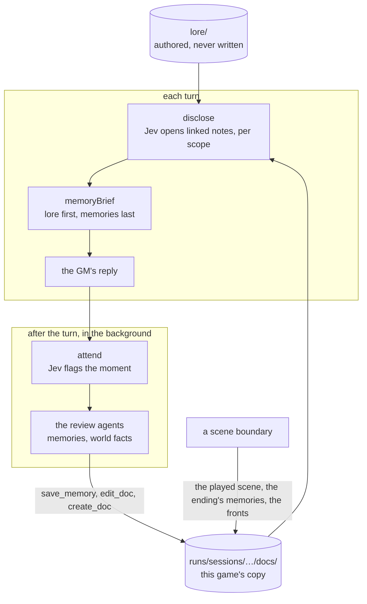

# src/lore: the docs service

Part of the [architecture overview](../../ARCHITECTURE.md).

The lore as linked Markdown documents, a copy of it for each game that play writes to, who may read what, what the GM is shown of it each turn, and what people remember. It's V1's docs service, rebuilt for scenes. Disclosure and the reviews run when the approach has memory, as `v2` does; the fronts and companion talks use the store whatever the approach.

```sh
npm run scene -- memories <session>    # every doc as that game has it: the lore, its edits, the memories, the story so far
```

## What it is

The authored lore in [lore/](../../lore/README.md) is the seed: Markdown files with a frontmatter line per key, linked to each other by relative links. Each game gets an overlay, `runs/sessions/<id>/docs/`, and every write goes there (copy on write), so play changes that game's lore and never the authored files. On top of the store sit:

- **access by scope:** what each person in a scene, and the GM, may read;
- **progressive disclosure:** before each reply, Jev opens the linked notes that bear on the moment;
- **the reviews:** after each reply, in the background, agents write what people will remember and record what play has made true;
- **the boundary's records:** the scene as played, how it ended, and the fronts' clocks.

## What it owns

| File | What's in it |
|---|---|
| [docs.ts](docs.ts) | The store: `readDoc` (the overlay first, then lore/), `writeDoc` (the overlay only), `seedDoc` (as authored), `parseDoc` (the frontmatter), `permitted` (who may read), `linksIn` (a doc's links), `characterEntry` (a cast id's lore entry), memories (`saveMemory`, `memoryIndex`, `memoryLines`), the story index (`savePlayedScene`, `saveFact`), the player's doc, `searchDocs`, `editDoc`, `createDoc` |
| [disclosure.ts](disclosure.ts) | `disclose` (each turn, per scope), `keepOpened`, `withhold`, and `memoryBrief` (what the GM is shown, in a stable part and a live part) |
| [reviews.ts](reviews.ts) | `memory: "docs"`: the attention filter (`attend`, V1's seven categories), the two review agents and their tools (`reviewTurn`), and `broadcastEnding` |
| [remember.ts](remember.ts) | `memory: "lite"`: one merged review of a flagged turn (`rememberTurn`), and one memory per person at a scene's end (`rememberScene`) |
| [fronts.ts](fronts.ts) | `frontsText` and `moveFronts`: steps ticked and struck, and bills added, in this game's copy of a fronts doc |

**Docs written in play,** in the overlay:

| Path | What it is | Visibility | Written by |
|---|---|---|---|
| `Cast/<Name>/memories/index.md` and a note per memory | A person's memories (`characters/<id>/memories/` for someone with no lore entry) | private to `character:<id>` | `saveMemory`: the review agents, the lite reviews, `broadcastEnding`, talks |
| `story/index.md`, `story/scenes/<scene>.md` | The scenes played so far: each one's hand-off and how it ended | gm | `savePlayedScene`, at a boundary |
| `story/facts/<id>.md` | Shared facts, each a note of its own (lite) | public | `saveFact` |
| `Player/<name>.md` | Who the player character is, and what they've told or shown people about themselves | gm | `playerDoc`, then the world-facts agent |
| Any lore path | The world-facts agent's edits and new docs | as written | `editDoc`, `createDoc` |
| `World/Fronts.md` | The story's fronts, as this game has moved them | gm | `moveFronts` at a boundary; the world-facts agent mid-scene |
| `Zoo/Fronts.md` | The zoo's own fronts, for its boundary desk | gm | [src/game/zoo/fronts.ts](../game/zoo/fronts.ts) |

**Session state:** `state.memory.opened` (the notes opened in this scene, with their scope and turn, 24 at most) and `state.memory.withheld` (notes kept out of it however relevant they get: a talk's held story). Both reset when the next scene starts.

## How it fits



| Caller | Uses |
|---|---|
| [src/runtime/engine.ts](../runtime/engine.ts) | `disclose` and `keepOpened` before each reply and before an opening; at a boundary `savePlayedScene`, `broadcastEnding` or `rememberScene`, `frontsText` and `moveFronts` |
| [src/runtime/voices.ts](../runtime/voices.ts) | `memoryBrief`, in every GM reply when the approach has memory |
| [src/runtime/jobs.ts](../runtime/jobs.ts) | `reviewTurn` or `rememberTurn`, after each turn, in the background |
| [src/runtime/talk.ts](../runtime/talk.ts), [scenes/talk.ts](../../scenes/talk.ts) | A companion's lore entry, notes and memories (`characterEntry`, `seedDoc`, `readDoc`, `linksIn`, `permitted`, `memoryLines`, `saveMemory`), and `withhold` |
| The scene harness, the evals, the zoo | `listDocs` and `readDoc` (`scene memories`), the memory evals, the zoo's own fronts |

It calls [src/llm](../llm/README.md) (`JevDecider` for disclosure and the attention filter, `runTools` for the agents, `respondJson` for the lite reviews), [src/runtime/brief.ts](../runtime/brief.ts) (who is present, the transcript, `prompt`), `sessionDir` from [src/runtime/session.ts](../runtime/session.ts), and the review prompts in [prompts/](../../prompts/README.md).

## How it works

### Access

- **Scopes.** `gm`, and `character:<cast id>` for each person present.
- **`permitted`** ([docs.ts:95](docs.ts#L95)). The GM reads everything. A `gm` doc is the GM's alone; a `public` doc is anyone's; a `private` doc is only its `readers`'.
- **Defaults.** A doc with no frontmatter counts as `gm`; one with frontmatter but no `visibility` counts as `public`.

### Disclosure

- **Where each scope starts** ([disclosure.ts:24](disclosure.ts#L24)). Each person present starts with their lore entry (`Cast/<Name>/private.md`, found by its `character` id) and their memory index. The GM starts with the player's doc, the story index and the scene's `lore` docs.
- **Each turn,** alongside the decision. For each scope, the unopened notes linked from what it has open, and that it may read, go to Jev: a yes-or-no question per link, one call per scope and round, all scopes at once. A note opens above 0.7 (`OPEN_THRESHOLD`), four at most per scope per round, over two rounds; a note opened in the first round brings its own links into the second.
- **Open for the scene.** Opened notes stay open until the scene ends (24 at most). A note at 0.9 or more (`URGENT`) is clearly about this moment, and the reply is told to let it show.
- **What the GM reads** (`memoryBrief`, [disclosure.ts:112](disclosure.ts#L112)): a block per scope, so it can keep straight who knows what. `stable` is each person's lore entry and the GM's own notes (the player's doc, the scene's `lore` docs), sent before the conversation. `live` is the memory indexes, the notes opened and the story index, sent after it.

### Reviews (`memory: "docs"`)

After each turn, a background job ([src/runtime/jobs.ts](../runtime/jobs.ts)) runs `reviewTurn` ([reviews.ts:168](reviews.ts#L168)) on that turn's snapshot.

- **`attend`:** one Jev call with V1's seven attention categories. A category flagged at 0.4 or more (`FLAG_THRESHOLD`) fires its agent: a false flag costs a review that writes nothing, and a missed one loses the memory.
- **The personal-memories agent** handles commitments, changes in trust or knowledge, and exchanges, with `save_memory`, `list_memories`, `read_doc` and `edit_doc`. It's told to write at most one memory per person present.
- **The world-facts agent** handles improvised details and lasting changes, with `search_lore`, `read_doc`, `edit_doc`, `create_doc`, `save_memory` and `list_memories`. It records a fact in the doc where it belongs, the player's claims about themselves in their doc, and talk anyone could hear in `World/Caerwyn now.md`. It may also tick or strike a front's step mid-scene, through `edit_doc` ([prompts/review/world.md](../../prompts/review/world.md)).
- **How they run.** Each is a Luna tool loop at medium reasoning ([src/llm/tools.ts](../llm/tools.ts)), with prompts/review/system.md and its categories' prompts. They run in that order, so the second sees the first's edits. What each one changed goes in the session's `memory-reviews.jsonl`.

### The lite alternative (`memory: "lite"`)

`rememberTurn` ([remember.ts:74](remember.ts#L74)) flags five categories (at 0.5), then makes one JSON call that returns memories for the people present and facts as notes of their own (`story/facts/`). At a scene's end, `rememberScene` gives each person one memory of it.

### At a scene boundary

`chainScene` ([src/runtime/engine.ts](../runtime/engine.ts)) records the scene that ended:

- **`broadcastEnding`** (`docs`): everyone present gets the authored outcome as a memory, so the ending itself is never left to a review;
- **`rememberScene`** (`lite`);
- **`savePlayedScene`** (either): the hand-off as `story/scenes/<scene>.md`, linked from the story index.

The fronts move in the same crossing. `moveFronts` ([fronts.ts:25](fronts.ts#L25)) ticks the steps that play or time has made true (`- [x]`, "Ticked after" the scene), strikes the ones play has made meaningless (with why), and adds up to two new bills under "Bills still to come due", leaving out any already on their way. It writes this game's copy of the doc, and `frontsText` reads that copy back at the next boundary.

### A companion's stories: told, now, held

Talks ([src/runtime/talk.ts](../runtime/talk.ts)) keep a companion's stories with the store. `confidences` lists the private notes linked from their lore entry that they haven't told yet. A story they tell goes in their memories (`saveMemory`) as well as the talk record. The deepest is held until the third talk: the GM is told its title and summary and to turn the question aside, and `withhold` ([disclosure.ts:99](disclosure.ts#L99)) keeps the note itself out of disclosure.

## Where to look first

- **Access.** A new doc's `visibility` and `readers`, and any change to `permitted` or `parseDoc`. A private note whose frontmatter loses its `visibility` becomes everyone's.
- **What the agents can write.** The tools' definitions ([reviews.ts:82](reviews.ts#L82)) and their handlers ([reviews.ts:112](reviews.ts#L112)). The paths come from the model; `save_memory` takes only people present.
- **The thresholds:** `OPEN_THRESHOLD` (0.7), `PER_ROUND` (4), `MAX_OPEN` (24) and `URGENT` (0.9) in disclosure.ts; `FLAG_THRESHOLD` (0.4) in reviews.ts.
- **The stable and live parts of `memoryBrief`.** Something that changes every turn, put in `stable`, spoils the GM's prompt cache on every turn.
- **Writes go to the overlay.** `writeDoc` writes only to this game's copy. Nothing should write under lore/.

## How to test it

```sh
node --no-warnings --test src/lore/fronts.test.ts src/runtime/talk.test.ts   # the fronts in a game's copy; talks' records and memories: offline
node --no-warnings src/eval/memory-eval.ts --approach v2-nomemory,v2,v2-memory-lite   # does someone remember, in a later scene? judged
node --no-warnings src/eval/memory-run.ts <script.json> --approach v2   # scripted turns, reviews awaited, then what each person remembers
npm run scene -- memories <session>                                   # a game's docs, with their visibility and readers
```

The evals need the key. After a live game, `runs/sessions/<id>/docs/` holds everything play wrote, and `memory-reviews.jsonl` says which flags fired and what each review changed.

## Known gaps and sharp edges

- **A missing `visibility` fails open.** No frontmatter means `gm`, but frontmatter without `visibility` means `public`. Every authored doc has one today.
- **The path guard is a prefix check** (`inside`, [docs.ts:37](docs.ts#L37)): `../docs2/x.md` passes, into a folder beside the overlay. The world-facts agent chooses the paths it reads, edits and creates.
- **Whole-file writes, and no locks.** Memory reviews for consecutive turns can run at once, and two of them adding to one memory index can lose a line.
- **Synchronous, and on disk.** Every `readDoc` reads a file, `linksIn` reads each linked doc, and a `[[wiki link]]` walks both trees.
- **Search isn't ranked.** `searchDocs` counts the query's words in each doc, across every `.md` under lore/ (its README included).
- **The registry is the authored lore's.** `characterEntry` scans lore/ once per process, so a lore entry created in play isn't found.
- **The held story is cut, not annotated.** The GM knows its title and summary, and nothing else of it. A fast GM asked about something it can't see tends to invent it or deny it, and the reviews then record the invention.
- **Always Jev.** Disclosure and the attention filter make their own `JevDecider`; the approach's decider never reaches them.
- **Reviews run late.** A review reads its turn's snapshot but writes into the live overlay, perhaps after the next turn's disclosure has already read it.
- **Only the fronts have unit tests.** Disclosure and the reviews are tested by the memory evals, live.
