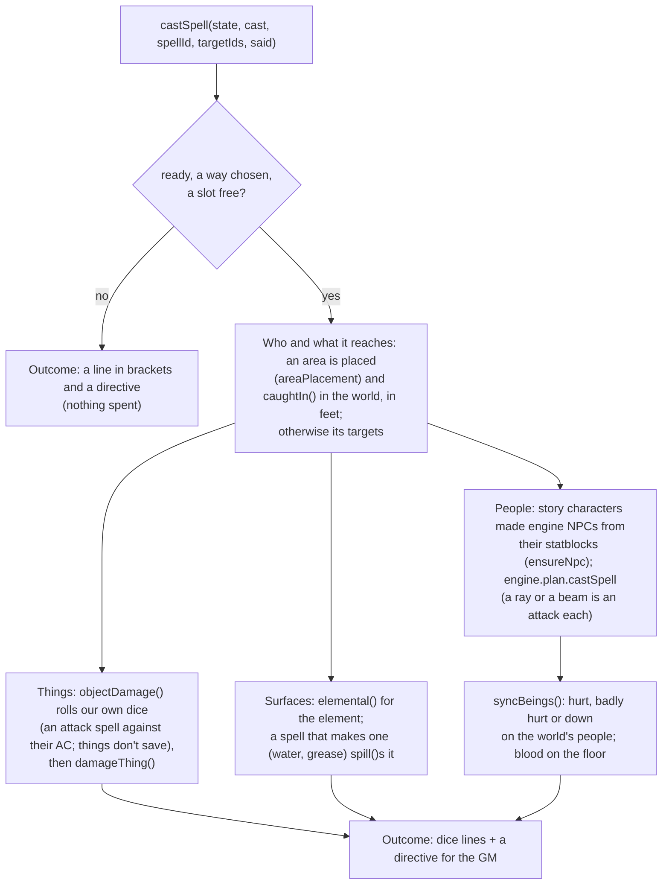

# src/rules: D&D on the vendored engine

Part of the [architecture overview](../../ARCHITECTURE.md). Where it's going (the rules wrapper and the action catalogue in a pure, deterministic `src/shared`) is in [docs/design/productionise.md](../../docs/design/productionise.md#packages-and-bundles).

## What it is

The game's D&D 5.5e (SRD 5.2.1), through the vendored [dnd-srd-engine](../../vendor/dnd-srd-engine/README.md): the player's character, and every roll a scene or the map needs. The GM still decides whether something needs dice at all, how hard it is and what it means; this module decides what the rules and the dice say, writes it into the session's rules state and the scene's world, and hands back dice lines for the player and a directive for the GM to narrate exactly that. It also says what the character can do out of a fight (the action menu's catalogue) and what a spell is (its card, its terms at the caster's numbers, and the SRD's own words). Fights on the map use the same engine through a bridge of their own in [src/game/combat](../game/combat/README.md).

## What it owns

| file | what's in it |
|---|---|
| [`dnd.ts`](dnd.ts) | Loading the engine ([`dnd`](dnd.ts#L23)). The character: [`createCharacter`](dnd.ts#L350) (the build chosen at character creation, or a model call for one from the concept; then the engine), `settleBuild` (any build made legal: ids the SRD's, a subclass from level 3, a Fighting Style that fits its weapons, `styleFor`), [`levelUp`](dnd.ts#L1630). The sheet: [`sheetData`](dnd.ts#L639), `sheetText`, `statusLine`, and [`rulesNow`](dnd.ts#L57), a synchronous read for menus. Checks and saves: [`skillCheck`](dnd.ts#L832), [`rollFor`](dnd.ts#L853), [`hazard`](dnd.ts#L1537). Spells: [`castSpell`](dnd.ts#L1149), `castable`, `spellCard`, [`areaPlacement`](dnd.ts#L1267). Blows: [`attack`](dnd.ts#L1421), [`wrestle`](dnd.ts#L1469), [`attackOnPlayer`](dnd.ts#L1500). Class features ([`FEATURES`](dnd.ts#L1750), [`useFeature`](dnd.ts#L1782), `arcaneRecovery`), items (`useItem`, [`carryGear`](dnd.ts#L1383)), time ([`passTime`](dnd.ts#L1572), [`rest`](dnd.ts#L1589), [`comeTo`](dnd.ts#L1656)) and [`jump`](dnd.ts#L1702). |
| [`actions.ts`](actions.ts) | [`catalogue(state)`](actions.ts#L450): what the character can do out of a fight, by kind (cantrips, spells by level, class features, actions, what's to hand), each entry with its one line, its aim, what it does to whoever it's aimed at (harm, social, help), the core's action id, and why it can't be done now. The hand-written lines for 177 spells ([`SPELLS`](actions.ts#L111)); [`spellAim`](actions.ts#L334) and [`spellEffect`](actions.ts#L323). |
| [`builds.ts`](builds.ts) | Character creation's builds: [`threeBuilds`](builds.ts#L270), three that fit a concept from one model call, each made legal and made by the engine as a card (`throughEngine`, `cardOf`), or offline the class defaults the concept's words suggest (`defaultBuilds`); [`ownBuild`](builds.ts#L344), one of the player's own from the SRD's lists (`srdLists`), refusing an id that isn't the SRD's; `cardText` for the QA console. |
| [`spells.ts`](spells.ts) | [`spellDetails`](spells.ts#L145): a spell as the sheet shows it when it's picked (the card, the engine's mechanics at the caster's numbers, how it grows, where the SRD and the game differ, the SRD's text and its attribution). [`inFights`](spells.ts#L102): whether a fight on the map offers it. [`RAYS`](spells.ts#L139): spells that are an attack per ray or beam. |
| [vendor/dnd-srd-engine](../../vendor/dnd-srd-engine/README.md) | The engine's bundled build, its pre-validated starter pack, our typings, and `patch.ts`. |
| [vendor/srd-spells](../../vendor/srd-spells/README.md) | The SRD 5.2.1's words for every spell in the pack, by spell id. |

### State

The session's `rules` ([`RulesState`, src/runtime/session.ts:38](../runtime/session.ts#L38)):

- **`campaign`:** the engine's serialised campaign, its event log and state. It's the truth about the player's hit points, slots, conditions, class resources and gear, and about every story character the rules have touched.
- **Who's who:** `pc` (the player's engine id), `npcs` (cast id to engine id and weapon), `aliases` (what the player calls people whose names they haven't heard: the dice lines use it).
- **Caches** so a turn's decision needn't load the engine: `spells`, `weapons`, `features`, `gear`, `status`; and `timed` (a spell with a duration is running), `prefer` (the build's preferences for later choices), `gone` (gear the story has parted them from).

It also writes `state.player.modifiers` and `state.player.build`, bumps `state.rollCount` (the dice stream), and writes into `state.world`: things' hit points and states, people's `hurt`, `badly hurt` and `down`, `grappled` and `prone`, and surfaces (a fire's element, blood, a Grease spell).

## How it fits

| caller | what it uses |
|---|---|
| [src/runtime/engine.ts](../runtime/engine.ts#L353) | a turn's mechanic (`castSpell`, `attack`, `wrestle`, `useFeature`, `rest`, `jump`); a threat or a danger before the player acts (`attackOnPlayer`, `hazard`); `passTime`; `comeTo` and `levelUp` between scenes; `carryGear`; `createCharacter` |
| src/runtime/director.ts | `rollFor` for a route's check; `HAZARD_KINDS` |
| [src/game/menu.ts](../game/menu.ts) | the action menu: `catalogue`, `rulesNow`, and the same calls a scene makes, on the town's world |
| src/game/play.ts | `comeTo` after a fight |
| [src/game/combat](../game/combat/README.md) | `dnd()` for the engine, `damageLine`, `inFights` and `RAYS` |
| src/app | `sheetData` and `spellInfo` for the sheet; character creation's `threeBuilds`, `srdLists`, `ownBuild` and `picksOf` |
| src/cli/qa.ts, src/cli/scene.ts | `sheetText`; `qa builds` and `qa new --build` (`threeBuilds`, `ownBuild`, `throughEngine`, `cardText`) |
| src/game/zoo | the Rules Room, the wardrobe's builds, the tailor's three cuts (`threeBuilds`), exhibits that cast through the rules |

How a turn comes to pick a mechanic is the runtime's ([src/runtime/README.md](../runtime/README.md#one-player-turn)).

It calls the vendored engine (its planners as `engine.plan.*`, `commit`, `buildCharacterSheet`, `buildEffectStack`), [src/world](../world/README.md) for things and surfaces (`caughtIn`, `damageThing`, `elemental`, `spill`, `bleed`), src/llm for its model calls (one build, or character creation's three), and src/runtime/dice.ts (`rng`, `describeRoll`).

## How it works

### Every call that changes something

1. [`open(state)`](dnd.ts#L72) loads the campaign into a fresh engine seeded with `state.seed + 7919 × ++state.rollCount`, so a session's dice replay from its seed.
2. A planner (`engine.plan.castSpell`, `.attack`, `.save`, `.longRest`...) decides the events; what the engine gets wrong is fixed on the way in ([`wellFormed`](dnd.ts#L88), [`missesMiss`](dnd.ts#L103)); they're committed.
3. [`describe`](dnd.ts#L938) turns the events into dice lines ("Fire Bolt: your attack on the talking Crake: 14 +5 = 19 vs AC 12: hit") and a plain account.
4. `close` serialises the campaign and the status line back into the session.
5. The call returns an `Outcome`: `lines` (the 🎲 lines), `directive` (for the GM: "Rules: the player cast ... Narrate exactly this"), and `status`.

Reading calls (`sheetData`, `castable`, `weapons`, `statusLine`) open a throwaway engine. [`rulesNow`](dnd.ts#L57) keeps one engine and one reading in memory until the campaign string changes, so a menu can ask between keystrokes; it needs `dnd()` to have loaded first.

### A spell



A blow ([`attack`](dnd.ts#L1421)) goes the same way: the engine's attack at a person (with the weapon in hand, another they carry, or an improvised one), and our own d20 against AC and hit points at a thing. For how a spell gets here from a typed line, a menu or a fight, and what's drawn after, see [src/game/README.md](../game/README.md#a-spell-or-a-blow-end-to-end).

### The catalogue

[`catalogue(state, { rested })`](actions.ts#L450) reads `rulesNow` and lists what the character can do, by kind. Each `Entry` has an `act` (the core's action id, or its stem for something aimed: `cast_fire-bolt` takes `@x,y` or `_self`), an `aim` (`none`, `self`, `creature`, `target`, `area`, `tile`, with its reach in feet), an `effect`, and a `why` when it can't be done now (no slots left and what brings them back, only in a fight, rested already). It knows nothing of the map: [src/game/menu.ts](../game/menu.ts) adds what's in reach and checks the aim.

### A spell's card

[`spellDetails(spell, caster, names)`](spells.ts#L145) builds the card and the terms from the engine's own mechanics for the spell (`Terms`), at the caster's save DC, attack bonus and level, with what the engine adds for this character named (Agonizing Blast, Disciple of Life: `spellExtras` in dnd.ts). The SRD's text comes from vendor/srd-spells with its attribution. Where the SRD and the game differ (a casting time, a higher slot that does nothing more here, a spell no fight offers), the card says so.

## Where to look first

- **The dice stream.** Every call that opens the engine moves `rollCount`, so adding or removing a call shifts every later roll in the session: seeded tests, replays and evals will roll differently. Things' dice come from another stream (`rng(state.seed + 9973 × rollCount)`).
- **Directives are prompts.** "Narrate exactly this ... Don't add effects the spell doesn't have" goes to the GM as it is. A change to one is a prompt change.
- **Dice lines are parsed downstream.** The look director reads them to play spells and float damage numbers (`spellsFrom`, `rulesLines` in [src/game/look/director.ts](../game/look/director.ts#L160)), the app tells rolls from news by them, and the zoo tour checks the effects and numbers that come of them. The fights' lines share `damageLine` and are parsed again by `fightEffects` in src/game/views.ts. A reworded line can stop an effect playing without any test here failing.
- **What the map offers.** `spellAim`, `spellEffect` and the sets beside them (`SOCIAL_SPELLS`, `AT_THINGS`, `AT_CREATURES`) decide what a spell is aimed at on the map and whether it counts as violence there.
- **What a fight offers.** `inFights` is read by the fight (src/game/combat/skirmish.ts) and by the sheet's note about it: one function, two readers that must agree.
- **The engine's half-truths** are worked round here and patched in the build: see [vendor/dnd-srd-engine/README.md](../../vendor/dnd-srd-engine/README.md). A fix here often has a twin in src/game/combat/rules.ts.

## How to test it

```sh
node --no-warnings --test src/rules/*.test.ts              # the catalogue, blows, spells and their cards: 25 tests, offline (ready-made characters), about 5 s
node --no-warnings src/game/zoo/tour.ts --only rules,fire  # the Rules Room and the Burning Gallery, through the rules, offline
npm run qa -- sheet --session <id>                         # a game's sheet as the rules have it
node --no-warnings vendor/dnd-srd-engine/patch.ts          # after rebuilding the engine; then the tests above
python3 tools/srd-spells/build.py --check                  # the SRD's spell text, checked against the official PDF
```

The tests build characters from ready-made builds (`pregenSession` in src/game/combat/pregen.ts), so they never call the model.

## Known gaps and sharp edges

- **Two sets of dice for one blow.** Damage to people is the engine's. Damage to things is ours: [`objectDamage`](dnd.ts#L1310) and `attack` roll their own d20 and dice against the thing's AC and hit points, then the world's `damageThing`. Fights have a third model for props. See [the table in src/game/README.md](../game/README.md#the-same-rule-coded-more-than-once).
- **Workarounds kept in more than one place.** The placeholder for a spell attack's `weaponInstanceId` (the engine can't reload its own campaign without it) is in `wellFormed` here, in src/game/combat/rules.ts and in src/app/rules-repair.ts. Dropping a missed spell attack's half damage (`missesMiss`) is here and in combat/rules.ts, keyed differently. The statblock weapon table, the hurt words (`hurt` here, `health` in the fights), the status line and `rangeFeet` (actions.ts) each have a twin in src/game/combat.
- **Loading at import.** actions.ts (like src/game/menu.ts and src/game/combat/fights.ts) awaits `dnd()` at the top of the module so `rulesNow` can answer synchronously: importing it loads the engine, about 70 ms, and makes the import asynchronous.
- **The player doesn't die out of a fight.** Dropped to 0 by a blow, a danger or a fall, they're stabilised and knocked out ([`knockedDown`](dnd.ts#L1519)), and come to with 1 HP at the next scene or after a fight ([`comeTo`](dnd.ts#L1656)). Their own spell doesn't go through `knockedDown`. The engine lets hit points go below zero; the code reads them as 0.
- **The model in character creation.** The game offers three builds from one model call (`threeBuilds`); offline, or if the call fails, the class defaults that best match the concept's words stand in, and the cards say so. `createCharacter` without a build (the QA console's `qa new` with no `--build`, the evals) still asks the model for one, and falls back on the class defaults (a human rogue with the criminal background).
- **Weapons aren't matched to proficiency.** A model can give a bard a rapier, which the 2024 bard isn't proficient with; the card shows the lower bonus honestly.
- **A dwarf starts 3 HP below their maximum.** The engine's healing and rests cap current HP at the base maximum, so Dwarven Toughness shows only in `effectiveHpMax`. It needs a fix in the engine or its patch.
- **What the map can't play yet.** A reaction, a summons, and a spell cast one of several ways (Command's word, Hex's ability) are dimmed with a reason ([`spellWhy`](actions.ts#L377)); in a scene, the player's words choose.
- **Aimed only at things,** a spell spends its slot by hand: the engine's planner wants a creature ([dnd.ts:1212](dnd.ts#L1212)).
- **`dnd.ts` is 1,757 lines:** creation, the sheet, checks, spells, blows, features, rests and jumps in one module.
