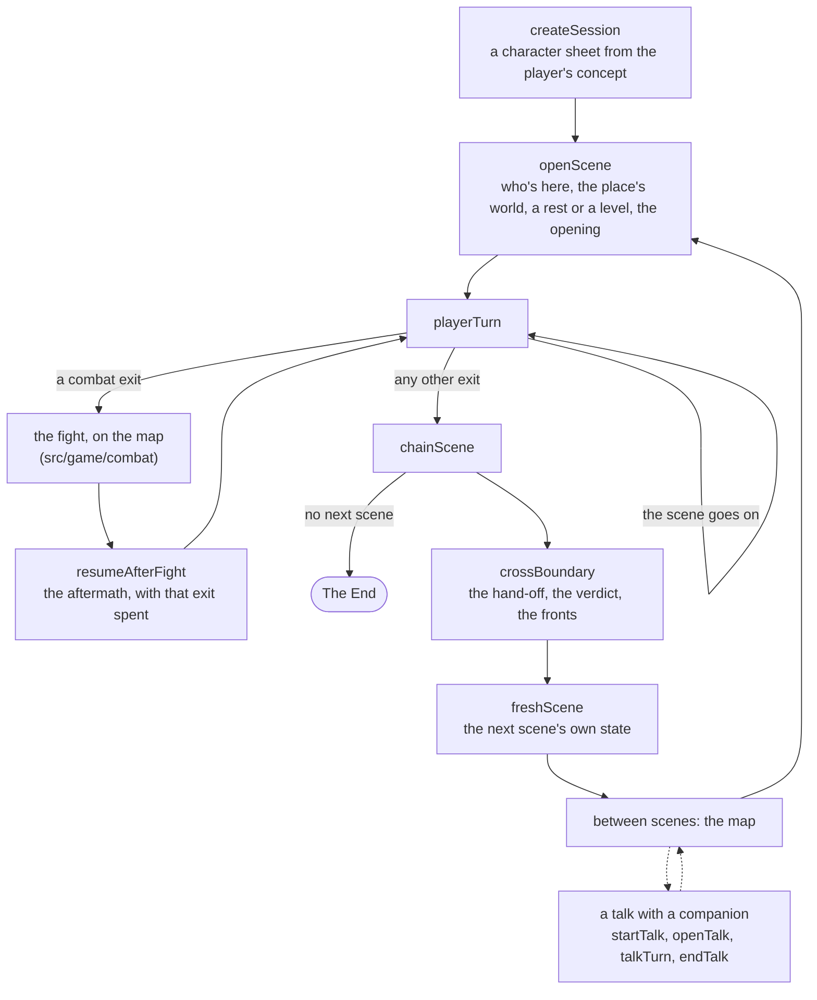
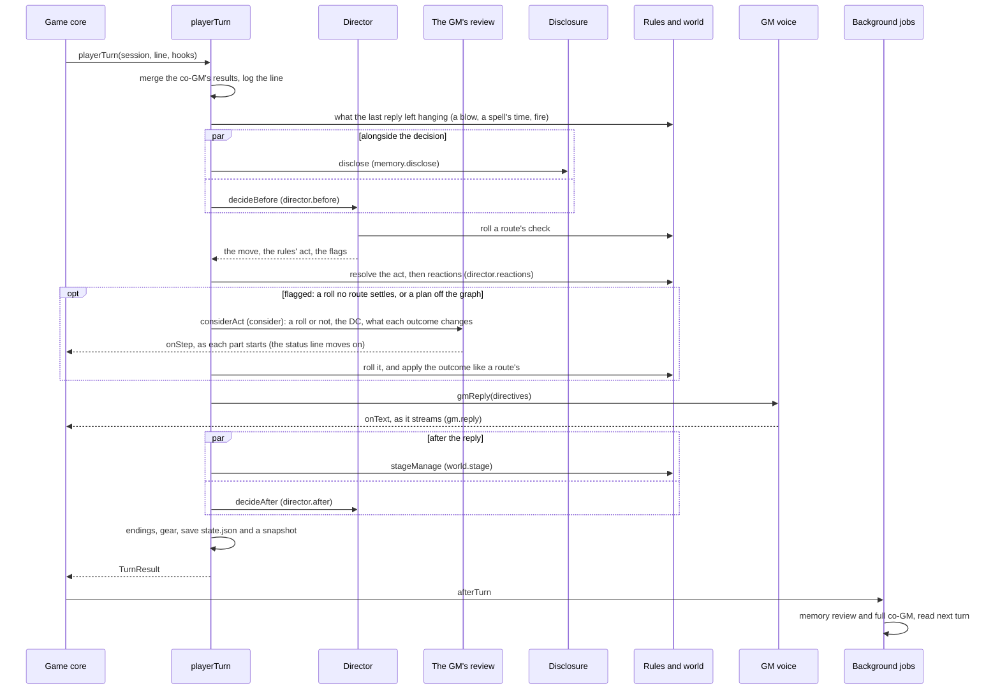

# src/runtime: the scene runtime

Part of the [architecture overview](../../ARCHITECTURE.md).

The engine that plays a scene: the player's line goes in, the GM's reply comes out, and the session's state keeps up. Everything the player meets in a scene goes through here, in the terminal app, the browser build, the QA console, the zoo and the evals.

```sh
npm run scene -- start hanged-clerk --session demo    # a scene in the terminal (approach v2): the sheet, then the opening
npm run scene -- say demo '(I look up at the body) Who found him?'
npm run scene -- status demo                          # the beat, the path, the co-GM's notes, latency and cost
```

Live runs need `OPENROUTER_API_KEY` (or `~/secrets/kingmaker-dev-openrouter.txt`). Why each mechanism exists is in [docs/guide/running.md](../../docs/guide/running.md). Where the runtime is going (a flattened `playerTurn`, a model client behind the calls, the session split into documents) is in [docs/design/productionise.md](../../docs/design/productionise.md).

## What it is

A session plays one authored scene at a time ([scenes/](../../scenes/README.md)). Each turn, the director asks a fast decider what the player is attempting and, after the reply, what has happened. The D&D rules ([src/rules](../rules/)) and the scene's world ([src/world](../world/)) settle what's theirs to settle: checks, spells, blows, fire. The GM voice narrates the result from a brief built from the scene's prep and from what people remember ([src/lore](../lore/README.md)). The session records the beat, the rolls, the transcript and what is still pending. Between turns a co-GM reviews the scene and patches the prep where play has left it. When a scene ends, the runtime crosses the boundary: it writes the hand-off, checks the coming scenes against what happened, rewrites the next opening and moves the world's fronts on. How all this is run (one voice or actors, which decider, when the co-GM runs, memory or not) is an approach, a preset in [approaches.ts](approaches.ts).

## What it owns

| File | What's in it |
|---|---|
| [engine.ts](engine.ts) | The turn pipeline: `createSession`, `openScene`, `playerTurn`, `resumeAfterFight`, `forceEnding` and `chainScene`. The boundary (`crossBoundary`, `moveOn`, `boundaryPreview`), the zoo's hub scenes (`openHubScene`, `closeHubScene`), and reactions to violence (`violence`, `witnessesOf`, `react`). |
| [director.ts](director.ts) | What the decider is asked before the reply (`decideBefore`, with the considered-rolls flag) and after it (`decideAfter`). The follow-up calls (a spell's or blow's details, a jump, a freeform roll, pressure), `decideReactions`, `decideNextSpeaker` for actors, and the directives that tell the GM what was decided. |
| [consider.ts](consider.ts) | Considered rolls: the GM's review of a flagged act (`considerAct`, [prompts/consider.md](../../prompts/consider.md)), the verdict from its judgements (`verdict`: yes, no or a DC), and the ruling settled as a route of its own (`settleRuling`). |
| [voices.ts](voices.ts) | The GM (`gmReply`), the narrator and the actors (`narratorReply`, `actorReply`), and the guard against repeated sentences. |
| [brief.ts](brief.ts) | What the GM is shown: the stable prep (`sceneBrief`) and the per-turn note (`nowNote`). Also the scene as play has it (`effectiveScene`: the authored scene, the co-GM's patches and "an ending of their own"), who is present, whose names the player hasn't heard (`unnamed` in a scene, `strangers` across a boundary), and the prompt loader (`prompt`). |
| [scene.ts](scene.ts) | The Scene format's types, and `validateScene`. The scenes themselves are in [scenes/](../../scenes/README.md). |
| [session.ts](session.ts) | `SessionState` and its files: `saveSession`, `snapshotSession`, `loadSession`. |
| [approaches.ts](approaches.ts) | The 28 approaches (`v2` is the game's; `v2-quick` is `v2` before considered rolls), and `sceneApproach`, which applies a scene's own overrides. |
| [repair.ts](repair.ts) | The co-GM: the full review (`runRepair`) and the quick one (`quickRepair`), and how their notes, whispers and patches apply. |
| [background.ts](background.ts), [jobs.ts](jobs.ts) | The work after each turn (the memory review and the co-GM's review). `afterTurn` starts it, and jobs.ts is what it runs. |
| [talk.ts](talk.ts) | Talks with a companion between scenes. |
| [owed.ts](owed.ts) | What the story still owes the player: an essential the rest of the story needs (`later`), missed in its scene, carried by the boundary into the next scene that holds, with its things where they were. |
| [dice.ts](dice.ts) | The seeded RNG and d20 checks, shared with the rules and the world. |

**State.** One `SessionState` per game ([session.ts:203](session.ts#L203)), a mutable JSON object:

- **The story,** kept across scenes: the player, the turn count, the dice's seed and count, the transcript, per-turn metrics, the rules engine's campaign (`rules`), `history` (each finished scene's hand-off, its last moments, scenes skipped and fronts moved), `talks`, and `owed` (what the story still owes the player, from scenes already over: [owed.ts](owed.ts)).
- **The scene's own,** reset by `freshScene` ([engine.ts:794](engine.ts#L794)) when the next scene starts: the beat and the `path` of moves, facts established, the co-GM's notes, whispers and patches, the GM's `rulings` on considered turns, who has entered or is absent, the scene's status, the memory notes opened, essentials landed or hinted, staged secrets (`guard`), exits already fought, and the place's `world`.
- **What's pending:** `pendingExit` (an ending held for the player's answer), `closing` (a wind-down turn), `endingLead`, `threat` (a blow or a danger that lands next turn), `brawl` and `ended`.
- **From the boundary:** `adjustments`, `opening`, `lead`, and what the player `carried` out of the last scene's world.

**Files,** under `runs/sessions/<id>/` (`KM_RUNS_DIR` moves `runs/`):

| File | Written by | Read by |
|---|---|---|
| `state.json` | `saveSession` (a temp file, then a rename) | `loadSession`, the co-GM job |
| `snapshots/<scene>-turn-NNN.json` | `snapshotSession`, after every turn | the memory job, eval fixtures, the End's chapters ([src/app/story.ts](../app/story.ts)) |
| `repair-NNN.json`, `repair.lock` | the co-GM job, and a quick co-GM that missed its deadline | `applyPendingRepairs`, at the start of the next turn |
| `remember-N.lock`, `memory-reviews.jsonl` | `afterTurn`, the memory job | people reading a run |
| `docs/` | src/lore: this game's copy of the lore | src/lore |
| `calls.jsonl` | src/llm, once the caller points the call log here | people reading a run |

The game core and the app keep `game.json` and `app.json` beside them.

## How it fits

| Caller | What it calls |
|---|---|
| The game core, [src/game/play.ts](../game/play.ts) (the app, the QA console, the browser build and the zoo all play through it) | `createSession`; `openScene` as a scene begins; for each line `playerTurn` (or `talkTurn` in a talk) and then `afterTurn` ([play.ts:288](../game/play.ts#L288)); `forceEnding` for `/end`; `resumeAfterFight` after a fight on the map; `chainScene` with `skipInterludes` when a scene ends ([play.ts:468](../game/play.ts#L468)); `startTalk`, `openTalk`, `endTalk`, `leaveTalk`; `openHubScene` and `closeHubScene` for the zoo |
| The scene harness, [src/cli/scene.ts](../cli/scene.ts) | `createSession`, `openScene`, `playerTurn` and `chainScene`, opening the next scene at once. Its `remember` and `repair` commands are what the background jobs run. |
| The evals, [src/eval/run.ts](../eval/run.ts) | `openScene`, `playerTurn` and `chainScene`, and `decideBefore`, `decideAfter` and `runRepair` on fixture states |
| The browser build, [src/web/static/game.tsx](../web/static/game.tsx) | `setBackgroundRunner`, so the jobs run in the game's worker |
| The zoo's boundary desk, [src/game/zoo/wings/theatre.ts](../game/zoo/wings/theatre.ts) | `boundaryPreview` |

| It calls | For |
|---|---|
| [src/llm](../llm/README.md) | `respond` and `respondJson` for every voice, the hand-off, the boundary verdict and the fronts; `deciderFor` for the director |
| [src/lore](../lore/README.md) | Memory each turn (`disclose`, `memoryBrief`); the boundary's records (`savePlayedScene`, `broadcastEnding`, `rememberScene`, `frontsText`, `moveFronts`); the docs store for talks |
| [src/rules/dnd.ts](../rules/dnd.ts) | The character sheet, checks (`rollFor`), spells, attacks, grapples and shoves, jumps, class features, rests, hazards and NPCs' attacks, time passing, coming to, levelling up, and gear |
| [src/world](../world/) | The place as a world (`buildWorld`, `joinWorld`, `applyOps`, `tick`, `worldView`), the stage manager (`stageManage`), and exit scripts run against a recording world (`recordingWorld`) |
| [scenes/index.ts](../../scenes/index.ts) | `sceneById`, the only way a scene comes in |
| [prompts/](../../prompts/README.md) | Through `prompt()` ([brief.ts:11](brief.ts#L11)) |

**What a caller can count on:**

- **Hooks.** `TurnHooks` ([engine.ts:26](engine.ts#L26)): `onSpeaker` when someone starts speaking; `onText` with the text so far (accumulated, not a delta); `onEntry` for each finished entry (dice lines, system lines, finished speech); `onScene` from the core as it goes into a scene.
- **A turn saves at its end.** `playerTurn` writes `state.json` and a snapshot once, when it's done. It returns the entries it added, the exit if the scene ended, and the turn's metric.
- **A turn that throws has already changed the session in memory:** the turn count, the player's line, rolls, the world. The GM reply and the decider calls aren't caught, so when one fails the caller goes back to the last save, as the app does ([src/app/game.ts:1444](../app/game.ts#L1444)). The QA console loads from disk for every command anyway.
- **One turn at a time.** Nothing locks a session; callers send one turn after another.
- **An ended scene takes no turns.** `playerTurn` throws once `state.ended` is set. The caller then fights (a combat exit), chains on, or ends the talk.

## How it works

### A session's life



In the scene harness `chainScene` is followed at once by `openScene`: there's no map between scenes, so the interludes (downtime scenes that stand in for it) are played. The zoo's scenes belong to a hub: `openHubScene` starts one from the top and `closeHubScene` ends it, with nothing handed on.

### One player turn

As `v2` plays it, in a scene with a world and a character sheet. The names in brackets are the calls' operation labels, as they appear in `calls.jsonl`.



1. **Before the decision** ([engine.ts:232](engine.ts#L232)). Co-GM results that have arrived since the last turn are merged (`applyPendingRepairs`), and the scene is the authored one plus their patches. A wind-down turn (`state.closing`) only closes the scene ([engine.ts:264](engine.ts#L264)). Otherwise the rules go first: a timed spell running out, fire spreading in the world, and a blow or danger the last reply left hanging (`state.threat`) all land before the player's act ([engine.ts:283](engine.ts#L283)).
2. **The decision** ([director.ts:447](director.ts#L447)). One decider call asks every question the turn needs at once. Is the player attempting one of the scene's routes, or doing something that simply happens? By what means? Would a GM call for a roll, and is it what one of the routes with a roll is for (`roll_call`, the considered-rolls flag)? Should a pacing cue fire? Is this off the graph? Should a missed essential reach them through someone else? Are they pressing someone's secret, or have they earned the payoff? Is it daft enough to send a bill? Is it something the rules resolve? Is it out of character, or past the scene's limits? For actors, who speaks first? A second, smaller call follows only when needed: a spell's or blow's details (`director.mechanic`), a jump, a class feature, a freeform roll's skill and difficulty (in approaches with `freeformChecks`), or pressure.
3. **What the dice and the rules decide.** A route's check is rolled (`rollFor`) and the move applied: a new beat, facts established, perhaps an ending. The rules resolve a spell, blow, grapple, jump, feature or rest, and violence draws a reaction from everyone present. Each decision becomes a directive, a short paragraph under "For this reply" in the GM's note.
4. **Considered rolls** (`v2`, [consider.ts](consider.ts)). A roll is wanted ("route" and "new" together at 0.7) and nothing the author wrote settles it (no route's roll the decider chose and didn't call another's act, no route without dice, no ending the player simply reaches, no payoff already earned, nothing the rules resolve, no limit), or it's a plan off the graph. Then nothing is rolled in the decision, and the GM reviews it before replying: one Luna call with the whole prep, which judges who's being worked on and by what skill, the guidance's stakes, approach and disposition (or a feat's difficulty), and what success and failure each change (where the scene goes, the authored route it counts as, the facts, what comes out, the ways of trying it shuts). Code turns the judgements into yes, no or a DC ([docs/research/dc-guidance.md](../../docs/research/dc-guidance.md)'s grid, leaning to the dice). The ruling is a route of its own (`considered-N`), rolled and applied like any route: the dice line, the beat or ending, the facts, a directive that says what was decided and that it stands. No bill or earned payoff goes on top. `hooks.onStep` hears each part start, for the app's status line. If the review fails, a wanted roll is still made as a freeform check.
5. **Off the graph, in `v2-quick`** ([engine.ts:501](engine.ts#L501)). A turn the decider judged off the graph waits for the quick co-GM until 3 s after the turn began. If it opened a route, the turn is decided again with it. A late answer is written as a repair file and lands next turn.
6. **The reply.** One streamed GM call (`gm.reply`). For actors, up to four lines in all, the narrator's and the characters', with the decider choosing who speaks next (`director.next`).
7. **After the reply, in parallel.** The stage manager writes what the reply established into the world (`world.stage`, [src/world/stage.ts](../world/stage.ts)). `decideAfter` ([director.ts:908](director.ts#L908)) reads what happened: an outcome route, which ending the story is at, the scene's status, essentials landed or hinted, how far secret-holders have opened up, a threat hanging over the player, and whether they've left the place.
8. **Endings, gear and the save.** The table below says how a scene ends. Gear the story moved to or from the player changes their sheet; the turn's metric goes in `state.metrics`; the state and a snapshot are written. The caller then runs `afterTurn`.

### How a scene ends

| What happened | When the scene closes | Where |
|---|---|---|
| The player chose an exit with no roll in it (an attempt, or something that simply happens), or a fight, read with confidence 0.6 or more | In this reply | [engine.ts:209](engine.ts#L209) |
| A roll decided an exit the player went for, other than a fight | The decisive moment plays now; the scene closes on the next reply | [engine.ts:203](engine.ts#L203) |
| An exit the player didn't choose (a failed check, a cue) | It escalates now and closes on the player's next turn, unless that turn changes things; held once more if they try something (`pendingExit`) | [engine.ts:473](engine.ts#L473) |
| An outcome after the reply leads to an exit | A fight at once; anything else after one wind-down turn (`closing`) | [engine.ts:656](engine.ts#L656) |
| The ending-state read puts the story at an exit (0.6, or 0.35 twice running) | The same | [engine.ts:645](engine.ts#L645) |
| The player walks out of the place (read at 0.7, with a character sheet) | Now, through "an ending of their own" | [engine.ts:680](engine.ts#L680) |

Every scene has "an ending of their own" (`own-ending`, [brief.ts:25](brief.ts#L25)), added by `sceneById`. The director prefers any plausible authored ending to it ([director.ts:988](director.ts#L988)). A fight ends its scene at once so it can be played out on the map from where everyone stood, and `resumeAfterFight` picks the scene up afterwards with that exit spent. `finishScene` ([engine.ts:709](engine.ts#L709)) runs the exit's script against a recording world (`state.ended.operations`) and applies the scene's `afterwards`.

### Approaches

| Switch | What it changes | `v2` |
|---|---|---|
| `voice` | `gm`: one GM voices everyone. `actors`: a narrator, and a call per character from their own card. | `gm` |
| `decider` | Who answers the director's questions ([src/llm/decide.ts](../llm/decide.ts)) | `luna-decisions` |
| `repair` | When the co-GM runs: `off`, `background`, `blocking` (before each reply), `stall` (a holding beat, then a follow-up), `quick-block` (wait for the quick co-GM on off-graph turns) | `background` (`v2-quick`: `quick-block`, 3 s) |
| `considered` | Considered rolls: an act a roll should settle that no route does, or a plan off the graph, is ruled on by the GM before the reply (a roll or not, the DC, what each outcome changes); those turns take a few seconds longer | on |
| `memory` | `docs`: the docs service each turn, and the background reviews. `lite`: one merged review. Unset: hand-offs only. | `docs` |
| `tone` | `comic` adds [prompts/tone-comic.md](../../prompts/tone-comic.md) to the GM's prompt | `comic` |
| `consequences` | The "daft" question and its bill (not on a considered turn: the ruling carries its consequences) | on |
| `freeformChecks` | A roll on the decider's skill and difficulty for a risky attempt that no route covers (what considered rolls replace) | off (`v2-quick`: on) |
| `pressureRolls`, `staging` | Pressing someone for a secret is ruled yes, no, or a roll at DC 12, 15 or 18; staged secrets (surface, tell, stirred, torn, settled) | off |
| `speculative`, `deciderRelocation`, `hideEssentials`, `effort`, `repairEffort` | Experiments: the reply started alongside the decision, the decider moving missed essentials, no essentials in the prep, reasoning for the voices and the co-GM | off |

A scene can set any of these for itself (`Scene.approach`, through `sceneApproach`, [approaches.ts:118](approaches.ts#L118)). A talk turns the co-GM, freeform rolls and rulings off and staged secrets on. The other `v2-*` presets (`v2-staged`, `v2-pressure` and the rest) are the experiments as they were run, with the quick co-GM's wait and no rulings.

### What the GM sees

`gmReply` ([voices.ts:62](voices.ts#L62)) sends, in this order:

1. **Instructions:** [prompts/gm.md](../../prompts/gm.md), with the tone.
2. **The prep** (`sceneBrief`, [brief.ts:207](brief.ts#L207)): the place, the premise, background, the last hand-off with its last moments word for word, where the prep is out of date (the boundary's adjustments, which outrank it), every cast card with its secrets, the ways it can end, the essentials, the limits, the player character and the table rules.
3. **Each person's lore** (`memoryBrief(…, "stable")`), when the approach has memory.
4. **The scene so far,** as a conversation: the player's lines as user turns, the GM's as assistant turns, dice and system lines as developer notes.
5. **What changes every turn, last:** what people remember (`memoryBrief(…, "live")`) and `nowNote` ([brief.ts:284](brief.ts#L284)). That's the beat and its direction, cast notes, pressure, the routes from here, staged secrets, the co-GM's notes and whispers, details established in play, the player's injuries, names not yet heard, the world right now, and the directives under "For this reply".

The order serves the provider's prompt cache: what's stable comes first, so a newly opened note doesn't spoil the prefix ([voices.ts:74](voices.ts#L74)).

### The co-GM and the background jobs

- **The full co-GM** (`runRepair`, [repair.ts:125](repair.ts#L125)) uses [prompts/repair.md](../../prompts/repair.md) with Luna at medium reasoning. Its JSON schema's enums are built from the scene's own ids, so it can only point at beats, endings, people and essentials that exist. It returns notes for the GM (they last two turns), whispers to characters (one turn), canon to keep true, relocated essentials, "no, but" alternatives, a beat the story has already reached, a bridging beat and new routes. The patches go in `state.patches` and are seen through `effectiveScene`; the authored scene is never edited.
- **The quick co-GM** (`quickRepair`, [repair.ts:260](repair.ts#L260)) is one small call with no reasoning, in `v2-quick` and the other quick-block presets. It makes the smallest move: open a route to an existing beat or ending (with a roll if the outcome is uncertain), bring a missed essential through someone present, or leave a note. In `v2`, the GM's review on a considered turn does that job inside the turn, and nothing runs it alongside every decision.
- **After each turn,** `afterTurn` ([background.ts:37](background.ts#L37)) starts the memory review when the approach has memory. It starts the full co-GM for `background`, `stall` and `quick-block` approaches when `shouldRepair` ([repair.ts:246](repair.ts#L246)) says so: off the graph this turn, a status other than on track, or three turns since the last review. Each job is a detached `node src/cli/scene.ts remember|repair <id> --turn N`. In the browser, `setBackgroundRunner` runs the same functions (jobs.ts) in the worker.
- **Nothing waits for them.** The co-GM's `repair-NNN.json` is merged at the start of the next turn if it's for the same scene. The memory review writes into this game's docs, where the next disclosure finds it if the review has finished.

### Scene boundaries

`chainScene` ([engine.ts:752](engine.ts#L752)) lists the scenes the story could go to: the exit's `next`, then, while a candidate `assumes` something, its `overtaken` scene (six at most; the game skips interludes). `crossBoundary` ([engine.ts:835](engine.ts#L835)) then makes three calls at once:

- **the hand-off** (`handoff`): how things stand as play left them, for the next scene's GM;
- **the verdict** (`boundary`): which candidates still hold; where the first that holds is out of date (`adjustments`); its opening rewritten to start where the story is; and the `lead`, how the player hears where to go and why. Besides the story and the coming scenes' prep (labelled the GM's, which the player knows none of), it's given what the people the story goes on with do in the time between (the last scene's people who are in the scenes to come: their lore's "What they do next", `errandsOf` in [src/lore](../lore/README.md)), and whose names the player hasn't heard (`strangers`, [brief.ts](brief.ts)). What it writes rests only on play and those errands: the lead says why in the player's own terms, from what they saw or were told (Kell saw the big man with the bandaged hand at a gentleman's elbow and followed him to the Rat), never from the prep, and calls anyone unnamed what the player would; and when the story still owes the player something, it says whether it was found after all, and whether and where it comes up next;
- **the world's turn** (`fronts`, `moveOn` at [engine.ts:934](engine.ts#L934)): which steps of the fronts doc play or time have made true, which are now meaningless, any new bills, and what of it shows in the next scene. `moveFronts` writes them into this game's copy ([src/lore/fronts.ts](../lore/fronts.ts)).

Each falls back if its call fails: a plain hand-off line, no scene skipped, the author's opening. Then memory has its turn (`broadcastEnding` for `docs`, `rememberScene` for `lite`, `savePlayedScene` for either). The scene goes in `history`, what the player carries is kept for the next world, and `freshScene` starts the next scene's own state. `boundaryPreview` ([engine.ts:918](engine.ts#L918)) makes the same crossing without moving on, for the zoo's boundary desk.

**What the story still owes the player** ([owed.ts](owed.ts)). An essential the rest of the story needs (`later`: Prout's page, whose countersignature the King's morning needs) doesn't fall through the cracks when the player misses it. As the scene ends, `owedAtEnd` reads what was missed from the record (`landed`, `hinted`) and where its things are from the world (the page in the boot, on Cob), along with anything still owed from before. The verdict call judges, for each, whether the player came across it after all, and whether it can come up in the first scene that holds: that scene's own prep for it (an essential with `missed`), or, if it has none, where it is there and who could bring it out. `bringOver` then puts it into the next scene as a patch to its prep (`ScenePatch.essential`), so the brief, the deciders and the co-GM see it as one of the scene's essentials, with its routes (a route's `essential`: there only while the scene has it, and gone once it's found); a sign already given stays given. Its things go with whoever has them into each next world (`placeOwedThings`, as the scene opens and as people come on). What can't come up next stays owed for a later scene; found, it's owed no more, and a scene's prep for it never shows. Without the verdict, a scene's own prep holds, and a placing goes only where someone who has it will be; the player's own things (the boots, the page unread in them) come up wherever they go.

### Companion talks

A talk ([talk.ts](talk.ts)) is a scene built from a companion's lore ([scenes/talk.ts](../../scenes/talk.ts)) and played by `playerTurn`. `startTalk` sets the waiting scene's own state aside (every field not in `STORY_WIDE`, [talk.ts:40](talk.ts#L40)), and `endTalk` puts it back exactly. `openTalk` runs the greeting alongside the talk's prep:

- `sift` (`talk.sift`, a decider call): which of their notes they've already told the heart of, anywhere, and which is the deepest;
- `plan` (`talk.plan`): the one thing they might open up about this time, how readily, and the first lines the player can choose.

That one thing goes on their card as a staged secret, with a `given` outcome route to the talk's "told" beat (`prepare`, [talk.ts:298](talk.ts#L298)). Their stories are told, now or held. What they've told is in the talk record and their memories, and isn't told again. The one thing for now comes out a step at a time. The deepest is held until the third talk: the GM is told its title and summary, and it's kept out of disclosure. `talkTurn` adds the next dialogue choices (`talk.suggest`) as the reply lands.

### Reactions to violence

The rules may resolve an act that hurt or caught people, or set something burning or broke it where people are (`violence`, [engine.ts:1001](engine.ts#L1001)). Then up to ten witnesses, the hurt first, each get a reaction from one decider call ([director.ts:829](director.ts#L829)): fight, flee, raise the alarm, cower, intervene, take the player's side, or carry on. The fleeing leave the scene and its world, and the cowering cower. If anyone fights, `state.brawl` records who, the first of them swings at the player at the start of the next turn (`state.threat`), and an authored ending due on the same turn waits.

## Where to look first

- **`playerTurn`** ([engine.ts:232](engine.ts#L232)) is about 470 lines with five reply strategies inline: a considered turn, `quick-block`, `stall`, a plain GM reply, and actors. A change to one path can change another, so check which approach flags gate it, and run `v2` as well as the approach the change is for. A move before the reply (a route's, or a ruling's) goes through `applyMove` and `moveTaken` either way.
- **New session state.** A field added to `SessionState` needs a decision. If it's the story's, it goes in `STORY_WIDE` ([talk.ts:40](talk.ts#L40)), or a talk undoes it. If it's the scene's, `freshScene` ([engine.ts:794](engine.ts#L794)) resets it, or it leaks into the next scene; and `resumeAfterFight` clears it if a fight should.
- **The decider's questions are the logic.** The wording in director.ts is what the model judges, and the thresholds decide what counts: 0.6 (`SCENE_ENDING_CONFIDENCE`, [director.ts:61](director.ts#L61)) for endings, rolls, limits, pressure and the rules' act, 0.7 (`CONSIDER_CONFIDENCE`) for the considered-rolls flag, and 0.45 for an ordinary route. A reworded question needs the decision suite. The review's verdict (yes, no or a DC) is code, from its judgements (`verdict` in consider.ts), so it can be tested offline.
- **Directives are matched by their opening words.** The engine drops a directive by its prefix when a later decision overrides it ("This reply closes the scene", "Something the scene needs is within reach": [engine.ts:365](engine.ts#L365), [:400](engine.ts#L400), [:519](engine.ts#L519)). Rewording one breaks its filter without an error.
- **The brief.** Anything added to `sceneBrief` or `nowNote` goes to the GM on every turn. Keep what's stable in the prep and what changes in the note.
- **Latency.** The budget is about 5 s to the text that answers the player. A new model call in the turn should run alongside the decision or the after-reply decision, not in front of the reply. The one exception is a considered turn: the GM's review is in front of the reply on purpose (about 3.5 s, so first text at about 5 to 7 s; 8 to 9 s and 12 s when OpenRouter is slow), only on the turns the flag sends there, and the app says the GM is considering.
- **What may fail.** Calls wrapped in `.catch(() => undefined)` are best effort: presence, disclosure, the co-GM, the stage manager, the boundary's three calls. The GM reply and the decisions aren't, and a failure there fails the turn.

## How to test it

```sh
node --no-warnings --test src/runtime/*.test.ts   # decideBefore with a scripted decider, considered rolls (a turn through playerTurn with OpenRouter stood in for), talks, what the boundary is given, and what's owed across it: offline
npm test                                          # every unit test (npm run check adds the typecheck and the screens check)
KM_RUNS_DIR=runs/app-test OPENROUTER_API_KEY=offline node --no-warnings src/app/smoke/flow.ts   # the arc through the game core, offline
npm run scene -- start drowned-rat --session t1   # live; then say, status and transcript
npm run qa -- new --session q1 --as "Wren Ashdown: a quick-witted ranger"   # the playable game by action ids (qa observe, say, end)
npm run eval -- --suite decision --decider luna-decisions   # the director's reads on fixture states
npm run eval -- --suite reply --approach v2 --samples 3    # single replies, judged
npm run eval -- --suite trajectory --approach v2           # simulated players through whole scenes
npm run eval -- --suite opening                            # does the next scene pick up where the last one ended?
node --no-warnings src/game/zoo/tour.ts --live              # the zoo's tour with the real GM: the Theatre has a scene per mechanism
```

Offline, the flow smoke's openings fail (as expected), `/end` takes each scene's exit, and the boundary falls back to its plain hand-off. `npm run scene -- status <id>` shows the path (every move, its roll and its source), the GM's rulings, the co-GM's notes and patches, latency and cost. A report (`npm run report -- inspect`) shows each considered turn's ruling and how long it took. A live session's model calls, with their whole prompts, are in `runs/sessions/<id>/calls.jsonl` (the review is `consider`).

## Known gaps and sharp edges

- **Few tests drive `playerTurn`, and none `openScene` or `chainScene`.** The unit tests cover `decideBefore`, talks, a considered turn and an ordinary one through `playerTurn` with OpenRouter stood in for (consider.test.ts; the report tests play two more), and what the boundary's verdict is given (errands and strangers, [boundary.test.ts](boundary.test.ts)), not what it writes. Offline, the flow smoke ends every scene with `forceEnding`, so most turns only run live: the evals, the smoke tests' `--live`, the zoo tour's `--live`.
- **The lead can still let the prep slip.** The verdict judges the coming scenes from their prep, so the prep is in front of it (labelled the GM's) when it writes the lead. In 45 replays of the arc's first two boundaries, four leads hoped to learn something only the prep or the fronts say ("where the King's grain is going", two men waiting at the pump). None named anyone unheard or made up a source. At medium effort none slipped, but the call took 44 s rather than 12; a lead written by a call of its own, without the prep, lost the player's reason for going about one time in five.
- **A scene's `approach` doesn't reach everything.** `playerTurn`, `afterTurn` and talks read it through `sceneApproach`. `openScene` ([engine.ts:128](engine.ts#L128)), the voices ([voices.ts:10](voices.ts#L10), [:67](voices.ts#L67)) and the memory job ([jobs.ts:35](jobs.ts#L35)) read the session's approach.
- **A brawl isn't fought on the map.** Nothing outside the engine reads `state.brawl`, though its comment ([session.ts:269](session.ts#L269)) says the game plays it out there. In the game too, the first fighter swings at the start of the next turn, and only a scene's own combat exit takes a fight to the map. Once a brawl has started, later violence in that scene draws no reactions ([engine.ts:389](engine.ts#L389)).
- **The quick co-GM runs on every `v2-quick` turn** ([engine.ts:328](engine.ts#L328)) but is used only off the graph. Its cost is in the ledger, but in the turn's metric only when it was used; the background jobs' costs never are. A late quick result and the background review of the same turn write the same `repair-NNN.json`, and the later one wins.
- **Considered rolls are a spike.** The flag's bar (0.7) and wording were tuned on three QA runs of the hanged clerk and a few live turns, not the decision suite; the verdict leans to the dice on purpose (yes only when overwhelming, a long shot at 18). A ruling's outcomes are narrative plus facts, a beat or ending, and ways of trying shut: it can't hurt the player (no damage or conditions from the rules), and it opens no new routes (a model asked to wrote "what's still possible", which the after-reply decider then judged as having happened). The ruling's dice line is the review's own reason, so it can name someone the player hasn't heard of if the review ignores the names it's given.
- **Background jobs race the next turn.** A co-GM review lands a turn or more late, and only if the scene hasn't changed. Memory reviews of consecutive turns can run at once, and the docs store writes whole files, so two of them adding to one memory index can lose a line. One `repair.lock` serves every repair job. The scene harness starts its jobs with its own copy of `afterTurn`'s gating ([src/cli/scene.ts:69](../cli/scene.ts#L69)).
- **No unit of work.** A turn changes the session as it goes and saves once at the end. `chainScene` writes the docs (the fronts, the played scene, the ending's memories) before it saves the session, so a crash between the two leaves them out of step.
- **A full snapshot every turn,** with the rules engine's event log inside `rules.campaign`, so the session folder grows with every turn.
- **Process-wide state.** The prompt cache ([brief.ts:10](brief.ts#L10)), the background runner ([background.ts:30](background.ts#L30)), the talk scenes ([scenes/talk.ts:48](../../scenes/talk.ts#L48)), and src/llm's call log and spend are per process, so two games in one process share them.
