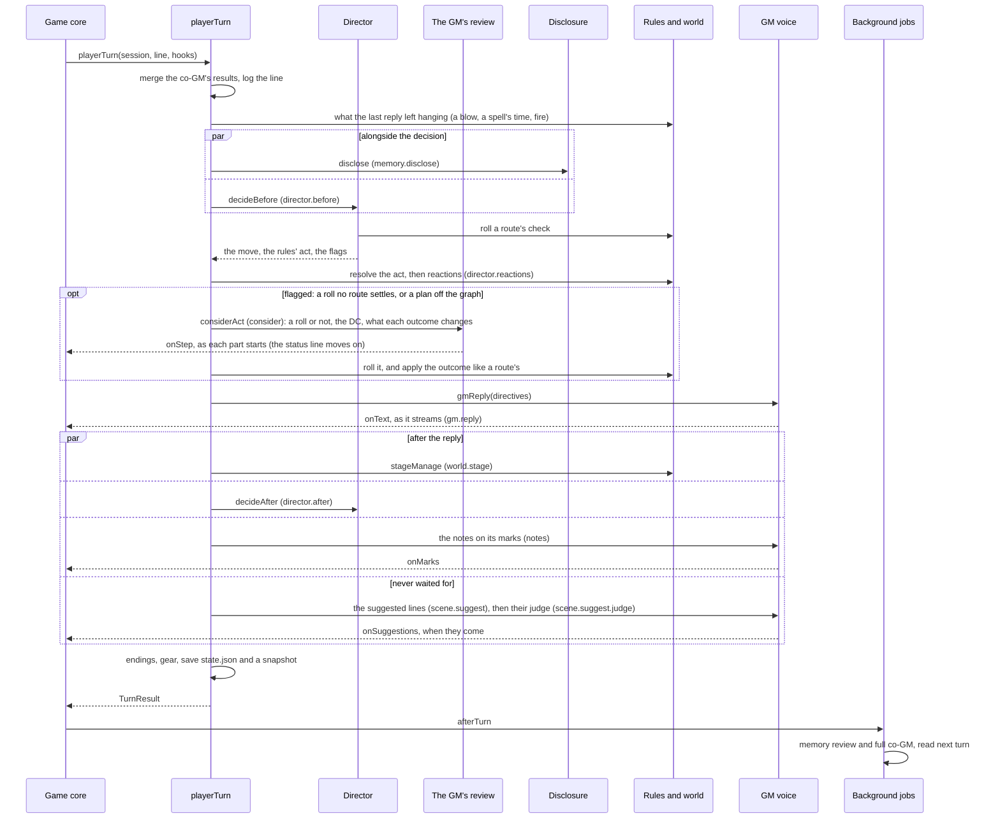

# src/runtime: the scene runtime

Part of the [architecture overview](../../ARCHITECTURE.md).

The engine that plays a scene: the player's line goes in, the GM's reply comes out, and the session's state keeps up. Everything the player meets in a scene goes through here, in the terminal app, the browser build, the QA console, the zoo and the evals.

```sh
npm run scene -- start hanged-clerk --session demo    # a scene in the terminal (approach v2): the sheet, then the opening
npm run scene -- say demo '(I look up at the body) Who found him?'
npm run scene -- status demo                          # the beat, the path, the co-GM's notes, latency and cost
```

Live runs need `OPENROUTER_API_KEY` (or `~/secrets/kingmaker-dev-openrouter.txt`). Why each mechanism exists is in [docs/guide/running.md](../../docs/guide/running.md). Where the runtime is going (a flattened `playerTurn`, a model client behind the calls, the session split into documents) is in [docs/design/productionise.md](../../docs/design/productionise.md).

## What it is

A session plays one authored scene at a time ([scenes/](../../scenes/README.md)). Each turn, the director asks a fast decider what the player is attempting and, after the reply, what has happened. The D&D rules ([src/rules](../rules/)) and the scene's world ([src/world](../world/)) settle what's theirs to settle: checks, spells, blows, fire. The GM voice narrates the result from a brief built from the scene's prep and from what people remember ([src/lore](../lore/README.md)). The session records the beat, the rolls, the transcript and what is still pending. Between turns a co-GM reviews the scene and patches the prep where play has left it. After each reply, a small call suggests a few things the player might say or do next, never waited for. When a scene ends, the runtime crosses the boundary: it writes the hand-off, checks the coming scenes against what happened, rewrites the next opening and moves the world's fronts on. How all this is run (one voice or actors, which decider, when the co-GM runs, memory or not) is an approach, a preset in [approaches.ts](approaches.ts).

## What it owns

| File | What's in it |
|---|---|
| [engine.ts](engine.ts) | The turn pipeline: `createSession`, `openScene`, `playerTurn`, `resumeAfterFight`, `forceEnding` and `chainScene`. The boundary (`crossBoundary`, `moveOn`, `boundaryPreview`), the zoo's hub scenes (`openHubScene`, `closeHubScene`), and reactions to violence (`violence`, `witnessesOf`, `react`). |
| [director.ts](director.ts) | What the decider is asked before the reply (`decideBefore`, with the considered-rolls flag) and after it (`decideAfter`). The follow-up calls (a spell's or blow's details, a jump, a freeform roll, pressure), `decideReactions`, `decideNextSpeaker` for actors, and the directives that tell the GM what was decided. |
| [consider.ts](consider.ts) | Considered rolls: the GM's review of a flagged act (`considerAct`, [prompts/consider.md](../../prompts/consider.md)), the verdict from its judgements (`verdict`: yes, no or a DC), and the ruling settled as a route of its own (`settleRuling`). |
| [voices.ts](voices.ts) | The GM (`gmReply`), the narrator and the actors (`narratorReply`, `actorReply`), and the guard against repeated sentences. `readReply` reads a reply's markup once it's whole. |
| [markup.ts](markup.ts), [speakers.ts](speakers.ts), [knowledge.ts](knowledge.ts), [notes.ts](notes.ts) | The GM's markup ([below](#the-gms-markup)): the parser (`parseMarkup`, as the reply streams and once it's whole), who says each line (`withSpeakers`, from the GM's tags or the prose, as the look's barks find them), what the player knows (`knowledgeBrief` for the GM; `linkMarks`, `asKnown` and `knowledgeCard` for the marks and their popover), and the notes the player reads on the marks, written after the reply from what they know (`annotate`, `writeNotes`). |
| [brief.ts](brief.ts) | What the GM is shown: the stable prep (`sceneBrief`) and the per-turn note (`nowNote`). Also the scene as play has it (`effectiveScene`: the authored scene, the co-GM's patches and "an ending of their own"), who is present, whose names the player hasn't heard (`unnamed` in a scene, `strangers` across a boundary), and the prompt loader (`prompt`). |
| [scene.ts](scene.ts) | The Scene format's types, and `validateScene`. The scenes themselves are in [scenes/](../../scenes/README.md). |
| [session.ts](session.ts) | `SessionState` and its files: `saveSession`, `snapshotSession`, `loadSession`. |
| [approaches.ts](approaches.ts) | The 28 approaches (`v2` is the game's; `v2-quick` is `v2` before considered rolls), and `sceneApproach`, which applies a scene's own overrides. |
| [repair.ts](repair.ts) | The co-GM: the full review (`runRepair`) and the quick one (`quickRepair`), and how their notes, whispers and patches apply. |
| [background.ts](background.ts), [jobs.ts](jobs.ts) | The work after each turn (the memory review and the co-GM's review). `afterTurn` starts it, and jobs.ts is what it runs. |
| [talk.ts](talk.ts) | Talks with a companion between scenes. |
| [owed.ts](owed.ts) | What the story still owes the player: an essential the rest of the story needs (`later`), missed in its scene, carried by the boundary into the next scene that holds, with its things where they were. |
| [suggest.ts](suggest.ts) | The suggested lines: what the player might say or do next, from a GM reply (`startSuggesting`), vetted (`screen`, `judge`, `mix`), and kept for their scene and turn (`currentSuggestions`). |
| [dice.ts](dice.ts) | The seeded RNG and d20 checks, shared with the rules and the world. |

**State.** One `SessionState` per game ([session.ts:229](session.ts#L229)), a mutable JSON object:

- **The story,** kept across scenes: the player, the turn count, the dice's seed and count, the transcript, per-turn metrics, the rules engine's campaign (`rules`), `history` (each finished scene's hand-off, the facts play settled there, its last moments, scenes skipped and fronts moved), `talks`, and `owed` (what the story still owes the player, from scenes already over: [owed.ts](owed.ts)).
- **The scene's own,** reset by `freshScene` ([engine.ts:1098](engine.ts#L1098)) when the next scene starts: the beat and the `path` of moves, facts established, the co-GM's notes, whispers and patches, the GM's `rulings` on considered turns, the turns spoken out of character (`oocTurns`), who has entered or is absent, the scene's status, the memory notes opened, essentials landed or hinted, staged secrets (`guard`), exits already fought, the place's `world`, and the lines suggested for this moment (`suggestions`, for their scene and turn only).
- **What's pending:** `pendingExit` (an ending held for the player's answer), `closing` (a wind-down turn), `endingLead`, `threat` (a blow or a danger that lands next turn), `brawl` and `ended`.
- **From the boundary:** `adjustments`, `opening`, `lead`, and what the player `carried` out of the last scene's world.

**Files,** under `runs/sessions/<id>/` (`KM_RUNS_DIR` moves `runs/`):

| File | Written by | Read by |
|---|---|---|
| `state.json` | `saveSession` (a temp file, then a rename) | `loadSession`, the co-GM job |
| `snapshots/<scene>-turn-NNN.json` | `snapshotSession`, after every turn | the memory job, eval fixtures, the End's chapters ([src/app/story.ts](../app/story.ts)) |
| `repair-NNN.json`, `repair-NNN-quick.json`, `repair.lock` | the co-GM job; a quick co-GM that missed its deadline (a file of its own, so the full review of the same turn doesn't overwrite it) | `applyPendingRepairs`, at the start of the next turn (a turn's quick review first) |
| `remember-N.lock`, `memory-reviews.jsonl` | `afterTurn`, the memory job | people reading a run |
| `docs/` | src/lore: this game's copy of the lore | src/lore |
| `calls.jsonl` | src/llm, once the caller points the call log here | people reading a run |

The game core and the app keep `game.json` and `app.json` beside them.

## How it fits

| Caller | What it calls |
|---|---|
| The game core, [src/game/play.ts](../game/play.ts) (the app, the QA console, the browser build and the zoo all play through it) | `createSession`; `openScene` as a scene begins; for each line `playerTurn` (or `talkTurn` in a talk) and then `afterTurn` ([play.ts:290](../game/play.ts#L290)), each with `suggest` from the game's setting; `currentSuggestions`, `startSuggesting`, `stopSuggesting` and `suggested` for its say_1… choices and the setting; `forceEnding` for `/end`; `resumeAfterFight` after a fight on the map; `chainScene` with `skipInterludes` when a scene ends ([play.ts:471](../game/play.ts#L471)); `startTalk`, `openTalk`, `endTalk`, `leaveTalk`; `openHubScene` and `closeHubScene` for the zoo |
| The scene harness, [src/cli/scene.ts](../cli/scene.ts) | `createSession`, `openScene`, `playerTurn` and `chainScene`, opening the next scene at once. Its `remember` and `repair` commands are what the background jobs run. |
| The evals, [src/eval/run.ts](../eval/run.ts) | `openScene`, `playerTurn` and `chainScene`, and `decideBefore`, `decideAfter` and `runRepair` on fixture states |
| The browser build, [src/web/static/game.tsx](../web/static/game.tsx) | `setBackgroundRunner`, so the jobs run in the game's worker |
| The zoo's boundary desk, [src/game/zoo/wings/theatre.ts](../game/zoo/wings/theatre.ts) | `boundaryPreview` |

| It calls | For |
|---|---|
| [src/llm](../llm/README.md) | `respond` and `respondJson` for every voice, the hand-off, the boundary verdict, the fronts and the suggested lines; `deciderFor` for the director and the suggested lines' judge |
| [src/lore](../lore/README.md) | Memory each turn (`disclose`, `memoryBrief`); the boundary's records (`savePlayedScene`, `broadcastEnding`, `rememberScene`, `frontsText`, `moveFronts`); the docs store for talks |
| [src/rules/dnd.ts](../rules/dnd.ts) | The character sheet, checks (`rollFor`), spells, attacks, grapples and shoves, jumps, class features, rests, hazards and NPCs' attacks, time passing, coming to, levelling up, and gear |
| [src/world](../world/) | The place as a world (`buildWorld`, `joinWorld`, `applyOps`, `tick`, `worldView`), the stage manager (`stageManage`), and exit scripts run against a recording world (`recordingWorld`) |
| [scenes/index.ts](../../scenes/index.ts) | `sceneById`, the only way a scene comes in |
| [prompts/](../../prompts/README.md) | Through `prompt()` ([brief.ts:12](brief.ts#L12)) |

**What a caller can count on:**

- **Hooks.** `TurnHooks` ([engine.ts:30](engine.ts#L30)): `onSpeaker` when someone starts speaking; `onText` with the text so far as the player reads it (accumulated, not a delta; the GM's markup taken out), and the markup so far (who says each line, the marks: [the GM's markup](#the-gms-markup)); `onEntry` for each finished entry (dice lines, system lines, finished speech); `onScene` from the core as it goes into a scene; `onSuggestions` when the lines suggested after a reply have come (the session has them), which can be after the turn has returned.
- **A turn saves at its end.** `playerTurn` writes `state.json` and a snapshot once, when it's done. It returns the entries it added, the exit if the scene ended, and the turn's metric.
- **A turn that throws has already changed the session in memory:** the turn count, the player's line, rolls, the world. The GM reply and the decider calls aren't caught, so when one fails the caller goes back to the last save, as the app does ([src/app/game.ts:1529](../app/game.ts#L1529)). The QA console loads from disk for every command anyway.
- **One turn at a time.** Nothing locks a session; callers send one turn after another.
- **An ended scene takes no turns.** `playerTurn` throws once `state.ended` is set. The caller then fights (a combat exit), chains on, or ends the talk.

## How it works

### A session's life


In the scene harness `chainScene` is followed at once by `openScene`: there's no map between scenes, so the interludes (downtime scenes that stand in for it) are played. The zoo's scenes belong to a hub: `openHubScene` starts one from the top and `closeHubScene` ends it, with nothing handed on.

### One player turn

As `v2` plays it, in a scene with a world and a character sheet. The names in brackets are the calls' operation labels, as they appear in `calls.jsonl`.



1. **Before the decision** ([engine.ts:443](engine.ts#L443)). Co-GM results that have arrived since the last turn are merged (`applyPendingRepairs`), and the scene is the authored one plus their patches. A wind-down turn (`state.closing`) only closes the scene ([engine.ts:484](engine.ts#L484)), answering the player's last turn first, unless they speak out of character: a small decision asks (`outOfCharacter`), and then they're answered and the close waits. Otherwise the rules go first: a timed spell running out, fire spreading in the world, and a blow or danger the last reply left hanging (`state.threat`) all land before the player's act ([engine.ts:512](engine.ts#L512)).
2. **The decision** ([director.ts:680](director.ts#L680)). One decider call asks every question the turn needs at once. Is the player attempting one of the scene's routes, or doing something that simply happens? By what means? Would a GM call for a roll, and is it what one of the routes with a roll is for (`roll_call`, the considered-rolls flag)? Should a pacing cue fire? Is this off the graph? Should a missed essential reach them through someone else? Are they pressing someone's secret, or have they earned the payoff? Is it daft enough to send a bill? Is it something the rules resolve? Is it out of character, or past the scene's limits? For actors, who speaks first? A second, smaller call follows only when needed: a spell's or blow's details (`director.mechanic`), a jump, a class feature, a freeform roll's skill and difficulty (in approaches with `freeformChecks`), or pressure.
3. **What the dice and the rules decide.** A route's check is rolled (`rollFor`) and the move applied: a new beat, facts established, perhaps an ending. The rules resolve a spell, blow, grapple, jump, feature or rest, and violence draws a reaction from everyone present. Each decision becomes a directive, a short paragraph under "For this reply" in the GM's note.
4. **Considered rolls** (`v2`, [consider.ts](consider.ts)). A roll is wanted ("route" and "new" together at 0.7) and nothing the author wrote settles it (no route's roll the decider chose surely, at 0.7 (`ROUTE_CONFIDENCE`), unless the roll call says plainly (0.8) that the roll is for something else, or chose less surely and didn't call another's act; no route without dice, no ending the player simply reaches, no payoff already earned, nothing the rules resolve, no limit), or it's a plan off the graph. The rules' act settles it unless it's only the means to something risky it doesn't settle (asked in the act's details call, `means_only`: a Mage Hand at the page in a watching boy's boot); then, and beside a class feature, the review waits for the rules to resolve the act, so it rules knowing how that went. A route without dice read with an attempt's confidence (0.45) is the prep's own answer either way (`byPrep`): a bribe gets the haggling the author wrote, however the off-graph flag reads it. A route's roll isn't made again for the same push (`same_again`, asked once something has failed: which failed try the turn repeats, so only one on that route, or a ruling's same ask, counts): it gets the answer that try got, the route's authored failure or the ruling's, and nothing more. (The review's own `same_again` says no without dice to a ruling's.) Then nothing is rolled in the decision, and the GM reviews it before replying: one Luna call with the whole prep, which judges who's being worked on and by what skill, the guidance's stakes, approach and disposition (or a feat's difficulty), and what success and failure each change (where the scene goes, the authored route it counts as, the facts, what comes out, the ways of trying it shuts). Code turns the judgements into yes, no or a DC ([docs/research/dc-guidance.md](../../docs/research/dc-guidance.md)'s grid as designed: [the GM's ruling](#the-gms-ruling-on-a-considered-turn), below). The ruling is a route of its own (`considered-N`), rolled and applied like any route: the dice line, the beat or ending, the facts, a directive that says what was decided and that it stands. No bill or earned payoff goes on top. `hooks.onStep` hears each part start, for the app's status line. If the review fails, a wanted roll is still made as a freeform check.
5. **Off the graph, in `v2-quick`** ([engine.ts:751](engine.ts#L751)). A turn the decider judged off the graph waits for the quick co-GM until 3 s after the turn began. If it opened a route, the turn is decided again with it. A late answer is written as a repair file and lands next turn.
6. **The reply.** One streamed GM call (`gm.reply`). For actors, up to four lines in all, the narrator's and the characters', with the decider choosing who speaks next (`director.next`).
7. **After the reply, in parallel.** The stage manager writes what the reply established into the world (`world.stage`, [src/world/stage.ts](../world/stage.ts)). `decideAfter` ([director.ts:1198](director.ts#L1198)) reads what happened: an outcome route, which ending the story is at, the scene's status, essentials landed or hinted, how far secret-holders have opened up, a threat hanging over the player, whether they've left the place, and whether an ending now would leave something hanging (a question the reply left unanswered, `ask`) or be the player's own doing (`own_exit`). After a word out of character only the status is kept: nothing in the story moves on. The notes on the reply's marks are written ([below](#the-gms-markup)) and reach the screen as they land (`onMarks`), about 2 s after the reply; the stage manager takes longer, so they don't hold the turn up. With `suggest`, the suggested lines start too ([below](#suggested-lines)); the turn doesn't wait for them either.
8. **Endings, gear and the save.** The table below says how a scene ends. Gear the story moved to or from the player changes their sheet; the turn's metric goes in `state.metrics`; the state and a snapshot are written. The caller then runs `afterTurn`.

### How a scene ends

| What happened | When the scene closes | Where |
|---|---|---|
| The player chose an exit with no roll in it (an attempt, or something that simply happens), or a fight, read with confidence 0.6 or more | In this reply | [engine.ts:259](engine.ts#L259) |
| A roll decided an exit the player went for, other than a fight | The decisive moment plays now; the scene closes on the next reply | [engine.ts:253](engine.ts#L253) |
| An exit the player didn't choose (a failed check, a cue) | It escalates now and closes on the player's next turn, unless that turn answers it (a question or a request to someone here, an objection, a challenge, something new, a try that might change things: the decision's `brink` question): then it's held once more (`pendingExit`) | [`heldEnding`](engine.ts#L273) |
| A cue would end the scene (not in a fight) as the player goes for a way out of their own | Not over it: the cue waits while an ending is held for their answer, and while the routes that settle the scene read 0.45 together. When they read 0.6 together and one of them leads where the cue does, the player is leaving by it: their choice, closed in this reply | [director.ts:820](director.ts#L820) |
| An outcome after the reply leads to an exit, or the ending-state read puts the story at one (0.6, or 0.35 twice running; an outcome that keeps the scene where it was, a fact established, doesn't make that read stale) | A fight at once. One the player chose themselves (`own_exit`), with nothing left hanging, after one wind-down turn (`closing`), whose reply answers their last turn first. Any other waits for their answer, as above: when they asked something the reply left unanswered (`ask`), someone has just come in, or it isn't their own doing (`whyItWaits`) | [`moveOnAfterReply`](engine.ts#L332) |
| The player speaks out of character | Never: an ending held or winding down waits for their next turn in character, and the turn isn't an exchange on the clock | [`oocHold`](engine.ts#L286) |
| The player walks out of the place (read at 0.7, with a character sheet) | Now, through "an ending of their own" | [engine.ts:921](engine.ts#L921) |

A closing reply (the wind-down's, or one an ending held for the player's answer lands in) shows nothing the scene has already shown (Kell's arrest of Hobb came twice, word for word), and tells what became of people in the story's own voice, with only the promises made in play and none of the game's words ("not established here", "between scenes"). Every scene has "an ending of their own" (`own-ending`, [brief.ts:27](brief.ts#L27)), added by `sceneById`. The director prefers any plausible authored ending to it ([director.ts:1282](director.ts#L1282)). A fight ends its scene at once so it can be played out on the map from where everyone stood, and `resumeAfterFight` picks the scene up afterwards with that exit spent: its aftermath is told as the fight went (who's standing is the summary's, whatever the facts before it say; the winners take what they'd want off a beaten player), and the stage manager writes it into the world as it does a turn's reply. `finishScene` ([engine.ts:955](engine.ts#L955)) runs the exit's script against a recording world (`state.ended.operations`) and applies the scene's `afterwards`.

### The GM's ruling on a considered turn

The review judges; code holds the ruling to its job ([consider.ts](consider.ts)):

- **The verdict** is [docs/research/dc-guidance.md](../../docs/research/dc-guidance.md)'s grid as designed (§3.2 and §3.4): yes at a gap of 0 or less, DC 12, 15 or 18 at 1 to 3, and no at 4 or more, the reply showing what would reach them. A lie always rolls, at 10 where the truth would be enough, since it can be seen through. A lie is what the player's words assert this turn that they know is false, never a sincere promise, an honest appeal or haggling, whatever they lied before. What someone gives when asked (the beat says it comes out as the player asks, their card says they'd give it if asked straight, or they've agreed to it or offered it) is asked as a question of its own (`freely`), and it's a yes whatever the stakes: folded into the approach it didn't land (a confessing Hobb asked straight for the Master was still ruinous and strong, DC 15). The verdict leaned to the dice before the first whole-game QA pass, which met a wall of DC 18s from two children.
- **The same push again**, with nothing new on the table, is checked first and gets the same answer, whatever else the review judged. It counts only when something has failed here, and the review is given each earlier try (a ruling's or a route's) with the player's own words, to tell it from a new one.
- **A lift, a snatch or a slip past someone** in the cast is a contest with them (`contest`): their attention and what they stand to lose against the player's cover, rolled at 10 to 18 on the same steps, unless they'd let them anyway or both of the review's reads say it can't be done under their eyes. Only taking what nobody's watching is a feat.
- **A roll decides only what the player's own act is up against.** The review is given the beat's notes on what the people there are doing at this point, and told that an ally's choice is theirs, made in the reply: Kell's signing isn't Tull's Intimidation roll.
- **A no without dice is an honest refusal**, never the failure's cost (that's for a roll that went against them): the review's own when the success it wrote gets the player nothing (Hobb pressing the coin back, "Coin won't keep her safe"), otherwise the person's plain no, which shows what would reach them, moves nothing and shuts nothing. The same push keeps the answer it got before. A success that gets nothing, or shuts a way of trying (a lift written as being caught), is no success; a ruling whose outcomes come to the same and give the player what they were after is a yes.
- **Ways of trying** are shut only by a roll that went against the player, and only one they really tried (the decider read the attempt as it, at 0.25: `TRIED`): never on a success, never by a no without dice, never an authored way without dice.
- **Where it goes, and what lands.** A ruling that takes the scene into a beat or ending without counting as a route settles what every authored way in there settles (the Rat's "Big Hobb has broken", which its exits check). It never takes the scene back to a beat it has left with something settled since (`leftBehind`, as for the co-GM). What lands is what the reply showed, as the after-reply decider reads it, not the ruling's own list, and what the dice kept back doesn't land whatever the reply let slip. A route tagged with an essential brings it only when it goes the player's way all the way: a bribe that gets haggling is tagged with the page, and never brings it.
- **When the review fails,** a wanted roll is still made as a freeform check, its dice line saying what it's for (`plainReason`: the plain goal at whoever the turn names, as the player would call them). A review that comes in two phases is taken by its final answer when that reads as JSON (`finalAnswer`), rather than asked for again past its deadline.

### Approaches

| Switch | What it changes | `v2` |
|---|---|---|
| `voice` | `gm`: one GM voices everyone. `actors`: a narrator, and a call per character from their own card. | `gm` |
| `decider` | Who answers the director's questions ([src/llm/decide.ts](../llm/decide.ts)) | `luna-decisions` |
| `repair` | When the co-GM runs: `off`, `background`, `blocking` (before each reply), `stall` (a holding beat, then a follow-up), `quick-block` (wait for the quick co-GM on off-graph turns) | `background` (`v2-quick`: `quick-block`, 3 s) |
| `considered` | Considered rolls: an act a roll should settle that no route does, or a plan off the graph, is ruled on by the GM before the reply (a roll or not, the DC, what each outcome changes); those turns take a few seconds longer | on |
| `memory` | `docs`: the docs service each turn, and the background reviews. `lite`: one merged review. Unset: hand-offs only. | `docs` |
| `tone` | `comic` adds [prompts/tone-comic.md](../../prompts/tone-comic.md) to the GM's prompt | `comic` |
| `consequences` | The "daft" question and its bill, at 0.7 (`DAFT_CONFIDENCE`): something daft, reckless or cheeky the player does, never an earnest ask, honest offer, case made or plan, however bold. Not on a considered turn, nor when a route's or a freeform roll decided the act: the outcome carries its consequences | on |
| `freeformChecks` | A roll on the decider's skill and difficulty for a risky attempt that no route covers (what considered rolls replace) | off (`v2-quick`: on) |
| `pressureRolls`, `staging` | Pressing someone for a secret is ruled yes, no, or a roll at DC 12, 15 or 18; staged secrets (surface, tell, stirred, torn, settled) | off |
| `speculative`, `deciderRelocation`, `hideEssentials`, `effort`, `repairEffort` | Experiments: the reply started alongside the decision, the decider moving missed essentials, no essentials in the prep, reasoning for the voices and the co-GM | off |

A scene can set any of these for itself (`Scene.approach`, through `sceneApproach`, [approaches.ts:118](approaches.ts#L118)). A talk turns the co-GM, freeform rolls and rulings off and staged secrets on. The other `v2-*` presets (`v2-staged`, `v2-pressure` and the rest) are the experiments as they were run, with the quick co-GM's wait and no rulings.

### What the GM sees

`gmReply` ([voices.ts:128](voices.ts#L128)) sends, in this order:

1. **Instructions:** [prompts/gm.md](../../prompts/gm.md), with the tone.
2. **The prep** (`sceneBrief`, [brief.ts:306](brief.ts#L306)): the place, the premise, background, the story so far (every scene's hand-off, earliest first, each with the facts play settled there, and the last one's last moments word for word: all of them, so a confession two scenes back is the GM's to know, not a story note disclosure may never open), where the prep is out of date (the boundary's adjustments, which outrank it), every cast card with its secrets, the ways it can end, the essentials (each with whether the player has come across it: until they have, nobody here says, writes or acts on it as known unless they know it themselves), the limits, the player character and the table rules.
3. **Each person's lore** (`memoryBrief(…, "stable")`), when the approach has memory.
4. **The scene so far,** as a conversation: the player's lines as user turns, the GM's as assistant turns, dice and system lines as developer notes.
5. **What changes every turn, last:** what people remember (`memoryBrief(…, "live")`) and `nowNote` ([brief.ts:410](brief.ts#L410)). That's the beat and its direction, cast notes, pressure, the routes from here, staged secrets, the co-GM's notes and whispers, details established in play, the player's injuries, the world right now (the truth behind the screen, with what's out of the player's sight by name: `outOfSight`, anything hidden or inside what's hidden, neither theirs nor come across), names not yet heard (every name they go by, last before the reply's form, since the prep, the facts, the world and the directives all use them), and the directives under "For this reply". The GM is given every fact with its status, and the narration shows only what the player could see or has been told ([prompts/gm.md](../../prompts/gm.md)): listed like anything else, the page sewn into Cob's boot was narrated as staying there, to a player who had never met Cob.

The order serves the provider's prompt cache: what's stable comes first, so a newly opened note doesn't spoil the prefix ([voices.ts:141](voices.ts#L141)). The prep ends with "What the player knows" (`knowledgeBrief`), and the note with a one-line reminder of the markup ([prompts/gm-markup.md](../../prompts/gm-markup.md)), just before "For this reply" ([below](#the-gms-markup)).

### The GM's markup

The GM marks its reply up for the screen: who says each line, and the words a moment turns on, which the player can click for a note. The markup never shows. Anything in square brackets is for the screen; a marked phrase stays in the prose, in round brackets:

```text
[Kell] “On what evidence?”                                     who says the line after it
[the pie-seller] “(Not for you, my lamb.)[why: You called…]”   a note on the words it's on
```

- **Speakers.** A tag goes before every spoken line: the speaker's name, what the player calls them until they've heard it, or `you`. `withSpeakers` ([markup.ts](markup.ts)) resolves it to a cast or world id (`tagSpeaker`); an untagged line gets its speaker from the prose, as the look director's barks always have ([speakers.ts](speakers.ts)): the speech tag after it, in its own paragraph and before the next line (a "…,” he blurts" is whoever "he" is: `antecedent`, the one the nearest sentence about a "he" is about); the one who said the line before, across a "she says" or a pause ("A beat."); the one the sentence leading in is about: the first one named there who isn't only looked at or talked about ("Her gaze settles on Kell" isn't Kell talking, and a name inside an earlier line doesn't count), or, for a sentence that goes on about "her" ("Her eyes flick to Sergeant Kell’s notebook"), whoever she is; or, after narration that's only about "she" or "he", the one who said the last line, when they're who the pronoun can be and nobody new has come in ("The boy stops at your crown."). A line that opens a paragraph after a line said has no lead-in. Who's who comes from the cards (`speakersOf`, [knowledge.ts](knowledge.ts)): "she" or "he" from someone's look, their rank as "the King" or "the Sergeant", and what they are ("the woman", or "a woman in a rain cape", beside words of her look), each only while it means one person here. What someone's called counts by its last word only as "the boy", or beside another word of it ("a scrawny boy in enormous boots"): `[Porter]` is a porter, not the big porter with the bandaged hand. The cast who aren't here are known by their names only, or by what they're called once the narration brings them in by it ("The gentleman behind them carries a silver-topped cane"): "the porter" isn't Hobb while Hobb is in the cells. A short quote inside a sentence of narration ("At “the Royal Purveyor's office,” her pencil stills", "each “lost” wagon", "where “Lost to goblins!” rises from the crowd") and words written and read ("countersigned “J. Sallow”", "At the bottom: “Not goblins.”") are nobody's line, or the player's own when they echo their turn. Nobody found is left unplaced, rather than guessed, and the screen draws them gold, in italics. A tag written inside the line's quotes with the line's own quotes after it (`“[Kell] “No.””`, `“[Kell] ‘No.’”`) loses the tag and one pair of quotes.
- **Marks.** Three kinds: `why` (someone refuses, bristles or comes round because of the player's past, a side they're on or not, a prejudice or custom of the world, or a law), `know` (what the player's character would know and a newcomer wouldn't), `you` (one of the player's own past acts, called back). The GM writes a note on each as it marks it, with its whole prep in view, and that note never reaches the screen: the note the player reads is written after the reply, from what they know ([the notes](#the-notes)).
- **Why these tokens.** The user's sketch was `(text)[note]`. It holds up, with a kind on the note and the speaker's tag in the same square brackets, so square brackets are always for the screen. Markdown's order (`[text](kind: note)`) measured the same (adherence, notes and the judge's scores within noise of each other, docs/LOG.md), so the sketch's shape was kept, and the parser takes both. Brackets that are only brackets (the player's "(I cast Fireball)") stay as they are.
- **What the model drifts to, and how it's read** ([markup.ts](markup.ts), tested in [markup.test.ts](markup.test.ts)): Markdown's order; both in square brackets (`[Warden’s Book][know: …]`); a space between the phrase and its note; a note with no kind (a why); the note first and its phrase after; a note straight after a line, or a sentence, with no words of its own in brackets, or in round ones, or in both (`“…”(why: …)`, `“…”[(why: …)]`: it's on that line or sentence); a tag before a marked line (`[Peg] (“…”)[why: …]`), inside the line it's for, or after it at the end of a line of text; a marked sentence that lost its full stop (it gets it back); a marked phrase in square brackets (read without them). A phrase that isn't words of the reply (a note on a line of its own; a label after a finished sentence: “…again.” (the goblins scatter)[why: …]; or words just said, written again as a label: “…in the tally loft.” [The tally loft][know: …]) isn't shown: its note goes on the phrase where it already stands, or on the sentence it's about, or nowhere. What's malformed falls back to plain words: a phrase whose note never came is shown without brackets, a stray tag disappears, a note that never closes is hidden to the end of its line. Every one of these was seen in the evals or the ferry booth, and over all 1,681 replies of this work's runs the parser shows no markup.
- **As it streams.** `gmReply` parses the reply so far on every token (`parseMarkup(raw, { final: false })`) and calls `onText(text, markup)` only when the words shown have grown, with who says each line in them. A bracket that might be markup holds back what follows it until it's clear (and a `*` that may be the first of Markdown's `**`), so the words shown only ever grow and never show a token. The marks don't stream: they come with their notes. The tests check every cut point of a reply, and pieces of every size.
- **What's kept.** A narration entry keeps the words as the player reads them in `text`, and the markup beside them in `marked` (`{ speech, marks }`, offsets into `text`; the marks once their notes are written), so saves, resumes and the static build keep it; everything else that reads the transcript (the judge, the deciders, the stage manager, memory, the suggested lines) reads the plain words. The GM's own history is written back with its markup (`markupOf`, the notes as the player read them), a reply from before the markup with its lines tagged from the prose, since a model writes as its last replies were written. A turn's metric keeps how the reply kept to the markup (`markup`: lines tagged, the GM's marks by kind, what was dropped or malformed) and its notes (`notes`: how many, how many on lines the GM hadn't marked, their cost and time).

### The notes

What the player reads on a mark is written by a second call after the reply, `annotate` ([notes.ts](notes.ts)), which sees only what the player knows. The GM's own notes were the first try at this, and about one in five of them told the player something from behind the screen (the page in a dead man's boot, the motive, a character's private reason), however the prompt put it: the GM writes them with its whole prep in view, and the prep is where they came from. The writer can't: what it's told is built from what the player has lived and the world's public lore, never from the prep (tested in [notes.test.ts](notes.test.ts) against every cast card, beat, essential and GM-only or private doc).

- **What it's told** (`notesInput`): what anyone here knows (the scene's `hook` and `known`, its own public lore docs whole, the people here by their public faces, a line on each of the world's other public docs and places; a doc without its pointers to other docs, its "If …" lines, or the hours that aren't the scene's: `forReaders`); who the player is and what they've lived (their concept and build, how earlier scenes ended and the notebook, what companions told them, their own turns in earlier scenes); this scene as they saw it, their turns numbered; the notes they already have in it; and the reply, its spoken lines numbered with who the player knows says them, and the GM's marks (where, and what kind: not its notes). Names the player hasn't heard are what they'd call their owners, all through it (`asKnown`). Someone's public face is what the people who know them know, so it's there only once the player had heard their name before the reply: while Hobb is the big man by the fire, what the Rat's regulars know of him is the landlady's to sell (the QA pass had "You know him as Big Hobb Mallory, the Rat's champion" before she had).
- **What it does** ([prompts/notes.md](../../prompts/notes.md), Luna with no reasoning, JSON): writes a note for each of the GM's marks that what's in front of it explains, and leaves out the rest; adds a why to every line where someone refuses, bristles, warms or comes round for a reason it can see (what the GM most often left unmarked); and adds at most one know, on the first mention of something a newcomer couldn't follow. A note gives the player's turn it's about, or the lore doc it explains from. It's told to get who did what right ("you" is the player: the boy throws the stones; the King told the player how Wendell took his tea), that nobody says or thinks what they haven't said in play (a lore entry's "Dilly says…" is the lore), and that no note beats a guess.
- **Placed** (`placeNotes`): on the GM's mark it was written for, the few words of a line it names (or the whole line), or words of the reply; never two on the same words; a know isn't written again in the same scene; two whys a reply at most, three marks in all. Only what's so goes: a know explains from a lore doc, and never says the reply again ("You now know…", "You're hearing…", "You know him as…"); a `you`, or a why whose reason is something the player did ("You offered…"), is about one of their turns that's about it (the writer's turn when it shares a word that says what was done, names aside, else the one that does: `supports`, `deedFor`), or it goes, and a why on someone else's reason keeps its note but not a link to a turn that isn't about it; a note that has someone say or think something when they haven't spoken in the scene goes, and so does one about itself ("the reason for this line isn't clear"). The note is in the story's words (`storyWords`: no "turn 3", no doc ids), and linked: to the player's turn, to a lore doc, or to someone (a person's public face is their card, by the name the player knows them by); else `linkMarks` links it by the names in it ([knowledge.ts](knowledge.ts)).
- **When.** The engine pushes the reply's entry with who says what, and `annotate` writes its notes alongside the after-reply decision and the stage manager: they're put on the entry (the object the screen's line holds) and the screen told (`onMarks`), about 2 s after the reply, and the turn waits for them before it saves (it waits longer for the stage manager). An opening, a talk's greeting and a fight's aftermath wait for theirs the same way, with the suggested lines (when they're asked for) started beside them, not after. A reply with no spoken line and no mark of the GM's isn't read, and a reply whose notes fail has none. It costs about $0.0003 a reply ([docs/LOG.md](../../docs/LOG.md)).

### What the player knows

The GM is still given every fact: a fast model kept from one invents it (docs/guide, and the talks work). It's told which of them the player has, so that what it marks is what the player could follow. `knowledgeBrief` ([knowledge.ts](knowledge.ts)) builds "What the player knows" for the prep, from what the player has lived and never from the prep: who they are (their concept and their doc, `Player/<Name>.md`, where character creation writes the backstory), how each earlier scene ended and what the notebook says of it (`history[].journal`, the exit script's journal lines), what companions have told them in talks (`talks[].told`), the conversation itself, and the world's common knowledge (the public lore). Whose names they've heard is in the turn's note ("Names the player hasn't heard yet"). Everything else stays behind the screen: secrets, what someone's keeping back and how far they've opened up, what the scene means them to find, the GM-only and private notes, a story not told yet.

A mark's popover shows its note and, through `knowledgeCard`, what the player knows of its link: their own line and the turn they said it; someone by the name they know them by, the public lore on them if they know the name, and the last thing they said to the player; a public lore doc's title and what it says first (`lead`: a sentence or two for a reader, not its summary, which is a retrieval hint), with names they haven't heard as what they'd call their owners. Never a GM-only doc, a look written for the GM, or a name the player hasn't heard (tested in [knowledge.test.ts](knowledge.test.ts)).

### The co-GM and the background jobs

- **The full co-GM** (`runRepair`, [repair.ts:140](repair.ts#L140)) uses [prompts/repair.md](../../prompts/repair.md) with Luna at medium reasoning. Its JSON schema's enums are built from the scene's own ids, so it can only point at beats, endings, people and essentials that exist. It returns notes for the GM (they last two turns), whispers to characters (one turn), canon to keep true (only what the GM has shown in play), relocated essentials (the scene's own, moved through someone who could know them or something already there: never a clue of its own making, as the cane-cap stamped with a wheat-ear and the order naming J. Sallow it once invented), "no, but" alternatives, a beat the story has already reached (and what put it there, which becomes a fact), a bridging beat and new routes. The patches go in `state.patches` and are seen through `effectiveScene`; the authored scene is never edited. It can't undo progress: its tracker move is refused, and its routes aren't open, where they'd take the scene back to a beat it left before something was settled (`leftBehind`, [brief.ts](brief.ts): each path entry records how many facts there were, `known`), and a review of a turn spoken out of character (`oocTurns`) doesn't move the tracker. It's told both.
- **The quick co-GM** (`quickRepair`, [repair.ts:295](repair.ts#L295)) is one small call with no reasoning, in `v2-quick` and the other quick-block presets. It makes the smallest move: open a route to an existing beat or ending (with a roll if the outcome is uncertain), bring a missed essential through someone present, or leave a note. In `v2`, the GM's review on a considered turn does that job inside the turn, and nothing runs it alongside every decision.
- **After each turn,** `afterTurn` ([background.ts:37](background.ts#L37)) starts the memory review when the approach has memory. It starts the full co-GM for `background`, `stall` and `quick-block` approaches when `shouldRepair` ([repair.ts:281](repair.ts#L281)) says so: off the graph this turn, a status other than on track, or three turns since the last review. Each job is a detached `node src/cli/scene.ts remember|repair <id> --turn N`. In the browser, `setBackgroundRunner` runs the same functions (jobs.ts) in the worker.
- **Nothing waits for them.** The co-GM's `repair-NNN.json` (and a late quick co-GM's `repair-NNN-quick.json`) is merged at the start of the next turn if it's for the same scene. The memory review writes into this game's docs, where the next disclosure finds it if the review has finished.

### Scene boundaries

`chainScene` ([engine.ts:1027](engine.ts#L1027)) lists the scenes the story could go to: the exit's `next`, then, while a candidate `assumes` something, its `overtaken` scene (six at most; the game skips interludes). `crossBoundary` ([engine.ts:1140](engine.ts#L1140)) then makes three calls at once:

- **the hand-off** (`handoff`): how things stand as play left them, for the next scene's GM, always keeping what anyone admitted (in their words, in whose hearing), what was found or handed over, and what a companion saw and heard for themselves;
- **the verdict** (`boundary`): which candidates still hold; where the first that holds is out of date (`adjustments`: nobody there sooner than its prep brings them on); its opening rewritten to start where the story is (keeping the author's word on who isn't there yet: the Heron once opened on the Master, who comes at midnight), written as the author's is, as directions for its GM, never the scene's prose or lines (`openScene` shows the whole of it, none of it having happened yet: written as prose ending on the landlady's question, with "pick up after the last scene's closing lines" beside it, four Rat openings in nine began after the question, with Kell answering it); and the `lead`, how the player hears where to go and why. Besides the story and the coming scenes' prep (labelled the GM's, which the player knows none of), it's given what the people the story goes on with do in the time between (the last scene's people who are in the scenes to come: their lore's "What they do next", `errandsOf` in [src/lore](../lore/README.md)), and whose names the player hasn't heard (`strangers`, [brief.ts](brief.ts)). What it writes rests only on play and those errands (an errand that begins with an "if" happens only when play made it true: a granary filed as suicide once sent the Crakes after a murder entry nobody made): the lead says why in the player's own terms, from what they saw or were told (Kell saw the big man with the bandaged hand at a gentleman's elbow and followed him to the Rat), never from the prep, and calls anyone unnamed what the player would; what someone tells the player doesn't go against what they said in play (what they found out since is told as new); and it's always the story, never a note about it ("the story gives no word of how you learned the Heron was his destination"): with no way on from play, the player picks up the trail from someone who'd know and say; and when the story still owes the player something, it says whether it was found after all, and whether and where it comes up next;
- **the world's turn** (`fronts`, `moveOn` at [engine.ts:1239](engine.ts#L1239)): which steps of the fronts doc play or time have made true, which are now meaningless, any new bills, and what of it shows in the next scene (first any bill that comes due there, as what happens there and who brings it: the King's GM had the bills for the granary fire and the attack on Sallow in its lore, and never showed them). What shows goes in with the adjustments, whose heading tells the GM that the world answering what the player did comes up before the scene ends. `moveFronts` writes them into this game's copy ([src/lore/fronts.ts](../lore/fronts.ts)).

Each falls back if its call fails: a plain hand-off line, no scene skipped, the author's opening. Then memory has its turn (`broadcastEnding` for `docs`, `rememberScene` for `lite`, `savePlayedScene` for either), and for `docs`, what the boundary says of someone in the time between goes into their own memory (`rememberBetween`: the lead as the player heard it, if it names them, and the adjustments about them), so the next GM and their talks know it as theirs (Kell's afternoon at the Purveyor's wagons was in the lead, and in the talk that followed she flatly denied it).

Before a scene closes, the closing reply offers what it still holds for the player once, through someone here who has it (`lastChance`: an essential not come across, with a carrier present, and not one the story carries on anyway): in the Rat, once Hobb clammed up about the Heron, Nan, Dilly and Cob never said a word, and the boundary had no way to the wharf. The scene goes in `history`, what the player carries is kept for the next world, and `freshScene` starts the next scene's own state. As it opens, who from earlier scenes is there (`settlePresence`) is read from the hand-off and the adjustments together, so the cast and the world agree with the boundary ("Cob will not be at the Rat tonight", and he was, read from the hand-off alone). `boundaryPreview` ([engine.ts:1223](engine.ts#L1223)) makes the same crossing without moving on, for the zoo's boundary desk.

**What the story still owes the player** ([owed.ts](owed.ts)). An essential the rest of the story needs (`later`: Prout's page, whose countersignature the King's morning needs) doesn't fall through the cracks when the player misses it. As the scene ends, `owedAtEnd` reads what was missed from the record (`landed`, `hinted`) and where its things are from the world (the page in the boot, on Cob), along with anything still owed from before. The verdict call judges, for each, whether the player came across it after all, and whether it can come up in the first scene that holds: that scene's own prep for it (an essential with `missed`), or, if it has none, where it is there and who could bring it out. `bringOver` then puts it into the next scene as a patch to its prep (`ScenePatch.essential`), so the brief, the deciders and the co-GM see it as one of the scene's essentials, with its routes (a route's `essential`, or `towards` for a way towards it that doesn't bring it out: there only while the scene has it, and gone once it's found); a sign already given stays given. Its things go with whoever has them into each next world (`placeOwedThings`, as the scene opens and as people come on). What can't come up next stays owed for a later scene; found, it's owed no more, and a scene's prep for it never shows. Without the verdict, a scene's own prep holds, and a placing goes only where someone who has it will be; the player's own things (the boots, the page unread in them) come up wherever they go.

### Companion talks

A talk ([talk.ts](talk.ts)) is a scene built from a companion's lore ([scenes/talk.ts](../../scenes/talk.ts)) and played by `playerTurn`. `startTalk` sets the waiting scene's own state aside (every field not in `STORY_WIDE`, [talk.ts:41](talk.ts#L41)), and `endTalk` puts it back exactly. `openTalk` runs the greeting alongside the talk's prep:

- `sift` (`talk.sift`, a decider call): which of their notes they've already told the heart of, anywhere, and which is the deepest;
- `plan` (`talk.plan`): the one thing they might open up about this time, how readily, and the first lines the player can choose.

That one thing goes on their card as a staged secret, with a `given` outcome route to the talk's "told" beat (`prepare`, [talk.ts:315](talk.ts#L315)). The talk knows what the scenes knew: what the companion knew in the last scene of the story they were in (their card's `knows` there, as things stood then: asked how she knew the thief's real name, Kell made something up, though her granary card said a palace page brought it), and what the lead says they did or told, which is theirs and stood by (it's in their memories too, from the boundary). Their stories are told, now or held. What they've told is in the talk record and their memories, and isn't told again. The one thing for now comes out a step at a time. The deepest is held until the third talk: the GM is told its title and summary, and it's kept out of disclosure. `talkTurn` adds the next dialogue choices (`talk.suggest`) as the reply lands.

### Suggested lines

After a GM reply (an opening, a turn's, a fight's aftermath), with `suggest` (the game's setting, on unless turned off), `startSuggesting` ([suggest.ts](suggest.ts)) asks for three to five lines the player might say or do next, as a cRPG offers its dialogue choices. A talk has its own (`talk.suggest`). The scene harness and the evals don't ask.

- **Off the critical path.** It starts once the reply is in, alongside the stage manager, `decideAfter` and the notes on the reply's marks, and nothing waits for it. The lines land in `state.suggestions` for that scene and turn, if the session is still there, and `onSuggestions` says so. A turn sent before they come leaves them behind (and aborts the call), and a scene that ends stops them. On 21 live replies (18 turns and three openings, three characters, the granary and the Drowned Rat) they came a median 2.8 s after the reply (the call 2.6 s, its judge 0.3 s), while the after-reply work took a median 3.9 s: in 12 of the 18 turns they were there before the turn was, and in the other 6 they came 0.6 to 1.8 s after it. A reply's lines cost a median $0.0009 (the call $0.0004, the judge $0.0005). The call's cap, 150 tokens, is just over six lines: a reply that goes on thinking aloud, or says it all twice, is cut there.
- **What the call is given** (`suggestionBrief`, with [prompts/suggest.md](../../prompts/suggest.md)):
  - what the player knows: who they are (concept, build, strengths, spells, what they carry, and character creation's backstory when there is one), what they came in knowing, and the story so far;
  - behind the screen, the GM's prep on the threads: what each person here is after, the ways on from here and their rolls (by skill), what the scene still needs the player to come across and where, how it can end, and what it can't offer;
  - the scene as the player has seen it: who's here, as they look, what they've found out (the facts play has established and the essentials they've come across: settled, as a companion's told stories are, to act on and not to ask after), and the last ten entries, as the player reads them (each entry's words: never the GM's markup or its notes);
  - what's not to come again: the player's last line, and the lines offered last time.

  Anyone whose name the player hasn't heard goes by what they'd call them, in the prep too (`asTheyKnowIt`). What changes least comes first, for the provider's cache.
- **The kinds.** `say:` something to say. `do:` a deed in brackets. `try:` a risky try, "(I try to ...)", how and what for, which the decider reads as one of the scene's rolls or as `other_risky`. `leave:` a way out, only when one fits (`leaveFits`: the story at an ending, or four of the player's turns in).
- **Vetted in three steps.**
  - `screen`, by the words: the player's own words and deeds only; none of the GM's markup (anything in square brackets: a speaker's tag, a note; the call is never shown any, but a line that comes back with some isn't offered); no name not heard; no proper name the prep has and the player hasn't met; no word particular to what's hidden here (the present cast's secrets and the essentials not yet come across, less every word another scene or the GM's prompt uses); nothing a limit names in its brackets; nothing just said or offered last time (by most of its words).
  - `judge`, the session's decider, given every fact (what the player knows, what's hidden, what the scene can't offer, the scene's own rolls). A line that gives away or takes for granted what's hidden, reaches for what the scene can't offer, or decides for someone else goes, at 0.6 or more. A try that wouldn't take a roll becomes a deed. If the judge fails, the screened lines stand.
  - `mix`: up to two to say, a deed, a try and a way out, filled to four from what's spare, five at most, in that order.
- **No backticks in Luna's instructions.** The prompt had `kind: line` in backticks, and Luna (reasoning none) took 6 to 7 s more before its first word, every time; in the user's message they cost nothing. The call takes its reply as far as it got (`asFarAsItGot`): out of tokens, the lines so far, less the last, which may be half a line; in two phases, the final answer. The list ends at the first line that's neither tagged nor a deed, where the model has started thinking aloud.

### Reactions to violence

The rules may resolve an act that hurt or caught people, or set something burning or broke it where people are (`violence`, [engine.ts:1308](engine.ts#L1308)). Then up to ten witnesses, the hurt first, each get a reaction from one decider call ([director.ts:1119](director.ts#L1119)): fight, flee, raise the alarm, cower, intervene, take the player's side, or carry on. The fleeing leave the scene and its world, and the cowering cower. If anyone fights, `state.brawl` records who, the first of them swings at the player at the start of the next turn (`state.threat`), and an authored ending due on the same turn waits.

## Where to look first

- **`playerTurn`** ([engine.ts:443](engine.ts#L443)) is about 470 lines with five reply strategies inline: a considered turn, `quick-block`, `stall`, a plain GM reply, and actors. A change to one path can change another, so check which approach flags gate it, and run `v2` as well as the approach the change is for. A move before the reply (a route's, or a ruling's) goes through `applyMove` and `moveTaken` either way.
- **New session state.** A field added to `SessionState` needs a decision. If it's the story's, it goes in `STORY_WIDE` ([talk.ts:41](talk.ts#L41)), or a talk undoes it. If it's the scene's, `freshScene` ([engine.ts:1098](engine.ts#L1098)) resets it, or it leaks into the next scene; and `resumeAfterFight` clears it if a fight should.
- **The decider's questions are the logic.** The wording in director.ts is what the model judges, and the thresholds decide what counts: 0.6 (`SCENE_ENDING_CONFIDENCE`, [director.ts:61](director.ts#L61)) for endings, rolls, limits, pressure and the rules' act, 0.6 for a pacing cue (`CUE_CONFIDENCE`) and 0.8 before the exchanges it counts (`CUE_EARLY_CONFIDENCE`; `cueCount` reads the count off its text, the engine's own count is `turnsInBeat`, and the decider is told whether the count holds), 0.7 (`CONSIDER_CONFIDENCE`) for the considered-rolls flag, (`ROUTE_CONFIDENCE`) for a route with a roll to be rolled as written whatever the flag's split, and (`DAFT_CONFIDENCE`) the daft flag, and 0.45 for an ordinary route. A reworded question needs the decision suite. The review's verdict (yes, no or a DC) is code, from its judgements (`verdict` in consider.ts), so it can be tested offline.
- **Directives are matched by their opening words.** The engine drops a directive by its prefix when a later decision overrides it ("This reply closes the scene", "Something the scene needs is within reach": [engine.ts:603](engine.ts#L603), [:642](engine.ts#L642), [:769](engine.ts#L769)). Rewording one breaks its filter without an error.
- **The brief.** Anything added to `sceneBrief` or `nowNote` goes to the GM on every turn. Keep what's stable in the prep and what changes in the note.
- **Latency.** The budget is about 5 s to the text that answers the player. A new model call in the turn should run alongside the decision or the after-reply decision, not in front of the reply. The one exception is a considered turn: the GM's review is in front of the reply on purpose (about 3.5 s, so first text at about 5 to 7 s; 8 to 9 s and 12 s when OpenRouter is slow), only on the turns the flag sends there, and the app says the GM is considering. The suggested lines aren't waited for at all: whoever shows them is told when they come.
- **What may fail.** Calls wrapped in `.catch(() => undefined)` are best effort: presence, disclosure, the co-GM, the stage manager, the boundary's three calls. The GM reply and the decisions aren't, and a failure there fails the turn.

## How to test it

```sh
node --no-warnings --test src/runtime/*.test.ts   # decideBefore with a scripted decider (cues, the daft flag), considered rolls (a turn through playerTurn with OpenRouter stood in for), what settles a turn before the GM's review and the player's own way out (gates.test.ts), endings that wait and the clock (endings.test.ts), the co-GM's guards (repair.test.ts), the story's facts across scenes (story.test.ts), talks, what the boundary is given, what's owed across it, the suggested lines (a stand-in model and judge; never the GM's markup), the markup parser, what the player knows, what the notes' writer is told and how its notes are placed, what the GM is told so its narration shows only what the player could see (narration.test.ts: what's out of sight, the essentials' status, names, the player character, closings, the aftermath), and the crossing between scenes (crossing.test.ts: presence, the last chance before a close, the lead and memories, the opening): offline
npm test                                          # every unit test (npm run check adds the typecheck and the screens check)
KM_RUNS_DIR=runs/app-test OPENROUTER_API_KEY=offline node --no-warnings src/app/smoke/flow.ts   # the arc through the game core, offline
npm run scene -- start drowned-rat --session t1   # live; then say, status and transcript
npm run qa -- new --session q1 --as "Wren Ashdown: a quick-witted ranger"   # the playable game by action ids (qa observe, say, end)
npm run eval -- --suite decision --decider luna-decisions   # the director's reads on fixture states
npm run eval -- --suite reply --approach v2 --samples 3    # single replies, judged
npm run eval -- --suite trajectory --approach v2           # simulated players through whole scenes
npm run eval -- --suite opening                            # does the next scene pick up where the last one ended?
node --no-warnings src/game/zoo/tour.ts --live              # the zoo's tour with the real GM: the Theatre has a scene per mechanism
```

Offline, the flow smoke's openings fail (as expected), `/end` takes each scene's exit, and the boundary falls back to its plain hand-off. `npm run scene -- status <id>` shows the path (every move, its roll and its source), the GM's rulings, the co-GM's notes and patches, latency and cost. A report (`npm run report -- inspect`) shows each considered turn's ruling and how long it took. A live session's model calls, with their whole prompts, are in `runs/sessions/<id>/calls.jsonl` (the review is `consider`).

## Known gaps and sharp edges

- **Few tests drive `playerTurn`, a few `chainScene`, and one `openScene`.** The unit tests cover `decideBefore`, talks, a considered turn and an ordinary one through `playerTurn` with OpenRouter stood in for (consider.test.ts; the report tests play two more), endings held and wound down, the clock and the bill (endings.test.ts), a late quick co-GM under `v2-quick` (repair.test.ts), a boundary's hand-off and the facts it keeps (story.test.ts), what the boundary's verdict is given (errands and strangers, [boundary.test.ts](boundary.test.ts)) and what's done with what it writes (memories, presence: [crossing.test.ts](crossing.test.ts)) but not how well it writes it, the markup parser, what the player knows, and the notes' input and placing (not the writing: that's a model call). Offline, the flow smoke ends every scene with `forceEnding`, so most turns only run live: the evals, the smoke tests' `--live`, the zoo tour's `--live`.
- **The lead can still let the prep slip.** The verdict judges the coming scenes from their prep, so the prep is in front of it (labelled the GM's) when it writes the lead. In 45 replays of the arc's first two boundaries, four leads hoped to learn something only the prep or the fronts say ("where the King's grain is going", two men waiting at the pump). None named anyone unheard or made up a source. At medium effort none slipped, but the call took 44 s rather than 12; a lead written by a call of its own, without the prep, lost the player's reason for going about one time in five.
- **A scene's `approach` doesn't reach everything.** `playerTurn`, `afterTurn` and talks read it through `sceneApproach`. `openScene` ([engine.ts:162](engine.ts#L162)), the voices ([voices.ts:27](voices.ts#L27), [:133](voices.ts#L133)) and the memory job ([jobs.ts:35](jobs.ts#L35)) read the session's approach.
- **A brawl isn't fought on the map.** Nothing outside the engine reads `state.brawl`, though its comment ([session.ts:300](session.ts#L300)) says the game plays it out there. In the game too, the first fighter swings at the start of the next turn, and only a scene's own combat exit takes a fight to the map. Once a brawl has started, later violence in that scene draws no reactions ([engine.ts:631](engine.ts#L631)).
- **The quick co-GM runs on every `v2-quick` turn** ([engine.ts:557](engine.ts#L557)) but is used only off the graph. Its cost is in the ledger, but in the turn's metric only when it was used; the background jobs' costs never are.
- **Considered rolls are a spike.** The flag's bar (0.7) and wording were tuned on three QA runs of the hanged clerk and a few live turns, not the decision suite; the verdict follows the guidance's grid as designed (fewer, meaningful rolls). A ruling's outcomes are narrative plus facts, a beat or ending, and ways of trying shut: it can't hurt the player (no damage or conditions from the rules), and it opens no new routes (a model asked to wrote "what's still possible", which the after-reply decider then judged as having happened). The ruling's dice line is the review's own reason, so it can name someone the player hasn't heard of if the review ignores the names it's given.
- **Background jobs race the next turn.** A co-GM review lands a turn or more late, and only if the scene hasn't changed. Memory reviews of consecutive turns can run at once, and the docs store writes whole files, so two of them adding to one memory index can lose a line. One `repair.lock` serves every repair job. The scene harness starts its jobs with its own copy of `afterTurn`'s gating ([src/cli/scene.ts:77](../cli/scene.ts#L77)).
- **No unit of work.** A turn changes the session as it goes and saves once at the end. `chainScene` writes the docs (the fronts, the played scene, the ending's memories) before it saves the session, so a crash between the two leaves them out of step.
- **A full snapshot every turn,** with the rules engine's event log inside `rules.campaign`, so the session folder grows with every turn.
- **Process-wide state.** The prompt cache ([brief.ts:10](brief.ts#L10)), the background runner ([background.ts:30](background.ts#L30)), the talk scenes ([scenes/talk.ts:48](../../scenes/talk.ts#L48)), the suggested lines in flight (by session object) and the everyday words their screen leaves out ([suggest.ts](suggest.ts)), and src/llm's call log and spend are per process, so two games in one process share them.
- **The suggested lines' guards are a net, not a wall.** The judge lets through a line that's a fair guess from what's been seen ("the cord mark and the wound on his head", once a thump and a choking noise have been heard), and it drops only on a clear verdict; the word-level screen drops the odd good line (one with a word only a secret has). Their cost, about a third of a GM reply's, isn't in the turn's metric.
