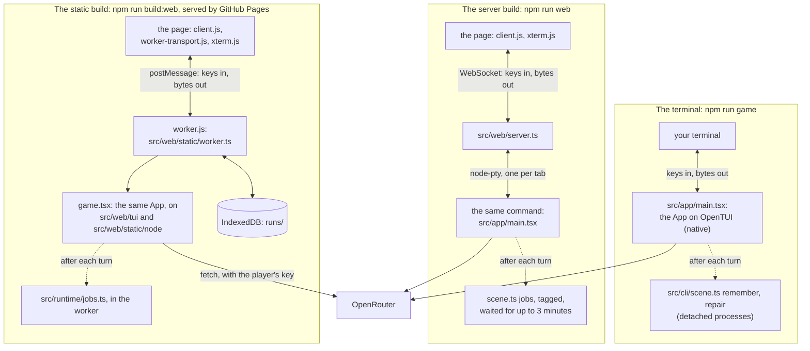

# src/web: the game in a browser

Part of the [architecture overview](../../ARCHITECTURE.md). Where it's going (the server bundle in a worker of its own in the static build, and hosting on Firebase) is in [docs/design/productionise.md](../../docs/design/productionise.md#keeping-page-only-mode).

## What it is

A spike: the real game (`npm run game`) runs on a small server in a pty, one per browser tab, and the page shows it with xterm.js. Keystrokes and output go over a WebSocket. Nothing in the game changes; it's the same terminal app drawing to a terminal that happens to be in a browser.

There's also a static build (`npm run build:web`, [below](#the-static-build-pr-previews)): the same game and page with no server at all, the game in a Web Worker on the page. That's what the PR previews publish.

```sh
npm install          # builds node-pty (needs g++, make and python3; package.json lets its install script run)
npm run web          # http://127.0.0.1:7311/
npm run web -- --offline              # no GM: make a character and walk the town
npm run web -- --port 8000 --max-games 2
```

| flag | env | |
|---|---|---|
| `--host` | `KM_WEB_HOST` | where to listen; `127.0.0.1` unless you say otherwise, and anything else prints a warning |
| `--port` | `KM_WEB_PORT` | `7311`; `0` picks a free port |
| `--max-games` | `KM_WEB_MAX_GAMES` | games running at once (4); a tab past the cap is told to try later |
| `--offline` | `KM_WEB_OFFLINE=1` | every game runs without the GM |
| `--origin` | `KM_WEB_ORIGINS` | another origin allowed to open games, such as an HTTPS proxy in front |

`KM_RUNS_DIR` moves the saves as it does for the terminal game, and `KM_WEB_DEBUG=1` logs what happens to each connection (never what's in it).

### The three ways to play



| | the terminal | the server build | the static build |
|---|---|---|---|
| start it | `npm run game` | `npm run web` | `npm run build:web`, then any static file server (GitHub Pages for the PR previews) |
| the game runs | in your terminal | in a pty per tab, on the server | in a Web Worker in the tab |
| OpenTUI | the real one (native, through `--experimental-ffi`) | the real one | src/web/tui, in JavaScript |
| Node | Node | Node | the stand-ins in src/web/static/node |
| what crosses | the terminal's bytes | the terminal's bytes, over a WebSocket | the terminal's bytes, over `postMessage` |
| saves | `runs/sessions/` | the server's `runs/`, shared by every tab | IndexedDB, a database per place it's published |
| background jobs | detached `scene.ts` processes | the same, found by a tag and waited for | in the worker (`setBackgroundRunner`) |
| the key | `OPENROUTER_API_KEY` or `~/secrets/` | the server's, or typed into the page for that game only | typed into the page, kept in localStorage |
| model calls from | the game's process | the game's process, on the server | the worker, straight to OpenRouter |

In all three it's the same src/app, and what crosses to the page is a terminal's bytes, never the game's own data.

## What it owns

The server keeps its running games in memory (a `GameTerminal` each, at most `--max-games`) and nothing on disk of its own: the games save under its `runs/`. The static build keeps the game's `runs/` in the worker's memory and in IndexedDB, holds a Web Lock for the deployment while a game runs, and the page keeps the key in localStorage. `npm run build:web` writes `dist/web` (and `dist/web-meta.json`, esbuild's metafile).

| path | what it is |
|---|---|
| `server.ts` | The server build: the page over HTTP, a WebSocket and a pty per game, the key's checks, Host and Origin checks, the cap, the background jobs' grace, shutdown. |
| `terminal.ts` | `GameTerminal`: one game under node-pty (`GAME_ARGS` is `npm run game`'s command, terminal.ts:15), stopped the way Ctrl+C stops it, its background jobs found by a tag in their environment. |
| `fonts.ts` | `@font-face` rules (family, weight, style and `unicode-range` read from each font's own tables) for the fonts in `assets/fonts`: made on request by the server, at build time by the static build. |
| `check.ts` | `npm run web:check`: the server build played in headless Chromium. |
| `page/` | The page both builds serve: `index.html`, `client.js` (xterm.js, the key form, the bar under the terminal), `worker-transport.js` (the static build's transport), `style.css`. |
| `static/build.ts` | `npm run build:web`: the static build into `dist/web`. |
| `static/worker.ts`, `static/game.tsx` | The game's Web Worker, and the App started in it as main.tsx starts it. |
| `static/node/` | The Node modules the game uses, for the browser: `fs` (in memory), `path`, `os`, `url`, `crypto`, `module`, `process`, `util`, and `child_process` (which throws). |
| `static/persist.ts` | `runs/` kept in IndexedDB. |
| `static/content.ts` | The allowlist of the files that go into `content.json`. |
| `static/plugins.ts`, `static/shims.ts` | esbuild plugins (each module's own `import.meta`, OpenTUI's fonts, stubs), and the build's check of what the game asks of the stand-ins. |
| `static/serve.ts`, `static/check.ts` | A static file server that serves as GitHub Pages does, and `npm run web:static-check`. |
| `tui/` | OpenTUI redone in JavaScript: the renderer (`renderer.ts`), the renderables (`box.ts`, `text.ts`, `scrollbox.ts`, `input.ts`, `ascii-font.ts`), the cell buffer, events and the React reconciler (`react.ts`), with `core.ts` standing in for `@opentui/core`. |
| `tui/compare/` | `npm run web:tui-check`: the same screens drawn by OpenTUI and by tui/, compared cell for cell. |

## How it fits

- **Both builds play src/app unchanged.** The server runs it as a process (`GAME_ARGS`). The static build bundles it with esbuild, with `@opentui/core` and `@opentui/react` aliased to tui/ and every `node:` module the game uses aliased to static/node (static/build.ts:56–65), and starts it in the worker (game.tsx).
- **Background jobs.** The server's games start them as processes, as the terminal game does (src/runtime/background.ts runs src/cli/scene.ts). In the worker, game.tsx calls `setBackgroundRunner` so the same jobs (src/runtime/jobs.ts) run in-process.
- **The look's live canvases** are registered in the worker as in main.tsx (`registerLookCanvas`), and draw through tui/'s buffer.
- **CI and GitHub Pages** (.github/workflows):

  | workflow | runs | when |
  |---|---|---|
  | check.yml | `moon ci workspace:check workspace:build`: the typecheck, `npm test`, the screens check, and this static build | every PR and push to main; only affected tasks, but every task's inputs are all the sources, so any source change runs them all |
  | preview.yml | `npm run build:web` at the PR's head, stored on the gh-pages branch under `pr-preview/pr-<N>/` (rossjrw/pr-preview-action), with a comment linking it; closing the PR takes it down | PRs from this repository, not forks |
  | pages.yml | main's `npm run build:web`, with the previews (and V1's eval history) copied in from gh-pages, deployed to GitHub Pages | a push to main, or when a preview or eval run finishes |

  While main is still V1 (PR #650 is the draft that replaces it), the site's root is V1's build and only the previews under `pr-preview/` are V2's. None of these is required to merge: main has no branch protection and the repository no rulesets, so a red check informs a merge rather than blocking it. The fourth workflow, evals.yml, is V1's ([evals/README.md](../../evals/README.md)).

## How it works

### The server

- **Closing the tab** ends the game the way Ctrl+C does (it saves and quits). If that doesn't work, the server sends SIGTERM (which also saves), then SIGKILL, and checks that nothing of the game's process group is left. The page asks before closing while a game runs, since Ctrl+W is a word-delete in terminals.
- **The last turn's background jobs** (above) can run on after the game for up to 3 minutes, and keep its place under `--max-games` meanwhile. A tab turned away in that time is told so: "…just finishing the GM's notes on a last turn. Try again in a minute or two."
- **Ctrl+C** in the page saves and quits as in a terminal. Play again starts a new game process, whose title screen offers Continue.
- **Stopping the server:** Ctrl+C (or SIGTERM, or closing its terminal) stops every game, each saving as it goes. The server then waits for their background jobs and says so. Ctrl+C again stops those at once. Under `npm run`, one Ctrl+C reaches the server twice (npm passes it on too), so a second press counts only if it comes a moment later.
- **Resize** follows the window: xterm's fit addon sizes the terminal, and the server resizes the pty.
- **Keys:** arrows, WASD, Esc, Enter, Tab, PgUp/PgDn and Ctrl+C reach the game. The browser keeps a few (Ctrl+W, Ctrl+T, Ctrl+N). Ctrl+C over text selected with Shift+drag copies it, as a browser's Ctrl+C does. Esc on the title screen quits in a terminal but not here: on a page Esc is for dismissing things, and there's nothing to quit to (the server and the static build set `KM_IN_BROWSER=1` for the game). q still quits.
- **The page:** xterm.js 6 with the WebGL renderer, so xterm draws box and block characters itself and the map's ▚▞▀▄█ join up. Without WebGL it falls back to the DOM renderer, which takes them from the font. It uses Unicode 11 widths, so 🎲 takes two cells as the game expects. The theme is the game's palette, and the font stack starts with Adwaita Mono. Browser zoom changes the size, and so does `?font=17` (15 by default).
- **Glyph fonts:** any `.ttf` or `.otf` in `assets/fonts/` gets an `@font-face` (`/fonts.css`) and goes at the front of the terminal's font stack, loaded before the terminal measures its cells. The family, weight and style come from the font's own tables, and its `unicode-range` from its cmap. A font of private-use glyphs (Kingmaker Glyphs, U+10E000 on) is used only for those and never changes the cell size.
- **Output:** the game's bytes go to the page as they're read from the pty. permessage-deflate brings them down about 9 times, since a frame is mostly the same truecolor escape sequences. If the page falls a megabyte behind, the server stops reading the pty until it catches up.
- **Reporting a problem** (b, `/report`, the Esc menu: src/app/README.md) saves the report on the server, under `runs/reports/`, as the terminal game does. The page tells the server its window's size as the game starts, and the server puts that and the browser's user agent in the game's environment (`KM_WINDOW`, `KM_BROWSER_UA`) for the report to say.

### The GM's key, on the server

- If the server has a key (`OPENROUTER_API_KEY`, or `~/secrets/kingmaker-dev-openrouter.txt`), games use it and the page doesn't ask. The server only checks the file is there; the game reads it, as it always does.
- Otherwise the page asks for an OpenRouter key before starting, or offers to look around offline. The key goes to the server once, in the WebSocket message that starts the game (never in a URL).
- The server checks the key before starting a game:
  - Another provider's key (OpenAI's `sk-…` or `sk-proj-…`, Anthropic's `sk-ant-…`) or anything not shaped like an OpenRouter key (`sk-or-…`) goes back to the form with a word on what's needed, without being sent anywhere.
  - An `sk-or-` key is checked with OpenRouter (`GET /api/v1/key`, which is free). A key OpenRouter turns down goes back to the form too. If OpenRouter can't be reached, the game starts anyway and the GM says what's wrong.
- The key goes into that game's environment (`OPENROUTER_API_KEY`) and nowhere else. It isn't logged, written to a file or sent back, and the page clears the field once it's sent. The next game asks again.
- **When the game ends, the key can outlive it by up to 3 minutes.** After each turn the game starts background jobs, the GM's notes on that turn (the memory review and the co-GM's repair), in sessions of their own, as it does in a terminal. They inherit the key with the rest of the environment.
  - The server finds them by a tag every process of the game inherits. It lets them finish, for up to 3 minutes after the game ends, and stops whatever is left then.
  - Meanwhile they keep the game's place under `--max-games`.
  - When the server stops, it waits for them too (see below).
  - So nothing of a game outlives the server, unless the server is killed outright (SIGKILL). Then the game itself still saves and stops, but its background jobs run to their end, as they would after the terminal game.
  - Finding them reads `/proc`, so this is Linux only. Elsewhere (macOS), they run to their end unwatched.
- The check (`--key-form`) confirms the wrong kinds of key are turned back. Then, with the real key, it confirms the key isn't in the server's output, the frames the page received, the URL or any file the run wrote, and that no process of the run holds it once the server has stopped.
- An environment is readable by the same OS user (`/proc/<pid>/environ`). That's fine on your own machine, but worth knowing on a shared one.

### Safety

- The server listens on `127.0.0.1` by default.
- Every request must name the server as it was reached (the Host header), so a DNS-rebinding page can't.
- The WebSocket must come from the server's own page (the Origin header). Another site open in the same browser can't start a game or send a key to localhost.
- The page has a strict CSP (no inline script, no eval) and refuses to be framed.
- A request or message the server can't make sense of ends only itself. A path like `//` gets a 400, and a message that isn't a JSON object closes that one connection. The server stays up for everyone else.
- `--host 0.0.0.0` works, but there's no TLS and no login: anyone who can reach it can play, on the server's key if it has one. A typed key would also travel in the clear. Put an authenticating HTTPS proxy in front, with `--origin https://your.host`.

### The static build (PR previews)

`npm run build:web` makes `dist/web`: the whole game as a static site, played entirely in the browser. The PR preview workflow publishes it to GitHub Pages under `/kingmaker/pr-preview/pr-<N>/`. Every URL in it is relative, so it works from any path.

```sh
npm run build:web                            # dist/web: 22 files, about 5.4 MB (1.4 MB gzipped), built in under a second
node --no-warnings src/web/static/serve.ts   # http://127.0.0.1:7312/kingmaker/pr-preview/pr-650/ (any static file server will do)
npm run web:static-check                     # build, serve under the preview's path, play it in Chromium, the zoo and a report's download too (about 80 s)
npm run web:static-check -- --live           # also the key from ~/secrets typed into the key form, and a real GM reply
```

`serve.ts` takes `--port`, `--base` (the path to serve under) and `--dir`. The page takes `?offline`, `?size=130x42`, `?font=17` as the server's does, and `?glyphs=ascii` to draw letters rather than Kingmaker Glyphs.

CI builds it too: `moon.yml`'s `build` is this build, and its `check` is the typecheck, the tests and the screens check (`npm run check`; `.github/workflows/check.yml` runs both).

#### How the static build works

- **The page** is the server's (`src/web/page`), marked `<html data-mode="static">`. `client.js` then takes `worker-transport.js` instead of the WebSocket. That speaks the server's messages (hello, started, exit, error), so the rest of the page is the same. `fonts.css` and `fonts.json` are made at build time, as the server makes them when asked.
- **Loading:** "Loading Kingmaker…" is on the page until the game draws its title (after 20 s it suggests a reload). The page fetches everything the game loads before its first screen at once, as it opens: the worker, its chunks and `content.json`, listed in `<meta name="km-preload">`. The worker then finds them in the browser's cache, rather than asking for each only once the one before it has loaded and run.
- **The build's stamp:** GitHub Pages lets a browser keep any file for ten minutes. So every file whose name doesn't carry a hash of its contents is asked for with the build's stamp (`?v=`, from `<html data-build>`): `worker.js`, `content.json`, the page's scripts and styles, xterm.js. A reload just after a new build is published can't mix the new page with an old worker, or an old worker with chunks that are gone. A part of the game that won't load anyway (a tab opened before the new build, asking for a chunk deleted with the old one) has the page say so and offer a reload. The game is saved as it goes.
- **The game** runs in a Web Worker (`worker.js`, `src/web/static/worker.ts`). It's the real `src/app`, bundled with esbuild, started as `src/app/main.tsx` starts it, on a renderer whose terminal is the page's (`game.tsx`). The page's xterm.js gets its bytes as the worker's messages, and the worker gets the keys, the mouse and resizes back.
- **OpenTUI** is native code, so the bundle has `src/web/tui` in its place: OpenTUI's renderables (box, text, scrollbox, input, textarea, ASCII font), the React reconciler, Yoga layout (yoga-layout's WebAssembly build), and OpenTUI's native painting and diffing, all redone in JavaScript. `@opentui/core` and `@opentui/react` are aliased to it in this bundle only. The terminal game and the server still use OpenTUI. `npm run web:tui-check` renders 82 screens (17 small ones, 65 of the game's: the zoo's, character creation's, the backstory box scrolled by the wheel, and a fight's box typed in, its keys taken by Enter and given back by Esc) both ways and compares them cell for cell: characters, colours and attributes.
- **Node**, as far as the game uses it, comes from `src/web/static/node`:
  - `fs` is a file system in memory. The game's content (`lore/` and `prompts/` Markdown, the rules' starter pack, the SRD's spell descriptions in `vendor/srd-spells` for the sheet's spell pages) is mounted read-only from `content.json`, which the build makes from an allowlist. Nothing else from the repo goes in. The scenes (the story's and the zoo's) and the zoo's wings are modules, bundled with the game.
  - `runs/` is writable, and every change to it is written through to IndexedDB within a second, one record a file. It's read back before the game starts. Each place the game is published has a database of its own, named after its path (`kingmaker-v2 /kingmaker/pr-preview/pr-650/`), so a preview's games are its own. Another preview's build might not read them, or might rewrite them as it reads them. (V1 keeps its games in `kingmaker` on the same origin; V2 keeps out of it.)
  - The rest are small: `path`, `os`, `url`, `crypto` (synchronous SHA-1 and SHA-256), `module` (`createRequire` for boardgame.io's CommonJS client), `process` (the environment), `util` (`inspect`, `format`, `promisify`), `child_process` (which throws).
  - Where these do less than Node, the build checks the game doesn't ask for more (`src/web/static/shims.ts`): it fails if a module it bundles calls `createHash` with a hash `crypto` hasn't got. esbuild already fails it on a missing module or export. Either way the preview isn't published broken.
- **Background jobs** between turns (the GM's notes: the memory review and the co-GM's repair) can't be processes here. They run in the worker, the same functions the scene CLI's `remember` and `repair` commands run (`src/runtime/jobs.ts`), started as the turn ends and never awaited by it. When the game closes, the worker finishes them and saves what they wrote before it goes (for up to 3 minutes, as the server allows), and Play again waits for that, saying so. `?jobdelay=<ms>` holds each job back, so the check can catch one running.
- **Model calls** go from the worker straight to OpenRouter (`fetch`, streamed), with the player's key.
- **The build** fails if any file in `dist/web` holds the dev key (`~/secrets/kingmaker-dev-openrouter.txt`, read in the build, never printed) or anything shaped like an OpenRouter key. It leaves out boardgame.io's debug panel (Svelte, about 90 KB), which its client shows only outside production builds.
- **The page's CSP** (a meta tag; GitHub Pages sends no headers of ours) allows scripts and workers from its own origin only, and connections to it and `https://openrouter.ai`. It doesn't reach into the worker, which would take a CSP from its own response's headers.
- **Reporting a problem** (b, `/report`, the Esc menu: src/app/README.md): the report is made in the worker, the key taken out of it as everywhere (src/report/redact.ts), gzipped with `CompressionStream`, and handed to the page, which downloads it as `kingmaker-report-<time>.json.gz`. The game says "Downloaded kingmaker-report-….json.gz (your browser's downloads): tell Claude 'report …'", and the bar under it says so too. The build writes the commit it was built from into the game (and whether there was more than the commit); the worker tells the game the build's stamp, the browser's user agent and its window, for the report to say. `npm run report` looks for it in ~/Downloads.

#### The key, in the static build

As V1 kept it:

- It's in localStorage under `kingmaker.openrouter-api-key`. The previews share an origin, so a key entered in one works in all of them.
- With no key kept, the page asks for one, or offers to look around offline.
  - The wrong kinds are turned back as the server turns them back.
  - An `sk-or-` key is checked with OpenRouter (`GET /api/v1/key`) before it's kept.
- It goes to the worker by `postMessage`, into the game's environment there, and to OpenRouter in the `Authorization` header.
- A line under the terminal says it's kept, and offers to change or forget it. Forgetting it saves the game, stops it, and asks again. If the browser won't keep it (its site data blocked), the line says the key is for this page only. Play again still has it until the page closes.
- Over a game that's playing, the form has Cancel (or Esc) to leave things as they were, and the game behind it takes nothing while it's up. A key pasted next to the form can't land in the game.
- If OpenRouter turns the key down mid-game (revoked since it was kept, say), the page asks for another.
- It's never in a URL, the saves, the call logs, a report of a problem, or a console line or error message. The worker blanks it from everything it logs or reports, and from anything it draws. Anything shaped like an OpenRouter key that's pasted into the game itself is dropped before the game sees it, as it would go to the GM and into the saves.
- Any page on the origin can read it: every preview, and V1. That's V1's way too, and every preview is this repo's own code (the workflow doesn't publish forks' PRs).
- The check fakes OpenRouter for a made-up key and confirms it's kept, and isn't in any URL, console line or saved file. With `--live` it confirms the same for the real key, and that none of the files the check wrote hold it.

#### What differs from the server version

- **Saves** are in the browser (IndexedDB), each preview's in its own database. Clearing the site's data loses them, and another browser or machine has its own. When the browser isn't keeping the game, the bar under it says so, on the left, until it is:
  - a save it wouldn't take (its storage full, say): the game plays on, and the next save tries again;
  - no IndexedDB at all (some private windows, or this site's data blocked), or one that hasn't answered in 5 seconds: the game plays, but it goes when the page closes;
  - saves it couldn't read back: none are offered, but this game is kept.
- **Deleting a game** (x x on the title) deletes it for good the next time the game starts. In a terminal its folder is kept in `runs/deleted/` for anyone who wants to look, but nobody can look in a browser's, and it would be read back into the worker every time.
- **Closing or reloading the tab** mid-game keeps what was played up to about a second before; the page also asks the game to save as it goes. A background job still running then is lost, and so are its notes on the last turn.
- **One tab at a time:** each tab would hold its own copy of the saves, and whichever wrote a file last would win, undoing the other's progress. So a tab opened while another plays is told so, and doesn't start. "Play here instead" asks the other tab to save its game and let go (a BroadcastChannel); that tab says the game is being played elsewhere, and offers to take it back. The worker holds a Web Lock while it runs, named after the preview as its database is, and a reload lets go as its old page goes. A browser without Web Locks (or a page that isn't https or localhost) plays a copy in each tab, as before.
- **The End's bar tab** counts the background jobs' calls too, as they run in the game's own worker. In a terminal they're other processes, and the game counts only its own calls.
- **Offline** (`?offline`, or Look around offline), nothing is sent anywhere: the worker turns away the GM's calls itself. The server's `--offline` gives the game a key that isn't one, so its GM gets OpenRouter's own refusal. Either way the GM can't speak.
- **Glyphs:** the worker draws with Kingmaker Glyphs (served from `fonts/`), as the server's game does on a machine that has them.
- **Speed:** on this machine (headless Chromium, software WebGL), the title is up in about 0.4 s from a local server. Over a link throttled to 10 Mbit/s and 60 ms, gzipped as Pages serves it, it's up in 1.4 s (2.0 s before the page fetched everything at once), and at 3 Mbit/s and 120 ms in 4.0 s (from 5.0). A frame takes the worker about 5-6 ms at 30 frames a second. A step on the map reaches the screen in about 190 ms (median), as with the server version under the same Chromium (183 ms in the same run). That time is Chromium drawing in software, not the game. The map idle sends about 5 KB/s from the worker to the page, against the server's 7 KB/s.
- **A report of a problem** is downloaded, not saved under `runs/reports/`: what the browser keeps is out of reach of anyone looking into it.

## Where to look first

- **The page** (page/client.js, worker-transport.js) is both builds' page. The static build rewrites `client.js`'s imports and `index.html` to stamp them, and fails if it can't find what it rewrites.
- **Something new the game asks of Node** must be in the stand-ins (static/node). esbuild fails the build on a missing module or export, and shims.ts on a hash the stand-in can't do; anything else fails only in play, so run `npm run web:static-check`.
- **A new file the game reads with `fs`** must be in the allowlist (static/content.ts), or the browser doesn't have it.
- **The key.** The server puts it in that game's environment and nowhere else; the worker blanks it from everything it says. Anything new that logs, reports or draws text could carry it, and the checks look for it in the output, the frames, the URL and the files written.
- **A change to how the app draws** (a new OpenTUI prop or renderable) has to be redone in tui/. `npm run web:tui-check` says where the two differ.
- **The server's safety checks:** `hostAllowed`, `originAllowed` and `headers` in server.ts, and the cap (`busy`).

## How to test it

```sh
node --no-warnings --test src/web/static/node/*.test.ts   # the fs and crypto stand-ins: 9 tests
npm run web:tui-check                                     # 54 screens drawn both ways, compared cell for cell: about 5 s
```

The server build's check:

```sh
npm run web:check                 # offline, about 90 s: screens, keys, latency, bandwidth, a report saved on the server, tab close, the cap, HiDPI, Origin and Host, odd requests
npm run web:check -- --live       # the server's own key: a real GM reply
npm run web:check -- --key-form   # no key on the server: the page asks, turns back the wrong kinds, and the key from ~/secrets goes in through it; a real GM reply
npm run web:check -- --gpu        # any of the above with Chromium drawing on the GPU (Vulkan) rather than in software
```

It drives the real server and game through headless Chromium (Playwright) with the keys a player would press. Each screen is saved under `runs/web/<run>/` as a PNG, with the terminal's text beside it. The screens are 130x42 (`?size=130x42` pins the page to that), like `src/app/smoke`'s, so the two can be diffed: the sheet, the map, the help and the granary scene match the terminal's cell for cell. The HiDPI screens use a real device scale factor (2 and 1.25). Playwright's emulated one disagrees with the canvas's device-pixel size, and that magnifies xterm's WebGL canvas. That's the emulation, not the page.

The latency is from the browser's keydown to three points:

- **First output:** the game's first output, parsed by xterm.
- **Drawn:** xterm's draw.
- **On screen:** the next animation frame after the draw. The frame that shows the draw has gone to the screen by then.

The last runs measured these on this machine, at 130x42:

| | the game alone (plain pty) | first output | drawn | on screen, GPU | on screen, software |
|---|---|---|---|---|---|
| a step on the map (50 KB) | 27 ms | 28 ms | 40 ms | 56 ms (p90 62) | 114 ms (p90 118) |
| opening or closing the sheet | 60 / 43 ms | | 55-60 ms | 75 ms (p90 86) | 121 ms (p90 130) |

"The game alone" is from key to first byte. "GPU" is an RTX 3080 Ti through ANGLE and Vulkan; "software" is SwiftShader, the check's default.

So the server and WebSocket add about a millisecond, and xterm parses and draws a step's 50 KB in about 12 ms. On a GPU, a step reaches the screen about 29 ms after the game has answered: the draw plus one frame.

- **The map idle:** 0.1 KB/s.
- **Walking 4 steps a second:** 198 KB/s from the game, 22 KB/s on the wire.

The static build's own checks (above) are `npm run web:static-check`, with `--live` for the real key and GM. CI runs only the build itself, which fails on anything shaped like a key in `dist/web` or on a hash the stand-ins can't do. The two checks in Chromium (`npm run web:check` and `npm run web:static-check`, each with its modes) and the renderer comparison are run by hand.

## Known gaps and sharp edges

- No accounts and no TLS, so it's for localhost or behind a proxy that has both.
- Every tab shares the server's saves: Continue offers the latest game, whoever played it.
- A dropped connection ends the game (it saves). There's no reattaching to a running one.
- A key OpenRouter accepts can still run out of credit. That shows up only when the GM fails to answer.
- Fonts are the viewer's own. Adwaita Mono is only on GNOME systems, so elsewhere a few map symbols (▬ ▫ ▾ ‿) come from fallback fonts. Serving Adwaita Mono (it's SIL OFL) would fix that.
- No touch keyboard, so it needs a real keyboard. Chromium and Firefox have been tried (the static build in both), Safari not yet.
- None of the checks in Chromium run in CI, nor the renderer comparison. CI runs the static build, with its checks for a leaked key and for what the stand-ins can't do.
- tui/ is a second OpenTUI, kept in step with `@opentui/core` and `@opentui/react` (^0.6.5) by hand.
- The static build ships everything to the browser: the scenes are bundled as code, with the GM's prep and every secret, and the lore is in `content.json`. That isn't a security concern: the content is public on GitHub and the game isn't competitive ([docs/design/productionise.md](../../docs/design/productionise.md)).
