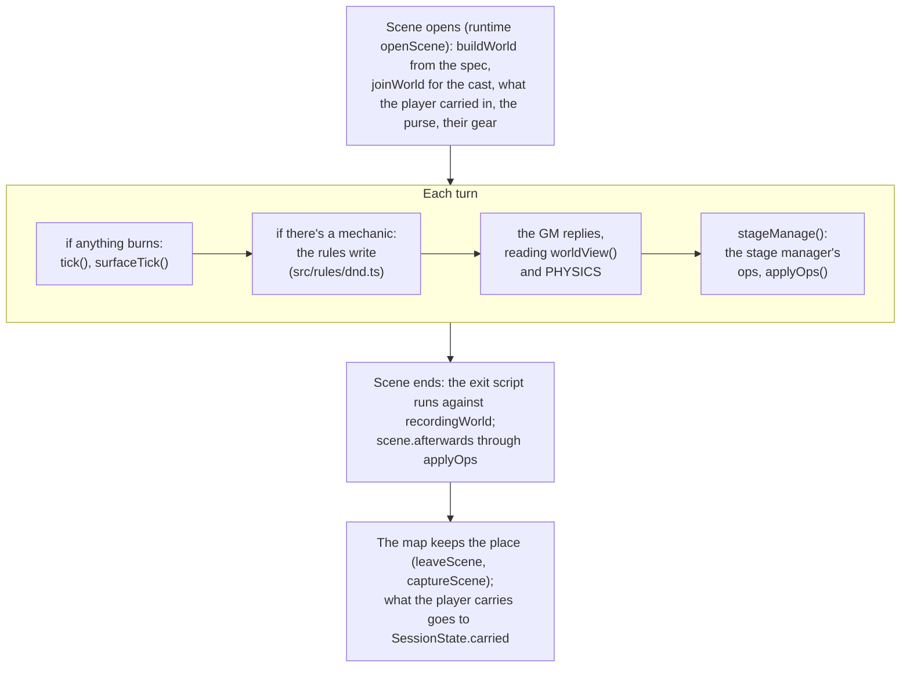

# src/world: the scene world

Part of the [architecture overview](../../ARCHITECTURE.md). Where the world is going (components and one registry of interaction rules) is in [docs/design/productionise.md](../../docs/design/productionise.md#the-world-components-and-interaction-rules).

## What it is

The scene world is the one record of where everything in a scene is and what state it's in: an entity tree (the place, its areas, the things and people in them, what people carry), in feet, with D&D object stats, states and notes. The rules write to it as they resolve a spell or a blow, a small physics (fire, water, spills, cold, blood, breaking) answers what they did, and the stage manager writes what each GM reply established. The GM reads it before every reply, and the map, the menus and the look layer draw from it. The module also holds the world-update DSL that scenes' exit scripts are written against, which only records what a script asks for.

## What it owns

| file | what's in it |
|---|---|
| [`scene-world.ts`](scene-world.ts) | The types (`SceneWorld`, `Entity`, `WorldOp`, and `WorldSpec`/`ThingSpec` for authoring worlds in `scenes/worlds/`). Building a world ([`buildWorld`](scene-world.ts#L116)), people coming on stage ([`joinWorld`](scene-world.ts#L855)). Space: positions, areas, [`within`](scene-world.ts#L301), spell areas ([`caughtIn`](scene-world.ts#L370), [`inArea`](scene-world.ts#L379)), [`jumpGap`](scene-world.ts#L270). Selectors ([`select`](scene-world.ts#L410)) and the operations ([`applyOps`](scene-world.ts#L503)). Damage to things ([`damageThing`](scene-world.ts#L702)) and story time ([`tick`](scene-world.ts#L728)). The GM's view ([`worldView`](scene-world.ts#L788)), the QA console's sketch ([`asciiMap`](scene-world.ts#L823)), and [`untangle`](scene-world.ts#L221) for old saves. |
| [`systems.ts`](systems.ts) | The physics verbs: [`spill`](systems.ts#L54), [`ignite`](systems.ts#L81), [`douse`](systems.ts#L112), [`chill`](systems.ts#L143), [`bleed`](systems.ts#L157), [`breakOpen`](systems.ts#L166), [`elemental`](systems.ts#L178) and [`surfaceTick`](systems.ts#L188). Surfaces (a puddle, a slick, a cloud) are entities of kind `surface`. [`PHYSICS`](systems.ts#L229) is the same rules in a sentence, for the GM's brief. |
| [`inventory.ts`](inventory.ts) | Who has what. An item's owner is its parent in the tree, so where a thing is and who has it can't disagree. [`inventory(world, turn)`](inventory.ts#L53) is V1's inventory service on that tree: a strict, versioned half (`read`, `add`, `remove`, `transfer`, `commit`) and the permissive [`settle`](inventory.ts#L139) the operations use. Also `ownerOf`, `countOf` and `startingPurse`. |
| [`stage.ts`](stage.ts) | The stage manager: one model call after each reply ([`stageManage`](stage.ts#L78)), with the world language ([`WORLD_LANGUAGE`](stage.ts#L12)) and a strict schema whose selectors are the world's own ids ([`opSchema`](stage.ts#L46)). |
| [`dsl.ts`](dsl.ts) | The exit scripts' API ([`WorldApi`](dsl.ts#L31)) and [`recordingWorld`](dsl.ts#L74), which records each call as an `Operation` and changes nothing. |
| [`assets.ts`](assets.ts) | The stub asset catalogue a script may place (`ASSETS`) and the places beyond the scene it may name (`LOCATIONS`). |
| [`scribe.ts`](scribe.ts), [`sandbox.ts`](sandbox.ts) | Phase 2: after a scene, a model writes its world-update script from what was narrated ([`scribe`](scribe.ts#L45)); the script is typechecked with tsc and run in a `vm` against a recording world ([`checkScript`](sandbox.ts#L60)). |

### The model

- **Kinds:** `place` (the root), `area`, `feature` (built in: a door, a beam), `object`, `item`, `person`, `creature`, `surface`.
- **Space:** feet in the place's frame, x east and y south. A thing that's carried or inside something has no `at`: it's where its holder is ([`positionOf`](scene-world.ts#L183) walks up the tree). On a map, a region's `worldOrigin` lines the world up at 5 ft a tile.
- **Tags and states:** `tags` say what a thing is (`flammable`, `container`, `door`, `light`, `fixed`, `liquid`, `hanging`), `states` what it is now (`burning`, `destroyed`, `wet`, `open`, `hidden`, `down`, `gone`). Both are free strings. `gone` means it has left the scene: it stays in the tree, and selectors skip it.
- **Object stats:** AC by material and hit points by size and fragility, from the DMG's table ([`objectStats`](scene-world.ts#L111)). Things whose material burns get `flammable` when the world is built.
- **Notes:** what the author, the rules or the stage manager wrote about an entity, kept to the last six; the GM sees the last two. The world's `log` is what changed lately; the GM sees the last six.

### Where a world lives

This module owns the shape and the rules on it. Where the game keeps a world, or what's left of one:

| where | what | written by |
|---|---|---|
| `SessionState.world` (state.json) | the current scene's world | built when a scene with a `world` spec opens ([src/runtime/engine.ts:171](../runtime/engine.ts#L171)), dropped at the scene boundary |
| `SessionState.carried` | what the player carried out of the last world, into the next | `chainScene` and `closeHubScene` in src/runtime/engine.ts |
| `ExploreState.overlay.scenes` (game.json) | what a played scene left in its place, as map actors | the map's `leaveScene` and `captureScene` ([src/game/map](../game/map/README.md)) |
| `ExploreState.overlay.town` | what the rules did to the town outside scenes | [`keepTown`](../game/town-world.ts#L256); the town's world itself is rebuilt from the map for every act |
| `ExploreState.roam` | a zoo wing's live world | src/game/zoo |

A fight has a model of its own (tiles on fire, props), and writes back into the scene's world when it ends: see [src/game/combat](../game/combat/README.md).

## How it fits

| caller | what it uses |
|---|---|
| [src/runtime/engine.ts](../runtime/engine.ts) | `buildWorld` and `joinWorld` as a scene opens and people enter; `tick` before a reply while anything burns; `stageManage` after the reply; `applyOps` for a scene's `afterwards`, a jump's landing and moving to act; `recordingWorld` for exit scripts; `jumpGap` |
| src/runtime/brief.ts, director.ts | `worldView` and `PHYSICS` in the GM's brief and the decider's questions |
| [src/rules/dnd.ts](../rules/dnd.ts) | `caughtIn`, `damageThing`, `elemental`, `spill`, `bleed`, `positionOf` while resolving spells and blows |
| [src/game/town-world.ts](../game/town-world.ts), menu.ts | a `SceneWorld` built from the map, for the rules out of scenes; `caughtIn` and `inArea` for aiming |
| [src/game/scene-menu.ts](../game/scene-menu.ts) | the scene's right-click menu and glances |
| [src/game/combat/controller.ts](../game/combat/controller.ts) | a fight's end written back (`placeInWorld`) |
| [src/game/map](../game/map/README.md), [src/game/look](../game/look/README.md) | drawing it: map actors from the world, the stage from above, the director's diffs |
| src/cli/qa.ts, src/cli/scene.ts | `asciiMap`; the scene CLI runs the scribe |
| src/game/zoo | the wings' worlds; its exhibits call the operations and verbs directly |

It calls out to `rng` in src/runtime/dice.ts (the spread of things in an area and the tick's dice, both seeded), `respondJson` in src/llm/openrouter.ts (the stage manager and the scribe), and the runtime's brief for the scribe's prompt.

## How it works

### A scene's world through a turn



The turn itself is the runtime's ([src/runtime/README.md](../runtime/README.md#one-player-turn)). The look layer's director compares the world after each turn with what it saw before, and plays the difference (walks, ignitions, wrecks, spills): see [src/game/look](../game/look/README.md).

### The operations

[`applyOps(world, ops, turn, by)`](scene-world.ts#L503) is the world's one way in for the stage manager, scripts and the runtime. It returns what changed in plain words (`changes`) and what couldn't be done (`problems`), and never throws.

| op | does |
|---|---|
| `move`, `place` | to an area, or near, behind, beside, under, on or in something; `away`/`toward` by `feet`. On or in someone is carried (an axe slung on his back); under someone is on the floor where they stand. Saying where someone already is isn't a move, nor is saying where someone has a thing of theirs ("his greataxe on his back" leaves it carried). |
| `give`, `drop` | through the inventory's `settle`: found wherever it is, part of a stack by `quantity` |
| `create` | someone or something new the story brought in, near something or in someone's hands (an item made beside someone, or a thing of theirs by name: "Kell's notebook"); one with no name isn't made |
| `state`, `note`, `forget` | states added and removed (`burning` goes through `ignite`); notes written and cleared |
| `remove`, `destroy`, `break` | leaves the scene; wrecked (what it held falls out, what hung from it falls); broken (a container spills) |
| `ignite`, `douse`, `spill`, `chill`, `bleed` | the physics verbs |

Selectors ([`select`](scene-world.ts#L410)) take an id, a name, or a model's way of naming things (words in any order, only a clear winner counts), and groups such as `all tag:flammable within:20:hearth`. The stage manager's schema allows only ids. Refused on purpose: moving or breaking an area, moving what's fixed, putting anything inside itself.

### The physics

- **Fire.** Wood, cloth, paper, rope and leather burn; metal, stone and glass only scorch; wet things won't catch; a thing with oil on it burns, metal too, for two turns. Each `tick`, a burning thing takes 1d10 fire and sets alight what's flammable within 5 ft; fire in a `dusty` area explodes it (4d6 fire to every thing in it). A wreck burned to 0 HP burns a turn more, then smoulders.
- **Surfaces.** Oil, spirits and grease burn for 4, 2 and 3 turns, burning what stands in them, then leave ash and smoke. Water puts fire out; water on burning oil spreads it. Cold freezes a puddle to ice. Water dries in 20 turns, smoke drifts off in 3, steam in 2.
- **Damage to things** ([`damageThing`](scene-world.ts#L702)): nothing feels poison or psychic, and each material shrugs off its own list (stone takes no fire); damaged at half, destroyed at none, with what's left in words. A broken container spills what it held, alight if fire broke it.
- **People** don't take damage from the world here: their hit points are the rules engine's (src/rules).

### The DSL

An exit script is `(world: WorldApi, outcome) => void` in `scenes/*.ts`. It runs when the scene ends, against [`recordingWorld`](dsl.ts#L74) and the asset catalogue, and its operations are kept on `SessionState.ended.operations`. Only two kinds are read back: `journal` (the notebook: [src/app/story.ts:56](../app/story.ts#L56)) and `startCombat` (who a fight sets out: [src/game/combat/fights.ts:460](../game/combat/fights.ts#L460), [heron.ts:43](../game/combat/heron.ts#L43), [src/game/zoo/fights.ts:103](../game/zoo/fights.ts#L103)). The scribe writes a script of its own from the transcript, adding to the author's or reconciling with it: the scene CLI saves it beside the session (`world-<scene>.ts`), and the evals score it.

## Where to look first

- **A new or changed operation** touches four places that must agree: `WorldOp` ([scene-world.ts:474](scene-world.ts#L474)), its branch in `applyOps`, the schema's enum in `opSchema` ([stage.ts:54](stage.ts#L54)) and the words for it in `WORLD_LANGUAGE`. The stage manager eval (evals/world/) measures today's stage manager against proposed languages of its own, so it's the way to see what a change does.
- **A physics change** comes with the words the models get about it (`PHYSICS`, `WORLD_LANGUAGE`): the GM is told that what it narrates is what the world will show. Then check the other codings of the same rule ([src/game/README.md](../game/README.md#the-same-rule-coded-more-than-once)).
- **State and tag words** are matched by spelling elsewhere: the look layer, the scene menu (`uses`, `breaking` in src/game/scene-menu.ts), the map's notable states ([src/game/map/reconcile.ts:36](../game/map/reconcile.ts#L36)), what counts as violence in a scene (`violence` in src/runtime/engine.ts). Grep for a word before renaming it.
- **`worldView`** is in every GM prompt and every stage manager call: a change to it is a prompt change, and the evals are how to see what it does.
- **`select`'s matching** decides which entity a model's words land on: a looser match moves the wrong thing, a stricter one turns into `problems`.
- **`applyOps` never throws:** a test that checks only `changes` won't see a refusal.

## How to test it

```sh
node --no-warnings --test src/world/*.test.ts               # the world, the physics, the inventory: 16 tests, offline, under a second
node --no-warnings src/game/zoo/tour.ts --only works,fire   # the Works and the Burning Gallery: every verb and the rules on things, offline
node --no-warnings evals/world/run.ts                       # the stage manager's accuracy against labelled cases (live: needs the key); runs/evals/world-<stamp>/
npm run scene -- world <session>                            # the scribe's world-update scripts for a session's finished scenes (live)
```

The zoo's Works wing ([src/game/zoo/README.md](../game/zoo/README.md#the-works-zoo-works)) has an exhibit for each verb, the testing rig for damage by material, and the sand-glass for the tick.

## Known gaps and sharp edges

- **The same rules are coded again elsewhere.** Fire, damage to things and breaking are coded here for scenes, and separately for the town map, for fights and in the map's ageing of what's left: see [the table in src/game/README.md](../game/README.md#the-same-rule-coded-more-than-once). Bugs that come of it:
  - people don't burn outside fights: `ignite` does nothing to a person, and a burning surface burns only things ([systems.ts:196](systems.ts#L196));
  - something the story creates can't catch fire: `create` gives it no `flammable` tag ([scene-world.ts:534](scene-world.ts#L534));
  - the look director waits for a "fire spread to" log line ([src/game/look/director.ts:140](../game/look/director.ts#L140)) that nothing writes (the world logs "X catches fire").
- **Story time passes only while something burns.** The runtime calls `tick` only then ([src/runtime/engine.ts:524](../runtime/engine.ts#L524)), so a puddle doesn't dry and smoke doesn't drift otherwise. The town's world never ticks: the map ages what was left by the time of day instead.
- **Spell areas ignore walls.** `caughtIn` is geometry in feet (its comment says the map will add walls). Fights lay areas on tiles and walls stop them ([src/game/combat/grid.ts `areaTiles`](../game/combat/grid.ts#L157)), so one Fireball can catch different people in a scene and in a fight.
- **The DSL is a stub.** An exit script's `setFlag`, `quest`, `moveTo` or `addItem` is recorded and changes nothing in play. The story's flags come only from a fight's result.
- **Half the inventory has no caller.** The strict, versioned `read`/`transfer`/`commit` are exercised only by their tests; the game uses `add` (the starting purse) and `settle`.
- **`applyOps` is one function of 150 lines,** a branch per op; the productionise review measured its cognitive complexity at 231.
- **A missing reference.** [stage.ts:9](stage.ts#L9) cites docs/research/gm-world-interface.md for the eval behind the stage manager; that document is on the `spike/world-research` branch and was never merged.
- **The scribe's sandbox** is Node's `vm` with a frozen recording world and a one-second timeout. That suits a recording world, but `vm` isn't a security boundary. Its typecheck needs `npm install` (for tsc) and writes a temporary directory under `runs/`.
- **The world's `log` isn't trimmed:** it grows for the length of a scene and is saved with the session.
